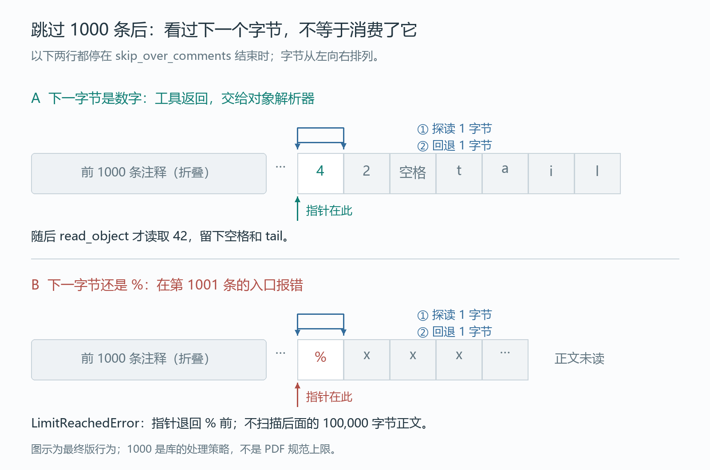

# 注释不再压垮栈，为什么普通对象又多绕了一次？

后面只是一个 `42`。前面多放一些注释，pypdf 却连这个数字都读不到。

```python
from io import BytesIO
from pypdf.generic import read_object

stream = BytesIO(b"% padding\n" * 1000 + b"42 tail")
value = read_object(stream, None)
```

本文的修前版本在这里抛出 `RecursionError`。把注释从递归改成循环，数字终于读出来了；接着按 review 建议抽出一个公共函数，又让另一份 PR 刚加上的调用次数测试过不了。

最后合并的补丁，既保留了循环和上限，也保住了没有注释时的解析路径。这里有意思的不是“递归不好，循环更好”，而是两个各有道理的改动，怎样在同一段代码里相遇。

## 1. 注释被跳过了，调用栈却没被放过

按 [PDF 规范 §7.2.3](https://opensource.adobe.com/dc-acrobat-sdk-docs/standards/pdfstandards/pdf/PDF32000_2008.pdf#page=21)，字符串与 stream 之外的注释应当被当作空白处理。在 pypdf 的[这段旧实现](https://github.com/py-pdf/pypdf/blob/a23cc36da7a8e86f2b551b7a6eed1d8798301c73/pypdf/generic/_data_structures.py#L1581-L1612)里，遇到 `%` 后，解析器先跳过本行，再跳过空白，随后重新调用 `read_object`。

一次只有一行，看起来很自然。但前一层还没返回，后一层又遇到了 `%`。注释虽然从字节流里消失了，每一行却都留下一层尚未返回的 Python 调用。

这与对象本身有多复杂无关。输入末尾的 `42` 不需要任何嵌套，只要前导注释足够多，就会耗尽调用栈。[原始 issue #4145](https://github.com/py-pdf/pypdf/issues/4145)用的正是这种小输入，而不是一份难以检查的大 PDF。

**跳过内容，不应当意味着保留一层等待返回的解析器。**

我为 [#4150](https://github.com/py-pdf/pypdf/pull/4150)写的[初稿](https://github.com/py-pdf/pypdf/blob/528c61de6b2e448634f899ee022eabdd1dce6041/pypdf/generic/_data_structures.py#L1551-L1579)，把连续注释放进同一个循环，并限制每次对象读取最多跳过 1000 条。它没有把 Python 的递归上限调大，而是让这段工作不再依赖剩余栈深度。

1000 是这份实现选择的处理上限，不是 PDF 格式规定的注释数量。维护者在 [issue 讨论里](https://github.com/py-pdf/pypdf/issues/4145#issuecomment-5950264868)建议先采用一个足够大的固定值；更深的对象嵌套则是另一个问题。

## 2. 第一版已经能修错，review 要求的是更好的落点

初稿的循环直接放在 `read_object` 里。维护者随后[提出](https://github.com/py-pdf/pypdf/pull/4150#discussion_r4207102313)：

> Can we move this new logic to a dedicated utility function?

把它移到专门的工具函数里，这个要求有具体的复用基础：pypdf 已经有跳过一条注释的 `skip_over_comment`，初稿的循环也在调用它。现在要抽出去的，是围绕这个单行工具的连续处理与数量限制。

于是，新函数 `skip_over_comments` 组合这两件事，内部继续复用旧的单条注释函数；对象解析器负责调用它，然后继续辨认数字、数组、字典等对象。[抽取提交](https://github.com/py-pdf/pypdf/commit/e7dfa72a41d07a216647c5b7d32c51558e59ed74)记录了这个改变。

到这里，递归问题仍然解决了，职责也更清楚。下一次转折并不是又找到了一个读错数字的例子，而是主线已经多出了一份对普通解析路径的要求。

## 3. 另一份 PR 留下的，不只是更快的代码

在这次修订期间，MartinThoma 的 [#4148](https://github.com/py-pdf/pypdf/pull/4148)先合并了。它优化了数字、间接引用等对象的解析，并留下了一条很特别的回归测试：不比秒数，而是数 Python 函数调用。

测试输入是一个数组，`123`、`4.5`、`12 0 R` 三种元素重复排列。它们分别走整数、浮点数和间接引用路径，总计 300 个元素。[测试的断言](https://github.com/py-pdf/pypdf/blob/79423c1288cbbb4a16bf0601b3539797f6900bb3/tests/test_generic.py#L436-L450)是：

```python
assert calls < 3 * len(array)
```

这不是解析结果的定义，而是给那份优化留下的成本预算：以后仍能读出相同的数组，还不够；也不能轻易把刚省下来的调用重新加回去。

按 review 抽出的注释工具，与这个预算有什么关系？关键在于它被放到了哪里。

[合并主线后的真实中间版本](https://github.com/py-pdf/pypdf/blob/ad63551501ef8ad03ca91a8d1e5246a79319a048/pypdf/generic/_data_structures.py#L1587-L1598)，在每次进入 `read_object` 时，都会先调用 `skip_over_comments`。输入没有注释，工具也会检查一下，然后原样返回。

一次空检查很小，但数组里的每个普通元素都会付出这一次 Python 函数调用。300 个元素多出 300 次调用，原本 601 次变成了 901 次；测试要求严格小于 900。

**处理连续注释的工具，也进入了根本没有注释的路径。**

这个交汇不是根据两份 PR 的编号猜出来的。[快路径修正的提交说明](https://github.com/py-pdf/pypdf/commit/9f5a61b26e4a9734b1756eb7da26789b4fd42790)明确点名了 #4148、那条测试，以及 300 个元素对应的 901 次调用。

本文也用固定中间源码和上游的计数函数重新跑出了这个结果。这里数的是 Python 函数调用，不是耗时；601 与 901 不能换算成“慢了多少百分比”。

## 4. 不拆掉工具，只把入口放回该去的地方

最后的改变很短：[先看首字节，只在它是 `%` 时进入工具](https://github.com/py-pdf/pypdf/blob/ccd8dc470e13915d384fb8b4c93a351cc1d79ae6/pypdf/generic/_data_structures.py#L1583-L1597)。

```python
tok = stream.read(1)
stream.seek(-1, 1)  # reset to start
if tok == b"%":
    # Skip consecutive comments in a loop instead of recursing per comment.
    skip_over_comments(stream, limit=_MAX_LEADING_COMMENTS)
    tok = stream.read(1)
    stream.seek(-1, 1)  # reset to start
```

没有 `%` 就没有连续注释要处理；真正遇到注释，仍然走那个有数量限制的循环。公共工具保住了，普通对象也不再为它多绕一次 Python 调用。

最终版解析同一个数组回到 601 次，满足原来的预算。修前版本在这个测试上同样是 601 次，所以这一步保住的是已有成本，而不是宣称最终补丁比修前更快。

## 5. 上限到了，流指针应该停在哪里？

还有一个细节不能只靠“没有再递归”来判断：读到多少条算失败，失败时又消费了多少输入？

[最终工具函数](https://github.com/py-pdf/pypdf/blob/ccd8dc470e13915d384fb8b4c93a351cc1d79ae6/pypdf/_utils.py#L288-L318)会在跳过每条注释后检查下一个非空白字节。恰好跳过 1000 条，接下来是 `42`，可以继续读对象；接下来仍是 `%`，就抛出 `LimitReachedError`，并把流留在这条新注释的 `%` 上，不再扫描它的正文。

这里的“留在 `%` 上”并不表示从没读过这个字节：工具会探读下一个非空白字节，再把指针退回它前面。接着是数字，就返回给对象解析器；接着还是 `%`，才在新一轮循环入口报错。



review 也[专门追问过错误文字](https://github.com/py-pdf/pypdf/pull/4150#discussion_r4207082471)：这里是达到限制，不一定是已经超过限制。被拒绝的是下一条注释，已经跳过的仍然只有 1000 条。

本文在 Python 3.12.14 下对真实源码做了以下对照。成功项不仅检查数字是 `42`，也检查流里仍然留下 ` tail`。

| 连续前导注释数 | 修前 | 抽工具并接入主线的中间版 | 最终合并版 |
|---|---|---|---|
| 0、1 | 读出 42 | 读出 42 | 读出 42 |
| 999、1000 | `RecursionError` | 读出 42 | 读出 42 |
| 1001、2000 | `RecursionError` | `LimitReachedError` | `LimitReachedError` |

旧版出现 `RecursionError` 的具体条数会受到调用栈余量影响，表中是这次运行的结果。新版本的 1000 条上限则来自实现本身。

另外，我在第 1001 条注释里放了 100,000 字节的正文：最终版停在它的 `%` 前，没有为了判定超限而先读完这段正文。LF、CR、CRLF 三种换行也分别验证了 1000 条后仍能读到对象。

这让边界变得具体：限制的是一次对象读取中连续跳过的前导注释数量，不是整个文档的注释总数，也不是单条注释的长度。对象嵌套深度另有自己的问题，不能由这段循环替它作保证。

## 6. 两份工作，最后留下两种回归约束

这次补丁没有沿着“第一版不对，第二版才对”的直线前进。初稿已经能解决连续注释的递归；抽工具让处理逻辑可以复用；另一份优化留下的调用预算，又要求这个工具不要无条件进入热点路径。

**最后要同时回答两个问题：遇到注释时，能不能有界地前进；没有注释时，能不能保住原来的解析成本。**

这也是把 PR 连起来读的价值。#4148 不只是这篇故事里的背景，它留下的测试，真的改变了 #4150 最后放置函数调用的位置。两份改动各自的理由，最终都留在了代码里。

[离线复现工程](comments_demo/)保存修前、中间和最终三版的固定源码，使用上游计数函数，分别核对读取结果、流位置和调用预算；运行方法、源码 SHA 与适用范围见[工程 README](comments_demo/README.md)。它直接解析内存里的对象字节，不需要外部 PDF 样本。

本文依据的最终实现已随 [#4150 合并](https://github.com/py-pdf/pypdf/commit/ccd8dc470e13915d384fb8b4c93a351cc1d79ae6)。前面的调用次数和注释边界，都是本文对固定源码的离线重现。
