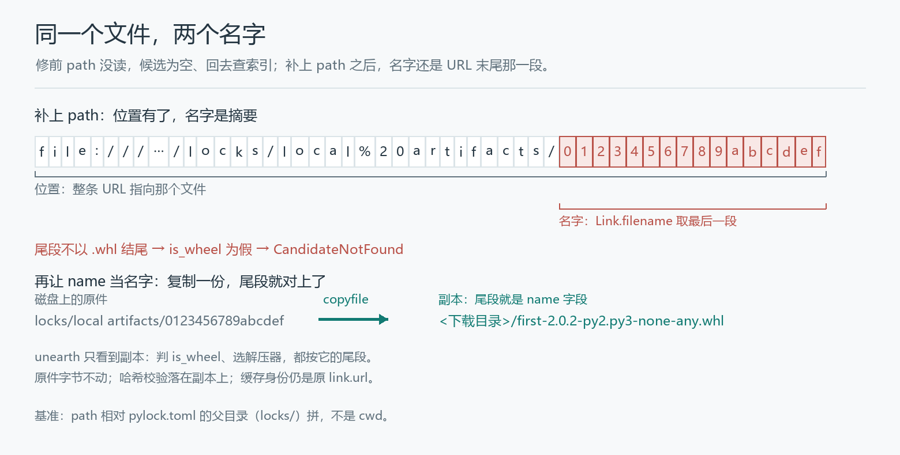

# The pylock names a local file, so why does PDM still go to the network

A `pylock.toml` that spells out the location, the file name and the hash:

```toml
[[packages]]
name = "first"
version = "2.0.2"

[[packages.wheels]]
name = "first-2.0.2-py2.py3-none-any.whl"
path = "local artifacts/0123456789abcdef"

[packages.wheels.hashes]
sha256 = "8d8e46e115ea8ac652c76123c0865e3ff18372aef6f03c22809ceefcea9dec86"
```

`local artifacts/0123456789abcdef` sits right next to the lockfile. The physical name is a content digest rather than a wheel name, which is why the entry carries `name` as well. Hand that lockfile to PDM before the fix:

```text
RuntimeError: offline: forbidden audit event socket.getaddrinfo
```

DNS. For a file that is already on disk.

[PDM #3975](https://github.com/pdm-project/pdm/pull/3975) fixes this path. The patch has two layers: first the reader has to see `path`, then comes the question of what the file should be called once it is seen. The second layer only shows up after the first is done — the PR description keeps one line about it: a dropped attempt that changed the reader alone still failed 30 of the 50 new test cases.

## `path` does not exist in the reader

The pylock spec gives every wheel/sdist entry three location fields: `url` is the download address, `path` is a local path relative to the directory that holds the lockfile, and `name` is an explicit file name. When an entry carries both `path` and `url`, `path` wins. PDM both reads this format and writes it with `pdm export --format pylock`.

Before the fix, `_read_pylock` (`pdm/models/repositories/lock.py:110`) had two branches:

```python
if "url" in artifact:
    hash_item["url"] = artifact["url"]
if "name" in artifact:
    hash_item["file"] = artifact["name"]
```

`name` came in and landed in `file`, an annotation field; `path` was not read at all. So for a path-only entry, `hash_item` holds hashes and no location. The next step, `_find_best_match_link`, collects candidate links from the hash list:

```python
links = [Link(f["url"]) for f in files if "url" in f]
```

An empty list, so `PackageFinder.find_best_match` looks up `first==2.0.2` in the configured index. With a network it downloads a package that was already at hand; without one it hangs on DNS.

`path` also needs a base: relative to what. The spec says the directory holding the lockfile, and this read happens before the working directory is switched to the project root — `cwd` cannot build the right path. So `lock.py:112` takes the lockfile's own parent as the root:

```python
lockfile_root = self.environment.project.lockfile._path.absolute().parent
...
hash_item["url"] = lockfile_root.joinpath(artifact["path"]).as_uri()
```

The space in the directory name is written `%20` in the URI; before taking a name, unearth runs `unquote`, which turns `%20` back into a space, and then takes the last segment.

PDM allows the lockfile in a subdirectory, so the PR's test parameterises `lock_directory` over `[".", "locks"]` and runs both. Build the location from the project root instead and `local artifacts/...` inside the `locks/` copy points somewhere wrong — and only shows up at the moment the file is opened.

The first comparison covers exactly this stretch:

```text
== path_only_wheel
  before: obtain=failed
          error=RuntimeError: offline: forbidden audit event socket.getaddrinfo
  after: obtain=ok filename='first-2.0.2-py2.py3-none-any.whl'
```

`before` is the parent of the merge commit, `dc1f476a`; `after` is the merge commit `a4965a8f`. Both source trees are untouched, each case runs in its own process, and an audit hook refuses sockets.

## Fix the location alone and 30 cases still fail

The second comparison points `path` and `url` at the same local file. The physical name is still `0123456789abcdef`, and `name` holds the real wheel name. Patch only `path` and the error moves down:

```text
CandidateNotFound: No candidate is found for `first` that matches the environment or hashes
```

unearth's `Link.filename` takes the last segment of the URL path. `0123456789abcdef` does not look like a wheel file name, so `Link.is_wheel` is false and name, version and tags cannot be derived; candidate matching breaks at the first gate. The dropped attempt was exactly this line of thinking: add a file URI and call it done, leaving candidate evaluation untouched. The PR description says why plainly: a file URI alone is not enough, because the candidate evaluator derives the wheel's type, name and tags from that URI's basename, and local unpacking hands the same basename back to the installer.

sdists have a second gate. unearth picks an unpacker by extension (`BZ2_EXTENSIONS` / `TAR_EXTENSIONS` / `ZIP_EXTENSIONS`), so a gzip-compressed package sitting under the name `wrong.tar.bz2` gets unpacked as bzip2. That is not a corner invented for this article: the PR's tests parameterise `physical_filename` over `["0123456789abcdef", "wrong.tar.bz2"]` and run both. The demo here stops at candidate matching and never reaches unpacking.

`name` is not a new field. The spec has always had it, and the reader always read it — into `hash_item["file"]`, where it only annotated the hash check and never reached `Link`. **Location and name are two dimensions: before the fix only "where to read from" was connected, not "what the thing read out is called".**



## Separating the name from the location

The merged version adds a `Link` subclass in `candidates.py:80`:

```python
@dataclasses.dataclass(eq=False, repr=False)
class _LinkWithFilename(Link):
    """Keep a locked artifact's filename separate from its location."""

    url: str
    filename_override: str | None = None

    @property
    def filename(self) -> str:
        return self.filename_override if self.filename_override is not None else super().filename
```

`_find_best_match_link` wraps every item of the hash list in it (`:105`), passing `file` as `filename_override`. From then on `link.filename` is the logical name, while `link.url` and `link.file_path` still point at the physical location.

The trouble is on unearth's side: downloading, deciding whether something is a wheel, and unpacking all still read the URL basename. So `_unpack` (`:487`) gains a step — for a local file with an explicit name whose physical basename differs from the logical one, copy it into the download directory under the logical name first, and let unearth work on the copy:

```python
artifact = Path(download_dir) / link.filename
artifact.parent.mkdir(parents=True, exist_ok=True)
shutil.copyfile(link.file_path, artifact)
url = artifact.as_uri()
if link.parsed.fragment:
    url += f"#{link.parsed.fragment}"
link = dataclasses.replace(link, url=url)
```

The fragment has to be put back by hand. A local sdist URL written by PDM can carry `#sha256=…&subdirectory=…`; the copy's new URL has none of that, and replacing it outright would drop the subdirectory. `test_read_pylock_named_local_sdist_preserves_fragment` pins this down: the unpacked directory must land in `demo.egg-info`, while `candidate.link.url` must still be the original one carrying the fragment.

**The bytes of the copy are what the later hash check sees.** The source file is untouched, the cache identity (`link.url`) stays on the original link, and `dataclasses.replace` only swaps the URL used for this one unpack. Failure does not fall back to the index or to a URL download either: a broken local artifact should raise.

## The name starts to be trusted

Before the fix `name` was only an annotation; whatever it said had no effect on the path. After the fix it takes part in `Path(download_dir) / link.filename`, so `_LinkWithFilename.__post_init__` rejects bad values at construction time (`:88-91`):

```python
if self.filename_override is not None and (
    self.filename_override in ("", ".", "..") or any(c in self.filename_override for c in "/\\:\0")
):
    raise RequirementError(f"Invalid artifact filename: {self.filename_override!r}")
```

`../x.whl`, `..\x.whl`, `C:x.whl`, the empty string, `.`, `..` and names containing NUL all fail. The error is raised while candidates are being prepared; `test_read_pylock_rejects_unsafe_artifact_name_before_io` swaps `find_best_match`, `_get_build_cache` and `_unpack` for stubs that raise `AssertionError`, then asserts none of them was called — not a repair after a failed write.

The check covers `name` only. The rules for resolving `path` are unchanged, and neither field gained a "must live inside the project" restriction. The spec does not ask for one, and the patch does not reach for it.

## What the patch does not touch

Only the install path that reads a pylock is affected: `pdm install` and `pdm sync` build a `LockedRepository` while parsing the lockfile, and a candidate's hash list comes from `_read_pylock`. Before the fix `path` did not exist on this path; after it, it is the first choice for a candidate location. PDM's own `pdm.lock`, requirements imports, VCS and directory dependencies do not go through here.

url-only lockfiles behave as before: `filename_override` is `None` and `filename` falls back to the parent class. An entry with neither `path` nor `url` still falls back to the package source, and `path` beating `url` only applies when both are present. A hash mismatch still raises `HashMismatchError`, against the bytes of the copy. The build cache's validation policy is unchanged too — an invariant the PR states outright.

The PR description also carries a CLI-level verification record (36 scenarios, 198 subprocess steps, including 54 successful installs, 54 hash rejections and 36 exports). The four cases here cover only `LockedRepository` plus `_obtain()`; that set of numbers is not repeated.

## Reproducing

The project lives in `pylock本地工件_pdm/pylock_artifact_demo/`. Both PDM source trees (parent `dc1f476a`, merge `a4965a8f`) sit untouched in `vendor/`, 147 files each, with the MIT licence and a per-file SHA-256. The fixtures come from PDM's own tests: `first-2.0.2-py2.py3-none-any.whl` and `demo-0.0.1.tar.gz`, with the physical names deliberately set to `0123456789abcdef` and `wrong.tar.bz2`. Running needs Python 3.12 and PDM's pinned dependencies (`unearth==0.19.0` and friends, see the project README):

```text
python run.py --test
```

The four cases:

```text
== path_only_wheel
  before: obtain=failed filename=None
          error=RuntimeError: offline: forbidden audit event socket.getaddrinfo
  after: obtain=ok filename='first-2.0.2-py2.py3-none-any.whl'

== path_and_url_wheel
  before: obtain=failed filename=None
          error=RuntimeError: offline: forbidden audit event socket.getaddrinfo
  after: obtain=ok filename='first-2.0.2-py2.py3-none-any.whl'

== named_local_wheel
  before: obtain=failed filename=None
          error=CandidateNotFound: No candidate is found for `first` that matches the environment or hashes
  after: obtain=ok filename='first-2.0.2-py2.py3-none-any.whl'

== named_local_sdist
  before: obtain=failed filename=None
          error=CandidateNotFound: No candidate is found for `demo` that matches the environment or hashes
  after: obtain=ok filename='demo-0.0.1.tar.gz'

PASS: 4 cases; before ignores path (and the explicit name), after honours both
```

The sdist `before` stops at candidate matching and never reaches unpacking, which is exactly what shows the name problem is one layer earlier: the physical basename is not recognised as an sdist, so the unpacker choice never gets a chance to run.

## References

- PDM PR [#3975](https://github.com/pdm-project/pdm/pull/3975); parent commit [`dc1f476a`](https://github.com/pdm-project/pdm/commit/dc1f476a53043ec36c83df104a73a6e86a4d4e64), merge commit [`a4965a8f`](https://github.com/pdm-project/pdm/commit/a4965a8f116dc51d961cdd6b1e0d55aabb0abd2e).
- Changed files: [`lock.py`](https://github.com/pdm-project/pdm/blob/a4965a8f116dc51d961cdd6b1e0d55aabb0abd2e/src/pdm/models/repositories/lock.py), [`candidates.py`](https://github.com/pdm-project/pdm/blob/a4965a8f116dc51d961cdd6b1e0d55aabb0abd2e/src/pdm/models/candidates.py), [`test_locked_repository.py`](https://github.com/pdm-project/pdm/blob/a4965a8f116dc51d961cdd6b1e0d55aabb0abd2e/tests/models/test_locked_repository.py).
- The pylock spec: [packaging.python.org — pylock.toml](https://packaging.python.org/en/latest/specifications/pylock-toml/) (the `path`, `name` and `hashes` fields).
- unearth's local-file and filename handling: `unearth.Link.filename`, `finder.download_and_unpack`, pinned at `0.19.0`.
