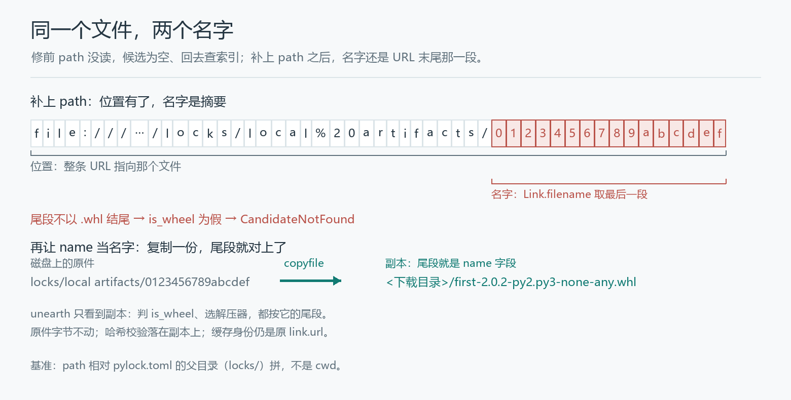

# pylock 里写了本地文件，PDM 为什么还去网上找

一份 `pylock.toml`，wheel 条目把位置、文件名、哈希都写全了：

```toml
[[packages]]
name = "first"
version = "2.0.2"

[[packages.wheels]]
name = "first-2.0.2-py2.py3-none-any.whl"
path = "local artifacts/0123456789abcdef"

[packages.wheels.hashes]
sha256 = "8d8e46e115ea8ac652c76123c0865e3ff18372aef6f03c22809ceefcea9dec86"
```

`local artifacts/0123456789abcdef` 就躺在锁文件旁边。物理名是内容摘要、不是 wheel 名，所以条目里另写了 `name`。把这份锁文件交给修前的 PDM：

```text
RuntimeError: offline: forbidden audit event socket.getaddrinfo
```

DNS。为一个已经在磁盘上的文件去查域名。

[PDM #3975](https://github.com/pdm-project/pdm/pull/3975) 修的是这条路径。补丁分两层：先让读取器看见 `path`，再处理「看见之后，这个文件该叫什么」。第二层是第一层修完才露出来的——PR 描述里留了一句：被放弃的「只改读取器」版本，在新加的 50 个用例里仍有 30 个不过。

## `path` 在读取函数里不存在

pylock 规范给每个 wheel/sdist 条目留了三个位置字段：`url` 是下载地址，`path` 是相对锁文件所在目录的本地路径，`name` 是显式文件名。同一条目给出 `path` 和 `url` 时，`path` 优先。PDM 既读这个格式，也能用 `pdm export --format pylock` 写出来。

修前的 `_read_pylock`（`pdm/models/repositories/lock.py:110`）只有两段判断：

```python
if "url" in artifact:
    hash_item["url"] = artifact["url"]
if "name" in artifact:
    hash_item["file"] = artifact["name"]
```

`name` 读进来了，落进 `file` 这个标注字段；`path` 一个字没读。于是 path-only 的条目，`hash_item` 里只剩哈希，没有位置。下一环 `_find_best_match_link` 从哈希列表里收候选链接：

```python
links = [Link(f["url"]) for f in files if "url" in f]
```

空列表，轮到 `PackageFinder.find_best_match`，按包名版本去配置的索引里找 `first==2.0.2`。有网时下载一份本来就在手边的包，没网时卡在 DNS 上。

`path` 还有一处基准要定：它相对谁。规范说是锁文件所在目录，而读取这一步发生在切换工作目录到项目根之前——靠 `cwd` 拼不出正确位置。`lock.py:112` 因此取锁文件自己的父目录当根：

```python
lockfile_root = self.environment.project.lockfile._path.absolute().parent
...
hash_item["url"] = lockfile_root.joinpath(artifact["path"]).as_uri()
```

目录名里那个空格在 URI 里写作 `%20`；unearth 取名字之前先 `unquote`，`%20` 还原成空格，然后取最后一段。

PDM 允许把锁文件放在子目录，PR 的测试把 `lock_directory` 参数化成了 `[".", "locks"]` 两档，每一档都跑一遍。按项目根去拼，`locks/` 下那份锁文件里的 `local artifacts/...` 会指到错的地方，而且要等打开文件那一刻才暴露。

第一组对照正是这一段：

```text
== path_only_wheel
  before: obtain=failed
          error=RuntimeError: offline: forbidden audit event socket.getaddrinfo
  after: obtain=ok filename='first-2.0.2-py2.py3-none-any.whl'
```

`before` 是合并提交的父提交 `dc1f476a`，`after` 是合并提交 `a4965a8f`。两版源码原样，各跑一个独立进程，socket 由 audit hook 拒绝。

## 只补位置，30 个用例还是不过

第二组把 `path` 和 `url` 指向同一个本地文件。物理名仍是 `0123456789abcdef`，`name` 写真正的 wheel 名。只补 `path` 的话，报错会换一个：

```text
CandidateNotFound: No candidate is found for `first` that matches the environment or hashes
```

unearth 的 `Link.filename` 取 URL 路径的最后一段。`0123456789abcdef` 不像 wheel 文件名，`Link.is_wheel` 为假，包名、版本、标签都推不出来，候选匹配在第一关就断了。被放弃的那版正是这条思路：补一条 file URI 就算完事，候选评估那一段没动。PR 描述把原因写得很直白：光加一条 file URI 不够，候选评估器要从 URI 的 basename 推 wheel 的类型、名字和标签，本地解包也把这个 basename 原样交回安装器。

sdist 还有第二道。unearth 按扩展名选解压器（`BZ2_EXTENSIONS` / `TAR_EXTENSIONS` / `ZIP_EXTENSIONS`），一个 gzip 压缩的包如果存在 `wrong.tar.bz2` 名下，会被当成 bzip2 去解。这不是推演出来的边角：PR 的测试直接把 `physical_filename` 参数化成 `["0123456789abcdef", "wrong.tar.bz2"]`，两个都跑。本轮 demo 的 before 停在候选匹配，没走到解压这一步。

`name` 不是新字段。规范里一直有，修前也在读，只是读进 `hash_item["file"]` 之后只当哈希校验的标注，没有进 `Link`。**位置和名字是两个维度：修前只打通了「从哪里读」，没打通「读出来叫什么」。**



## 名字和位置分开

合并版在 `candidates.py:80` 加了个 `Link` 子类：

```python
@dataclasses.dataclass(eq=False, repr=False)
class _LinkWithFilename(Link):
    """Keep a locked artifact's filename separate from its location."""

    url: str
    filename_override: str | None = None

    @property
    def filename(self) -> str:
        return self.filename_override if self.filename_override is not None else super().filename
```

`_find_best_match_link` 用它包装哈希列表里的每一项（`:105`），把 `file` 作为 `filename_override` 传进去。`link.filename` 从此是逻辑名，`link.url` 和 `link.file_path` 仍指向物理位置。

麻烦在 unearth 那一侧：下载、判断 wheel、解压，都还会去读 URL 的 basename。所以 `_unpack`（`:487`）里多了一步——本地文件、有显式名、物理 basename 与逻辑名不同，就先按逻辑名复制到下载目录，再让 unearth 处理副本：

```python
artifact = Path(download_dir) / link.filename
artifact.parent.mkdir(parents=True, exist_ok=True)
shutil.copyfile(link.file_path, artifact)
url = artifact.as_uri()
if link.parsed.fragment:
    url += f"#{link.parsed.fragment}"
link = dataclasses.replace(link, url=url)
```

fragment 得手动接回去。PDM 写出的本地 sdist URL 可以带 `#sha256=…&subdirectory=…`，复制出来的新 URL 天然没有它，直接替换会把子目录丢掉。PR 里 `test_read_pylock_named_local_sdist_preserves_fragment` 钉住这个：解包目录要落在 `demo.egg-info`，而 `candidate.link.url` 必须还是原来那条带 fragment 的。

**复制出来的字节就是后面哈希校验的对象**，源文件不动；缓存身份（`link.url`）留在原始 link 上，`dataclasses.replace` 只换这一趟解包用的 URL。失败时也不回退去索引或 URL 下载——本地工件坏了，就该报错。

## 名字开始被信任

修前 `name` 只是标注，写成什么都不影响路径。修后它会参与 `Path(download_dir) / link.filename` 的拼接，于是 `_LinkWithFilename.__post_init__` 在构造时就把不合法挡掉（`:88-91`）：

```python
if self.filename_override is not None and (
    self.filename_override in ("", ".", "..") or any(c in self.filename_override for c in "/\\:\0")
):
    raise RequirementError(f"Invalid artifact filename: {self.filename_override!r}")
```

`../x.whl`、`..\x.whl`、`C:x.whl`、空串、`.`、`..`、含 NUL 的名字都过不去。抛错发生在准备候选的阶段；`test_read_pylock_rejects_unsafe_artifact_name_before_io` 把 `find_best_match`、`_get_build_cache`、`_unpack` 三处都换成会抛 `AssertionError` 的桩，然后断言它们一个都没被调用——不是等写文件失败了再补救。

这条校验只管 `name`。`path` 的解析规则没改，两者也没加「必须位于项目里」的限制。规范没这样要求，补丁没往那里扩。

## 没动的地方

受影响的只有读 pylock 的那条安装路径：`pdm install`、`pdm sync` 解析锁文件时构造 `LockedRepository`，候选的哈希列表从 `_read_pylock` 来。修前 `path` 在这条路上等于不存在，修后它是候选位置的首选。PDM 自己的 `pdm.lock`、requirements 导入、VCS 与目录依赖都不走这里。

url-only 的锁文件行为不变：`filename_override` 是 `None`，`filename` 落回父类。既没有 `path` 也没有 `url` 的条目仍回退到包源，`path` 优先于 `url` 只在两者同时出现时生效。哈希不匹配照旧抛 `HashMismatchError`，校验的是复制后的字节。构建缓存的校验策略也没跟着动，这是 PR 里写明的不变项。

PR 描述另附了一段 CLI 层面的验证记录（36 个场景、198 个子进程步骤，含 54 次成功安装、54 次哈希拒绝、36 次导出）。本文四组只覆盖 `LockedRepository` 加 `_obtain()`，不重复那批数字。

## 复现

工程在 `pylock本地工件_pdm/pylock_artifact_demo/`，两版 PDM 源码（父 `dc1f476a`、合并 `a4965a8f`）原样放在 `vendor/`，各 147 个文件，附 MIT 许可证与逐文件 SHA-256。语料取自 PDM 自己的测试夹具：`first-2.0.2-py2.py3-none-any.whl` 与 `demo-0.0.1.tar.gz`，物理名故意写成 `0123456789abcdef` 和 `wrong.tar.bz2`。运行需要 Python 3.12 和 PDM 的固定依赖（`unearth==0.19.0` 等，见工程 README）：

```text
python run.py --test
```

四组输出：

```text
== path_only_wheel
  before: obtain=failed filename=None
          error=RuntimeError: offline: forbidden audit event socket.getaddrinfo
  after: obtain=ok filename='first-2.0.2-py2.py3-none-any.whl'

== path_and_url_wheel
  before: obtain=failed filename=None
          error=RuntimeError: offline: forbidden audit event socket.getaddrinfo
  after: obtain=ok filename='first-2.0.2-py2.py3-none-any.whl'

== named_local_wheel
  before: obtain=failed filename=None
          error=CandidateNotFound: No candidate is found for `first` that matches the environment or hashes
  after: obtain=ok filename='first-2.0.2-py2.py3-none-any.whl'

== named_local_sdist
  before: obtain=failed filename=None
          error=CandidateNotFound: No candidate is found for `demo` that matches the environment or hashes
  after: obtain=ok filename='demo-0.0.1.tar.gz'

PASS: 4 cases; before ignores path (and the explicit name), after honours both
```

`sdist` 的 before 停在候选匹配、没走到解压，正说明名字问题发生在更早一层：物理 basename 认不出是 sdist，后面的解压器选择根本没机会执行。

## 参考

- PDM PR [#3975](https://github.com/pdm-project/pdm/pull/3975)；父提交 [`dc1f476a`](https://github.com/pdm-project/pdm/commit/dc1f476a53043ec36c83df104a73a6e86a4d4e64)、合并提交 [`a4965a8f`](https://github.com/pdm-project/pdm/commit/a4965a8f116dc51d961cdd6b1e0d55aabb0abd2e)。
- 修改文件：[`lock.py`](https://github.com/pdm-project/pdm/blob/a4965a8f116dc51d961cdd6b1e0d55aabb0abd2e/src/pdm/models/repositories/lock.py)、[`candidates.py`](https://github.com/pdm-project/pdm/blob/a4965a8f116dc51d961cdd6b1e0d55aabb0abd2e/src/pdm/models/candidates.py)、[`test_locked_repository.py`](https://github.com/pdm-project/pdm/blob/a4965a8f116dc51d961cdd6b1e0d55aabb0abd2e/tests/models/test_locked_repository.py)。
- pylock 规范：[packaging.python.org — pylock.toml](https://packaging.python.org/en/latest/specifications/pylock-toml/)（`path`、`name`、`hashes` 字段）。
- unearth 的本地文件与文件名处理：`unearth.Link.filename`、`finder.download_and_unpack`，固定版本 `0.19.0`。
