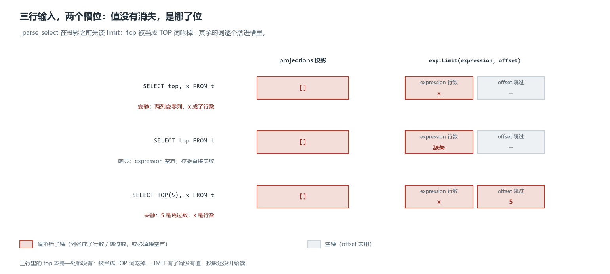

# A column named `top`, and sqlglot reads the projection as LIMIT

```python
import sqlglot

sqlglot.parse_one("SELECT top, x FROM t", read="snowflake").sql("snowflake")
# 'SELECT FROM t LIMIT x'
```

Two projected columns, `top` and `x`. One pass through `parse_one` and the projection list is empty, `x` has become the row count of a LIMIT, and nothing raised. That is the quiet shape. In five dialects — snowflake, oracle, tsql, teradata, redshift — a column named `top` directly after `SELECT` sends the words of the query into the two slots of `exp.Limit`.

The newest release on PyPI, 30.33.0 (2026-11-17), still has it. The fix, [#9295](https://github.com/tobymao/sqlglot/pull/9295), merged into main on 2026-11-20 18:37 UTC and has not reached any release; it also left the base parser alone, so tsql, teradata and redshift behave exactly as before, and [#9300](https://github.com/tobymao/sqlglot/issues/9300) (2026-11-21 07:01 UTC) is still open.

I reported this as [sqlglot #9284](https://github.com/tobymao/sqlglot/issues/9284). Issue to merge took 5 hours 45 minutes.

## Two faces

It splits on what comes after `top`.

- **A comma after it** (`SELECT top, x FROM t`): no error, output `SELECT FROM t LIMIT x`, projection list `[]`. The AST is legal; a consumer that reads column names off the projection gets an empty list — not an error, an absence.
- **`top` on its own** (`SELECT top FROM t`): `ParseError`, reading `Required keyword: 'expression' missing for <class 'sqlglot.expressions.query.Limit'>`.

The qualified form `top.x` and the function form `TOP(x)` are swallowed the same way — both sit in the 15-shape matrix below — because the first token after `SELECT` is still `top`, and the projection has not started reading. The worst shape has both a parenthesis and a comma, and is wrong twice:

```python
sqlglot.parse_one("SELECT TOP(5), x FROM t", read="snowflake").sql("snowflake")
# 'SELECT FROM t LIMIT 5, x'
```

`5` becomes the offset, `x` becomes the row count: both numbers come from the original query, both slots take the wrong one, and the projection is still empty.

postgres, duckdb and mysql do not tokenize `TOP` and are unaffected. The five mapped dialects share one consequence — empty projection, words inside LIMIT — and differ only in how they print: tsql keeps the `TOP` notation, redshift writes `LIMIT`, oracle writes `FETCH FIRST`.

## Where it is swallowed

Each of the five tokenizers carries one line, `"TOP": TokenType.TOP` (`dialects/oracle.py:116`, `dialects/redshift.py:56`, `dialects/snowflake.py:171`, `dialects/teradata.py:74`, `dialects/tsql.py:188`), so the word `top` leaves the tokenizer pinned as a keyword. But `TOP` is listed in `Parser.ID_VAR_TOKENS` (`parser.py:851`) — sqlglot marks this token as usable as an identifier, and Snowflake's [reserved word list](https://docs.snowflake.com/en/sql-reference/reserved-keywords) does not contain TOP, so `top` is a legal column name.

The problem is the order of parsing. Before `_parse_select` reads the projection, `parser.py:4252` calls `limit = self._parse_limit(top=True)`, and the first line of that function checks:

```python
if skip_limit_token or self._match(TokenType.TOP if top else TokenType.LIMIT):
    if top:
        limit_paren = self._match(TokenType.L_PAREN)
        expression = (
            self._parse_term() or self._parse_select()
            if limit_paren
            else self._parse_number()
        )
```

The word `TOP` is eaten as the introducer of a limit: with a parenthesis behind it, read one expression; without one, read a number. When `top` stands alone the next token is not a number, `_parse_number()` returns `None`, and `exp.Limit(expression=None)` fails validation — that is the loud face. With a comma behind it the parser takes the other branch:

```python
if self._match(TokenType.COMMA):
    offset = expression
    expression = self._parse_term()
```

For `TOP(5), x`: `5` is read as the row count first, the comma moves that whole value over to the offset, `x` is read as the new row count, and out comes `LIMIT 5, x`. The projection list is empty from beginning to end — in this order it never gets started:



## Five hours and forty-five minutes

| Time (UTC) | Event |
| --- | --- |
| 11-20 12:52 | I file [#9284](https://github.com/tobymao/sqlglot/issues/9284): five dialects side by side, the Snowflake documentation argued for TOP not being reserved; a 13:53 comment adds the six-line retreat patch and the double error in `TOP(5), x` |
| 13:41 | blucca reproduces it independently on the same version: `SELECT top(5) FROM t` → `SELECT FROM t LIMIT 5`, `projections: []`, with [four runnable cases](https://github.com/blucca/blucca.github.io/tree/3786ad7e8d0008b8058010c2599724ff005bdee6/research/sqlglot-top-prefix) |
| 17:35 | first commit on `fix/snowflake-top-identifier`, a general guard: consume `TOP` only when the next token is a number |
| 17:38 | georgesittas opens [#9295](https://github.com/tobymao/sqlglot/pull/9295) and asks treysp to review |
| 17:40 | Copilot's first review is green: all 1,764 unit tests pass |
| 18:17 | second commit narrows the guard to Snowflake, and deletes the `TOP` tokenize line from oracle |
| 18:25 | georgesittas comments line by line, "Oracle doesn't support the TOP limit syntax."; the same minute Copilot raises a warning: the snowflake guard rejects a placeholder count (`SELECT TOP ? x`) and asks for a regression case |
| 18:36 | geooo109 approves |
| 18:37 | merge commit `dc4afaf5`; the same minute georgesittas closes #9284 |

Two commits, one shift of approach: the first was a general guard in the base parser shared by all five dialects; the second pulled the scope back into the dialects — oracle was never a TOP limit dialect (the maintainer's line-by-line comment), so deleting one tokenizer line was enough; snowflake does have a real TOP syntax, so the guard belongs inside that dialect. The final diff is 5 files, +29/−6:

- `dialects/oracle.py` L116: the line `"TOP": TokenType.TOP,` is deleted, and in oracle `top` is an ordinary identifier from then on;
- `parsers/snowflake.py`: a new `_parse_limit` override (L1239) — when `TOP` is not followed by a number, the whole thing steps out of the way:

```python
# Only a bare number starts a TOP limit. TOP(x) is a function call.
if (
    top
    and self._curr.token_type == TokenType.TOP
    and self._next.token_type != TokenType.NUMBER
):
    return this
```

`return this` leaves the road open: `TOP 5` is still read as a limit; `top, x` and `TOP(x)` are not consumed and fall back to the projection path.

- Same file, tokenizer L379: `FUNC_TOKENS = parser.Parser.FUNC_TOKENS | {TokenType.ROLLBACK, TokenType.TOP}`, so `TOP(x)` walks the function-call path. The PR's six identity assertions (`top`, `top.x`, `top, x`, `TOP(x)`, `TOP(5), x`, `top:field`) all pass.
- oracle gained two shapes; redshift changed the bare `SELECT TOP 1 x` to run all three counts `1`, `%s`, `%(n)s` one after another, pinning the placeholder behaviour down.
- The base parser is untouched: the first-line check in `_parse_limit` at 30.33.0 (L5995) and at `dc4afaf5` (L6035) is the same word for word.

The six-line retreat patch I attached to #9284 and the four-line proposal in #9300 are the same route: once `TOP` has been eaten and no value follows, step back to the position before `TOP`. The merged dialect guard is narrower than that; the base layer is still waiting for the retreat.

## Fifteen shapes, two versions

The project at `top吞投影_sqlglot/top_demo/` pins the matrix down: 15 SQL shapes (including 3 control shapes that are real TOP limits) × 2 versions. Version A is PyPI `sqlglot==30.33.0`; version B is `30.33.0+dc4afaf5`, the merge commit on main. Both source trees are vendored verbatim (`provenance.txt` records where they came from and a SHA-256 per file, checked against the PyPI wheel and the codeload tarball); nothing is installed, nothing comes from a venv. `--test` asserts the output and the projection list row by row, and re-checks every vendored byte:

```console
$ python top吞投影_sqlglot/top_demo/run.py --test
版本：30.33.0 / 30.33.0+dc4afaf5
provenance 372 文件 SHA-256 全对
15 形 × 2 版全部断言通过
ALL PASS
```

| Shape | 30.33.0 | dc4afaf5 |
| --- | --- | --- |
| snowflake `SELECT top, x FROM t` | `SELECT FROM t LIMIT x` · `[]` | `SELECT top, x FROM t` · `[top, x]` |
| snowflake `SELECT top FROM t` | ParseError | `SELECT top FROM t` |
| snowflake `SELECT top.x FROM t AS top` | ParseError | `SELECT top.x FROM t AS top` |
| snowflake `SELECT TOP(x) FROM t` | `SELECT FROM t LIMIT x` · `[]` | `SELECT TOP(x) FROM t` |
| snowflake `SELECT TOP(5), x FROM t` | `SELECT FROM t LIMIT 5, x` · `[]` | `SELECT TOP(5), x FROM t` |
| snowflake `SELECT TOP 5 x FROM t` (control) | `SELECT x FROM t LIMIT 5` | same |
| oracle `SELECT top, x FROM t` | `SELECT FROM t FETCH FIRST x ROWS ONLY` · `[]` | `SELECT top, x FROM t` · `[top, x]` |
| oracle `SELECT TOP 5 x FROM t` (control) | `SELECT x FROM t FETCH FIRST 5 ROWS ONLY` | **ParseError** |
| oracle `SELECT TOP(5), x FROM t` | `SELECT FROM t FETCH FIRST x ROWS ONLY` · `[]` | `SELECT TOP(5), x FROM t` |
| tsql `SELECT top FROM t` | ParseError | same |
| tsql `SELECT top, x FROM t` | `SELECT TOP (x) FROM t` · `[]` | same |
| tsql `SELECT TOP (5) x FROM t` (control) | `SELECT TOP 5 x FROM t` | same |
| teradata `SELECT top FROM t` | ParseError | same |
| redshift `SELECT top FROM t` | ParseError | same |
| redshift `SELECT TOP 1 x FROM t` (control) | `SELECT x FROM t LIMIT 1` | same |

`[]` is the projection list. Version B rescues the six snowflake shapes and the two oracle identifier shapes, at the price of the `TOP 5` cell; the three controls with real TOP syntax are unchanged across the two versions, and what should be a limit still is.

## The cost

- **oracle's lenient reading of `TOP 5` is gone.** Before the fix it parsed — `TOP 5` read as a row count, transpiled to `FETCH FIRST 5 ROWS ONLY`. oracle itself does not support TOP (the maintainer's line), but whoever relied on that conversion breaks on upgrade. One error that was quiet is traded for one error that is loud.
- **snowflake's placeholder count is a silent regression.** `SELECT TOP ? x FROM t` used to become `SELECT x FROM t LIMIT ?` (the placeholder as the row count); on the merged version the guard rejects `?` and TOP stays on the projection side. This is exactly what the Copilot warning named, and it was confirmed twelve minutes later and not fixed. redshift is different: the same kind of placeholder is pinned by a new test in the PR, and `TOP %s` and `TOP %(n)s` are LIMIT-shaped before and after, untouched.
- **Three dialects at the base layer are not moved.** `top` as a column behaves in tsql, teradata and redshift exactly as it did before. The proposal in [#9300](https://github.com/tobymao/sqlglot/issues/9300) is four lines in the base `_parse_limit`: once `TOP` has been eaten and no value follows, step back to before the `TOP` word — which is why redshift's `TOP %s` would not be caught in the crossfire (as stated in the issue body). As of this writing: no comments, open.

## Who runs into this

Two conditions: the dialect handed to `parse_one` / `transpile` (and every entry point that goes through SELECT parsing) is one of snowflake, oracle, tsql, teradata, redshift; and a column named `top` — including the qualified `t.top` — comes directly after `SELECT`. The most common use of sqlglot is cross-dialect transpiling and AST diff, a pipeline that parses and then prints. Put a `top` column in the input and the SQL it prints is wrong, while the output is still valid syntax.

On versions: as of this writing the latest release on PyPI is 30.33.0 (published 2026-11-17 12:19 UTC) and still has it; #9284 reproduced it on main as of 11-19; the fix merged on 11-20 18:37 UTC — every install that took the latest sqlglot during those three days sits inside the window. The fix is on main, with no tag and no release. Once the next release lands, `pip install -U sqlglot` covers snowflake and oracle; the other three wait on #9300.

One line checks the install you have:

```console
$ python -c "import sqlglot; e = sqlglot.parse_one('SELECT top, x FROM t', read='snowflake'); print(sqlglot.__version__, e.sql('snowflake'), [p.sql() for p in e.expressions])"
30.33.0 SELECT FROM t LIMIT x []
```

If it prints `SELECT top, x FROM t ['top', 'x']`, yours is fixed. If you have real SQL with a `top` column, run it through the same dialect: a projection with fewer columns than you wrote, plus a LIMIT that should not be there, is this bug.

The next time I read a parser, I will look at the keyword-consumption branch first: in a "word plus number" form, can the word appear without a number? If it can, there has to be a retreat — the column name was in the sentence all along, it just never reached the projection.

## Sources

- Issue: [tobymao/sqlglot#9284](https://github.com/tobymao/sqlglot/issues/9284) (2026-11-20 12:52:27Z); the remaining three dialects: [#9300](https://github.com/tobymao/sqlglot/issues/9300) (2026-11-21 07:01:27Z, open).
- PR: [tobymao/sqlglot#9295](https://github.com/tobymao/sqlglot/pull/9295), 5 files, +29/−6.
- Parallel reproduction: [blucca's four runnable cases](https://github.com/blucca/blucca.github.io/tree/3786ad7e8d0008b8058010c2599724ff005bdee6/research/sqlglot-top-prefix) @ `3786ad7e`.
- Snowflake documentation: [reserved words](https://docs.snowflake.com/en/sql-reference/reserved-keywords) (no TOP), [TOP syntax](https://docs.snowflake.com/en/sql-reference/constructs/top_n) (n must be a non-negative integer constant).
- PyPI: [sqlglot 30.33.0](https://pypi.org/project/sqlglot/30.33.0/) (2026-11-17).
- Version pinning: A = PyPI 30.33.0; B = main @ [`dc4afaf5`](https://github.com/tobymao/sqlglot/commit/dc4afaf5c9a6748a004998ed13e3b438e20e431e) (codeload tarball, SHA-256 `D99EFE9B…C09F9`), both venv builds described in the project README.
- Reproduction: `top吞投影_sqlglot/top_demo/` (15 shapes × 2 versions, network blocked throughout).

Upstream: `tobymao/sqlglot`, [#9295](https://github.com/tobymao/sqlglot/pull/9295), parent commit [09a454dd](https://github.com/tobymao/sqlglot/commit/09a454dde013bfcbe372a87875e57dbaafb598ba), merge commit [dc4afaf5](https://github.com/tobymao/sqlglot/commit/dc4afaf5c9a6748a004998ed13e3b438e20e431e).
