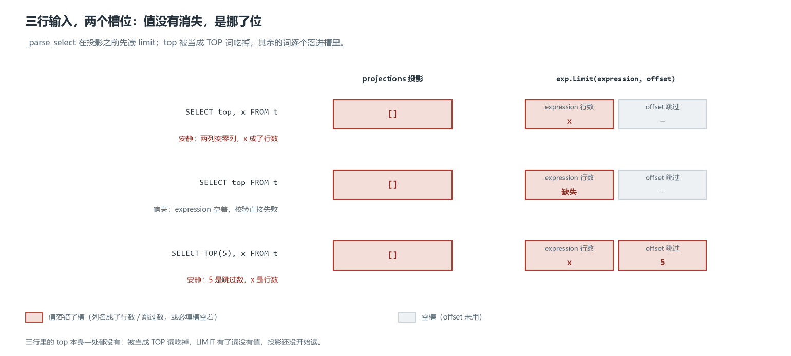

# 列名叫 top，sqlglot 把投影读成了 LIMIT

```python
import sqlglot

sqlglot.parse_one("SELECT top, x FROM t", read="snowflake").sql("snowflake")
# 'SELECT FROM t LIMIT x'
```

两列投影 `top` 和 `x`，`parse_one` 走一遍：投影列表空了，`x` 成了 LIMIT 的行数，全程没有报错。这只是它安静的样子：snowflake、oracle、tsql、teradata、redshift 五个方言里，列名叫 `top` 且紧跟在 `SELECT` 后面时，查询里的词会落到 `exp.Limit` 的两个槽位上去。

PyPI 当前最新 30.33.0（2026-11-17）问题仍在。修复 [#9295](https://github.com/tobymao/sqlglot/pull/9295) 在 2026-11-20 18:37 UTC 合进 main，截至发稿还没进任何发行版；它也没有动 base parser，tsql、teradata、redshift 的同一行为一字未变，[#9300](https://github.com/tobymao/sqlglot/issues/9300)（2026-11-21 07:01 UTC）还开着。

这是我报在 [sqlglot #9284](https://github.com/tobymao/sqlglot/issues/9284) 的问题，从 issue 到合并 5 小时 45 分。

## 两副面孔

按 `top` 后面跟的是什么，分两种。

- **跟着逗号**（`SELECT top, x FROM t`）：不报错，输出 `SELECT FROM t LIMIT x`，投影列表是空的 `[]`。AST 合法，下游按投影列名取数就拿一份空列表——不是错，是没有。
- **单独立**（`SELECT top FROM t`）：`ParseError`，报错是 `Required keyword: 'expression' missing for <class 'sqlglot.expressions.query.Limit'>`。

限定形 `top.x`、函数形 `TOP(x)` 同样被吞（都在下文的 15 形矩阵里）——`SELECT` 后面第一个 token 还是 `top`，投影还没来得及开始。最要命的是既带括号又带逗号的形状，双错：

```python
sqlglot.parse_one("SELECT TOP(5), x FROM t", read="snowflake").sql("snowflake")
# 'SELECT FROM t LIMIT 5, x'
```

`5` 成了跳过数（offset），`x` 成了行数（expression）——两个数都是原句里的，两个槽全填错，投影依旧空。

postgres、duckdb、mysql 不 tokenize `TOP`，不受影响。五个有映射的方言后果相同——投影空、词进了 `LIMIT`——只是输出写法各异：tsql 保留 `TOP` 记法，redshift 写成 `LIMIT`，oracle 写成 `FETCH FIRST`。

## 吞的地方

五个方言的 tokenizer 各挂一行 `"TOP": TokenType.TOP`（`dialects/oracle.py:116`、`dialects/redshift.py:56`、`dialects/snowflake.py:171`、`dialects/teradata.py:74`、`dialects/tsql.py:188`），词 `top` 出 tokenizer 就被钉成关键字。但 `TOP` 本身在 `Parser.ID_VAR_TOKENS`（`parser.py:851`）里——sqlglot 标这个 token 可用作标识符；Snowflake 的[保留字表](https://docs.snowflake.com/en/sql-reference/reserved-keywords)里没有 TOP，`top` 是合法列名。

真正的问题在解析顺序：`_parse_select` 读投影之前，`parser.py:4252` 先调 `limit = self._parse_limit(top=True)`；这个函数第一行判断：

```python
if skip_limit_token or self._match(TokenType.TOP if top else TokenType.LIMIT):
    if top:
        limit_paren = self._match(TokenType.L_PAREN)
        expression = (
            self._parse_term() or self._parse_select()
            if limit_paren
            else self._parse_number()
        )
```

`TOP` 词被当成 limit 的「引导词」吃掉，后面有括号读一个表达式，没有就读一个数。`top` 单独立时后面不是数，`_parse_number()` 返回 `None`，`exp.Limit(expression=None)` 过不了校验——这是响亮的样子。后面跟逗号时进另一个分支：

```python
if self._match(TokenType.COMMA):
    offset = expression
    expression = self._parse_term()
```

`TOP(5), x`：`5` 先被读成行数，逗号把它整体挪到跳过数，`x` 再读成新的行数，出 `LIMIT 5, x`。投影列表从头到尾是空的——这个顺序里，投影还没开始读：



## 5 小时 45 分：从 issue 到合并

| 时刻 (UTC) | 事件 |
| --- | --- |
| 11-20 12:52 | 我提 [#9284](https://github.com/tobymao/sqlglot/issues/9284)：五方言对照、按 Snowflake 文档论证 TOP 不是保留字；13:53 的评论补 6 行 retreat 补丁与 `TOP(5), x` 的双错 |
| 13:41 | blucca 独立实测同版本：追加 `SELECT top(5) FROM t` → `SELECT FROM t LIMIT 5`、`projections: []`，附[四案例可运行检查](https://github.com/blucca/blucca.github.io/tree/3786ad7e8d0008b8058010c2599724ff005bdee6/research/sqlglot-top-prefix) |
| 17:35 | `fix/snowflake-top-identifier` 第一笔提交，通用守卫：下一个 token 是数才消费 `TOP` |
| 17:38 | georgesittas 提 [#9295](https://github.com/tobymao/sqlglot/pull/9295)，请 treysp 评审 |
| 17:40 | Copilot 首评绿：1,764 个单元测试全过 |
| 18:17 | 第二笔提交收窄守卫：只留给 Snowflake，oracle 删掉 TOP 的 tokenize 行 |
| 18:25 | georgesittas 逐行评论「Oracle doesn't support the TOP limit syntax.」；同分钟 Copilot 黄牌：snowflake 守卫拒掉占位符计数（`SELECT TOP ? x`），要求回归用例 |
| 18:36 | geooo109 APPROVED |
| 18:37 | 合并提交 `dc4afaf5`，同分钟 georgesittas 关闭 #9284 |

两笔提交是一次思路位移：第一笔是通用守卫，五方言共用 base parser 里那一条；第二笔把范围收进方言——oracle 本来就不是 TOP limit 方言（维护者逐行评论的原话），删一行 tokenizer 即可；snowflake 有真实的 TOP 语法，得在方言内加守卫。最终 diff 是 5 个文件 +29/−6：

- `dialects/oracle.py` L116：删掉 `"TOP": TokenType.TOP,` 一行，oracle 里 `top` 从此是普通标识符；
- `parsers/snowflake.py`：新增 `_parse_limit` override（L1239），TOP 后不是数就整条让路：

```python
# Only a bare number starts a TOP limit. TOP(x) is a function call.
if (
    top
    and self._curr.token_type == TokenType.TOP
    and self._next.token_type != TokenType.NUMBER
):
    return this
```

`return this` 是把路让出来：`TOP 5` 照旧读 limit，`top, x` 与 `TOP(x)` 不被消费，落回投影路径。
- 同文件 tokenizer L379：`FUNC_TOKENS = parser.Parser.FUNC_TOKENS | {TokenType.ROLLBACK, TokenType.TOP}`，`TOP(x)` 走函数调用路径；PR 的六条 identity 断言（`top` / `top.x` / `top, x` / `TOP(x)` / `TOP(5), x` / `top:field`）全过。
- oracle 补两条形状；redshift 把裸 `SELECT TOP 1 x` 改成逐个跑完 `1`、`%s`、`%(n)s` 三个计数，把占位符计数的行为钉死。
- base parser 未动：30.33.0 的 `_parse_limit`（L5995）与 `dc4afaf5` 的（L6035）首行判断逐字相同。

我在 #9284 里附的 6 行 retreat 补丁，和 #9300 的 4 行提议是同一条路线：`TOP` 吃掉之后读不到值，就退回 `TOP` 之前的位置。合并的方言层守卫比它窄；base 层截至发稿还在等 retreat。

## 15 个形状 × 2 版

工程 `top吞投影_sqlglot/top_demo/` 把矩阵钉死：15 个 SQL 形状（含 3 个真 TOP limit 的控制形）× 2 版，A 版是 PyPI `sqlglot==30.33.0`，B 版是 `30.33.0+dc4afaf5`（main 上的合并提交）。两版源码原样 vendor 在工程里（`provenance.txt` 记来源与逐文件 SHA-256，已核对到 PyPI wheel 与 codeload tarball），不在 venv 里、不装任何依赖。`--test` 逐行断言输出与投影列表，并逐文件核对 vendor 字节：

```console
$ python top吞投影_sqlglot/top_demo/run.py --test
版本：30.33.0 / 30.33.0+dc4afaf5
provenance 372 文件 SHA-256 全对
15 形 × 2 版全部断言通过
ALL PASS
```

| 形状 | 30.33.0 | dc4afaf5 |
| --- | --- | --- |
| snowflake `SELECT top, x FROM t` | `SELECT FROM t LIMIT x` · `[]` | `SELECT top, x FROM t` · `[top, x]` |
| snowflake `SELECT top FROM t` | ParseError | `SELECT top FROM t` |
| snowflake `SELECT top.x FROM t AS top` | ParseError | `SELECT top.x FROM t AS top` |
| snowflake `SELECT TOP(x) FROM t` | `SELECT FROM t LIMIT x` · `[]` | `SELECT TOP(x) FROM t` |
| snowflake `SELECT TOP(5), x FROM t` | `SELECT FROM t LIMIT 5, x` · `[]` | `SELECT TOP(5), x FROM t` |
| snowflake `SELECT TOP 5 x FROM t`（控制） | `SELECT x FROM t LIMIT 5` | 同 |
| oracle `SELECT top, x FROM t` | `SELECT FROM t FETCH FIRST x ROWS ONLY` · `[]` | `SELECT top, x FROM t` · `[top, x]` |
| oracle `SELECT TOP 5 x FROM t`（控制） | `SELECT x FROM t FETCH FIRST 5 ROWS ONLY` | **ParseError** |
| oracle `SELECT TOP(5), x FROM t` | `SELECT FROM t FETCH FIRST x ROWS ONLY` · `[]` | `SELECT TOP(5), x FROM t` |
| tsql `SELECT top FROM t` | ParseError | 同 |
| tsql `SELECT top, x FROM t` | `SELECT TOP (x) FROM t` · `[]` | 同 |
| tsql `SELECT TOP (5) x FROM t`（控制） | `SELECT TOP 5 x FROM t` | 同 |
| teradata `SELECT top FROM t` | ParseError | 同 |
| redshift `SELECT top FROM t` | ParseError | 同 |
| redshift `SELECT TOP 1 x FROM t`（控制） | `SELECT x FROM t LIMIT 1` | 同 |

`[]` 是投影列表。B 版把 snowflake 六形、oracle 两个标识符形全救回，付出的代价是 `TOP 5` 那格断了；三个真 TOP 语法的控制形两版没动，该是 limit 的照旧是 limit。

## 代价

- **oracle 的 `TOP 5` 宽容解读没了**。修前它能解析——TOP 5 读成行数，转 `FETCH FIRST 5 ROWS ONLY`。oracle 本身不支持 TOP（逐行评论的原话），但依赖这个转换的人升级即断。用一处错得静，换一处错得响。
- **snowflake 的占位符计数是无声回归**。`SELECT TOP ? x FROM t`，修前是 `SELECT x FROM t LIMIT ?`（占位符当行数）；合并版里守卫把 `?` 拒了，TOP 留在投影一侧。这正是黄牌点名的回归，12 分钟后照合，没修。redshift 不一样：同类占位符有 PR 新增测试钉住，`TOP %s`、`TOP %(n)s` 前后都是 `LIMIT` 形，一字未动。
- **base 层的三个方言没动**。tsql / teradata / redshift 的 `top` 列行为与修前一字未变。[#9300](https://github.com/tobymao/sqlglot/issues/9300) 的提议是 base `_parse_limit` 里退四行：`TOP` 吃掉之后读不到值，就退回 `TOP` 词之前的位置——redshift 的 `TOP %s` 因此不会被误伤（issue 正文的声明）。截至发稿 0 评论，open。

## 哪些项目会撞上

两个条件：`parse_one` / `transpile`（以及一切走 SELECT 解析的入口）给的方言是 snowflake / oracle / tsql / teradata / redshift 之一；`SELECT` 后面紧跟着一个名叫 `top` 的列（含限定形 `t.top`）。sqlglot 最常见的用途是跨方言转写与 AST diff，解析完再吐输出的管线，输入里只要有 `top` 列，吐出的就是错的 SQL，而且输出本身还是合法语法。

版本口径：截至发稿，PyPI 最新 30.33.0（2026-11-17 12:19 UTC 发布）问题仍在，#9284 在 11-19 的 main 上验到同样在；修复在 11-20 18:37 UTC 合并——这三天里装最新版 sqlglot 的安装位都踩在窗口里。修复在 main 上，没 tag、没发行。下一次发行到位后，`pip install -U sqlglot` 可解 snowflake 与 oracle，其余三个等 #9300 落地。

查自己当前的安装，一行就够：

```console
$ python -c "import sqlglot; e = sqlglot.parse_one('SELECT top, x FROM t', read='snowflake'); print(sqlglot.__version__, e.sql('snowflake'), [p.sql() for p in e.expressions])"
30.33.0 SELECT FROM t LIMIT x []
```

打印出 `SELECT top, x FROM t ['top', 'x']` 的就是修好的。有真实带 `top` 列的 SQL 的，拿同一方言跑一遍：投影比写的少、多出一个不该有的 LIMIT，就是它。

下次看解析器代码，我会先看关键字消费分支：「词＋数」的形式里，词能不能不带数？能，就该有 retreat——列名一直在句子里，只是没进投影。

## 来源

- Issue：[tobymao/sqlglot#9284](https://github.com/tobymao/sqlglot/issues/9284)（2026-11-20 12:52:27Z）；剩余三方言：[#9300](https://github.com/tobymao/sqlglot/issues/9300)（2026-11-21 07:01:27Z，open）。
- PR：[tobymao/sqlglot#9295](https://github.com/tobymao/sqlglot/pull/9295)，5 文件 +29/−6。
- 平行复现：[blucca 的四案例可运行检查](https://github.com/blucca/blucca.github.io/tree/3786ad7e8d0008b8058010c2599724ff005bdee6/research/sqlglot-top-prefix) @ `3786ad7e`。
- Snowflake 文档：[保留字表](https://docs.snowflake.com/en/sql-reference/reserved-keywords)（无 TOP）、[TOP 语法](https://docs.snowflake.com/en/sql-reference/constructs/top_n)（n 必须是非负整数常量）。
- PyPI：[sqlglot 30.33.0](https://pypi.org/project/sqlglot/30.33.0/)（2026-11-17）。
- 版本固定：A = PyPI 30.33.0；B = main @ [`dc4afaf5`](https://github.com/tobymao/sqlglot/commit/dc4afaf5c9a6748a004998ed13e3b438e20e431e)（codeload tarball，SHA-256 `D99EFE9B…C09F9`），两个 venv 的构建在工程 README 内。
- 复现工程：`top吞投影_sqlglot/top_demo/`（15 形状 × 2 版矩阵，全程禁网）。

上游：`tobymao/sqlglot`，[#9295](https://github.com/tobymao/sqlglot/pull/9295)，父提交 [09a454dd](https://github.com/tobymao/sqlglot/commit/09a454dde013bfcbe372a87875e57dbaafb598ba)，合并提交 [dc4afaf5](https://github.com/tobymao/sqlglot/commit/dc4afaf5c9a6748a004998ed13e3b438e20e431e)。
