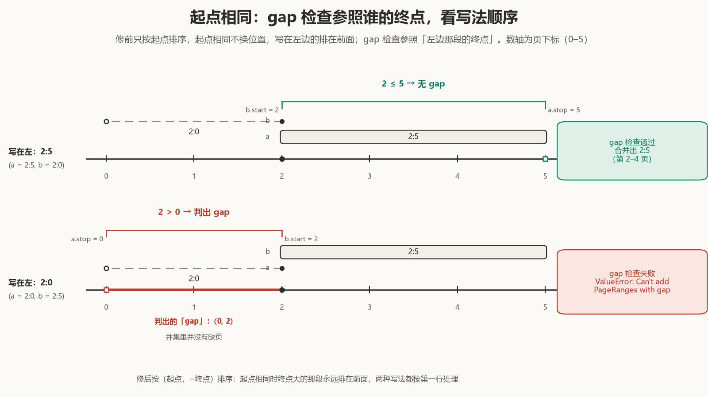

# Before pypdf 7.2.0, adding two PageRanges also depended on which came first

In pypdf 7.1.1, `PageRange("2:0") + PageRange("2:5")` raises `ValueError: Can't add PageRanges with gap`; the same pair reversed, `PageRange("2:5") + PageRange("2:0")`, returns `PageRange("2:5")`. One order raises, the other does not. Addition between these two shapes only became commutative in 7.2.0 ([pypdf #4468](https://github.com/py-pdf/pypdf/pull/4468)); the change is one comparison in `PageRange.__add__`. After `pip install -U pypdf` to 7.2.0, both orders return `PageRange("2:5")`.

## "2:0" is a legal page range

`PageRange` names a set of pages, written as a slice with 0-based indices: `2:5` is pages 2, 3, 4. `PageRange("2:0")` looks like a range that cannot exist — the constructor accepts it anyway:

```python
>>> PageRange("2:0").to_slice()
slice(2, 0, None)
>>> PageRange("2:0").indices(10)
(2, 0, 1)
```

Start 2, stop 0: it begins at page 3 and ends before page 1. Flipping forward never reaches an earlier page, so the range selects nothing. The constructor does not stop this: the regex only checks the shape, `0` is a legal index, and the constructor never compares the two numbers of `a:b`; it stores them as-is into a `slice`. The example table in the docstring reads `22` is page 23, `-2:` the last two pages, `::2` every other page; it also notes one deliberate break from `slice` — `slice(3)` is the first three pages, `PageRange("3")` is only the fourth, and only `PageRange(slice(3))` is the first three.

Strings like these often come out of external configuration or computation, and `2:0` is one of the shapes that gets produced. An empty range can exist legally like this, and `__add__` is a public entry point — merging two ranges to pass on to `writer.append` runs through it.

## The same pair, two orders

`PageRange.__add__` joins two ranges: adjacent or overlapping, they yield their union; pages in between, and it raises `ValueError` (stepped ranges are not accepted at all). The same pair, both versions:

| addition | before (7.1.1) | after (7.2.0) |
| --- | --- | --- |
| `PageRange("2:0") + PageRange("2:5")` | `ValueError: Can't add PageRanges with gap` | `PageRange("2:5")` |
| `PageRange("2:5") + PageRange("2:0")` | `PageRange("2:5")` | `PageRange("2:5")` |
| `PageRange("0:2") + PageRange("5:8")` | `ValueError` (real gap) | `ValueError` (real gap) |

Reaching this shape is not exotic: the tool's parameters or config carry page ranges, two sources select ranges that must be joined, and one of them degenerates to empty with its start exactly equal to the other's. The exception lifts out of the addition; `writer.append` never reaches the page-adding step and the pipeline stops halfway. Rearranging the parameter order fixes the same document — that is exactly what makes it hard to track down.

Feeding the same addition into `writer.append(reader, pages=…)` to add pages to a 10-page document: before the fix, the `2:0 + 2:5` order fails outright, the reverse yields 3 pages; after the fix, both orders yield 3 pages. The third row is the gap check working as designed — both versions raise, and the fix does not touch it.

## With equal starts, whoever is written first

The pre-fix `__add__` is short ([parent-commit source](https://github.com/py-pdf/pypdf/blob/8ffe8f2e3dda1fc34c312b71e1112ad9a361de6e/pypdf/pagerange.py#L157-L180)); the relevant part: sort the two ranges by start, then see whether the later start passes the earlier stop — if it does, that is a gap:

```python
if _start_key(a[0]) > _start_key(b[0]):
    a, b = b, a

# Now `a` has the smaller (or equal) start.
if _start_key(b[0]) > _stop_key(a[1]):
    # There is a gap between a and b.
    raise ValueError("Can't add PageRanges with gap")
```

The sort compares only starts; the missing ends are folded into the same comparison by two helpers: `_start_key` folds a missing start to −∞ so it always sorts first, `_stop_key` folds a missing stop to +∞, counting as reaching the far end — an open range like `:` slots into the same comparison. The problem case is the opposite: both ends are real numbers, only the start is larger than the stop, so the range degenerates to empty while its stop is still a small, real number. Two ranges with equal starts are not swapped, and "whoever comes first, whose stop the gap check uses" is decided purely by who is written on the left. Different starts are safe: the sort puts the smaller start first, and whose stop the gap check uses does not depend on the source order. Equal starts with the empty range written on the left — that is the exact shape that trips it.

The pair's common start is 2. With `2:5` on the left, its stop 5 is compared against 2: no gap, and the union is `2:5`. With `2:0` on the left, its stop 0 is compared against 2: **a gap appears** — while the actual content of the union is pages 2 through 4, not a page short.



The merged commit's comment puts it in one line: `an empty range such as 2:0 does not decide whether there is a gap` — an empty range such as `2:0` should not decide for a range that has content whether there is a gap.

## One more dimension in the comparison

The fix adds a second dimension to the sort key ([merge-commit source](https://github.com/py-pdf/pypdf/blob/d0620116c87df3dcb97365ae3d631af2f8c8dfa9/pypdf/pagerange.py#L157-L183)):

```python
# Order by start, and on equal starts put the larger stop first, so that
# an empty range such as 2:0 does not decide whether there is a gap.
if (_start_key(a[0]), -_stop_key(a[1])) > (_start_key(b[0]), -_stop_key(b[1])):
    a, b = b, a
```

With equal starts, the larger stop sorts first, and the gap check's reference pins to that larger stop: when it is at least the common start, there is no gap; when it is smaller than the common start, the other range's stop can only be smaller, so **both ranges are empty** — in that case both orders raise, before and after, with identical behaviour. What this line restores is only "the same pair, the same answer regardless of order".

You may ask why not add a second direction to the gap check, e.g. also compare `start_a > stop_b`? That way `2:0` on the left and `2:5` on the right is still 2 > 0 and still raises — the check itself is not wrong; what is wrong is which one gets placed first. The merged version leaves the check alone and changes only the comparison that decides the order.

The added test pins the missing cell in the [`test_addition` parameter table](https://github.com/py-pdf/pypdf/blob/d0620116c87df3dcb97365ae3d631af2f8c8dfa9/tests/test_pagerange.py#L202-L216):

```python
(PageRange(slice(2, 0)), PageRange(slice(2, 5)), slice(2, 5)),
```

The docstring states that adding two adjacent or overlapping ranges yields their union in both orders, "including the case where the empty range `2:0` starts exactly where the other range does". The PR also adds `test_indices`, pinning the expansion of the whole `:`, a plain `2:5`, a negative start `-2:`, a negative step `::-1` and the stepped `1:20:2` on a 10-page document, each cross-checked against the equivalent `slice`.

## The A0 height was never tested

The PR carries an independent test fix as well: in `test_papersizes` the two A0 assertions both used `width`:

```diff
- assert (dim.width - 841 * conversion_factor) < 1
- assert (dim.width - 1189 * conversion_factor) < 1
+ assert abs(dim.width - 841 * conversion_factor) < 1
+ assert abs(dim.height - 1189 * conversion_factor) < 1
```

A0 is 841 × 1189 mm. In the second assertion, `width` minus `1189 × 2.835` (72/25.4, points per millimetre) is a large negative number, so `< 1` holds anyway — **the height dimension has never actually been measured**. This changes it to `abs(dim.height − …) < 1`. The size-doubling test also gains `dimensions_a.width == dimensions_b.height`: the width of A(n) is exactly the height of A(n+1), folding the larger size in half gives the next, and that line had no assertion before; the C4 envelope test is filled in alongside.

## Shipped in 7.2.0

MartinThoma opened the PR on 2026-11-19; it was merged into main the next day and shipped in [7.2.0](https://github.com/py-pdf/pypdf/releases/tag/7.2.0) (2026-11-26). The earlier 7.1.1 (2026-11-18) does not have it. Projects still on 7.1.1, 7.1.0 or 7.0.x keep the order dependence for `+`: with equal starts and one of the two ranges empty, raising depends on which order they are written in.

The project is in `加法交换律_pypdf/pagerange_demo/`: both complete `pypdf` packages at the two fixed commits sit under `vendor/` verbatim with the upstream licence, hashes and file counts in `provenance.json`. Each package has 60 files, and the file-by-file comparison is different in exactly one: `pypdf/pagerange.py` — the whole effect of the merge commit on the package is in that one file. `python -B run.py --test` runs the two-version comparison above with per-row assertions, standard library only, no pypdf install, no network.

Upstream: `py-pdf/pypdf`, [#4468](https://github.com/py-pdf/pypdf/pull/4468), parent commit [8ffe8f2e](https://github.com/py-pdf/pypdf/commit/8ffe8f2e3dda1fc34c312b71e1112ad9a361de6e), merge commit [d0620116](https://github.com/py-pdf/pypdf/commit/d0620116c87df3dcb97365ae3d631af2f8c8dfa9).
