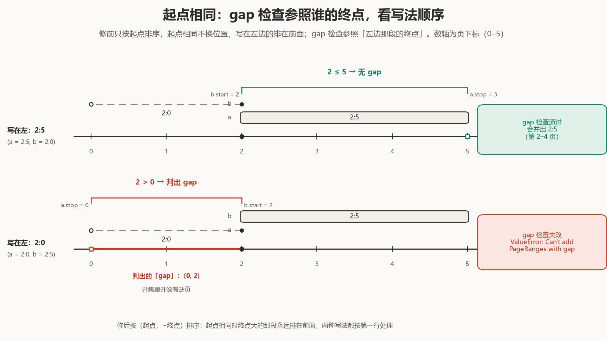

# pypdf 7.2.0 之前，两个 PageRange 相加，还要看谁写在前面

pypdf 7.1.1 里，`PageRange("2:0") + PageRange("2:5")` 抛 `ValueError: Can't add PageRanges with gap`；同一对操作数换个顺序，`PageRange("2:5") + PageRange("2:0")`，返回 `PageRange("2:5")`。这对区间两种顺序，一个抛、一个不抛——加法要到 7.2.0（[pypdf #4468](https://github.com/py-pdf/pypdf/pull/4468)）才在这个形状上恢复交换律，改动是 `PageRange.__add__` 里的一行比较。`pip install -U pypdf` 升到 7.2.0 后，两个顺序给出同一个结果 `PageRange("2:5")`。

## 一、「2:0」是一个合法的页码区间

`PageRange` 表示一组页码，就是 `[ ]` 里写的那种切片，下标从 0 起：`2:5` 是第 2、3、4 页。`PageRange("2:0")` 乍看是不存在的区间，构造函数照样接住：

```python
>>> PageRange("2:0").to_slice()
slice(2, 0, None)
>>> PageRange("2:0").indices(10)
(2, 0, 1)
```

start 是 2，stop 是 0：起点在第 3 页，终点定在第 1 页之前——从第 3 页往后翻，翻不到更前面的页，range 空手而归，一页也选不出。构造函数不拦这件事：正则只认形状，`0` 是合法的下标，`a:b` 里两个数谁大谁小它不校验，原样存进 `slice`。docstring 里的例表这么写：`22` 是第 23 页，`-2:` 是最后两页，`::2` 是每隔一页；还注了一处与 `slice` 刻意的分歧——`slice(3)` 是前三页，`PageRange("3")` 只有第四页，只有 `PageRange(slice(3))` 是前三页。

页码范围的字符串常由外部配置或计算拼出来，「2:0」就是会拼出的一种。空区间这样合法地存在，`__add__` 又是一个公开入口——把两段范围并为一段再交给 `writer.append` 这类合并操作，走的就是它。

## 二、同一对区间，两种顺序

`PageRange.__add__` 合并两段区间：相邻或重叠，给出并集；中间隔着页，抛 `ValueError`（带步长的区间直接不接）。同一对区间在两个版本上各算一遍：

| 加法 | 修前（7.1.1） | 修后（7.2.0） |
| --- | --- | --- |
| `PageRange("2:0") + PageRange("2:5")` | `ValueError: Can't add PageRanges with gap` | `PageRange("2:5")` |
| `PageRange("2:5") + PageRange("2:0")` | `PageRange("2:5")` | `PageRange("2:5")` |
| `PageRange("0:2") + PageRange("5:8")` | `ValueError`（真隔了页） | `ValueError`（真隔了页） |

落到这个形状不算少见：工具的参数或配置里写着页码范围，两处来源选出的范围要并成一段；其中一处退化成空区间，起点又正好与另一处相同。异常从加法里抛出来，`writer.append` 走不到加页那一步，管道在半路停住；把参数的顺序调一调，同一个文档又好了——难查的正是这一点。

同一个加法喂给 `writer.append(reader, pages=…)`，往 10 页的文档里加页：修前的 `2:0 + 2:5` 顺序合并直接失败，反过来的顺序拿到 3 页；修后两个顺序都拿到 3 页。表里第三行是 gap 检查的正常行为——两个版本都抛，修复没有碰它。

## 三、起点相同，谁排前面看写在左边

修前的 `__add__` 不长（[父提交源码](https://github.com/py-pdf/pypdf/blob/8ffe8f2e3dda1fc34c312b71e1112ad9a361de6e/pypdf/pagerange.py#L157-L180)），节选：先把两段区间按起点排个序，再看排在后面的起点是不是越过了排在前面的终点——越过了，就是有 gap：

```python
if _start_key(a[0]) > _start_key(b[0]):
    a, b = b, a

# Now `a` has the smaller (or equal) start.
if _start_key(b[0]) > _stop_key(a[1]):
    # There is a gap between a and b.
    raise ValueError("Can't add PageRanges with gap")
```

排序只看起点；缺省端由两个辅助函数折进同一个比较：`_start_key` 把缺的起点折成 −∞、永远排最前，`_stop_key` 把缺的终点折成 +∞、就算覆盖到最远——`:` 这种两头敞开的区间也排得进。问题的情形恰恰相反：两头都是实数，只是起点大于终点，区间退化成空，而它的终点还是个小得实在的数。起点相同的两段之间不发生交换，「谁排在前、拿谁的终点做 gap 检查」全看谁写在左边。起点不同时不会出这个麻烦：排序必然把起点小的那段摆在前，拿谁的终点做 gap 检查与写法无关。起点相同、空区间又写在左边——才正好踩中这个形状。

这对区间的公共起点是 2。`2:5` 写在左边，拿它的终点 5 去比 2，没有 gap，并集是 `2:5`。`2:0` 写在左边，拿它的终点 0 去比 2，**gap 冒出来了**——而并集真正的内容是第 2 到第 4 页，一页不缺。



合并提交的注释把这事说成一句：`an empty range such as 2:0 does not decide whether there is a gap`——`2:0` 这样的空区间，不该替有内容的区间决定有没有 gap。

## 四、比较里补一个维度

修后只给排序键加了第二个维度（[合并提交源码](https://github.com/py-pdf/pypdf/blob/d0620116c87df3dcb97365ae3d631af2f8c8dfa9/pypdf/pagerange.py#L157-L183)）：

```python
# Order by start, and on equal starts put the larger stop first, so that
# an empty range such as 2:0 does not decide whether there is a gap.
if (_start_key(a[0]), -_stop_key(a[1])) > (_start_key(b[0]), -_stop_key(b[1])):
    a, b = b, a
```

起点相同时，终点大的排在前，gap 检查的比较基准就定在这个较大的终点上：它大于等于公共起点时不构成 gap；比公共起点小时，另一段的终点只会更小，**两段都是空的**——那种情形两个顺序都抛，修前修后行为一样。这一行恢复的只是「同一对区间，答案不随顺序变」。

也可以问：为什么不在 gap 检查上补一个方向，比如再比一次 `start_a > stop_b`？那样的话 `2:0` 在左、`2:5` 在右照旧是 2 > 0，还是抛——检查本身没有错，错的是「谁被摆在了前面」。合并版于是没动检查那一行，只改决定排位的比较。

补的测试把漏掉的这一格钉在 [`test_addition` 的参数表](https://github.com/py-pdf/pypdf/blob/d0620116c87df3dcb97365ae3d631af2f8c8dfa9/tests/test_pagerange.py#L202-L216) 里：

```python
(PageRange(slice(2, 0)), PageRange(slice(2, 5)), slice(2, 5)),
```

docstring 写明：两段相邻或重叠的区间相加，两个顺序都给出并集，「包括空区间 `2:0` 的起点正好与另一段相同」这一格。PR 还新增 `test_indices`，把整段 `:`、普通 `2:5`、负起点 `-2:`、负步长 `::-1` 与带步长的 `1:20:2` 在一份 10 页的文档上的展开各钉一条，并与等价的 `slice` 互验。

## 五、A0 的高度一直没有被测过

PR 还有一处独立的测试修复：`test_papersizes` 里 A0 纸幅那两条断言，原来用的都是 `width`：

```diff
- assert (dim.width - 841 * conversion_factor) < 1
- assert (dim.width - 1189 * conversion_factor) < 1
+ assert abs(dim.width - 841 * conversion_factor) < 1
+ assert abs(dim.height - 1189 * conversion_factor) < 1
```

A0 是 841 × 1189 mm，第二条里 `width` 减去 `1189 × 2.835`（72/25.4，毫米换算成点）是个大负数，`< 1` 恒成立——**高度这一维从来没有被真正测过**。这次改成 `abs(dim.height − …) < 1`。纸幅翻倍那条测试也补了一行 `dimensions_a.width == dimensions_b.height`：A(n) 的宽正是 A(n+1) 的高，大一号对折就是小一号，这一行原来没有断言；C4 信封纸幅的测试一并补上。

## 六、落在 7.2.0 里

MartinThoma 2026-11-19 开的 PR，第二天合进 main，随 [7.2.0](https://github.com/py-pdf/pypdf/releases/tag/7.2.0)（2026-11-26）发行；此前发布的 7.1.1（2026-11-18）里没有。停在 7.1.1、7.1.0 或 7.0.x 的工程里，`+` 还是第二节的行为：起点相同、其中一段为空时，抛不抛看顺序。

工程在 `加法交换律_pypdf/pagerange_demo/`：两个固定提交的完整 `pypdf/` 包原样放在 `vendor/`，附上游许可证，哈希与文件数见 `provenance.json`。两份包各 60 个文件，逐文件比下来只有 `pypdf/pagerange.py` 不同——合并提交对 pypdf 包的影响全部在这一份文件里。`python -B run.py --test` 跑上面这份两版对照并逐条断言，只用标准库，不需要装 pypdf，也不联网。

上游：`py-pdf/pypdf`，[#4468](https://github.com/py-pdf/pypdf/pull/4468)，父提交 [8ffe8f2e](https://github.com/py-pdf/pypdf/commit/8ffe8f2e3dda1fc34c312b71e1112ad9a361de6e)，合并提交 [d0620116](https://github.com/py-pdf/pypdf/commit/d0620116c87df3dcb97365ae3d631af2f8c8dfa9)。
