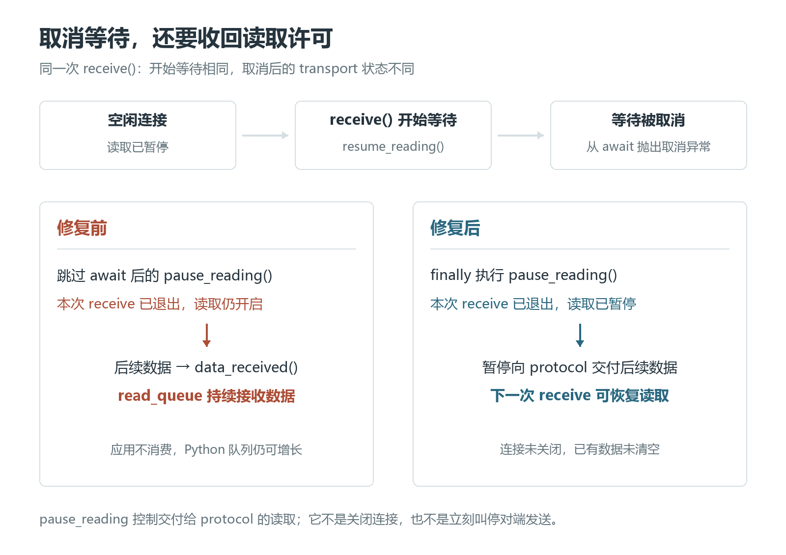

# receive 取消了，TCP 为什么还在读：AnyIO 的一次背压修复

给一次网络接收加上超时，超时之后去做别的事，连接留着下次再用。这是很平常的写法：

```python
with anyio.move_on_after(0.1):
    data = await stream.receive()

# 暂时不再接收，但保留这条连接
```

在修复前的 AnyIO asyncio 后端里，这里会留下一个不太显眼的状态：`receive()` 已经因超时退出，底层 TCP transport 却仍然在读。对端随后发来的数据，继续进入 Python 中的接收队列，哪怕应用已经没有人消费它。

**取消了等待，不等于撤销了等待前开启的读取。**

这个问题在 [AnyIO #1424](https://github.com/agronholm/anyio/pull/1424) 中修复，2026 年 10 月 18 日合并。生产代码只给一个 `await` 加上了 `try/finally`。要看清这两行为什么有用，得先把“应用在接收”和“底层在读取”分开。

## 一、应用没调用 receive，数据也可能进入 Python

一条 TCP 连接里的数据不是从网络直接跳到 `await stream.receive()` 的返回值里。AnyIO 的这条 asyncio 路径中间有几层：

- 操作系统先接收 TCP 数据，放进内核缓冲。
- asyncio 的 transport 把读到的数据交给 protocol 的 `data_received()` 回调。
- AnyIO 的 protocol 把数据放进 `read_queue`，应用的 `receive()` 再从队列中取走。

这里的 protocol 是 asyncio 的回调接口，不是又套了一层网络协议。它接收 transport 交上来的字节，源码中对应的处理很短（[StreamProtocol](https://github.com/agronholm/anyio/blob/6219807568bd7c32f2c08f923c7d93f95c836127/src/anyio/_backends/_asyncio.py#L1335-L1362)，节选）：

```python
# 建立连接时
self.read_queue = deque()

# transport 交来数据时
def data_received(self, data: bytes) -> None:
    self.read_queue.append(bytes(data))
    self.read_event.set()
```

`read_event` 用来叫醒等待中的接收者；`read_queue` 用来保存数据。这个 `deque()` 没有设置容量上限，`data_received()` 里也没有“队列超过某个大小就暂停”的判断。

那正常情况下，谁来阻止它一直增长？答案在 `receive()`。AnyIO 并不是始终开着读取、等队列满了再停，而是在需要等新数据时恢复读取，等到数据后再暂停。客户端连接刚建好时，也会先调用一次 `pause_reading()`（[connect_tcp](https://github.com/agronholm/anyio/blob/6219807568bd7c32f2c08f923c7d93f95c836127/src/anyio/_backends/_asyncio.py#L2915-L2926)）。

`pause_reading()` 暂停的是 transport 向 protocol 交付数据。这让应用暂时不消费时，数据不再源源不断地搬进这个 Python 队列；随着内核接收缓冲填满，TCP 的流量控制会逐步把压力传回发送端。这就是这里的背压：接收者处理不过来，不能靠本进程无限存着来掩盖。

暂停读取并不等于关闭连接，也不保证对端下一次 `send()` 立刻卡住。内核缓冲、对端的发送缓冲和在途数据仍然存在。它首先关掉的是“继续把数据交给这个 protocol”的入口（[asyncio ReadTransport 文档](https://docs.python.org/3.12/library/asyncio-protocol.html#asyncio.ReadTransport.pause_reading)）。

## 二、漏掉的不是取消，而是取消后的暂停

修复前，`receive()` 在需要等待新数据的分支里做这三件事（[修前源码](https://github.com/agronholm/anyio/blob/633965bad02a857574b3dbad03d1ef9f35e9caa4/src/anyio/_backends/_asyncio.py#L1417-L1457)）：

```python
self._transport.resume_reading()
await self._protocol.read_event.wait()
self._transport.pause_reading()
```

没有取消时，这段逻辑很好理解：打开读取，等数据到达，暂停读取，然后从队列取出一块数据返回。如果一块太大，就切出 `max_bytes`，把余下的部分放回队首。

问题是，中间的 `await` 不保证正常返回。

`move_on_after()` 到期会取消它包围的操作。当接收任务阻塞在 `read_event.wait()` 时，取消异常从这个等待点抛出来，控制流直接离开，下一行 `pause_reading()` 根本没有执行。`receive()` 退出了，但它之前对 transport 做的状态修改还在。

这时，对端再发来数据，会发生两件互不配合的事：

1. transport 仍在读取，`data_received()` 继续往队列追加字节。
2. 原来的接收任务已经退出，没有人从队列里取数据。

`read_event.set()` 只能通知“有数据了”，不能凭空找回一个已经取消的消费者，也不会替 transport 暂停读取。应用如果迟迟不再调用 `receive()`，队列就可以继续增长。



这也是为什么“取消成功”与“状态恢复正确”是两件事。这里的取消异常原本就能正常退出等待，真正漏掉的是等待退出时的收尾。

## 三、finally 收回的是读取许可，不是连接

[#1424 的最终改动](https://github.com/agronholm/anyio/commit/6219807568bd7c32f2c08f923c7d93f95c836127)把暂停放进了 `finally`：

```python
self._transport.resume_reading()
try:
    await self._protocol.read_event.wait()
finally:
    self._transport.pause_reading()
```

这就把“开始等待时启用读取”与“离开等待时暂停读取”配成了一对。正常收到数据要暂停；等待被取消，也要暂停。

这里没有捕获取消异常，也没有返回一个假的空字节串。`finally` 执行完后，取消仍会继续向外传播，由所属的取消作用域处理。暂停本身是同步调用，不需要再 `await` 一个清理操作。

它也没有调用 `close()` 或清空队列。取消一次接收，不代表应用放弃整条连接；下次再接收时，已有的队列数据仍然可以取走，需要新数据时也可以重新 `resume_reading()`。如果数据恰好在取消附近到达，已经入队的数据不该因为这次取消被顺手删掉。

**这次修复保留了取消、保留了连接，也保留了已经收到的数据；只是不再让退出的接收调用留下持续开启的读取。**

## 四、用真实 TCP 连接看前后差别

这篇配套的 [backpressure_demo](backpressure_demo/README.md) 直接加载两个固定提交的 AnyIO 源码，分别在独立进程中运行同一段实验：

- 修复前：[`633965b`](https://github.com/agronholm/anyio/tree/633965bad02a857574b3dbad03d1ef9f35e9caa4)，合并提交的父提交。
- 修复后：[`6219807`](https://github.com/agronholm/anyio/tree/6219807568bd7c32f2c08f923c7d93f95c836127)，最终合并提交。

实验在本机的 IPv4 回环 TCP 连接上进行。先让接收任务真正进入等待，确认 transport 已开启读取，再取消它。等接收任务退出后，对端开始发送 4 MiB 数据；接收端暂时不再调用 `receive()`，观察 0.3 秒。随后恢复接收，逐字节核对内容，并继续用同一条连接传输一段新数据。

在 Windows 11、CPython 3.12.14、默认 `ProactorEventLoop` 下，结果如下：

| 观察项 | 修复前 | 修复后 |
|---|---:|---:|
| 取消结束后的 `transport.is_reading()` | `True` | `False` |
| 0.3 秒后 `read_queue` 中的字节数 | 4,194,304（4 MiB） | 0 |
| 恢复接收后得到的数据 | 4 MiB，内容一致 | 4 MiB，内容一致 |
| 同一连接继续双向收发 | 正常 | 正常 |

旧版把全部 4 MiB 都搬进了 Python 队列。修复版没有继续向这个队列交付数据，但数据也没丢：重新接收后，4 MiB 完整到达，连接还能继续用。

两版在这个观察点上，发送任务都已经完成。这恰好能把两个概念分开：数据可以先被系统缓冲接住，并不意味着它已经进入 AnyIO 的 Python 队列；修复恢复了读取侧的背压，不是强迫对端每次发送都立即等待。

配套工程在默认循环与 Windows Selector 循环下，各对两版复跑 10 次，队列快照都是上表的 4 MiB / 0，取消传播、数据完整性和连接复用检查均通过。进入 `backpressure_demo` 目录后可以运行：

```powershell
python -m pip install -r requirements.txt
python run.py --test
```

首次运行会下载两份固定源码，以后可以加 `--offline` 使用缓存。`--test` 对两版各跑 3 项集成测试：旧版通过表示成功复现了错误状态，修复版通过才表示读取已恢复暂停。

这里检查的缓冲字节数是 `sum(len(chunk) for chunk in stream._protocol.read_queue)`，不是进程 RSS，也不包含内核缓冲或 transport 内部可能暂存的数据。私有属性只用来观察这个固定版本的实现。

4 MiB 是实验选择的发送量，不是漏洞的上限。0.3 秒也是观察窗口，不是吞吐量测试：换一个事件循环、操作系统或负载，窗口内到达的字节数可以不同。关键的状态对照是，取消结束后 transport 是否还在读，以及恢复接收后数据能否完整交付。

## 五、TLS 为什么也会经过这条路径

给连接加上 TLS，并不会让底层 TCP 的读取状态自动恢复。

AnyIO 的 [TLSStream.receive()](https://github.com/agronholm/anyio/blob/6219807568bd7c32f2c08f923c7d93f95c836127/src/anyio/streams/tls.py#L264-L272) 尝试从 SSL 对象中取出明文。SSL 对象需要更多网络数据时，`_call_sslobject_method()` 会走到这句（[源码](https://github.com/agronholm/anyio/blob/6219807568bd7c32f2c08f923c7d93f95c836127/src/anyio/streams/tls.py#L201-L217)）：

```python
data = await self.transport_stream.receive()
```

当 `transport_stream` 就是 asyncio 后端的 TCP `SocketStream`，等待便落回上面同一个 `receive()`。在这里被取消，同样可能跳过旧代码的暂停。之后继续进入底层队列的是 TLS 密文字节，不要求上层仍在解密或消费明文。

TLS 负责加密和解密，不会替底层接收队列补上遗漏的背压。这一段说明的是共享的调用路径；前面的 4 MiB 实测跑的是普通 TCP。

## 六、回归测试为什么可以不发那 4 MiB

真实连接里的队列增长能说明后果，但要防止这次错误重来，测试可以更直接。

PR 最终合并的回归测试没有靠持续灌数据、观察内存上涨来判断。它建立一条 TCP 连接，在已经取消的作用域里调用一次 `receive()`，退出后直接检查 transport 状态（[上游测试](https://github.com/agronholm/anyio/blob/6219807568bd7c32f2c08f923c7d93f95c836127/tests/test_sockets.py#L266-L276)，节选）：

```python
async with await connect_tcp(*server_addr) as stream:
    with CancelScope() as scope:
        scope.cancel()
        await stream.receive()

    assert not stream._transport.is_reading()
```

先 `scope.cancel()`，并不意味着后面的 Python 语句就不执行了。对于这条还没有数据的连接，`receive()` 仍会走到 `resume_reading()`，随后在等待点收到取消；旧代码跳过暂停，新代码进入 `finally`。这个短测试正好卡住两版分叉的位置。

这个写法来自维护者在 [review 中的建议](https://github.com/agronholm/anyio/pull/1424#discussion_r4306515133)。它不必证明整个 TCP 流量控制过程，只要钉住本次错误的直接原因：取消接收之后，读取不应该还开着。至于实际阻塞后再取消、队列增长和连接能否继续使用，则由配套复现展开观察。

## 写在最后

这次错误不在“取消有没有到达”，而在“到达以后，谁来恢复等待之前改过的状态”。

`resume_reading()` 并没有因为接收任务结束就自动失效。它改变的是另一个对象——transport——的持久状态。把 `pause_reading()` 写在 `await` 的下一行，只照顾了正常返回；放进 `finally`，才让这次接收临时开启的读取，随着这次等待一起结束。

原始问题与复现见 [#1423](https://github.com/agronholm/anyio/issues/1423)，修复与讨论见 [#1424](https://github.com/agronholm/anyio/pull/1424)。
