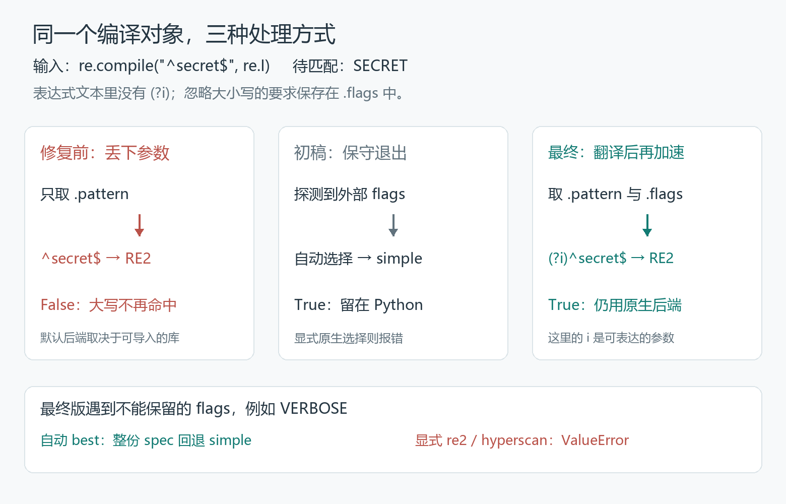

# 装了加速库，同一条规则却不认了

`SECRET` 应该匹配，结果却是 `False`。

规则没有写错。正则是 `^secret$`，编译时还明确要求忽略大小写：

```python
import re
from pathspec import PathSpec, RegexPattern

pattern = RegexPattern(re.compile('^secret$', re.I), include=True)
spec = PathSpec([pattern])
print(spec.match_file('SECRET'))
```

在 Pathspec 的修前版本里，强制使用 Python 的 `simple` 后端，答案是 `True`；机器上有能成功导入的 RE2，默认选择了它，答案就变成 `False`。显式选 Hyperscan，也会漏掉这个匹配。

本来只想多装一个可选加速库，却换了一套答案。

我在 [python-pathspec #151](https://github.com/cpburnz/python-pathspec/pull/151) 修的就是这个问题。第一版让答案恢复了，办法是遇到这类参数便退回 Python。维护者看完，却要求换个方向：能把参数带过去，为什么要直接放弃加速？

## 一、正则对象到了边界，只剩下文本

Pathspec 可以把一组规则编成匹配器，判断哪些路径命中。它不只有 Python 正则这一条执行路径，还可以使用 RE2 或 Hyperscan 原生后端。修前的[默认选择逻辑](https://github.com/cpburnz/python-pathspec/blob/88a9b711e0120a1eb16d5627fb68d15e3187c6ad/pathspec/_backends/agg.py#L39-L49)很简单：RE2 可用就选 RE2，否则尝试 Hyperscan，最后才是 simple。

这对普通规则是个便利：装好可选库，不必逐处修改调用，就能切换后端。但输入不总是一段等待编译的字符串。`RegexPattern` 也能[直接接收已经编译好的正则对象](https://github.com/cpburnz/python-pathspec/blob/88a9b711e0120a1eb16d5627fb68d15e3187c6ad/pathspec/pattern.py#L138-L142)。

拆开开头的对象，就能看到两份信息：

```python
regex = re.compile('^secret$', re.I)
regex.pattern       # '^secret$'
bool(regex.flags & re.I)  # True
```

表达式文本里没有“忽略大小写”。这个要求存在 `.flags` 中。如果只取 `.pattern` 再编译，拿到的是一条大小写敏感的新正则。

simple 会[沿着原来的对象调用 `regex.search(file)`](https://github.com/cpburnz/python-pathspec/blob/88a9b711e0120a1eb16d5627fb68d15e3187c6ad/pathspec/pattern.py#L214-L218)，参数还在。修前的 RE2 后端则[取出 `pattern.regex.pattern`](https://github.com/cpburnz/python-pathspec/blob/88a9b711e0120a1eb16d5627fb68d15e3187c6ad/pathspec/_backends/re2/pathspec.py#L134-L152)，交给另一个引擎重新编译；Hyperscan 的[对应路径](https://github.com/cpburnz/python-pathspec/blob/88a9b711e0120a1eb16d5627fb68d15e3187c6ad/pathspec/_backends/hyperscan/pathspec.py#L150-L165)也做了同样的事。

**丢掉的不是表达式，而是编译这个表达式时的要求。**

所以这也不只影响大小写。`re.M` 要求 `^`、`$` 识别多行边界，`re.S` 让点号匹配换行。它们一旦不在交接的信息里，同一段文本在新引擎中就会有另一种含义。

## 二、第一版修好了答案，却绕开了原生后端

初稿采取了一个保守策略：如果有参数没有写进表达式文本，原生后端就不要接手。

[探测函数 `has_regex_flags()`](https://github.com/cpburnz/python-pathspec/blob/21e4342c73fd02be6458b9b2353e9f63fa1824a0/pathspec/_backends/_utils.py#L22-L56)会重新用 Python 编译一次 `.pattern`，把新对象的 flags 和原对象比较。比如 `(?i)^secret$` 本身已经携带了忽略大小写，不需要仅仅因为它有 `re.I` 就退出；`re.compile('^secret$', re.I)` 的参数却在文本之外，探测便能发现差异。

之后分成两种处理：

- 自动选择 `best` 时，整份规则改用 simple；
- 用户显式指定 `re2` 或 `hyperscan` 时，抛出 `ValueError`，提示使用 simple。

这让开头的默认调用恢复了正确结果，也没有假装原生引擎能保住所有参数。但对于最普通的忽略大小写，哪怕两个原生引擎都能表达它，仍然一律退回了 Python。

维护者在[评论里](https://github.com/cpburnz/python-pathspec/pull/151#issuecomment-6098537091)指出：

> I don't think `has_regex_flags()` is the right approach.

他要求的不是把探测函数再补几个分支，而是不要重编译探测后直接退出：应该把 `.flags` 转成原生引擎能识别的全局内联标志。例如 `re.I | re.S`，就转成表达式开头的 `(?is)`。

这条意见改变了修复的方向。第一版回答的是“怎样不丢参数”，最终版还得回答“哪些参数能带着一起加速”。

## 三、不是把 Python 的字母原样贴过去

忽略大小写可以写成 `(?i)`，多行和点号跨行可以写成 `(?m)`、`(?s)`。最终补丁把这三种要求[映射为 `ims` 前缀](https://github.com/cpburnz/python-pathspec/blob/157bccfbc24777aed9330223a546487b0f3d7f1b/pathspec/_backends/_utils.py#L33-L113)，然后在原生后端重建表达式的位置使用它：

```python
regex = translate_regex_flags(
    translate_end_anchor(pattern.regex.pattern),
    get_regex_flags(pattern.regex),
)
```

这段来自[合并版的 RE2 路径](https://github.com/cpburnz/python-pathspec/blob/157bccfbc24777aed9330223a546487b0f3d7f1b/pathspec/_backends/re2/pathspec.py#L144-L149)。开头的例子送进去后，原生引擎收到的不再只是 `^secret$`，而是 `(?i)^secret$`。

但不能把 Python 的 flag 名称全部搬过去。例如 Python 的 `re.UNICODE` 不能简单翻译为 `(?U)`：[RE2 的语法表](https://github.com/google/re2/blob/927f5d53caf8111721e734cf24724686bb745f55/doc/syntax.txt#L64-L69)里，`U` 表示的是非贪婪模式，含义根本不同。Python 的 str 正则通常自带 `re.UNICODE`，最终实现不会为它添加前缀；这也没有把原生引擎原有的 Unicode 字符类、大小写折叠行为变成 Python 的行为。

`VERBOSE` 更能看出边界。Python 中这条正则会忽略表达式里的空白：

```python
re.compile('^S E C R E T$', re.X)
```

因此它应该匹配 `SECRET`。但 RE2 没有 `(?x)`；Hyperscan 虽然支持一部分相关语法，也不能照搬所有 Python VERBOSE 表达式。[改版回复](https://github.com/cpburnz/python-pathspec/pull/151#issuecomment-6103540982)记录了对两边 API 的核对，最终选择不在这个补丁中维护两套 VERBOSE 翻译，而是对两种原生后端统一回退或报错。

最终的[支持性判断](https://github.com/cpburnz/python-pathspec/blob/157bccfbc24777aed9330223a546487b0f3d7f1b/pathspec/_backends/_utils.py#L68-L86)同样拒绝 `LOCALE`、未知标志位，以及 `ASCII | IGNORECASE` 的组合。`UNICODE`、`DEBUG` 不加前缀，单独的 `ASCII` 按当前原生引擎的字符类行为处理；可转换的部分才组成 `(?ims)`。这里修的是编译参数的交接，不是实现一个把 Python 正则无损翻译到其他引擎的编译器。

**最终版不是取消回退，而是把回退留给不能保留的参数。**



## 四、PR 还开着，旁边的补丁先落地了

改版时，还有一小块代码从 diff 里消失了。

初稿除了处理 flags，也[加固了 `PathSpec.__iadd__`](https://github.com/cpburnz/python-pathspec/blob/21e4342c73fd02be6458b9b2353e9f63fa1824a0/pathspec/pathspec.py#L142-L154)：用 `+=` 合并规则时，先构建新的规则列表和后端，全部成功后再一起替换对象状态。

它与这次问题会相遇，是因为后端构造可能失败。若先把规则列表写回对象，再去构建匹配器，构造一旦抛异常，对象就会一边保存新规则，一边仍使用旧匹配器。初稿加入显式原生选择报错后，这个边界也需要留意。

不过，在 #151 尚未合并期间，另一位贡献者 Larry-Labs 的 [#159](https://github.com/cpburnz/python-pathspec/pull/159) 已经修好了这一处状态一致性问题，于 10 月 10 日先合入主线。我在改版回复里明确说明，既然 #159 已经落地，就删去重叠的 `+=` 改动。

这不是把 flags 问题另拆成一篇 PR，也不是删除整个 `+=` 功能。只是两个修复在同一个失败边界上碰到了一起：一份补丁先把对象更新的顺序理顺，另一份就不必再带着同样的加固走到合并。

最终 #151 保留下来的，是参数翻译、后端选择和相应回归测试。维护者随后[接受改版](https://github.com/cpburnz/python-pathspec/pull/151#issuecomment-6104819335)，PR 于 2026 年 10 月 11 日合并。

## 五、只看 True，还分不清两种修复

重跑这次修复，不能只问最终匹配有没有变成 `True`。

初稿的默认调用也是 `True`，但它用的是 simple。最终版则应该在可表达的参数上保留原生后端。所以本文的[离线复现工程](flags_demo/README.md)给三份固定源码各开独立进程，实际加载 RE2 和 Hyperscan，同时记录匹配结果与选中的后端。

以开头的忽略大小写为例：

| 后端请求 | 修复前 | 初稿 | 最终合并版 |
|---|---|---|---|
| simple | True，simple | True，simple | True，simple |
| 自动 best | False，RE2 | True，simple | True，RE2 |
| 显式 RE2 | False | ValueError | True |
| 显式 Hyperscan | False | ValueError | True |

这里的默认选择来自本文 Windows x64 / Python 3.12 环境，两种固定版本的原生依赖均可导入，所以 best 优先选 RE2。字符串矩阵包含 16 组场景，在两种 spec、五种后端请求与三版源码下，共完成 480 组构造与行为检查，包含预期的拒绝路径；开头的表格是其中一组。

初稿是强推前找回的真实提交，修前基线则是合并提交的第一父；它们用来比较三种策略，不是三个正式发行版。

再换成 `VERBOSE`：最终版自动选择 simple 并正确命中；显式选择任一种原生后端，均得到 `ValueError`，提示改用 simple。这个结果和忽略大小写那组不同，正是补丁要保留的分界。

[选择器](https://github.com/cpburnz/python-pathspec/blob/157bccfbc24777aed9330223a546487b0f3d7f1b/pathspec/_backends/agg.py#L87-L106)是在构建整份 spec 时决定回退的，不是把某条规则偷偷换一个引擎。显式选择时，[原生构造器](https://github.com/cpburnz/python-pathspec/blob/157bccfbc24777aed9330223a546487b0f3d7f1b/pathspec/_backends/re2/pathspec.py#L67-L71)则直接报告不能保留参数，不覆盖调用者的选择。

补丁还得顾及两条容易漏掉的交接路径：bytes 表达式的前缀也必须是 bytes；GitIgnoreSpec 的目录标记处理会拆出不同表达式，不能只替其中一个带上 flags。合并版的[回归测试](https://github.com/cpburnz/python-pathspec/blob/157bccfbc24777aed9330223a546487b0f3d7f1b/tests/test_08_regex_flags.py#L167-L259)检查了 bytes 前缀、目录优先级，以及普通规则仍使用原生后端；拆分后的各个表达式，则在[循环中逐一补上 flags](https://github.com/cpburnz/python-pathspec/blob/157bccfbc24777aed9330223a546487b0f3d7f1b/pathspec/_backends/re2/gitignore.py#L90-L127)。

## 六、best 不能只问机器上装了什么

只看开头的反例，这像是一次漏传参数的小修：原来的表达式旁边，再带上一份 flags。

沿着 PR 读下去，修复却经历了两次取舍。第一次，维护者把“发现文本外的参数就退出”改成“能表达的参数继续加速”；第二次，别的补丁已经处理了重叠的状态更新，当前 PR 就把那部分删掉。最终方案既没有停在最保守的答案，也没有为了支持所有模式而无限扩张。

**自动选择后端，不能只看哪个引擎可用，还要看它能否保住这份输入携带的参数。**

否则，同一条规则、同一段调用代码，只因环境中多了一个库，就可能从命中变成不命中。加速库本应改变执行方式，不该悄悄删掉调用者已经说清楚的要求。

---

### 源码与复现

- 主修复：[python-pathspec #151](https://github.com/cpburnz/python-pathspec/pull/151)；与 `+=` 加固重叠的 [#159](https://github.com/cpburnz/python-pathspec/pull/159)。
- 修前：[`88a9b71`](https://github.com/cpburnz/python-pathspec/tree/88a9b711e0120a1eb16d5627fb68d15e3187c6ad)；初稿：[`21e4342`](https://github.com/cpburnz/python-pathspec/tree/21e4342c73fd02be6458b9b2353e9f63fa1824a0)；合并：[`157bccf`](https://github.com/cpburnz/python-pathspec/tree/157bccfbc24777aed9330223a546487b0f3d7f1b)。
- [flags_demo：真实三版对照、一次准备与离线运行](flags_demo/README.md)。原生依赖固定为 `google-re2==1.1.20251105`、`hyperscan==0.9.1`。本文不做性能比较。
