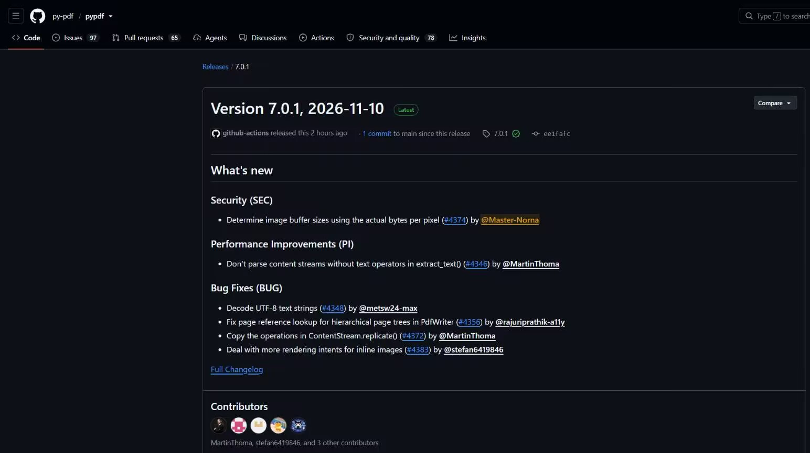

# A 4 MB TIFF, and pypdf counts it as 1 MB

A 1000×1000 32-bit TIFF is 4,000,134 bytes on disk. pypdf 7.0.0 opens it, records the footprint as 1,000,000 and lets it through — Pillow then allocates 4,000,000.

Same tree, a 1000×1000 16-bit grayscale PNG. It is 2,019 bytes on disk and gets recorded as 4,000,000. Lower the limit to 3,000,000 and the two results swap places: the 4 MB file goes through, the 2 KB file is turned away.

The small one rejected, the large one admitted. Both ends are the same multiplication, done wrong.

The fix is [GHSA-fhff-j4m8-439h](https://github.com/py-pdf/pypdf/security/advisories/GHSA-fhff-j4m8-439h), affecting `< 7.0.1`, fixed in `>= 7.0.1`. The [7.0.1 release](https://github.com/py-pdf/pypdf/releases/tag/7.0.1) of 2026-11-10 lists exactly one item under Security, and this is it. The title ends with `(Follow-up)` — it follows up the [advisory from four days earlier](https://github.com/py-pdf/pypdf/security/advisories/GHSA-rfv5-695j-j993). The same release's What's new also carries one performance improvement and four bug fixes, none of which touch the image buffer size check.



## The earlier fix pushed the old defect onto a new entry point

The 7.0.0 advisory is GHSA-rfv5-695j-j993, affecting `< 7.0.0`, fixed by [#4361](https://github.com/py-pdf/pypdf/pull/4361) "SEC: Apply image size limits more strictly". Before that, `_validate_image_size()` had exactly one caller, `_create_image_from_bytes()`. On that path pypdf assembles the image itself from the samples in the PDF stream, and the modes it can reach are `1`, `L`, `P`, `RGB`, `RGBA`, `CMYK`. For the first three and the last two the name happens to be as long as the pixel is wide; `RGB` is 3 against 4, 25% short.

#4361 pushed the check out to three more entry points: `_create_image_from_buffer()`, `_convert_image()`, `_merge_image()`. An image opened from a container takes whatever mode Pillow's decoder hands it, and that can be `I`, `F`, `I;16`. With the check standing there, errors that used to be out of reach came into reach.

- `I` and `F`: name 1, actual 4 — the limit is multiplied by four;
- the `I;16` family: name 4 or 5, actual 2 — the limit is cut by more than half.

#4361 merged at 10:30 on 6 November, 7.0.0 shipped at 12:09, that advisory went up at 12:13. #4374 merged at 11:15 on 10 November, 7.0.1 shipped at 11:47, the follow-up at 11:48. In between: 3 days, 23 hours, 37 minutes.

The Impact section is short:

> An attacker who uses this vulnerability can craft a PDF which leads to large memory usage. This requires loading images with filters not already employing a data size limit.

The advisory files it under [CWE-400](https://cwe.mitre.org/data/definitions/400.html) (uncontrolled resource consumption) and [CWE-770](https://cwe.mitre.org/data/definitions/770.html) (allocation without throttling).

## One line of multiplication

The test reads the same in both versions, at [`pypdf/generic/_image_xobject.py`](https://github.com/py-pdf/pypdf/blob/5a936f961c64c791682f997fec83221fa85b51b0/pypdf/generic/_image_xobject.py#L196-L208):

```python
pixel_count = size[0] * size[1]
bytes_per_pixel = len(mode)
required_byte_count = pixel_count * bytes_per_pixel
```

`len("I;16")` is 4. `len("I")` is 1. Pillow gives the first two bytes per pixel and the second four. **The length of a mode's name has nothing to do with its width in memory**, and this line treats the two as the same quantity.

## 20 modes, 13 of them disagree

`Image.MODES` reports 20 modes. Compare `len(mode)` against `pixelsize` for each mode in Pillow's source and 13 disagree: eight low, five high.

| Mode | `len(mode)` | Pillow allocates | Direction |
| --- | --- | --- | --- |
| `LA`, `La`, `PA` | 2 | 4 | 50% low |
| `RGB`, `LAB`, `HSV` | 3 | 4 | 25% low |
| `I`, `F` | 1 | 4 | 75% low |
| `YCbCr` | 5 | 4 | 25% high |
| `I;16`, `I;16B`, `I;16L`, `I;16N` | 4 or 5 | 2 | 2–2.5× high |

The remaining seven (`1`, `L`, `P`, `RGBA`, `RGBa`, `RGBX`, `CMYK`) were right all along, purely because their names happen to be as long as their pixels are wide.

## A 75 MB limit, 64 MB recorded, 256 MB allocated

The default is `Configuration.image_maximum_buffer_size = 75_000_000`. Draw the limit as a line and six images fall on either side of it:


| Mode | Pixels | Old code records | Old verdict | Pillow allocates | Fixed verdict |
| --- | --- | --- | --- | --- | --- |
| `I`, `F` | 25,000,000 | 25,000,000 | pass | 100,000,000 | reject |
| `RGB` | 25,000,000 | 75,000,000 | pass | 100,000,000 | reject |
| `LA` | 30,000,000 | 60,000,000 | pass | 120,000,000 | reject |
| `YCbCr` | 16,000,000 | 80,000,000 | reject | 64,000,000 | pass |
| `I;16` | 20,000,000 | 80,000,000 | reject | 40,000,000 | pass |

The `RGB` row deserves a pause: 25,000,000 × 3 is exactly 75,000,000, the check is a strict greater-than, so it balances on the line and is admitted, with 100,000,000 actually allocated. **A 25% underestimate is enough to turn a rejection into an admission.**

Step up one size: an 8000×8000 `I` image, 64,000,000 pixels. The parent records 64,000,000 — under 75,000,000, admitted. Pillow allocates 256,589,824, which is 3.4× the limit.

How many bytes Pillow gives a pixel is not only a question of reading source. Start one process per mode and read private memory before and after `Image.new(mode, (8000, 8000))`:

| Mode | Delta | Bytes per pixel |
| --- | --- | --- |
| `1`, `L`, `P` | 64,196,608 | 1.003 |
| `I;16` | 128,327,680 | 2.005 |
| `I`, `F`, `LA`, `PA`, `RGB`, `YCbCr`, `LAB`, `HSV` | around 256,585,728 | 4.009–4.010 |

Those extra hundredths of a byte are Pillow's image descriptor structures; at 64 Mpx they cost under 0.01 byte per pixel. The integer part matches `pixelsize` in `Storage.c`.

Three real files, end to end, with the limit lowered to 3,000,000 so that small images trip it:

| File | Bytes on disk | Old code records | Old verdict | Fixed records | Fixed verdict |
| --- | --- | --- | --- | --- | --- |
| 16-bit PNG (`I;16`) | 2,019 | 4,000,000 | reject | 2,000,000 | pass |
| 32-bit TIFF (`I`) | 4,000,134 | 1,000,000 | pass | 4,000,000 | reject |
| 32-bit TIFF (`F`) | 4,000,134 | 1,000,000 | pass | 4,000,000 | reject |

`_create_image_from_buffer()` has six call sites, all of them in `_xobj_to_image()` and `_handle_jpx()`: JPEG2000 under `/JPXDecode`, TIFF/PNG probing under `/LZWDecode` and `/ASCII85Decode`, JPEG under `/DCTDecode`, TIFF under `/CCITTFaxDecode`, PNG/PPM under `/JBIG2Decode`, and one generic branch with `formats=None`. 16-bit grayscale TIFF/PNG and 32-bit TIFF sit on several of those branches; `I` and `F` can arrive in a 32-bit TIFF inside an ASCII85 or LZW stream, and `RGB` needs no special container at all.

The overestimate half is not just "one more image rejected". 16-bit grayscale TIFF/PNG is how scans and medical images are usually stored. A 20 Mpx image takes 40 MB, gets counted as 80 MB at four bytes a pixel, and stays outside a 75 MB limit. After the fix that size opens normally, and a 16 Mpx `YCbCr` comes back from false rejection to admission — its name is five characters long and it only takes four bytes.

## The first patch copied name lengths into a table

The first version of the patch (`bf52204`) added a 20-key `_IMAGE_MODE_BYTES_PER_PIXEL`, moving `I`/`F` to 4 and `I;16` to 2, leaving `LA` at 2, `RGB` at 3, `YCbCr` at 3. **It copied `len(mode)` into a table; the table still held name lengths.**

Maintainer stefan6419846's first review asked:

> Please indicate why the previous solution would be wrong for our use case. In the worst case, we would have rejected `I;` and `YCbCr` too early, although we do not use these modes in our code as far as I am aware - similar to the underestimated `I` and `F` modes which would be the only gap. (If these can really be exploited in the default setup, this should not have been a public bug report anyway.)

That is a request to keep two things apart: 16-bit images being falsely rejected is a regression on a normal path; `I`/`F` being underestimated is the security half. The reply was blunt:

> 16-bit regression is a false rejection on the normal path, which is an issue at the "usage scenario" level; I/F underestimation is the real security problem.

Two suggestions followed: rename `_allocated_bytes_per_pixel` to `_get_allocated_bytes_per_pixel`, and fold the intermediate variable into `required_byte_count = pixel_count * _get_allocated_bytes_per_pixel(mode)`. Both were applied as a batch in `669a2c3`.

## Don't consult a table, ask Pillow

The reworked [`_get_allocated_bytes_per_pixel()`](https://github.com/py-pdf/pypdf/blob/1cd993b984e7cbbb0cd5f9b23800b7d06b7ec6ee/pypdf/generic/_image_xobject.py#L213-L241) takes its answer from a different place:

```python
try:
    bands = Image.getmodebands(mode)
except KeyError:
    return len(mode)
if bands > 1:
    return 4
return _SINGLE_BAND_BYTES_PER_PIXEL.get(mode, 4)
```

Pillow's `ImagingNewPrologueSubtype()` ([`src/libImaging/Storage.c`](https://github.com/python-pillow/Pillow/blob/8.0.0/src/libImaging/Storage.c#L127-L131)) sets `pixelsize = 4` for every mode with two or more bands — `RGB`, `YCbCr`, `LAB`, `HSV`, `LA`, `La`, `PA` alike. That line has not changed between Pillow 8.0.0 and 12.3.0, and `getmodebands()` has been there since 8.0.0. **For multiple bands, ask Pillow how many bands there are; only single bands need a table** — `1`/`L`/`P` are 1, the `I;16` family 2, `I`/`F` 4. Nine rows.

Single bands cannot be handed to Pillow either: `Image.getmodetype()` answers `L` for `1`, `L`, `P` and the entire 16-bit family, so it cannot tell the one byte of `1`/`L`/`P` from the two bytes of `I;16`. The nine-key table is the only stable way on this path.

Unknown modes keep the `len(mode)` fallback because the empty mode still lands here: `_get_mode_and_invert_color()` returns an empty string when the colour space is missing, `_handle_flate()` builds an image with it, and Pillow needs to be the one that reports corrupt data.

That fallback is pinned by a test: `test_validate_image_size__unknown_mode_is_not_rejected` asserts that an empty mode returns `(100, 0)`, that required is 0, that the limit is never reached, and that the data goes on to raise Pillow's own `ValueError`.

The new `test_get_allocated_bytes_per_pixel__matches_pillow` hard-codes the expected value for all 20 modes and asserts `set(expected) == set(Image.MODES)`. If Pillow adds a mode, that line goes red instead of the mode quietly falling into "unknown, four bytes". Three further groups — `test_validate_image_size__four_byte_modes`, `__16_bit_modes`, `__padded_modes` — cover the three kinds of error, plus end-to-end cases that push two real files through `_create_image_from_buffer()`.

Three older tests had the underestimate baked into their expectations and moved with it: `test_create_image_from_bytes__limit[RGB]` goes from 24,000,000,000 to 32,000,000,000 bytes, alongside `test_xobj_to_image__jpx_size_limit` and `test_merge_image`.

## The expansion factor cannot follow along

`_create_image_from_bytes()` used to hold `k = required_byte_count / data_length`, scaling up raw data that came up short. `required_byte_count` now means "bytes Pillow will allocate" rather than "raw sample count", so dividing by it is wrong. The final version writes back an explicit [`raw_byte_count = pixel_count * len(mode)`](https://github.com/py-pdf/pypdf/blob/1cd993b984e7cbbb0cd5f9b23800b7d06b7ec6ee/pypdf/generic/_image_xobject.py#L273-L279) — here `len(mode)` is right, because the only modes that reach this function are `1`, `L`, `P`, `RGB`, `RGBA`, `CMYK`, and for those the name length is the sample count.

`test_create_image_from_bytes__samples_are_expanded_per_band` pins that `k` did not move: a 2×2 `RGB` image given 4 bytes expands to 12, first pixel `(1, 1, 1)`.

## Which versions have to move

The advisory covers `< 7.0.1`, fixed in `>= 7.0.1`:

```text
pip install -U "pypdf>=7.0.1"
```

The workaround it gives is to apply #4374's change directly.

Before #4361, `_validate_image_size()` was called only from `_create_image_from_bytes()`, and of the five modes that path can reach, four have a name as long as their pixel is wide; only `RGB` is 25% short. The 4× on `I`/`F` only became reachable once the check spread to the buffer entry points — which is why it holds for exactly these 3 days and 23 hours.

## Reproducing

`image_buffer_demo/` holds two complete `pypdf` packages at fixed commits, 60 files each, and `sys.path` decides which one is imported. Both report `pypdf.__version__` as `7.0.0`; the merge commit did not bump it.

```text
python -B image_buffer_demo/run.py --test
```

It prints the tables above and ends with `ALL PASS`. `--mem` runs the memory measurement again (needs psutil), and `--emit DIR` writes both versions' probe payloads to disk. The probe imports only the vendored package and never touches the network.

Upstream: `py-pdf/pypdf`, [#4374](https://github.com/py-pdf/pypdf/pull/4374), parent commit [`5a936f96`](https://github.com/py-pdf/pypdf/commit/5a936f961c64c791682f997fec83221fa85b51b0), merge commit [`1cd993b9`](https://github.com/py-pdf/pypdf/commit/1cd993b984e7cbbb0cd5f9b23800b7d06b7ec6ee).
