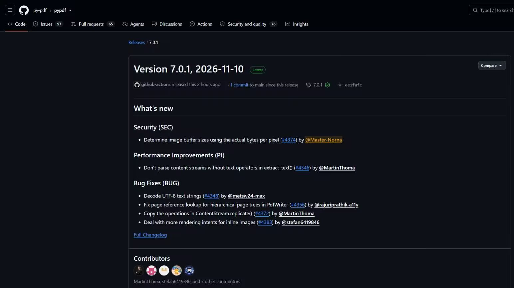
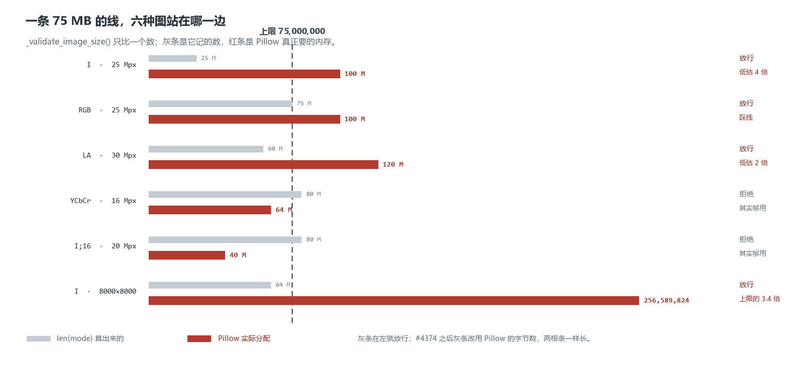

# 一张 4 MB 的 TIFF，pypdf 只当它占了 1 MB

一张 1000×1000 的 32 位 TIFF，文件 4,000,134 字节。pypdf 7.0.0 打开它，把占用量记成 1,000,000，放行——Pillow 随后分配了 4,000,000。

同一棵树，换一张 16 位灰度 PNG，也是 1000×1000，文件只有 2,019 字节，被记成 4,000,000。把这道检查的上限压到 3,000,000，两张图的结果反过来了：4 MB 的那张过去，2 KB 的那张留下。

小的被拒，大的被放。两头是同一个乘法算错的。

这次修复是 [GHSA-fhff-j4m8-439h](https://github.com/py-pdf/pypdf/security/advisories/GHSA-fhff-j4m8-439h)，影响 `< 7.0.1`，`>= 7.0.1` 已修。2026-11-10 的 [7.0.1](https://github.com/py-pdf/pypdf/releases/tag/7.0.1) 发行说明里，Security 段只有它一条。标题末尾挂着 `(Follow-up)`——它补的是四天前 [7.0.0 那份公告](https://github.com/py-pdf/pypdf/security/advisories/GHSA-rfv5-695j-j993)。同一版的 What's new 里另有性能改进一条、Bug Fixes 四条，都与图像缓冲的尺寸判断无关。



## 上一次修复，把旧缺陷推到了新入口

7.0.0 的公告是 GHSA-rfv5-695j-j993，影响 `< 7.0.0`，修法是 [#4361](https://github.com/py-pdf/pypdf/pull/4361)「SEC: Apply image size limits more strictly」。改之前，`_validate_image_size()` 只被 `_create_image_from_bytes()` 调用。那一条路径上，pypdf 自己把 PDF 流里的采样拼成图像，能走到的模式只有 `1`、`L`、`P`、`RGB`、`RGBA`、`CMYK`——前三个和最后两个的名字长度恰好等于字节数，`RGB` 是 3 对 4，差 25%。

#4361 把检查推到另外三个入口：`_create_image_from_buffer()`、`_convert_image()`、`_merge_image()`。从容器里打开的图像，模式由 Pillow 解码决定，可能是 `I`、`F`、`I;16`。这一推，原来够不着的错法就够得着了。

- `I` 和 `F`：名字 1，实际 4，上限被放大到 4 倍；
- `I;16` 一族：名字 4 或 5，实际 2，上限被砍掉一半以上。

11 月 6 日 10:30 合并 #4361，12:09 发 7.0.0，12:13 公布那份公告。11 月 10 日 11:15 合并 #4374，11:47 发 7.0.1，11:48 补上 Follow-up。中间隔了 3 天 23 小时 37 分。

公告的 Impact 一节写得很短：

> An attacker who uses this vulnerability can craft a PDF which leads to large memory usage. This requires loading images with filters not already employing a data size limit.

公告把它归在 [CWE-400](https://cwe.mitre.org/data/definitions/400.html)（资源消耗失控）与 [CWE-770](https://cwe.mitre.org/data/definitions/770.html)（无节流地分配资源）下。

## 一行乘法

判据在两个版本里都长这样，位置是 [`pypdf/generic/_image_xobject.py`](https://github.com/py-pdf/pypdf/blob/5a936f961c64c791682f997fec83221fa85b51b0/pypdf/generic/_image_xobject.py#L196-L208)：

```python
pixel_count = size[0] * size[1]
bytes_per_pixel = len(mode)
required_byte_count = pixel_count * bytes_per_pixel
```

`len("I;16")` 是 4，`len("I")` 是 1。Pillow 给前者每个像素 2 字节，给后者 4 字节。**模式名的长度和它在内存里的宽度没有关系**，这一行把两者当成了同一件事。

## 20 个模式，13 个对不上

`Image.MODES` 报 20 个模式。把 `len(mode)` 与 Pillow 源码里每个模式的 `pixelsize` 逐个对照，13 个不符：8 个低、5 个高。

| 模式 | `len(mode)` | Pillow 分配 | 方向 |
| --- | --- | --- | --- |
| `LA`、`La`、`PA` | 2 | 4 | 低 50% |
| `RGB`、`LAB`、`HSV` | 3 | 4 | 低 25% |
| `I`、`F` | 1 | 4 | 低 75% |
| `YCbCr` | 5 | 4 | 高 25% |
| `I;16`、`I;16B`、`I;16L`、`I;16N` | 4 或 5 | 2 | 高 2–2.5 倍 |

剩下 7 个（`1`、`L`、`P`、`RGBA`、`RGBa`、`RGBX`、`CMYK`）本来就对，纯属名字长度碰巧等于字节数。

## 上限 75 MB，记 64 MB，实分 256 MB

默认上限是 `Configuration.image_maximum_buffer_size = 75_000_000`。把上限画成一条线，六种图分别站在线的两侧：



| 模式 | 像素数 | 旧代码记的字节 | 旧代码判定 | Pillow 实际分配 | 修后判定 |
| --- | --- | --- | --- | --- | --- |
| `I`、`F` | 25,000,000 | 25,000,000 | 放行 | 100,000,000 | 拒绝 |
| `RGB` | 25,000,000 | 75,000,000 | 放行 | 100,000,000 | 拒绝 |
| `LA` | 30,000,000 | 60,000,000 | 放行 | 120,000,000 | 拒绝 |
| `YCbCr` | 16,000,000 | 80,000,000 | 拒绝 | 64,000,000 | 放行 |
| `I;16` | 20,000,000 | 80,000,000 | 拒绝 | 40,000,000 | 放行 |

`RGB` 那行值得停一下：25,000,000 × 3 正好 75,000,000，检查用的是严格大于，所以它踩在线上被放行，实际分配 100,000,000。**低估 25%，就够让一次本该拒绝变成放行**。

再放大一档：8000×8000 的 `I` 图，64,000,000 像素。父版记 64,000,000，在 75,000,000 之下，放行。Pillow 实际分配 256,589,824——上限的 3.4 倍。

Pillow 到底给一个像素分多少字节，不只看源码。每个模式单独起一个进程，`Image.new(mode, (8000, 8000))` 前后读一次进程私有内存：

| 模式 | 增量 | 字节/像素 |
| --- | --- | --- |
| `1`、`L`、`P` | 64,196,608 | 1.003 |
| `I;16` | 128,327,680 | 2.005 |
| `I`、`F`、`LA`、`PA`、`RGB`、`YCbCr`、`LAB`、`HSV` | 256,585,728 左右 | 4.009–4.010 |

多出来的零点零零几字节，是 Pillow 的图像描述结构，64 Mpx 下摊到每个像素不足 0.01 字节。整数位与 `Storage.c` 里的 `pixelsize` 对得上。

端到端的三张真实文件，上限压到 3,000,000，好让小图触发：

| 文件 | 文件字节 | 旧代码记的 | 旧代码 | 修后记的 | 修后 |
| --- | --- | --- | --- | --- | --- |
| 16 位 PNG（`I;16`） | 2,019 | 4,000,000 | 拒绝 | 2,000,000 | 放行 |
| 32 位 TIFF（`I`） | 4,000,134 | 1,000,000 | 放行 | 4,000,000 | 拒绝 |
| 32 位 TIFF（`F`） | 4,000,134 | 1,000,000 | 放行 | 4,000,000 | 拒绝 |

`_create_image_from_buffer()` 有六个调用点，都在 `_xobj_to_image()` 与 `_handle_jpx()` 里：`/JPXDecode` 的 JPEG2000、`/LZWDecode` 与 `/ASCII85Decode` 的 TIFF/PNG 探测、`/DCTDecode` 的 JPEG、`/CCITTFaxDecode` 的 TIFF、`/JBIG2Decode` 的 PNG/PPM，以及一条 `formats=None` 的通用分支。16 位灰度 TIFF/PNG 与 32 位 TIFF 就在这几条分支上；`I` 和 `F` 可以从 ASCII85 或 LZW 流里的 32 位 TIFF 来，`RGB` 连特殊容器都不需要。

高估那一半不只是「多拒了一张图」。16 位灰度 TIFF/PNG 是扫描件与医学影像常用的存法，一张 20 Mpx 的图实际占 40 MB，却被按 4 字节算成 80 MB，挡在 75 MB 外面。修完之后，这个尺寸能正常打开，16 Mpx 的 `YCbCr` 也从误拒变回放行——后者按名字长度是 5 字节，实际也只占 4。

## 初版把名字长度抄成了一张表

第一版补丁（`bf52204`）新增了一张 20 键的 `_IMAGE_MODE_BYTES_PER_PIXEL`，把 `I`/`F` 改成 4、`I;16` 改成 2，`LA` 还是 2、`RGB` 还是 3、`YCbCr` 还是 3。**它把 `len(mode)` 抄进了一张表，表里装的仍然是名字长度。**

维护者 stefan6419846 的第一次 review 是这么问的：

> Please indicate why the previous solution would be wrong for our use case. In the worst case, we would have rejected `I;` and `YCbCr` too early, although we do not use these modes in our code as far as I am aware - similar to the underestimated `I` and `F` modes which would be the only gap. (If these can really be exploited in the default setup, this should not have been a public bug report anyway.)

这句话要求作者把两件事分开讲：16 位图被误拒，是正常使用路径上的回归；`I`/`F` 被低估，才是安全的那一半。作者的回复很干脆：

> 16-bit regression is a false rejection on the normal path, which is an issue at the "usage scenario" level; I/F underestimation is the real security problem.

初版之后还有两次 suggestion：把 `_allocated_bytes_per_pixel` 改成 `_get_allocated_bytes_per_pixel`，以及把中间变量折进 `required_byte_count = pixel_count * _get_allocated_bytes_per_pixel(mode)`。批量应用在 `669a2c3`。

## 不去列表，去问 Pillow

重做后的 [`_get_allocated_bytes_per_pixel()`](https://github.com/py-pdf/pypdf/blob/1cd993b984e7cbbb0cd5f9b23800b7d06b7ec6ee/pypdf/generic/_image_xobject.py#L213-L241) 换了个来源：

```python
try:
    bands = Image.getmodebands(mode)
except KeyError:
    return len(mode)
if bands > 1:
    return 4
return _SINGLE_BAND_BYTES_PER_PIXEL.get(mode, 4)
```

Pillow 的 `ImagingNewPrologueSubtype()`（[`src/libImaging/Storage.c`](https://github.com/python-pillow/Pillow/blob/8.0.0/src/libImaging/Storage.c#L127-L131)）对每个两带及以上的模式都设 `pixelsize = 4`，`RGB`、`YCbCr`、`LAB`、`HSV`、`LA`、`La`、`PA` 都一样。这一行从 Pillow 8.0.0 到 12.3.0 没有变过，`getmodebands()` 从 8.0.0 就有。**多带只看 Pillow 的带数，单带才需要表**——`1`/`L`/`P` 是 1，`I;16` 一族是 2，`I`/`F` 是 4，九行。

单带不能也交给 Pillow：`Image.getmodetype()` 对 `1`、`L`、`P` 和整个 16 位家族一律答 `L`，分不出 `1`/`L`/`P` 的 1 字节与 `I;16` 的 2 字节。九键表是这条路上唯一稳定的写法。

未知模式保留 `len(mode)` 的回退，因为空模式还会走到这里：`_get_mode_and_invert_color()` 在缺色彩空间时返回空串，`_handle_flate()` 会拿它建图，得让 Pillow 自己去报数据损坏。

这条回退有测试钉着：`test_validate_image_size__unknown_mode_is_not_rejected` 断言空模式返回 `(100, 0)`，required 是 0，碰不到上限，数据继续往下走，由 Pillow 抛自己的 `ValueError`。

新测试 `test_get_allocated_bytes_per_pixel__matches_pillow` 把 20 个模式的期望值写死，同时断言 `set(expected) == set(Image.MODES)`。Pillow 将来加一个模式，这行会红，而不是悄悄落进「未知回退 4 字节」。另有 `test_validate_image_size__four_byte_modes`、`__16_bit_modes`、`__padded_modes` 三组分别管三类错法，以及两张真实文件走 `_create_image_from_buffer()` 的端到端用例。

三个旧测试把低估值写进了期望，跟着改：`test_create_image_from_bytes__limit[RGB]` 的字节数从 24,000,000,000 变成 32,000,000,000，`test_xobj_to_image__jpx_size_limit` 与 `test_merge_image` 也在其中。

## 扩展因子不能跟着换

`_create_image_from_bytes()` 里原来有个 `k = required_byte_count / data_length`，把长度不够的原始数据按比例扩开。`required_byte_count` 现在表示「Pillow 会分配的字节」，不再是「原始采样数」，接着拿它除会错。终版写回显式的 [`raw_byte_count = pixel_count * len(mode)`](https://github.com/py-pdf/pypdf/blob/1cd993b984e7cbbb0cd5f9b23800b7d06b7ec6ee/pypdf/generic/_image_xobject.py#L273-L279)——这里 `len(mode)` 反而对，因为能走到这个函数的只有 `1`、`L`、`P`、`RGB`、`RGBA`、`CMYK`，名字长度就是采样数。

`test_create_image_from_bytes__samples_are_expanded_per_band` 钉着 `k` 没变：`RGB` 的 2×2 图给 4 字节数据，扩成 12 字节，第一个像素是 `(1, 1, 1)`。

## 哪些版本要动

这条公告的范围是 `< 7.0.1`，修在 `>= 7.0.1`：

```text
pip install -U "pypdf>=7.0.1"
```

公告给的临时办法是直接应用 #4374 的改动。

`_validate_image_size()` 在 #4361 之前只被 `_create_image_from_bytes()` 调用，能走到的五个模式里，四个的名字长度就是字节数，只有 `RGB` 少算 25%。`I`/`F` 那 4 倍，是检查铺到 buffer 入口之后才够得着的——所以它只在这 3 天 23 小时里成立。

## 复现

`image_buffer_demo/` 里放了两份固定提交的完整 `pypdf` 包，各 60 个文件，靠 `sys.path` 决定导入哪一版；两边的 `pypdf.__version__` 都是 `7.0.0`，合并提交没有改版本号。

```text
python -B image_buffer_demo/run.py --test
```

输出上面几张表，末尾 `ALL PASS`。`--mem` 再跑一遍内存实测（需要 psutil），`--emit DIR` 把两版探针的 JSON 落盘。探针只导入 vendor 里的包，不联网。

上游：`py-pdf/pypdf`，[#4374](https://github.com/py-pdf/pypdf/pull/4374)，父提交 [5a936f9](https://github.com/py-pdf/pypdf/commit/5a936f961c64c791682f997fec83221fa85b51b0)，合并提交 [1cd993b](https://github.com/py-pdf/pypdf/commit/1cd993b984e7cbbb0cd5f9b23800b7d06b7ec6ee)。
