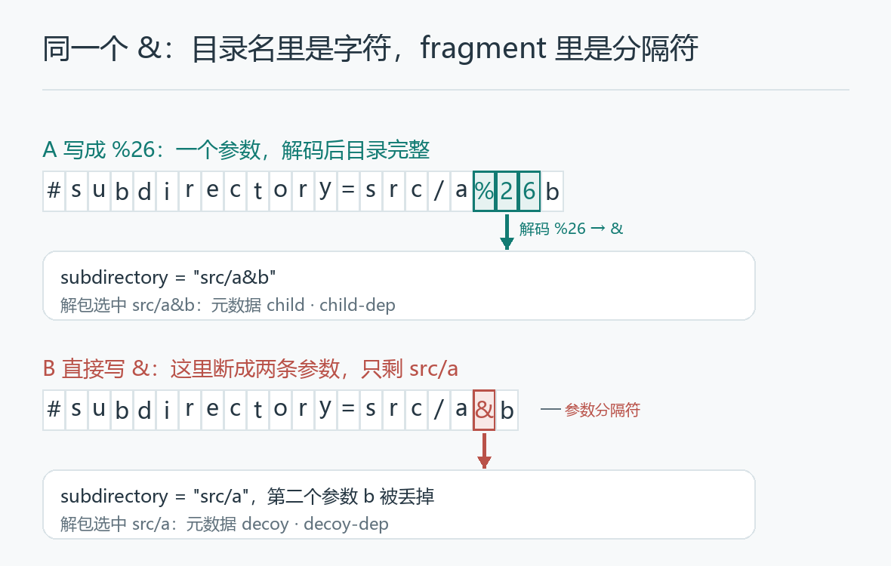
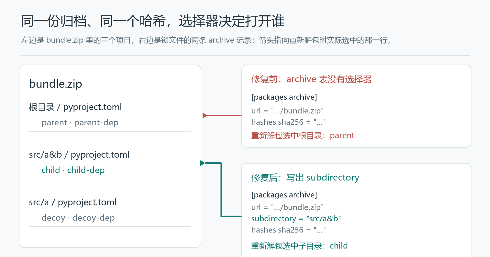

# The Lock File Says `child`. It Opens `parent`

The lock file still calls it `child`. The archive’s hash is unchanged.

Read that file back and prepare project metadata, and the metadata comes from `parent`, with `parent-dep` instead of `child-dep`.

This is not a package that changed its name. They are two projects in the same ZIP: one at the root, one in a subdirectory. **The file is the right one; the project inside it is the wrong one.**

This is the third patch on the same export path in the last week of October. The first was [PDM #3954](https://github.com/pdm-project/pdm/pull/3954), opened on October 24 and merged early on the 25th, covering the entry: whether `#subdirectory=...` in an archive URL makes it into the requirement. The second was #3956, opened on the 25th and merged early on the 27th, covering the read side: the archive hash in a lock file must not be dropped when the file is opened again. The previous post, [The Hashes Are in pylock.toml. Why Does PDM Say They Aren’t?](../锁文件哈希_pdm/PDM_Archive_Hashes_Roundtrip_EN.md), is about that one.

The third is [PDM #3964](https://github.com/pdm-project/pdm/pull/3964). Opened on the 28th, approved at 12:04:27 on the 29th, merged at 12:04:38 — eleven seconds apart. Two lines of production code. To see why those two lines cannot be skipped, you have to line up the already-fixed entry, one successful export, and the fresh read after that export, in the order they happened. (Dates are UTC as recorded by GitHub.)

## 1. This station was repaired only days ago

The archive holds three projects: `parent` at the root, `child` under `src/a&b`, and a `decoy` under `src/a`. Each declares a different dependency, which is how you can tell who was actually read; the ordinary-directory control puts the same child under `src/child`.

What we want is not whichever `pyproject.toml` happens to be in the unzipped tree, but the one a subdirectory points at:

```text
child @ file:///.../bundle.zip#subdirectory=src/a%26b
```

That `%26` is not decoration. An archive requirement’s fragment is read by [`parse_qsl()`](https://github.com/pdm-project/pdm/blob/f01b85810baacec4c8a22168da3f9e54550adb14/src/pdm/models/requirements.py#L403-L407): split on `&` into key-value pairs, then percent-decode each value. Write the `&` from a directory name as-is and it breaks itself into two parameters, and the leftover `src/a` is exactly the `decoy` directory in that archive; write `%26` and it stays data.



The patch that covered this station was #3954. It makes an archive requirement take `subdirectory` out of the URL fragment and keep it when the link is regenerated; for an unnamed archive that has a subdirectory, it no longer guesses the project name from the outer file name but leaves the name to the metadata of the selected directory.

Regenerating the link matters too, because a requirements import is not the original line stashed away untouched. The [import function](https://github.com/pdm-project/pdm/blob/f01b85810baacec4c8a22168da3f9e54550adb14/src/pdm/formats/requirements.py#L199-L214) parses first, then calls `as_line()` to emit the dependency. Remember the subdirectory only during that first parse, and the next write can still lose it.

The [#3954 regression test](https://github.com/pdm-project/pdm/blob/f41b4e7c0d12ca9a171470beb1f3bc96a4a0233d/tests/models/test_candidates.py#L74-L110) already puts parent, child and decoy into one archive, checks that the selected dependencies come from child, and checks that an ordinary PDM lock entry carries the subdirectory as well.

The entry station worked. But between “reading it correctly” and “reading it correctly after switching to another lock file format” there is still an exit to get through.

## 2. The export succeeded, so why isn’t that enough?

The counterexample is the one #3964 recorded itself, and it is concrete: `pdm add --no-sync`, then `pdm export -f pylock`. The exported record still says child. Read that export back and prepare metadata, and the metadata comes from parent.

The command reports no error, and the name does not change. If a successful export plus `name = "child"` were the test, this round trip would look like it passed.

The problem is in the archive record. Before the fix, the package record looks like this (equivalent excerpt: pylock header and other fields dropped, download address and hash abbreviated):

```toml
[[packages]]
name = "child"
version = "1.0"

[packages.archive]
url = "file:///.../bundle.zip"

[packages.archive.hashes]
sha256 = "…"
```

The name is there, the file is there, the hash is there. Nothing says where in the ZIP `child` lives.

The requirement in memory carried `subdirectory` all along. But the [pylock writer at the parent commit](https://github.com/pdm-project/pdm/blob/7aaeb992092d827dee173e60e82cfffa0a5b9676/src/pdm/formats/pylock.py#L33-L69) only wrote the download URL, the optional path and the hashes in its archive branch — this separate attribute never went out.

That is also where the tempting wrong turn sits: the fragment really is gone from the URL, so the most direct fix looks like keeping `#subdirectory=...`.

But [`get_full_url()`](https://github.com/pdm-project/pdm/blob/f01b85810baacec4c8a22168da3f9e54550adb14/src/pdm/models/requirements.py#L372-L407) dropping the fragment is not the decision to overturn here. A download address says which archive to fetch; which project to take out of that archive is pylock’s own `archive.subdirectory` field. The URL no longer carrying the selector is no reason for the selector to vanish from the record entirely.

**What was lost was not a tail of the download address, but a project location that one format conversion failed to catch.**

## 3. The hash is correct, and therefore cannot vouch for this

The previous post’s problem was that the hashes in the file were not restored on read. Both versions examined here already contain that read fix: the hash is fully preserved, and the subdirectory can still disappear.

That is why these PRs cannot each tell their own story — they connect different stations along one route.

| Fix | Which segment it connects | What it cannot stand in for |
|---|---|---|
| #3954 | A subdirectory in an archive URL enters the requirement, and survives link regeneration and ordinary PDM lock entries | The pylock archive branch’s output |
| #3956 | Restores archive hashes to the candidate when reading pylock | Keeping the project directory |
| #3964 | Writes the requirement’s subdirectory into the archive table when writing pylock | Redoing the entry and hash read the first two connected |

The relationship is stated in [#3964’s own description](https://github.com/pdm-project/pdm/pull/3964), in one line:

> “Neither wrote `archive.subdirectory` in the pylock converter.”

Neither of the first two wrote this field in the pylock converter. It is not one patch that repeatedly failed; it is the same information in another representation, and every station needs someone to catch it.

A single ZIP can easily contain several `pyproject.toml`. Pick parent, pick child, pick decoy — the archive bytes can be identical. SHA-256 only confirms that the file is still this archive; it cannot supply the choice of which directory to enter.



So an identical hash is not the contradiction in this counterexample but its most important condition: the file never changed; what changed is which directory you stand in when interpreting it.

## 4. Two lines that bring back a location, not a package name

The final [fix](https://github.com/pdm-project/pdm/blob/f01b85810baacec4c8a22168da3f9e54550adb14/src/pdm/formats/pylock.py#L60-L69) adds to the archive branch:

```python
if req.subdirectory:
    archive["subdirectory"] = req.subdirectory
```

Write it when there is a subdirectory, add no field when there is none. In the same function, the VCS and directory branches had long been keeping their own subdirectory this way; archive was only missing this step.

The value written is the actual directory `src/a&b`, not the `src/a%26b` from the URL fragment. URL encoding is the representation for putting a selector into a link; a structured field should store the decoded path. pylock’s [definition of an archive subdirectory](https://github.com/pypa/packaging.python.org/blob/8c6552668b7ff550de1a4a207ea21925703fba26/source/specifications/pylock-toml.rst#L516-L521) refers to the [VCS subdirectory rule](https://github.com/pypa/packaging.python.org/blob/8c6552668b7ff550de1a4a207ea21925703fba26/source/specifications/pylock-toml.rst#L356-L368): it points at a project root inside the source tree.

Once written, the field lands in the `packages.archive` table, level with the URL and the hashes:

```toml
[packages.archive]
url = "file:///.../bundle.zip"
subdirectory = "src/a&b"
# hashes keep their original values
```

The package name needs no change. The hash needs no recomputation, and the download URL needs no fragment glued back on. What has to be restored is which directory the next opening of this archive will enter.

The [pylock reader](https://github.com/pdm-project/pdm/blob/f01b85810baacec4c8a22168da3f9e54550adb14/src/pdm/models/repositories/lock.py#L141-L148) already reads `archive.subdirectory` and hands it back to the requirement. The reader understands the field; the writer simply never wrote it.

After that, [`as_file_link()`](https://github.com/pdm-project/pdm/blob/f01b85810baacec4c8a22168da3f9e54550adb14/src/pdm/models/requirements.py#L372-L379) puts the subdirectory back into the install link; [`_unpack()`](https://github.com/pdm-project/pdm/blob/f01b85810baacec4c8a22168da3f9e54550adb14/src/pdm/models/candidates.py#L468-L491) hands it to the unpacker to choose a directory; and [`prepare_metadata()`](https://github.com/pdm-project/pdm/blob/f01b85810baacec4c8a22168da3f9e54550adb14/src/pdm/models/candidates.py#L511-L524) reads the project metadata from the path actually selected. That explains the impossible-looking combination from the opening: the record says child, the metadata comes from parent. The name comes from the lock file; the metadata comes from the directory opened later — they are not the same fact from the same read.

## 5. A fresh read, and who it opens

The reproduction lives in [subdirectory_demo](subdirectory_demo/), pinned to #3964’s actual parent commit and merge commit. Both sides already contain #3954 and #3956, so whatever differs can only belong to the segment added here.

Starting from one local ZIP, two complete PDM source trees each run requirements import, candidate metadata reading, and pylock conversion; the serialized TOML then goes to a new `LockedRepository`, and we look at the metadata the new candidate prepares. An old object that still remembers the subdirectory from before it was written does not count as a read-back result.

This calls the real importer, converter and reader directly, skipping the dependency resolution of a full add command; names like `parent-dep` are only metadata observations and are never downloaded or installed. There are two kinds of input, URL and local path: the URL case serves the same ZIP bytes from an in-process transport without touching the public network, and creating a network socket is forbidden for the duration.

Both kinds run three cases each — no directory, an ordinary directory, a directory containing `&` — for 12 fresh metadata reads across the two versions, plus one decoy control on each side. URL and path results agree and are shown together; the full output and environment are in the [project README](subdirectory_demo/README.md).

| Requested subdirectory | Project prepared before the fix | Project prepared after the fix |
|---|---|---|
| none | parent | parent |
| `src/child` | parent | child |
| `src/a&b` | parent | child |

In both subdirectory cases the exported record says child on either side, and the archive hash is identical; the difference is that before the fix there is no `archive.subdirectory`, and after it the original directory is still there. The `&` case also has to select the whole `src/a&b`, not the `src/a` decoy.

The upstream [regression test merged with the fix](https://github.com/pdm-project/pdm/blob/f01b85810baacec4c8a22168da3f9e54550adb14/tests/test_formats.py#L1239-L1278) checks from add through export all the way to the subdirectory attribute of a newly read-back candidate; this reproduction goes one step further, to the metadata, observing `parent-dep` and `child-dep`. When preparing metadata, upstream calls `_unpack(validate_hashes=False)`; the experiment separately computes the ZIP’s SHA-256 and confirms that the exported and read-back hash fields stay identical, stopping at metadata and never running a build or an install.

## 6. Six days, three stations, and the last one

From October 24 to the 29th, three patches went onto this route: the entry, the hash on the read side, the directory on the write side. None of them is large — this one is two lines — and what is large is the segment each of them covers on one chain.

Looking only at the two-line patch is the easiest way to compress away the most valuable parts on either side of it: the entry had been fixed, the hash had been fixed, and the export could still succeed at dropping another piece of information. Each station looks fine on its own, and only when the archive is opened again does it turn out not to be the project that was chosen.

**What a round trip has to preserve is not only the strings in the file, but what the next operation will actually select.**

The previous post fixed the read side: information present in the file has to be restored on read. This one fixes the write side: what memory knows has to be kept on write. Catch both ends, and a lock file is more than something that still looks like the original.

---

### Source and reproduction

- Main fix: [PDM #3964](https://github.com/pdm-project/pdm/pull/3964); prior links [#3954](https://github.com/pdm-project/pdm/pull/3954), [#3956](https://github.com/pdm-project/pdm/pull/3956).
- Merge dates (UTC): #3954 2026-10-25, #3956 2026-10-27, #3964 2026-10-29.
- Before: [`7aaeb99`](https://github.com/pdm-project/pdm/tree/7aaeb992092d827dee173e60e82cfffa0a5b9676); final merge: [`f01b858`](https://github.com/pdm-project/pdm/tree/f01b85810baacec4c8a22168da3f9e54550adb14).
- Offline comparison and provenance: [subdirectory_demo](subdirectory_demo/README.md). This article observes fresh project metadata and does not run a package install.
