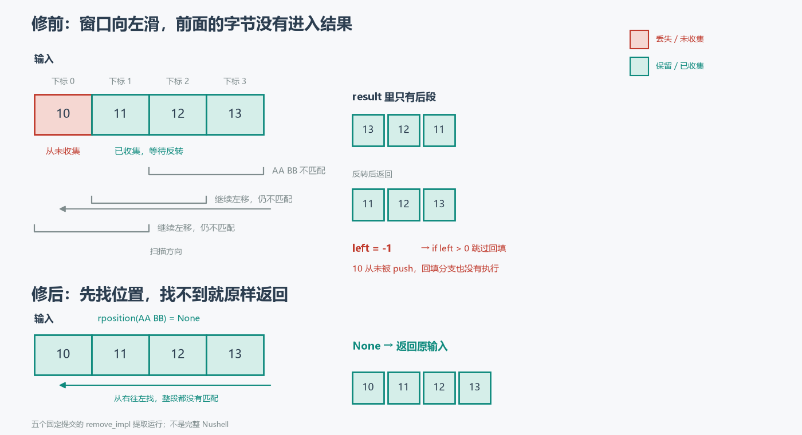

# The panic went away. So did some bytes.

```nushell
# before the fix
0x[10 11 12 13] | bytes remove --end 0x[AA BB]
# 0x[11 12 13]
```

`AA BB` is not in the input, yet `10` is gone. Shrink the input below the length of the pattern:

```nushell
# before the fix
0x[10 11] | bytes remove --end 0x[AA BB CC]
# 0x[]
```

The whole input disappears.

Both lines come from one rule: on a miss, the first `min(n, m−1)` bytes are dropped, where `n` is the input length and `m` the pattern length. When `m = 1`, that number is 0.

This is not a new rule. It is a seam left behind by an earlier fix.

## 1. The window slides left, and the prefix never reaches the result

Without `--all`, `bytes remove --end` runs [this backward scan](https://github.com/nushell/nushell/blob/8696b5246f7a920156a0be08f29ce7fefe16d885/crates/nu-command/src/bytes/remove.rs#L151-L169):

```rust
let (mut left, mut right) = (
    input.len() as isize - arg.pattern.len() as isize,
    input.len() as isize,
);
while left >= 0 && input[left as usize..right as usize] != arg.pattern {
    result.push(input[right as usize - 1]);
    left -= 1;
    right -= 1;
}
if left > 0 {
    let mut remain = input[..left as usize].iter().copied().rev().collect();
    result.append(&mut remain);
}
result = result.into_iter().rev().collect();
```

The window starts at the end of the input and moves one byte left per comparison. Every time it fails to match, the rightmost byte of the window is pushed into `result`. If nothing ever matches, the window walks off the left end, `left` becomes `-1`, and the loop stops.

What is in `result` at that point? For a four-byte input and a two-byte pattern, the loop pushes `13`, then `12`, then `11`. The first byte, `10`, is never pushed. The `if left > 0` below sees `left = -1` and does not backfill it either. After the reversal, the function returns `11 12 13`.



Generalised to an input of length `n` and a pattern of length `m`:

- `m <= n`, no match: the loop collects `input[m−1..n]`; the first `m−1` bytes stay outside;
- `m > n`: the window starts left of the input, the loop never runs, `result` is empty, and the whole input vanishes.

Both cases reduce to the same loss: `min(n, m−1)`.

**On a miss, the scan only collected the tail; the first `m−1` bytes never entered `result`.**

The `if left > 0` in that snippet was added more than two years ago. The next section goes back to it.

## 2. The panic from two years ago, and a guard that only stopped the panic

This path had failed before. In December 2023, [issue #11426](https://github.com/nushell/nushell/issues/11426) reported another failure of the same branch: when the pattern was not found, the command did not return the input, it panicked. The smallest input is a single byte:

```nushell
0x[FF] | bytes remove --end 0x[00]
```

The cause was the line after the loop. The [old implementation](https://github.com/nushell/nushell/blob/95220520639910c77d79c31bece37c468d54aeec/crates/nu-command/src/bytes/remove.rs#L150-L165) never checked the sign of `left` before using it as a slice start:

```rust
let mut remain = input[..left as usize].iter().copied().rev().collect();
```

`left = -1` cast to `usize` is `usize::MAX`, the slice is out of bounds, and the process panics.

[#11428](https://github.com/nushell/nushell/pull/11428) merged shortly after. What it did to this logic was put a guard around the backfill:

```diff
-let mut remain = input[..left as usize].iter().copied().rev().collect();
-result.append(&mut remain);
+if left > 0 {
+    let mut remain = input[..left as usize].iter().copied().rev().collect();
+    result.append(&mut remain);
+}
```

Note that it did not change the integer type. In the fixed parent source, `left` and `right` are already `isize`; what #11428 added is the `if`. The distinction is worth stating because the [#19107 description](https://github.com/nushell/nushell/pull/19107), looking back at #11426, says "fixed in v0.89.0 by switching to isize". Going by the fixed parent source and the [original merge patch](https://github.com/nushell/nushell/commit/15421dc45e6b8b831b6cacebe80b37eda46fbcd9), the type was `isize` all along; the guard is what appeared. That sentence in the description does not match the fixed patch.

The guard made the panic go away. It did not bring back the prefix the scan had skipped. The "not found, keep the input" example added along with #11428 is:

```nushell
0x[10 AA 10 BB CC AA 10] | bytes remove --end 0x[11]
```

The pattern is a single byte. With `m = 1`, the loss is `min(n, 0) = 0`, so this example happens to return the input unchanged and the test passes. It covered the single-byte panic that had been reported, not the other class of error, the one controlled by pattern length.

**A vanished panic and a correct result are two separate properties.**

## 3. The first draft already gave the right answer; review asked for a different scan

By #19107, the most direct fix was an early return on a miss. My [first draft](https://github.com/nushell/nushell/blob/9e99b50de7dd8cb37b5b8b4187d3972afe6e291c/crates/nu-command/src/bytes/remove.rs#L152-L182) did exactly that:

```rust
if left < 0 {
    // Pattern not found: return the input unchanged. (The scan
    // skipped over the leading bytes without saving them, so the
    // `result` collected above is incomplete.)
    return Value::binary(input.to_vec(), span);
}
```

The result is right: on a miss, the original input is returned, and whatever the scan collected no longer feeds the output.

But the code still kept the hand-rolled cursor: `left` and `right` decremented one at a time, sliced, cast, pushed, and then the whole thing reversed. The maintainer, fdncred, did not dispute the answer in [review](https://github.com/nushell/nushell/pull/19107#discussion_r4230407747). He pointed out that this path had already gone wrong twice:

> This adds a special case to a hand-rolled `isize` index walk that has now produced two bugs in this branch (the #11426 panic and this data loss). `bytes index-of` already does the backward search with `input.windows(n).rev().position(..)`. … It also avoids the wasted work here: in the not-found case the loop copies nearly every byte into `result`, and then this return throws it away and copies the input again.

The alternative he proposed was `input.windows(pattern_len).rposition(..)`: splice around the match if there is one, return the input if there is not. That removes the special case and also removes the double copy on the miss path — nearly the whole input copied into `result`, thrown away, then copied again.

I accepted it in [my reply](https://github.com/nushell/nushell/pull/19107#discussion_r4235787984) and dropped the whole cursor in the rewrite commit [`bb2c7f5a`](https://github.com/nushell/nushell/commit/bb2c7f5a748c6ca21a415dcf681b17b7302d4b7e).

## 4. The final version turns "not found" into an explicit branch

In the [final implementation](https://github.com/nushell/nushell/blob/65a22bfa4512e061ef7142914d032e2ad4a5d2ae/crates/nu-command/src/bytes/remove.rs#L147-L184), the `end && !all` branch is a single `match`:

```rust
match input.windows(pattern_len).rposition(|w| w == arg.pattern) {
    Some(pos) => Value::binary([&input[..pos], &input[pos + pattern_len..]].concat(), span),
    None => Value::binary(input.to_vec(), span),
}
```

`rposition` searches from the right for the last occurrence. With `Some(pos)`, `input[..pos]` and `input[pos + pattern_len..]` are joined. With `None`, the input comes back as it was. No `isize` cast, no "collect then reverse", no "build then discard".

`windows` panics on an empty pattern, but `run()` rejects empty patterns before it ever reaches `remove_impl`; the final code records that dependency in a comment. This PR did not touch the empty-pattern check in `run()`, and did not make `remove_impl` a function that handles empty patterns on its own.

**The final version does not add another special case; it writes "found" and "not found" as two explicit branches.**

## 5. Five fixed revisions, side by side

To see what each step changed, the reproduction project extracts `remove_impl` from five fixed commits and compiles it against minimal stand-ins for `Value`, `Span`, and `Arguments`. It is not Nushell: no parser, no pipeline, no metadata. What is compared is the return value of this one function.

Named counterexamples (`--end` without `--all`; "empty" means `0x[]`):

| Input / pattern | Before #11428 | After #11428 (= #19107's parent) | #19107 first draft | Final |
|---|---|---|---|---|
| `FF` / `00` | PANIC | `FF` | `FF` | `FF` |
| `10 11 12 13` / `AA BB` | PANIC | `11 12 13` | `10 11 12 13` | `10 11 12 13` |
| `10 11` / `AA BB CC` | PANIC | empty | `10 11` | `10 11` |
| `AA BB 10` / `AA BB` | `10` | `10` | `10` | `10` |
| `AA BB` / `AA BB` | empty | empty | empty | empty |
| `01 02 01 02 01` / `01 02` | `01 02 01` | `01 02 01` | `01 02 01` | `01 02 01` |

Then a small exhaustive sweep: alphabet `[00, 01]`, input lengths 0–5, pattern lengths 1–3, 882 pairs in total.

| Comparison | Result |
|---|---|
| First draft vs final | 0 / 882 differences |
| Final vs an independent oracle | 0 / 882 differences |
| After #11428 vs oracle | 474 / 882 differences |
| Before #11428 | 498 panics |
| After #11428 vs #19107's parent | 0 / 882 differences |

Of the 498 misses, the post-#11428 version returned a truncated result on 474. The remaining 24 happened to be right: 12 are misses with a single-byte pattern (loss 0), and 12 are empty inputs with a multi-byte pattern (no bytes to lose). That is also why the single-byte example from #11428 passes.

The number of bytes lost by those 474 truncated results is `min(n, m−1)` in every case; that is an assertion in the project, not a pattern generalised from a few examples.

Every number above comes from this 882-pair run. The PR discussion contains comparisons over a wider range; this article did not reproduce them and does not report their numbers as results of this run.

## 6. What this fix leaves alone

**`--end` does not mean "match the suffix only".** It removes the last occurrence, wherever it is. `0x[01 02 01 02 01] | bytes remove --end 0x[01 02]` returns `0x[01 02 01]`, and the trailing `01` is still there. The final revision changes the comment to "Remove the last occurrence of the pattern anywhere in the input", which is what it does.

**`--end --all` ignores `--end`.** The entry condition is `if arg.end && !remove_all`; when `--all` is set, the code goes straight to the forward branch. For overlapping patterns the two branches differ: `0x[01 02 01 02 01] | bytes remove --end 0x[01 02 01]` returns `0x[01 02]`, while the same command with `--all` returns `0x[02 01]`. This is existing behaviour, untouched here.

**Empty patterns are still rejected by `run()`.** `windows(0)` panics, but the normal command path never delivers an empty pattern. The final code records the premise in a comment, and the reproduction only tests non-empty patterns.

**Metadata is still cleared.** Before returning, `run()` unconditionally sets `content_type` to `None`. So "returned unchanged" holds at the byte level; it does not promise that `image/png` and friends survive the pipeline. The PR description attributes this behaviour to #16500; I checked only the unconditional clearing in the final code and did not trace the commit that introduced it.

**A merge is not a release.** #19107 has merged. This article does not infer which release contains it; the `v0.89.0` in the PR description is a description, not release evidence I verified.

## 7. A test that passed by accident

Two "passing" runs, side by side:

- the regression example from #11428 uses a single-byte pattern, where the loss happens to be 0;
- the first draft of #19107 gives the right result, but still runs on a hand-rolled cursor that has now failed twice.

The first passed because the input never touched the boundary controlled by pattern length. The second review did not ask for another boundary case. It asked to split "found" and "not found" out of one cursor and write them as two explicit branches.

The patch itself is short. What holds it up is a clear statement of the miss semantics: not found, return the input. Not "return whatever is left when the loop ends".

The [offline reproduction project](bytes_demo/) keeps the `remove.rs` of five fixed commits, extracts `remove_impl` at build time, and ships the upstream MIT licence, source SHAs, and hashes; commands and scope are in the [project README](bytes_demo/README.md). It compiles the extracted function directly, needs no full Nushell, and runs offline.

The final implementation discussed here was [merged with #19107](https://github.com/nushell/nushell/commit/65a22bfa4512e061ef7142914d032e2ad4a5d2ae).
