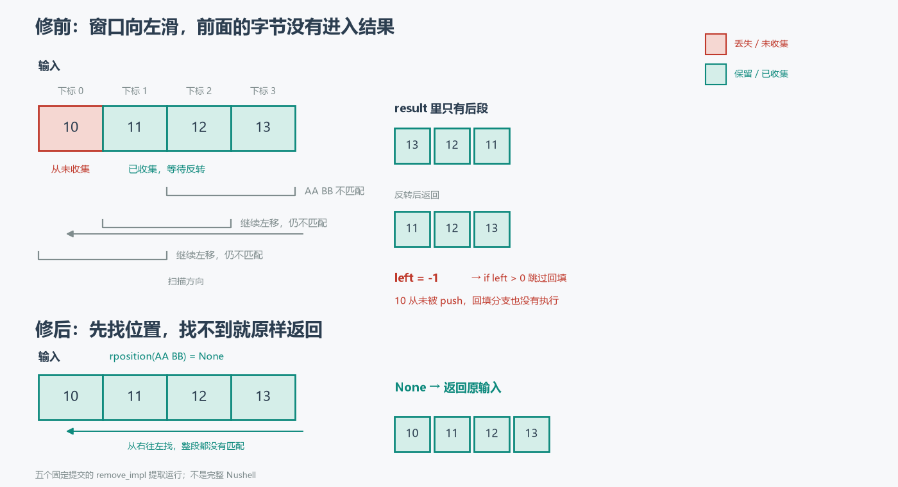

# panic 消失以后，字节却少了

```nushell
# 修前
0x[10 11 12 13] | bytes remove --end 0x[AA BB]
# 0x[11 12 13]
```

`AA BB` 不在输入里，`10` 却没了。把输入缩到比模式还短：

```nushell
# 修前
0x[10 11] | bytes remove --end 0x[AA BB CC]
# 0x[]
```

整个输入消失。

两行指向同一条规则：未命中时，输入的前 `min(n, m−1)` 个字节被丢掉。`n` 是输入长度，`m` 是模式长度。`m=1` 时这个数是 0。

这不是一条新规则，而是一次修复留下的缝。

## 1. 窗口向左滑，前缀没有进入结果

`bytes remove --end` 不带 `--all` 时，走的是[这段逆向扫描](https://github.com/nushell/nushell/blob/8696b5246f7a920156a0be08f29ce7fefe16d885/crates/nu-command/src/bytes/remove.rs#L151-L169)：

```rust
let (mut left, mut right) = (
    input.len() as isize - arg.pattern.len() as isize,
    input.len() as isize,
);
while left >= 0 && input[left as usize..right as usize] != arg.pattern {
    result.push(input[right as usize - 1]);
    left -= 1;
    right -= 1;
}
if left > 0 {
    let mut remain = input[..left as usize].iter().copied().rev().collect();
    result.append(&mut remain);
}
result = result.into_iter().rev().collect();
```

窗口从输入末尾开始，一次向左挪一格。每不匹配一次，就把窗口最右边的字节推进 `result`。如果一直不匹配，窗口会挪到左端之外，`left` 变成 `-1`，循环结束。

这时 `result` 里有什么？对长度 4 的输入、长度 2 的模式，循环依次推入 `13`、`12`、`11`。第一个字节 `10` 从来没有被推入。后面的 `if left > 0` 看见 `left = -1`，也不执行回填。反转 `result` 之后，函数返回 `11 12 13`。



推广到长度 `n` 的输入和长度 `m` 的模式：

- `m <= n` 且未命中：循环收集 `input[m−1..n]`，前 `m−1` 个字节留在外面；
- `m > n`：窗口一开始就在输入左边，循环一次也不执行，`result` 为空，整个输入消失。

两种情况可以写成同一个丢失长度：`min(n, m−1)`。

**未命中时，扫描只收集了后段；前 `m−1` 个字节从未进入 `result`。**

这段代码里的 `if left > 0` 是两年多前加上的。下一节回到它。

## 2. 两年多前的那次 panic，和一道只挡住 panic 的守卫

这条路径不是第一次出问题。2023 年 12 月，[issue #11426](https://github.com/nushell/nushell/issues/11426) 报告了同一个分支的另一种失败：模式找不到时，命令不是返回原输入，而是直接 panic。最小输入只有一个字节：

```nushell
0x[FF] | bytes remove --end 0x[00]
```

原因在循环结束后的那一行。[旧实现](https://github.com/nushell/nushell/blob/95220520639910c77d79c31bece37c468d54aeec/crates/nu-command/src/bytes/remove.rs#L150-L165)没有检查 `left` 的正负，直接拿它做切片起点：

```rust
let mut remain = input[..left as usize].iter().copied().rev().collect();
```

`left = -1` 转成 `usize` 是 `usize::MAX`，切片越界，进程 panic。

[#11428](https://github.com/nushell/nushell/pull/11428) 随后合并。它对这段逻辑做的，是给回填加一道守卫：

```diff
-let mut remain = input[..left as usize].iter().copied().rev().collect();
-result.append(&mut remain);
+if left > 0 {
+    let mut remain = input[..left as usize].iter().copied().rev().collect();
+    result.append(&mut remain);
+}
```

注意这里没有换整型类型。固定父源码里，`left` 和 `right` 已经是 `isize`；#11428 改的是那道 `if`。这个区别值得说清楚，因为 [#19107 的描述](https://github.com/nushell/nushell/pull/19107)在回顾 #11426 时写的是「fixed in v0.89.0 by switching to isize」。按固定父源码和[旧合并补丁](https://github.com/nushell/nushell/commit/15421dc45e6b8b831b6cacebe80b37eda46fbcd9)看，类型早已是 `isize`，真正加上的是守卫；描述里那句与固定补丁不符。

守卫让 panic 消失，却没有把扫描跳过的前缀补回来。#11428 同时新增的「找不到则保持原样」示例是：

```nushell
0x[10 AA 10 BB CC AA 10] | bytes remove --end 0x[11]
```

模式只有一个字节。`m=1`，丢失长度 `min(n, 0) = 0`，所以这个例子恰好返回原输入，测试通过。它验证了当时报告的单字节 panic，却没有覆盖由模式长度控制的另一类错误。

**panic 消失和结果正确，是两项性质。**

## 3. 首稿已经修对，review 要求换掉那条游标

到 #19107，最直接的修法是给未命中补一个早退。我的[首稿](https://github.com/nushell/nushell/blob/9e99b50de7dd8cb37b5b8b4187d3972afe6e291c/crates/nu-command/src/bytes/remove.rs#L152-L182)就是这样：

```rust
if left < 0 {
    // Pattern not found: return the input unchanged. (The scan
    // skipped over the leading bytes without saving them, so the
    // `result` collected above is incomplete.)
    return Value::binary(input.to_vec(), span);
}
```

结果是对的。未命中时直接返回原输入，前面的扫描结果不再参与返回。

但这段代码仍然沿用手写游标：`left` 和 `right` 每次减一，切片、强转、`push` 后再整体反转。维护者 fdncred 在 [review](https://github.com/nushell/nushell/pull/19107#discussion_r4230407747) 里没有否定这个答案，而是指出这条路径已经出过两次问题：

> This adds a special case to a hand-rolled `isize` index walk that has now produced two bugs in this branch (the #11426 panic and this data loss). `bytes index-of` already does the backward search with `input.windows(n).rev().position(..)`. … It also avoids the wasted work here: in the not-found case the loop copies nearly every byte into `result`, and then this return throws it away and copies the input again.

他给出的替代方案是 `input.windows(pattern_len).rposition(..)`，找到就拼接匹配两侧，找不到就返回原输入。这样不仅去掉了早退特判，也省掉了未命中路径上「先把几乎整段输入复制进 `result`，再丢弃，再复制原输入」的两次复制。

我在[回复](https://github.com/nushell/nushell/pull/19107#discussion_r4235787984)里采纳，并在重写提交 [`bb2c7f5a`](https://github.com/nushell/nushell/commit/bb2c7f5a748c6ca21a415dcf681b17b7302d4b7e) 里改掉了整段游标。

## 4. 最终版：把找不到变成一个显式分支

[最终实现](https://github.com/nushell/nushell/blob/65a22bfa4512e061ef7142914d032e2ad4a5d2ae/crates/nu-command/src/bytes/remove.rs#L147-L184)里，`end && !all` 分支只剩下一个 `match`：

```rust
match input.windows(pattern_len).rposition(|w| w == arg.pattern) {
    Some(pos) => Value::binary([&input[..pos], &input[pos + pattern_len..]].concat(), span),
    None => Value::binary(input.to_vec(), span),
}
```

`rposition` 从右往左找最后一次出现。`Some(pos)` 时，匹配前的 `input[..pos]` 和匹配后的 `input[pos + pattern_len..]` 拼起来；`None` 时，原输入原样返回。没有 `isize` 强转，没有「先收集再反转」，也没有「先构造再丢弃」。

`windows` 在模式为空时会 panic，但 `run()` 在进入 `remove_impl` 之前就拒绝了空模式；最终代码用注释记录了这个依赖。这个 PR 没有改 `run()` 的空模式检查，也没有把 `remove_impl` 变成能独立处理空模式的函数。

**最终版没有再加一个特判，而是把「找到」和「没找到」写成两个显式分支。**

## 5. 五个固定版本，同场对照

为了看清每一步改变了什么，复现工程从五个固定提交里提取 `remove_impl`，用最小的 `Value`、`Span`、`Arguments` 代用品编译。它不是完整 Nushell，不跑解析器、管道或 metadata；比较的只是这个函数的返回值。

具名反例（`--end`，不带 `--all`；空表示 `0x[]`）：

| 输入 / 模式 | #11428 前 | #11428 后（= #19107 父） | #19107 首稿 | 最终 |
|---|---|---|---|---|
| `FF` / `00` | PANIC | `FF` | `FF` | `FF` |
| `10 11 12 13` / `AA BB` | PANIC | `11 12 13` | `10 11 12 13` | `10 11 12 13` |
| `10 11` / `AA BB CC` | PANIC | 空 | `10 11` | `10 11` |
| `AA BB 10` / `AA BB` | `10` | `10` | `10` | `10` |
| `AA BB` / `AA BB` | 空 | 空 | 空 | 空 |
| `01 02 01 02 01` / `01 02` | `01 02 01` | `01 02 01` | `01 02 01` | `01 02 01` |

再穷举一个小范围：字母表 `[00, 01]`，输入长度 0–5，模式长度 1–3，共 882 对。

| 对照 | 结果 |
|---|---|
| 首稿 vs 最终 | 0 / 882 差异 |
| 最终 vs 独立 oracle | 0 / 882 差异 |
| #11428 后 vs oracle | 474 / 882 差异 |
| #11428 前 | 498 次 panic |
| #11428 后 vs #19107 父 | 0 / 882 差异 |

498 个未命中案例里，#11428 后的版本在 474 个上返回了残缺结果。剩下 24 个碰巧正确：12 个是单字节模式的未命中（丢失长度为 0），12 个是非单字节模式配空输入（没有字节可丢）。这也解释了为什么 #11428 的单字节示例能通过。

474 个残缺结果丢失的字节数，全部等于 `min(n, m−1)`；这是工程里的断言，不是从几个例子里归纳出来的。

本文的数字全部来自这次 882 对运行。PR 讨论里还有更大范围的历史对照，本文没有复刻，也不把那些数字当作这次实跑的结果。

## 6. 这次修复没有覆盖的边界

**`--end` 不是「只匹配后缀」。** 它删的是输入里最后一次出现，出现位置可以在中间。`0x[01 02 01 02 01] | bytes remove --end 0x[01 02]` 返回 `0x[01 02 01]`，尾部的 `01` 仍在。最终版把注释改成了「Remove the last occurrence of the pattern anywhere in the input」，说的就是这件事。

**`--end --all` 会忽略 `--end`。** 入口条件是 `if arg.end && !remove_all`；`--all` 为真时直接走 forward 分支。对重叠模式，这两个分支结果不同：`0x[01 02 01 02 01] | bytes remove --end 0x[01 02 01]` 返回 `0x[01 02]`，加上 `--all` 则返回 `0x[02 01]`。这是既有行为，本次没有改。

**空模式仍由 `run()` 拒绝。** `windows(0)` 会 panic，但正常命令路径不会把空模式送进来。最终代码的注释明确记录了这个前提，复现工程也只测非空模式。

**metadata 仍会被清空。** `run()` 在返回前无条件把 `content_type` 设为 `None`。所以「原样返回」在字节层面成立，不保证管道里的 `image/png` 等元数据也保留。PR 描述把这个行为归到 #16500；本文只核了最终代码里的无条件清空，没有追它的引入提交。

**PR 合并不等于版本发布。** #19107 已合并，本文不推断它进入了哪个发行版；PR 描述里的 `v0.89.0` 也只是描述，不是本文核过的发行证据。

## 7. 一个恰好通过的示例

把两次「通过」放在一起看：

- #11428 的回归示例是单字节模式，丢失长度恰好为 0；
- #19107 的首稿结果正确，但仍在用一条已经出过两次问题的手写游标。

第一次通过，是因为输入没有踩到由模式长度控制的边界；第二次 review，要求的不是再补一个边界，而是把「找到」和「没找到」从同一条游标里拆出来，写成两个显式分支。

补丁本身很短。它要成立，靠的是把未命中的语义说清楚：没找到，就原样返回。不是「循环结束后剩下什么就返回什么」。

[离线复现工程](bytes_demo/)保存五个固定提交的 `remove.rs`，构建时自动提取 `remove_impl`，附上游 MIT 许可证、来源 SHA 与哈希；运行方法和适用范围见[工程 README](bytes_demo/README.md)。它直接编译提取出的函数，不需要完整 Nushell，也不需要联网。

本文依据的最终实现已随 [#19107 合并](https://github.com/nushell/nushell/commit/65a22bfa4512e061ef7142914d032e2ad4a5d2ae)。
