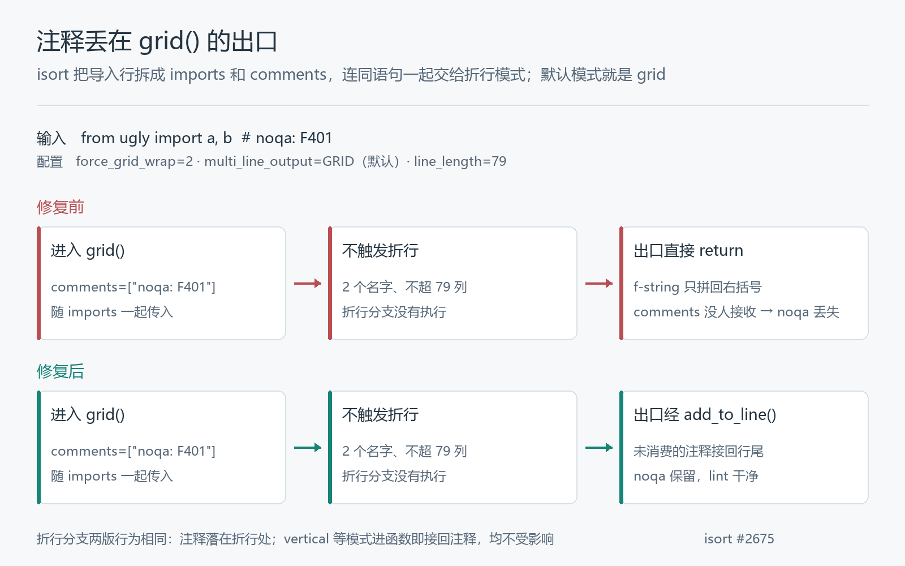

# isort 格式化一遍，两条 F401 回来了

一行导入语句，行尾挂着一条 `# noqa: F401`，意思是：这两个名字我就是故意不用的，flake8 别报。让它过一遍 [isort](https://github.com/PyCQA/isort)（配置 `force_grid_wrap=2`，其余默认），输出是：

```text
输入：from ugly import a, b  # noqa: F401
输出：from ugly import (a, b)
```

代码合法，名字按字母序排好，再跑一遍 isort 输出也不再变。一切看起来都很正常——除了那条注释没了。紧接着的 flake8 报出两条 F401：`'ugly.a' imported but unused` 和 `'ugly.b' imported but unused`。

注释被格式化工具悄悄丢掉，它压制的那条 lint 就地复活。这就是我在 [isort #2675](https://github.com/PyCQA/isort/pull/2675) 修复的问题，2026 年 10 月 18 日合并，生产代码加了六行、删了一行。本文沿着这条注释在 isort 内部走的路，看它是在哪个出口掉下去的。

## 一、注释是作为参数进来的

isort 输出导入行时，不是把原行原样搬过去，而是拆开重装：名字列表归名字列表，行尾注释在解析阶段就被摘下来，单独存成一个列表。最后交给你配置的折行模式（wrap mode）重建整行。

折行模式是一组函数，[`grid()` 是其中之一](https://github.com/PyCQA/isort/blob/3415efa3668f5514c57dfa4291d83021a575b56f/isort/wrap_modes.py#L46-L57)，它的参数里明确有一项 `comments`：

```python
def grid(
    statement: str,
    imports: list[str],
    ...
    comments: Sequence[str],
    comment_prefix: str,
    ...
) -> str:
```

注释能不能活下来，取决于这些模式函数有没有把它装回去。调用链是 `output.py` 组装导入块时判断是否需要重排（[`output.py` L432-L446](https://github.com/PyCQA/isort/blob/3415efa3668f5514c57dfa4291d83021a575b56f/isort/output.py#L432-L446)），再经 `wrap.import_statement()` 进入模式函数。

## 二、grid 的两条路，注释只被一条接住

看修复前 [`grid()` 的完整实现](https://github.com/PyCQA/isort/blob/1745766e5cc705eec7179c1122fcdf5b5b6e7546/isort/wrap_modes.py#L46-L91)（父提交 `1745766e`，节选）：

```python
statement += "(" + imports.pop(0)
while imports:
    next_import = imports.pop(0)
    next_statement = isort.comments.add_to_line(
        comments,
        statement + ", " + next_import,
        removed=remove_comments,
        comment_prefix=comment_prefix,
    )
    if len(next_statement.split(line_separator)[-1]) + 1 > line_length:
        # 折行分支：把注释接在折行处，然后清空
        statement = isort.comments.add_to_line(...) + f"{line_separator}{next_import}"
        comments = []
    else:
        statement += ", " + next_import
return f"{statement}{',' if include_trailing_comma else ''})"
```

循环里每次先试探：加上下一个名字会不会超宽。超了，走折行分支——注释被 [`add_to_line()`](https://github.com/PyCQA/isort/blob/1745766e5cc705eec7179c1122fcdf5b5b6e7546/isort/comments.py#L16-L43) 接回折行处，`comments` 清空，任务完成。

可要是从头到尾都不超宽呢？循环一路走 `else`，`comments` 原封不动，最后那行 `return` 直接拼右括号收尾。**注释被收进来，却没有一条路把它送出去。**

同一份输入，修复前后的分岔就在这个出口上：



同一文件的其余模式各有各的接法：

- [`vertical`](https://github.com/PyCQA/isort/blob/1745766e5cc705eec7179c1122fcdf5b5b6e7546/isort/wrap_modes.py#L110-L123)：拿到第一个名字时就用 `add_to_line` 把注释接上；
- [`vertical_hanging_indent`](https://github.com/PyCQA/isort/blob/1745766e5cc705eec7179c1122fcdf5b5b6e7546/isort/wrap_modes.py#L211-L222)：一进函数就先算好带注释的那一行；
- [`_vertical_grid_common`](https://github.com/PyCQA/isort/blob/1745766e5cc705eec7179c1122fcdf5b5b6e7546/isort/wrap_modes.py#L241-L251)：左括号一写出，注释就跟上；
- [`hanging_indent`](https://github.com/PyCQA/isort/blob/1745766e5cc705eec7179c1122fcdf5b5b6e7546/isort/wrap_modes.py#L176-L195)：结尾有专门的 `if comments:` 分支兜底；
- [`noqa` 模式](https://github.com/PyCQA/isort/blob/1745766e5cc705eec7179c1122fcdf5b5b6e7546/isort/wrap_modes.py#L364-L376)：注释本身就是输出主体。

grid 是唯一一个只靠折行分支消费注释的。PR 里我把这层意思写成一句话：

> The `# noqa: F401` is lost, re-activating the lint it was suppressing — with no error or warning, and the output stays valid and idempotent, so it's easy to miss.
> —— [isort #2675 描述](https://github.com/PyCQA/isort/pull/2675)

## 三、为什么默认配置踩不到

这个毛病潜伏得不浅，和 isort 的默认值有关。[`multi_line_output` 默认就是 GRID](https://github.com/PyCQA/isort/blob/3415efa3668f5514c57dfa4291d83021a575b56f/isort/settings.py#L150)，但 [`force_grid_wrap` 默认是 0](https://github.com/PyCQA/isort/blob/3415efa3668f5514c57dfa4291d83021a575b56f/isort/settings.py#L183)。

`force_grid_wrap=0` 时，不超宽的语句根本不会进重排流程——上面第二节的调用链压根不触发，注释由输出层原样拼回，安然无恙。我按默认配置跑了同一份输入，输出原样返回，注释还在。

所以四个条件要凑齐才会丢注释：

1. 折行模式是 GRID（默认就是）；
2. 显式设置了 `force_grid_wrap` 大于 0；
3. `from` 导入的名字数达到这个阈值；
4. 语句不超 `line_length`，进得去 grid、又不触发折行。

第 2 条是用户自己写进配置的，第 4 条看似矛盾——都进重排了怎么会不超宽——但 `force_grid_wrap` 的语义正是「名字数够了就强制走 grid 布局，不看行宽」。设了它的用户得到的是带括号的 grid 输出，就算语句很短。

顺带排除一个误会：常用的 [pycharm 预设](https://github.com/PyCQA/isort/blob/3415efa3668f5514c57dfa4291d83021a575b56f/isort/profiles.py#L20-L24)虽然也写着 `force_grid_wrap: 2`，但它的 `multi_line_output` 是 VERTICAL，走的是第一节里「进函数就接注释」的那类模式，不受影响。丢失只发生在 GRID 模式下。

## 四、七行补在出口

修复动了一处：[`grid()` 的出口](https://github.com/PyCQA/isort/blob/3415efa3668f5514c57dfa4291d83021a575b56f/isort/wrap_modes.py#L88-L96)改为经 `add_to_line()` 返回：

```python
return isort.comments.add_to_line(
    comments,
    f"{statement}{',' if include_trailing_comma else ''})",
    removed=remove_comments,
    comment_prefix=comment_prefix,
)
```

这个落点成立，靠的是 [`add_to_line()`](https://github.com/PyCQA/isort/blob/3415efa3668f5514c57dfa4291d83021a575b56f/isort/comments.py#L16-L43) 对三种情况的分寸：

- `comments` 为空：原样返回，正常输出一个字不变；
- `remove_comments` 开启：返回剥掉注释的语句，`--ignore-comments` 的语义保持；
- 有未消费的注释：去重、用 `; ` 连接，按 `comment_prefix` 接回行尾。

折行分支一个字没动。语句真的超宽时，注释仍然落在折行处——那是依赖行尾 `noqa` 的现有行为，**修复不能碰它**。上游为此加了[两个回归测试](https://github.com/PyCQA/isort/blob/3415efa3668f5514c57dfa4291d83021a575b56f/tests/unit/test_wrap_modes.py#L210-L324)：一个钉住四种不折行的情形（保留、无注释不变、带尾逗号、多条注释合并），另一个把折行时注释的位置原样钉住，防止修复反过来弄坏折行分支。

review 的过程不复杂：[DanielNoord](https://github.com/DanielNoord) 要求 rebase 并给测试补类型标注，改完即 [Approved](https://github.com/PyCQA/isort/pull/2675#pullrequestreview-5563642587)。合并当天四小时后打出的 [10.0.0b1 预发布](https://github.com/PyCQA/isort/releases/tag/10.0.0b1)已包含这个修复（比对 tag 内容核实过）；最新的稳定版 9.0.2（9 月 28 日）还不包含。

## 五、修前修后，同场对照

我把父提交 `1745766e` 和合并提交 `3415efa` 的 `isort` 包源码原样放进 [isort_demo](isort_demo/)，同一份输入分别喂给两版快照。运行不需要联网：

```powershell
pip install mypy_extensions      # 快照 settings.py 的依赖
pip install flake8               # 可选：参与 lint 对照
python 导入排序语义_isort/isort_demo/run.py
```

两版快照加载后都会核验模块路径确实来自快照目录（isort 的 `__version__` 走 importlib.metadata，会误读环境里已安装的同名发行版，版本一律以 git SHA 标识）。这次运行得到：

| 观察点 | 修复前 `1745766e` | 修复后 `3415efa` |
| --- | --- | --- |
| 输出里的 `# noqa: F401` | 0 条（丢失） | 1 条（行尾保留） |
| `flake8 --select=F401` | 2 条 F401，退出码 1 | 无，退出码 0 |
| 二次格式化输出不变 | 是 | 是 |
| 折行场景（19 个名字） | 注释落在折行处 | 与修前逐字一致 |
| 无注释的输入 | 正常输出 | 与修前逐字一致 |

修前的表现值得多看一眼：输出合法、幂等，`flake8` 报的两条 F401 指向的也正是代码里真实存在的导入——每个环节单看都「对」，**丢失只发生在语义那一层**。最后一点对不上号的，只有用户写在行尾的那条注释。

demo 在 Windows / Python 3.12.14 上运行，自带 9 项断言（含 flake8 两项），`python run.py --test` 全部通过；配 `--offline` 可跳过 lint 对照。

## 写在最后

格式化工具的输出要同时过三关：语法合法、二次执行幂等、不改变代码的语义。前两关是 isort 自身的测试长期覆盖的；第三关里，注释是最容易被当成装饰的一类——它不参与语法解析，丢了也不报错。

但 `# noqa` 不是装饰，它是写给下游工具的指令。这次修复只做了七行的事：让 grid 在离开时，把用户交来的东西带走。

改动已合并进 isort 主干（[`3415efa`](https://github.com/PyCQA/isort/commit/3415efa3668f5514c57dfa4291d83021a575b56f)）。如果你的配置里有 `force_grid_wrap`，值得看一下自己是不是也在那四个条件的交集里。
