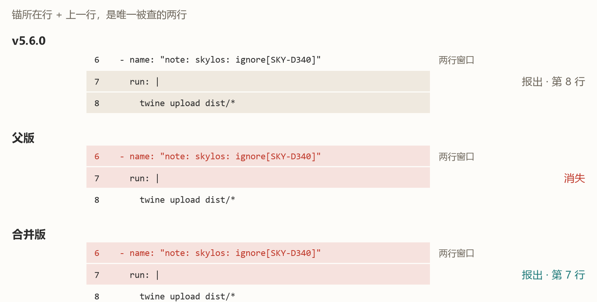

# A `skylos: ignore` inside a quoted string silenced a HIGH finding

A GitHub Actions workflow with a publish step:

```yaml
      - name: "note: skylos: ignore[SKY-D340]"
        run: |
          twine upload dist/*
```

`name` is a line of text for humans on the Actions page. D340 reports `twine upload` as HIGH: the command publishes to a package index unless the workflow can prove it is a release. Hand the file to 5.6.0 and it reports line 8, the `twine` line. Hand it to the parent commit `a5024d7` and it reports nothing. Same file, same rule, with only #1218 between them.

The problem is how the ignore marker gets read.

## How the ignore marker is read

An inline ignore in skylos is a literal string, `skylos: ignore[rule]`. The decision lives in `_is_inline_ignored()` (`skylos/rules/config/cicd/github_actions.py:581`):

```python
needle = f"skylos: ignore[{rule_id}]"
if not any(needle in lines[idx] for idx in (line - 2, line - 1) if idx >= 0):
    return False
```

`line` is the 1-based line of the finding and `lines` is 0-based, so `line-2` is the line above and `line-1` is the line itself. Those two lines are all that gets looked at, and the lookup is plain substring containment.

`_add_finding()` (`:620`) has an extra switch, `yaml_only`, default `False`. When it is `True`, the decision asks `YamlSource.comment_on_line()` (`yaml_source.py:134`) as well, and only real YAML comments count:

- a trailing comment on the anchor's own line;
- the line immediately above, which has to start with `#` after `lstrip()`, otherwise it is skipped.

`comment_on_line()` knows which characters each scalar occupies in the source, and a `#` inside quotes does not end the scalar, so it keeps looking. The line `name: "note: skylos: ignore[SKY-D340]"` has no `#` in it; `comment_on_line()` returns `None` for it.

The default of `False` is there for a reason: some findings really do anchor inside a `run:` block scalar. A `# skylos: ignore[...]` written there is a shell comment, people have always written it that way, and it has always worked. Both spellings coexist in one file, and telling which one counts means knowing where the anchor is.

## The previous fix pushed name into the window

D340 used to report on the first line holding the command text, located by `_line_for_value()` (`:784`), which takes the command's first line and searches the whole file for the first hit (`_line_for_contains`, `:526`). One command appearing in two steps put both findings on the first one.

[#1218](https://github.com/duriantaco/skylos/pull/1218) dealt with [issue #1212](https://github.com/duriantaco/skylos/issues/1212): workflows that only run on `release` were reported for D340 too. It listed three things, and the last was "report the right step when several steps contain the same publish command", which changed the anchor:

```python
line=(
    source.line_for_path(run_path)
    if risk.rule_id == "SKY-D340" and source is not None
    else None
)
or _line_for_value(lines, run_body),
```

D340 now reports on the line where the `run:` key sits. The change itself is right: report on the line the user has to edit, and each step gets its own `run:`.

But the window follows the anchor. With the anchor moved up from the command line inside the block scalar to the `run:` key, the window moves from "the command line and the line above" to "`run:` and the line above"; and the line above `run:` is exactly `name:`. The text inside those quotes walked into the window.



Top is 5.6.0: the anchor is on line 8, the window is lines 7 and 8, `name` sits outside it, and the finding is reported. Middle is the parent: the anchor moved up to line 7, the window became lines 6 and 7, `name` is inside, and the finding is gone. Bottom is after the fix: the window is still those two lines, but that line is only text inside quotes, not a YAML comment, so the finding is reported.

## Fix D340 only, at first

My first version touched D340 alone, switching the flag on by rule id:

```python
yaml_only=risk.rule_id == "SKY-D340" and source is not None,
```

The reason given in the PR text: other shell risk rules may still anchor inside a block scalar, where `#` is a script comment and text matching has to stay. The reason is right, but it only covers the case of an anchor inside a block scalar. It does not follow through to a one-line `run:`, where the anchor sits on `run:` already and the line above it is `name`.

The maintainer replied "the D340 fix is ok so we'll keep it", and then said he had pushed two more commits to the branch.

## Two more commits from the maintainer

The first swapped the condition from which rule to where the anchor is:

```python
yaml_only=line == run_line,
```

Whatever the rule, if the anchor of this finding is the `run:` line itself, only YAML comments count. For a finding anchored inside a block scalar, `line` is the command line and does not equal `run_line`, so text matching stays and shell comments keep working. Turning it on for everything would break that set of spellings; dispatching on the anchor gets both sides right.

The second fixed an earlier step: why the anchor gets pulled elsewhere at all. In the case `d327_name_repeats_command`, `name` holds the whole command plus an ignore marker and `run` is the same sentence. The text search starts at the top of the file, hits `name` on line 6 first, and the anchor stops there; the marker is there too, and the finding is gone. An `env:` value at the top of the workflow getting hit is the same flaw.

The new `scalar_lines_for_path()` (`yaml_source.py:246`) returns the span of lines a scalar occupies on its own path; it returns `None` when the value arrives through an alias or a merge, because the value is written somewhere else and this path has no lines of its own. `_line_for_run_command()` (`github_actions.py:1753`) looks for the command's first line within that span and falls back to the `run:` line:

```python
span = source.scalar_lines_for_path(run_path)
...
for lineno in range(first, min(last, len(search_lines)) + 1):
    if needle in search_lines[lineno - 1]:
        return lineno
return run_line
```

The range is locked to its own scalar, and the same text elsewhere can no longer pull the anchor. That fixed something else on the way: two steps running the same command used to both be located at the first one, and `_finding_identity()` compares (rule, file, line, name, message, value) and dropped the second as a duplicate; now each lands on its own `run:`, and both survive.

## Three versions side by side

Twelve workflows, each run through all three versions, looking only at D340 (publish command, HIGH) and D327 (env vars or local secrets sent to an external address, CRITICAL):

| Case | v5.6.0 | Parent `a5024d7` | Merged `1a105bd` |
| --- | --- | --- | --- |
| `d340_quoted_name_oneline` | not reported | not reported | line 7 |
| `d340_quoted_name_block` | line 8 | not reported | line 7 |
| `d327_quoted_name_oneline` | not reported | not reported | line 7 |
| `d340_comment_above_run` | line 9 | not reported | not reported |
| `d340_trailing_comment` | not reported | not reported | not reported |
| `d327_trailing_comment` | not reported | not reported | not reported |
| `d327_name_repeats_command` | not reported | not reported | line 7 |
| `d327_env_repeats_command` | not reported | not reported | line 9 |
| `d327_escaped_run` | not reported | not reported | line 8 |
| `d327_two_identical_steps` | line 7 | line 7 | lines 7, 9 |
| `d327_alias_run` | line 7 | line 7 | lines 7, 9 |
| `d327_ignore_first_of_two` | not reported | not reported | line 9 |

The merged version reports eleven findings, the parent two, 5.6.0 four. One of those four is deliberately not reported by the merged version: a `# skylos: ignore[SKY-D340]` written on its own line above `run:` — 5.6.0's anchor is inside the block scalar and cannot reach that line; after #1218 it can.

The table falls into four groups.

**Rows 1 to 3: a quoted marker falls into the window.** 5.6.0 only trips on a one-line `run:` — the anchor is the `run:` line, and the line above is exactly `name`. The block scalar case needs #1218 to move the anchor first, which is why that one is reported on line 8 in 5.6.0 and disappears in the parent. That path never shipped: 5.6.0 was released 11-11 04:19 UTC, and #1218 merged at 13:42 that day.

**Rows 4 to 6: real comments.** Rows 5 and 6 are accepted by all three versions, which is the behaviour to keep. Row 4 goes the other way: 5.6.0 does not accept a standalone comment on the line above `run:`, because its window is inside the block scalar and cannot reach it; the parent and the merged version do.

**Rows 7 to 9: the anchor is pulled away by command text elsewhere.** In row 7 `name` repeats the whole command, in row 8 an `env:` value repeats it, and row 9 is the subtlest: a one-line `run:` writes the pipe as `\x7c`, four characters in the source and one `|` after parsing, so searching the source for the parsed command matches nothing, `_line_for_contains()` finds nothing and returns 1 — and line 1 happens to be the `name:` carrying the marker, so the finding is gone. In the merged version all three land on the `run:` itself.

**Last 3 rows: the same command twice.** 5.6.0 and the parent locate both hits at the first one, `_finding_identity()` compares them, and the second is dropped as a duplicate. `d327_ignore_first_of_two` shows it best: the first copy carries a trailing ignore, and both disappear — the ignore lands on the first, and the loss falls on the second.

## Reproduction

The reproduction is under `忽略标记_skylos/cicd_ignore_demo/`:

```bash
python -B run.py --test
python -B run.py --table
```

Each of the three source trees is cut down to the import closure of the rule file (51, 52, and 52 files, including the registry in `skylos/rules/config/` — without it, the circular import of `skylos.rules.config.cicd` fails at import time). One workflow per file under `cases/`; `scan_one.py` starts a subprocess per version, puts the matching vendor directory first on `sys.path`, and then asserts that `skylos.__path__` lands inside it, so the three versions never share a module tree.

Upstream: `duriantaco/skylos`, [#1225](https://github.com/duriantaco/skylos/pull/1225), parent commit [`a5024d78`](https://github.com/duriantaco/skylos/commit/a5024d78565de6ed5840fa3e0c96c8ab6db27c00), merge commit [`1a105bdc`](https://github.com/duriantaco/skylos/commit/1a105bdc3227b0dce8507a19da9f69fcf90eade2).
