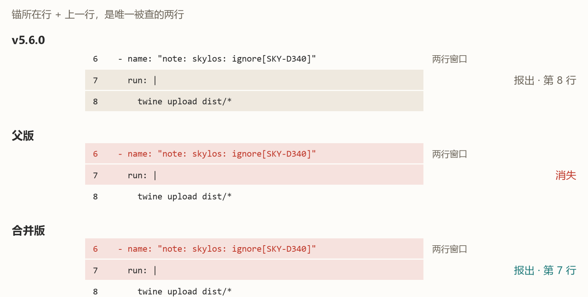

# 引号里的 `skylos: ignore`，让一条 HIGH 告警消失了

一份 GitHub Actions workflow 里，发布这一步长这样：

```yaml
      - name: "note: skylos: ignore[SKY-D340]"
        run: |
          twine upload dist/*
```

`name` 是 Actions 页面上给人看的一行字。D340 扫到 `twine upload` 会报一条 HIGH：这条命令会往包仓库发布东西，除非 workflow 能证明这是一次发布。把这份文件交给 5.6.0，它报在第 8 行，`twine` 那一行。交给父提交 `a5024d7`，它什么也不报。同一份文件、同一条规则，中间只隔了 #1218 那一笔。

问题出在忽略标记怎么被读。

## 忽略标记是怎么读的

skylos 的行内忽略是一串字面量：`skylos: ignore[规则号]`。判定在 `_is_inline_ignored()`（`skylos/rules/config/cicd/github_actions.py:581`）：

```python
needle = f"skylos: ignore[{rule_id}]"
if not any(needle in lines[idx] for idx in (line - 2, line - 1) if idx >= 0):
    return False
```

`line` 是告警的 1 基行号，`lines` 下标 0 基，所以 `line-2` 是它上面一行，`line-1` 是它自己。能被查到的只有这两行，查法就是子串包含。

`_add_finding()`（同文件 `:620`）多一个 `yaml_only` 开关，默认 `False`。传 `True` 时，判定会再问一次 `YamlSource.comment_on_line()`（`yaml_source.py:134`），只认真正的 YAML 注释：

- 锚自己那一行的行尾注释；
- 紧挨着的上一行，且必须以 `#` 打头（`lines[idx].lstrip().startswith("#")`），否则跳过。

`comment_on_line()` 知道每个标量在源码里占哪段字符，遇到引号里的 `#` 会继续往后找，不会被当成注释开头。上面那行 `name: "note: skylos: ignore[SKY-D340]"` 里没有 `#`，`comment_on_line()` 对它返回 `None`。

默认填 `False` 有原因：有些告警的锚确实落在 `run:` 的块标量里面。那儿写的 `# skylos: ignore[...]` 是 shell 注释，用户一直这么写，也一直有效。一份文件里两种写法并存，要判哪一种算数，得先知道锚在哪。

## 上一笔修复把 name 推进了窗口

D340 原来报在「第一处含命令文本的行」上，定位靠 `_line_for_value()`（`:784`），它把命令的第一行拿去全文搜索，从头找到第一个命中（`_line_for_contains`，`:526`）。同一条命令出现在两个 step 里，两处都被定位到第一处。

[#1218](https://github.com/duriantaco/skylos/pull/1218) 处理的是 [issue #1212](https://github.com/duriantaco/skylos/issues/1212)：只在 `release` 事件上跑的 workflow 也被报 D340。它列了三件事，最后一件是「多个 step 含同一条发布命令时，报对那一步」，为此换了锚：

```python
line=(
    source.line_for_path(run_path)
    if risk.rule_id == "SKY-D340" and source is not None
    else None
)
or _line_for_value(lines, run_body),
```

D340 改成报在 `run:` 这个键所在的行。这个改法本身是对的：报在用户要改的那一行，不同 step 也各自有自己的 `run:`。

但窗口跟着锚走。锚从块标量里的命令行上移到 `run:` 键，窗口就从「命令行和它上一行」变成「`run:` 和它上一行」；而 `run:` 的上一行正是 `name:`。那行引号里的字就这么进了窗口。



最上面是 5.6.0：锚在第 8 行，窗口是第 7、8 行，`name` 在窗口外，照报。中间是父版：锚上移到第 7 行，窗口变成第 6、7 行，`name` 进来了，告警消失。最下面是修好之后：窗口还是那两行，但那行只是引号里的一段文字，不是 YAML 注释，所以照报。

## 先只修 D340

我的第一版只动了 D340 这一条，把开关按规则号打开：

```python
yaml_only=risk.rule_id == "SKY-D340" and source is not None,
```

PR 正文里写的理由是：其余 shell 风险规则的锚还可能落在块标量内部，那里 `#` 是脚本注释，得保留文本匹配。理由没错，但它只覆盖了「锚在块标量里」这一种情形，没接着想单行的 `run:`——那种写法里锚本来就在 `run:` 上，窗口上一个就是 `name`。

维护者的回复是「the D340 fix is ok so we'll keep it」，然后说明他往分支上又推了两笔。

## 维护者又推了两笔

第一笔把条件从「哪条规则」换成「锚在哪」：

```python
yaml_only=line == run_line,
```

不管哪条规则，只要这次告警的锚就是 `run:` 那一行本身，就只认 YAML 注释。锚在块标量里的告警，`line` 是命令行，不等于 `run_line`，仍旧走文本匹配，shell 注释照旧有效。一刀切成 `True` 会误伤那一批写法；按锚分派，两边才对。

第二笔修的是更靠前的一步：锚为什么会被拉到别处。用例 `d327_name_repeats_command` 里，`name` 写着整条命令再加一个忽略标记，`run` 是同一句。文本搜索从文件头开始，先撞到第 6 行的 `name`，锚就停在那儿，标记也在那儿，告警消失。工作流顶上的 `env:` 值被撞到，是同一个毛病。

新加的 `scalar_lines_for_path()`（`yaml_source.py:246`）返回一个标量在它自己路径上占的行区间；走别名或合并拿到值的情形返回 `None`，因为值写在别处，这个路径上没有自己的行。`_line_for_run_command()`（`github_actions.py:1753`）在这个区间里找命令的第一行，找不到就退回 `run:` 那一行：

```python
span = source.scalar_lines_for_path(run_path)
...
for lineno in range(first, min(last, len(search_lines)) + 1):
    if needle in search_lines[lineno - 1]:
        return lineno
return run_line
```

范围锁在自己这段标量里，别处的同名文本再也拉不动锚。顺带解决了一件事：两个 step 跑同一句命令，以前两条命中都被定位到第一处，`_finding_identity()` 按（规则、文件、行、名称、消息、值）比对，第二条被当成重复丢掉；现在各自落在自己的 `run:` 上，两条都在。

## 三版放在一起

12 份 workflow，三版各跑一遍，只看 D340（发布命令，HIGH）和 D327（把环境变量或本地机密往外部地址送，CRITICAL）：

| 用例 | v5.6.0 | 父版 `a5024d7` | 合并版 `1a105bd` |
| --- | --- | --- | --- |
| `d340_quoted_name_oneline` | 未报出 | 未报出 | 第 7 行 |
| `d340_quoted_name_block` | 第 8 行 | 未报出 | 第 7 行 |
| `d327_quoted_name_oneline` | 未报出 | 未报出 | 第 7 行 |
| `d340_comment_above_run` | 第 9 行 | 未报出 | 未报出 |
| `d340_trailing_comment` | 未报出 | 未报出 | 未报出 |
| `d327_trailing_comment` | 未报出 | 未报出 | 未报出 |
| `d327_name_repeats_command` | 未报出 | 未报出 | 第 7 行 |
| `d327_env_repeats_command` | 未报出 | 未报出 | 第 9 行 |
| `d327_escaped_run` | 未报出 | 未报出 | 第 8 行 |
| `d327_two_identical_steps` | 第 7 行 | 第 7 行 | 第 7 行、第 9 行 |
| `d327_alias_run` | 第 7 行 | 第 7 行 | 第 7 行、第 9 行 |
| `d327_ignore_first_of_two` | 未报出 | 未报出 | 第 9 行 |

合并版一共报出 11 条，父版 2 条，5.6.0 报 4 条。5.6.0 那 4 条里有一条是合并版故意不报的：`# skylos: ignore[SKY-D340]` 单独写在 `run:` 上一行，5.6.0 的锚在块标量内，够不到那行注释；#1218 之后够得到了。

表里分得开四组。

**前 3 行：引号的标记落进窗口。** 5.6.0 只在单行的 `run:` 上中招——锚就是 `run:` 那一行，窗口上一个正好是 `name`。块标量要等 #1218 把锚上移才出现，所以那一条 5.6.0 报在第 8 行、父版消失。这条路径没进过发行版：5.6.0 发布于 11-11 04:19 UTC，#1218 是当天 13:42 合的。

**第 4 至 6 行：真注释。** 第 5、6 行三版都认，这是该保住的行为。第 4 行反过来，5.6.0 不认写在 `run:` 上一行的独立注释，因为它的窗口在块标量里，够不到；父版和合并版认。

**第 7 至 9 行：锚被别处的命令文本拉走。** 第 7 行是 `name` 重复了整条命令，第 8 行是 `env:` 的值重复了它，第 9 行最隐蔽：单行的 `run:` 把竖线写成 `\x7c`，源码里是四个字符、解析后是一个 `|`，拿解析后的命令去源码里搜，一个字符都对不上，`_line_for_contains()` 找不到就返回 1——第 1 行恰好是带标记的 `name:`，告警没了。这三条在合并版里都落在 `run:` 自己身上。

**最后 3 行：同一句命令出现两次。** 5.6.0 和父版把两处都定位到第一处，`_finding_identity()` 一比对，第二条当重复丢掉。`d327_ignore_first_of_two` 更能说明问题：第一处带行尾忽略，两处一起消失——忽略的是第一处，丢的是第二处。

## 复现

复现工程在 `忽略标记_skylos/cicd_ignore_demo/`：

```bash
python -B run.py --test
python -B run.py --table
```

三版源码各裁到导入链最小集（51、52、52 个文件，含 `skylos/rules/config/` 的注册表——少了它会撞上 `skylos.rules.config.cicd` 的循环导入）。`cases/` 下每份 workflow 一个文件；`scan_one.py` 每个版本起一个子进程，`sys.path` 先插 vendor 目录，再断言 `skylos.__path__` 落在里面，三版不会共用已导入的模块树。

上游：`duriantaco/skylos`，[#1225](https://github.com/duriantaco/skylos/pull/1225)，父提交 [`a5024d78`](https://github.com/duriantaco/skylos/commit/a5024d78565de6ed5840fa3e0c96c8ab6db27c00)，合并提交 [`1a105bdc`](https://github.com/duriantaco/skylos/commit/1a105bdc3227b0dce8507a19da9f69fcf90eade2)。
