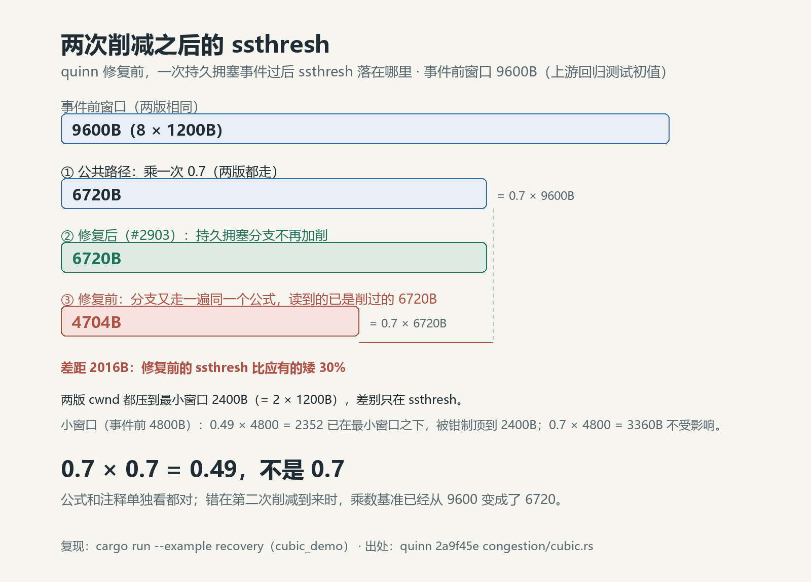
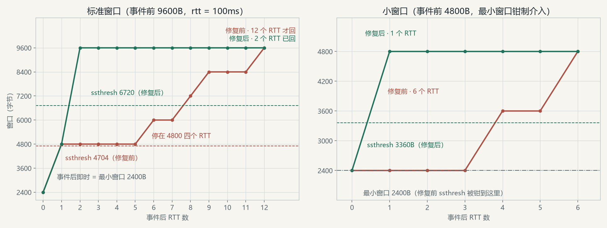

# ssthresh 怎么会是 0.49：quinn CUBIC 持久拥塞里的两次削减

事件前窗口 9600 字节（8 × 1200，上游回归测试的初值），一次持久拥塞事件打进 CUBIC。按规范，事件后 `cwnd` 压到最小窗口 2400 字节，`ssthresh` = 0.7 × 事件前窗口 = 6720 字节（[RFC 9438 §4.8](https://www.rfc-editor.org/rfc/rfc9438.html#section-4.8)）。

修复前的 quinn 把 `ssthresh` 留成了 4704。4704 = 0.49 × 9600：**β_cubic 被乘了第二下**。`cwnd` 两版相同，差别全在这条界线上——它是慢启动翻倍和拥塞避免一格一格推的分界（[§4.6](https://www.rfc-editor.org/rfc/rfc9438.html#section-4.6)），矮了，事件后窗口回来的路就长：复现例子里，2 个 RTT 被拖成 12 个，小窗口下 1 个拖成 6 个。

[#2903](https://github.com/quinn-rs/quinn/pull/2903)（9 月 30 日合并，提交 [`2a9f45e`](https://github.com/quinn-rs/quinn/commit/2a9f45e47899608ba8875260969667144fb9ef6c)）删的就是那一下多出的乘法，补上回归测试，只改一个文件。下一节直接上[修后源码](https://github.com/quinn-rs/quinn/blob/2a9f45e47899608ba8875260969667144fb9ef6c/quinn-proto/src/congestion/cubic.rs#L185-L237)，看两次削减各自落在哪。

## 一、两个削减的位置

先看修后的代码（[固定源码](https://github.com/quinn-rs/quinn/blob/2a9f45e47899608ba8875260969667144fb9ef6c/quinn-proto/src/congestion/cubic.rs#L185-L237)），`on_congestion_event` 与本篇相关的部分：

```rust
let window = self.state.window as f64;   // 事件前窗口的快照

// ……快速收敛先更新 w_max（RFC 9438 §4.7）……

// 公共路径：一次 β_cubic 削减（RFC 9438 §4.6）
self.state.ssthresh = cmp::max((window * BETA_CUBIC) as u64, self.minimum_window());
self.state.window = self.state.ssthresh;
self.state.k = self.state.cubic_k(self.current_mtu);
self.state.cwnd_inc = (self.state.cwnd_inc as f64 * BETA_CUBIC) as u64;

if is_persistent_congestion {
    // ssthresh already carries the single β_cubic reduction of the pre-event window
    // applied above; RFC 9438 §4.8 (Timeout) requires no further reduction of ssthresh,
    // only cwnd lowered to the minimum window.
    self.state.recovery_start_time = None;
    self.state.w_max = self.state.window as f64;
    self.state.cwnd_inc = 0;
    self.state.window = self.minimum_window();
}
```

公共路径对所有拥塞事件都执行：`ssthresh = 0.7 × 事件前窗口`，并把 `window` 拉到同一个值。持久拥塞分支只做额外的事——清恢复状态、把 `w_max` 压到当前窗口、清掉拥塞避免的累积信用、把 `window` 压到最小窗口（`2 × 1200` 字节）。

修复前，这个分支里还多着五行：

```rust
// 4.7 Timeout - reduce ssthresh based on BETA_CUBIC
self.state.ssthresh = cmp::max(
    (self.state.window as f64 * BETA_CUBIC) as u64,
    self.minimum_window(),
);
```

事件前窗口取 9600 字节（8 × 1200），走一遍：

| 步骤 | 二次削减读到的值 | 修复前 ssthresh | 修复后 ssthresh | window |
|---|---|---:|---:|---:|
| 事件前 | — | 9600 | 9600 | 9600 |
| 公共路径 | — | 6720 | 6720 | 6720 |
| 持久拥塞分支 | 6720（已削过） | **4704** | 6720（不动） | 2400 |

事件前的状态对两版都一样，分叉完全发生在持久拥塞分支里：同一个公式，修复前乘进去的是 6720 而不是 9600。



## 二、规范说的是撤一次

持久拥塞是 QUIC 自己的概念（[RFC 9002 §7.6](https://www.rfc-editor.org/rfc/rfc9002.html#section-7.6)）：丢包持续超过 `(smoothed_rtt + max(4×rttvar, 时隙粒度) + max_ack_delay) × kThreshold` 就算。quinn 的 `kThreshold` 默认 3，也就是说这条路通常意味着"这一段的丢失至少持续了大约三个 PTO"——比丢几个包更重的情况。

CUBIC 对它的处理走的是超时路径，[RFC 9438 §4.8](https://www.rfc-editor.org/rfc/rfc9438.html#section-4.8) 的原文：

> In the case of a timeout, CUBIC follows Reno to reduce *cwnd* but sets *ssthresh* using β_cubic (same as in Section 4.6) in a way that is different from Reno TCP.

而 §4.6 说的削减，基准是事件前的在途窗口：`ssthresh = flight_size × β_cubic`。两节合起来的意思就是一句话：超时之后，`ssthresh` 等于**事件前**窗口的一次 0.7，不再减第二下。

旧代码的注释写着 `4.7 Timeout`——那不是编号写错了。旧版 RFC 8312 里 Timeout 就是 [§4.7](https://www.rfc-editor.org/rfc/rfc8312.html#section-4.7)，原文 "sets ssthresh using beta_cubic (same as in Section 4.5)"，和 RFC 9438 说的是同一件事。条款的意思始终是"削减后 `ssthresh` 为事件前窗口的 0.7 倍"；代码把它当成持久拥塞分支里的一个**追加步骤**，乘的基准已经变成了公共路径削完的值。

## 三、同一个问题，NewReno 没有

quinn 的另一个控制器 `NewReno` 有完整的同款分支（[new_reno.rs](https://github.com/quinn-rs/quinn/blob/2a9f45e47899608ba8875260969667144fb9ef6c/quinn-proto/src/congestion/new_reno.rs#L85-L105)）：

```rust
self.window = (self.window as f32 * self.config.loss_reduction_factor) as u64;
self.window = self.window.max(self.minimum_window());
self.ssthresh = self.window;

if is_persistent_congestion {
    self.window = self.minimum_window();
}
```

`ssthresh` 只被赋值一次，持久拥塞分支只动 `window`。CUBIC 的路径多曲线参数，持久拥塞分支更长，多出的五行就落在这上面。

## 四、0.49 有多重

`ssthresh` 是慢启动和拥塞避免的分界。持久拥塞收尾时恢复状态被清掉，发送方从最小窗口重新进慢启动，指数增长到 `ssthresh` 才切回 CUBIC 的立方增长。`ssthresh` 矮 30%，慢启动阶段被截短，后面靠立方曲线爬回来的路就更长。

仓库里的 `cubic_demo` 把这条路径做了个最小移植，两个版本跑同一个剧本：事件前窗口 9600 字节、rtt 100ms，触发一次持久拥塞事件，之后每个 RTT 把当前窗口一次性发满并全部确认，直到窗口回到事件前大小。事件后两版都从 2400B（最小窗口）出发，爬升过程画出来：



左图是标准窗口（事件前 9600B）：第一个 RTT 两版都是 4800——2400 还没碰各自的阈值，慢启动如常翻倍。第二个 RTT 分道：6720 之上，fixed 继续翻倍回到 9600；buggy 的 4800 已经越过 4704 的阈值，滑进拥塞避免：窗口又停住 4 个 RTT，随后按 1200 字节一格地推，6000、7200、8400，到第 12 个 RTT 才回到 9600。

右图是小窗口：事件前 4800 字节时，0.49 × 4800 = 2352 已经低于最小窗口 2400，被钳制定住；0.7 × 4800 = 3360 还留在上面。相差的还是那个 0.49，只是钳制把 buggy 的 `ssthresh` 顶在 2400B——矮得少一点，但 fixed 第一次增长就直接回到事件前大小（1 个 RTT），buggy 一格一格推了 6 个 RTT。

## 五、测试把断言钉在一行上

PR 里的回归测试不长（[cubic.rs](https://github.com/quinn-rs/quinn/blob/2a9f45e47899608ba8875260969667144fb9ef6c/quinn-proto/src/congestion/cubic.rs#L329-L346)）：

```rust
#[test]
fn persistent_congestion_does_not_double_reduce_ssthresh() {
    let now = Instant::now();
    let config = Arc::new(CubicConfig::default());
    let mut cubic = Cubic::new(config, now, BASE_DATAGRAM_SIZE as u16);
    let window = 8 * BASE_DATAGRAM_SIZE;

    cubic.state.window = window;
    cubic.state.ssthresh = window;
    cubic.state.w_max = window as f64;

    cubic.on_congestion_event(now, now + Duration::from_millis(1), true, false, 0);

    // RFC 9438 §4.8 (Timeout): ssthresh is the pre-event window reduced by β_cubic
    // exactly once, as in §4.6; only cwnd is lowered to the minimum window.
    assert_eq!(cubic.state.ssthresh, (window as f64 * BETA_CUBIC) as u64);
    assert_eq!(cubic.state.window, 2 * BASE_DATAGRAM_SIZE);
}
```

断言就是第二节那句话：持久拥塞事件之后，`ssthresh == 0.7 × 事件前窗口`，`cwnd` 只剩最小窗口。换成 0.49 的版本，第一行断言就给抓住。PR 的验证记录：`cargo test -p quinn-proto` 333 个测试全过，clippy 与 fmt 干净。

`cubic_demo` 的移植保留了事件处理的完整顺序，简化了三件事：时间用毫秒整数、rtt 每次调用固定、去掉 spurious 回滚和 MTU 更新的枝节。两版的全部差异就是那五行在不在：

- [`cubic_demo`](cubic_demo/)：`cargo test` 五个测试（两版事件后状态、非持久路径一致性、钳制、恢复先后），debug/release 都过；`cargo run --example recovery` 打印上一节的两个轨迹。

## 写在最后

这是个把公式放错顺序就能成立的错：`ssthresh = 0.7 × window` 这一句，单独看和注释指向的规范条款都没有错，它只是不该出现在公共路径削减之后。规范里"减一次"的语义，被实现成了"公共路径减一次、分支里再减一次"，而第二次拿到的已经是缩小后的窗口。

上游的修法没有重写任何逻辑——删五行，加测试。
