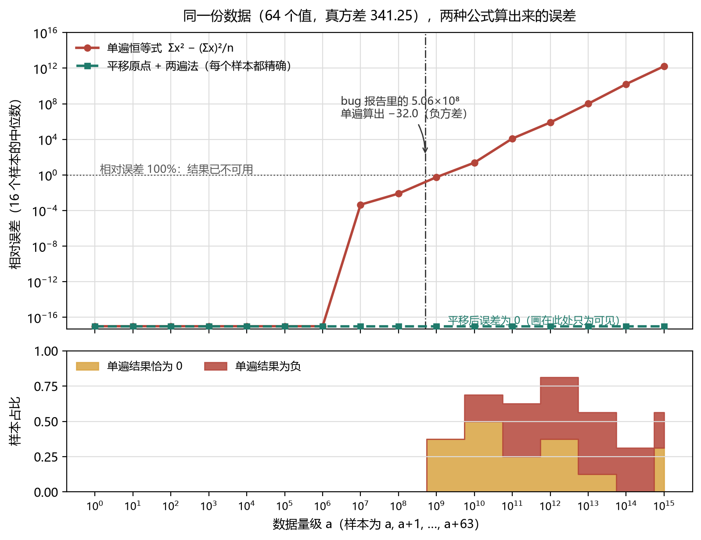

# How Can a Variance Be −32?

Before the fix (`main` as of the parent of `251b3927`):

```nushell
[506250000.0 506250001.0] | math variance   # -32.0
[506250000.0 506250001.0] | math stddev     # NaN
[1000000000 1000000001 1000000002] | math variance   # 0.0
```

Two numbers one apart: the true variance is **0.25**. Three consecutive integers: the true value is **2/3**. The command returns a negative number, a `NaN`, and a zero.

A variance is a sum of squares. How can it be negative? That is the interesting part: the minus sign is not garbage out of nowhere. It is floating-point subtraction honestly reporting what it computed — two nearly equal numbers are subtracted, everything left in the low bits is noise, and the sign falls out of rounding. `math stddev` then takes the square root, and the noise becomes a quiet `NaN`.

The fix landed in nushell on 10 October 2026 ([#19108](https://github.com/nushell/nushell/pull/19108), squashed to [`251b3927`](https://github.com/nushell/nushell/commit/251b39276970c015fb6d97d9ee750fe14788f62c), milestone 1.0). What is worth writing about is not "a more stable formula replaced an unstable one", but **which one was chosen**: the first version fixed the three commands in the report and broke a case that had been correct — constant series. What shipped shifts the origin to the minimum before doing the two-pass.

The conclusions up front:

- The culprit is the one-pass identity `S = Σx² − (Σx)²/n`. It is exact in mathematics and hopeless in floating point: to get 0.25 you have to subtract two numbers around 10¹⁷, where the f64 ulp is 32 and every low bit is rounding noise. The result can be 0, any positive number, or a negative one.
- The plain two-pass method (mean first, then sum of squared deviations) removes the cancellation, but **the mean itself has to be summed first**: constant series get polluted by that sum's rounding, and `1e308` overflows while summing.
- Subtracting `min` first and running the two passes in residual coordinates kills both problems at once: the residuals of a constant series are exactly 0, and the overflow threshold drops from the data's magnitude to `range`. This is not a guarantee — the sum of squares can still overflow even when the true variance fits in f64 (Section 7, item 2).

---

If you are short on time: Sections 1–3 are the main line — problem, fix, trade-off. Sections 4 and 5 are closer to an appendix: the full experiment and the test list. Come back to them later.

## 1. The error is not in the derivation but in the cancellation

The definition of variance is inherently two-pass:

```
S = Σ (xᵢ − x̄)²,   var = S / n   (sample variance: divide by n−1)
```

You need the mean before you can compute a deviation. To make it a single pass, statistics textbooks offer an identity:

```
S = Σxᵢ² − (Σxᵢ)²/n
```

The derivation is fine. The computation is not: the right-hand side **subtracts two nearly equal huge numbers**. Both terms are about `n·a²` (a is the data's magnitude), while the `S` we want is only `n·σ²`. The significant digits are eaten in that one subtraction.

How many digits get eaten depends on "how far from zero the data sits" relative to "how spread out the data is". Chan, Golub and LeVeque quantified this in their 1983 survey: the condition number of the variance problem is

```
κ = ‖x‖₂ / √S  ≥ 1
```

When the mean is much larger than the standard deviation, `κ ≈ x̄/σ`. The textbook one-pass algorithm has a relative error bound of `N·κ²·u` (u is machine epsilon, about 1.1×10⁻¹⁶ for f64). That is, the sensitivity of the problem grows with the **square** of mean-over-standard-deviation. This is a property of the data, not of the algorithm: another algorithm can change the constants and the order in the bound, not the growth.

Walk the first command from the report:

- `5.0625×10⁸` squared is `2.562890625×10¹⁷`. At that magnitude adjacent f64 values are 32 apart (ulp = 2⁵), so one squaring costs up to 16 of rounding error.
- Adding the two squares gives `5.1×10¹⁷`, where the ulp is already 64; `Σx²` and `(Σx)²/n` each carry an absolute error of a few dozen.
- The true variance is 0.25. Subtract two numbers with errors of a few dozen and the −32.0 you get is noise from end to end, sign included.

The three-integer case is blunter: `Σx²` and `(Σx)²/n` are both around `3×10¹⁸`, where the ulp is 512; the true `S = 2`, and after converting both sides to f64 and dividing, the answer is `0.0`.

A negative variance is mathematically impossible, which makes it a rather good alarm. In Chan et al.'s words it is "a blessing in disguise since this at least alerts the programmer that disastrous cancellation has occurred" — except `math stddev` turned it into a silent `NaN`.

---

## 2. Move the origin next to the data

The merged code looks like this ([`variance.rs`](https://github.com/nushell/nushell/blob/main/crates/nu-command/src/math/variance.rs)):

```rust
let denom = variance_denominator(nums.len(), sample, head, span)? as f64;
// Shift the origin to the smallest value, then average and accumulate the
// deviations of the residuals.
let origin = nums.iter().copied().fold(f64::INFINITY, f64::min);
let mean = nums.iter().map(|x| x - origin).sum::<f64>() / nums.len() as f64;
let ss = nums.iter().map(|x| {
    let d = (x - origin) - mean;
    d * d
}).sum::<f64>();
Ok(ss / denom)
```

That is `r = x − min`, `m = Σr/n`, `var = Σ(r − m)² / denom`. In implementation it is three passes: take `min`, average the residuals, accumulate the sum of squares.

The shift is an identity: `Σ(x−d − (x̄−d))² = Σ(x−x̄)²`. Subtracting the same constant from every value cannot change a variance. In floating point it buys four things:

1. **The condition number decouples from the data's absolute size.** After shifting, `κ_d = ‖x−d‖₂/√S`. Chan et al. give a clean bound: as long as `d` lies in `[min, max]`, `κ_d² < 1 + N`. Choosing `d = min` is the least effort among them: it is one of the data points, the residuals are non-negative, and they are bounded by `range`. The magnitude `a` disappears from the formula.
2. **Constant series are exactly zero.** Every residual is `x − x = 0`, the mean is 0, the sum of squares is 0 — regardless of whether `a` is 0.3 or 1e150.
3. **Neither pass cancels.** The residuals are non-negative, so averaging them is a sum of positive numbers; the second pass adds squares, which is even safer. Error accumulates linearly in the number of terms instead of being amplified by `κ²`.
4. **The overflow threshold drops from `a` to `range`.** Residuals are bounded by `range`, so `Σr ≤ n·range` rather than `n·a`. But that lowers the threshold, it does not remove it: the sum of squares has to fit in f64, and `ss ≈ n·var`, so even when `var` itself is representable, some `d²` or `ss` can overflow first. Be careful once `range` exceeds about `1.3×10¹⁵⁴`, or when `n·range²` approaches the f64 maximum (Section 7, item 2).

### Why min, not mean

"Subtract the mean first, then do two passes" looks more natural, and it costs you a mean that has to be summed first:

- `[1e308 1e308]` sums to `inf`, the mean is `inf`, the deviation is `−inf`, the result is `NaN`;
- the sum of a constant series carries an absolute error of about `n·u·a`, the mean is off by about `u·a`, the residuals are no longer 0, and squaring amplifies them to about `(n·u·a)²`.

Chan et al. warn about exactly this: using the **computed mean** as the shift degrades the condition bound to `1 + N²κ²u²`, and "One can easily construct examples where the computed mean does not even lie between min *xᵢ* and max *xᵢ*". `min` needs nothing computed first; it is already there in the input, exact.

`min` rather than the first element, because that keeps the residuals non-negative and their bound as tight as possible; and the choice of origin does not depend on element order. Note that this applies to the origin only: the sums are still sequential, and a different order can change the last few ulps (Section 3, the Welford bullet, has an example). Any data point works as a shift — `κ² < 1+N` holds all the same.

---

## 3. Why not "just any two-pass method"

The first version of the PR simply routed the `Number` path through the plain two-pass method that the same file already used for durations and file sizes. The three commands from the report were fixed, and review found it had broken something that used to be right: **constant series**.

For identical values, the one-pass identity often cancels exactly to 0 (both terms are computed from the same numbers and tend to land on the same float); the plain two-pass mean is polluted by the sum's rounding and returns something non-zero. `1..64 | each { 1e150 } | math variance` is 0 on `main` and `2.97×10²⁶⁹` in the first version; `0.3` repeated ten times: 0 on `main`, `3.08×10⁻³³` in the first version. A fix must not trade one failure mode for another.

The choice was settled by the maintainer fdncred during review: `r = x − min`, `m = Σr/n`, `Σ(r − m)²/denom`, with the constant-series case added as a test.

So every candidate was measured. The table below is `variance_demo`'s output (population variance, f64; bold marks a value that disagrees with the truth; `×k` means repeated k times):

| Case | True | One-pass | Two-pass | Σ(x/n) | corrected | Welford | Shifted |
|---|---|---|---|---|---|---|---|
| `[506250000.0 506250001.0]` | 0.25 | **−32** | 0.25 | 0.25 | 0.25 | 0.25 | 0.25 |
| `[1000000000 1000000001 1000000002]` | 2/3 | **0** | 2/3 | 2/3 | 2/3 | 2/3 | 2/3 |
| `1..64 \| each { 1e150 }` | 0 | 0 | **2.97e269** | **2.97e269** | 0 | 0 | 0 |
| `[0.3]×10` | 0 | 0 | **3.08e−33** | **3.08e−33** | 0 | 0 | 0 |
| `[2⁶²]×7` | 0 | 0 | 0 | **1048576** | 0 | 0 | 0 |
| `[1e308 1e308]` | 0 | **NaN** | **inf** | 0 | **NaN** | 0 | 0 |
| `[2⁵² 2⁵²+1]` | 0.25 | **4.5e15** | **0.5** | **0.5** | 0.25 | **0.5** | 0.25 |
| `[2⁵³+1 2⁵³+2]` | 1 (f64) | **1.8e16** | **2** | **2** | 1 | **2** | 1 |
| `[4000000000 4000000001]` | 0.25 | **0** | 0.25 | 0.25 | 0.25 | 0.25 | 0.25 |
| `[1e300 1e300+1e285]` | 2.5e569 (beyond f64) | **NaN** | inf | inf | **NaN** | inf | inf |
| `[−1e308 1e308 1e308 1e308]` | 7.5e615 (beyond f64) | **NaN** | inf | inf | **NaN** | **NaN** | NaN |

> The `[4000000000 4000000001]` row reimplements the arithmetic in f64: nushell's old integer path hits `OperatorOverflow` in `Value::mul` while squaring and never reaches the final subtraction.

Case by case, every variant has its own pit:

- **Plain two-pass**: the cancellation is gone, but constant series regress (`1e150` repeated 64 times, `0.3` repeated 10 times), and the mean overflows on `[1e308 1e308]`. It also returns 0.5 for `[2⁵², 2⁵²+1]` — the sum `2⁵³+1` rounds to `2⁵³`, the mean becomes `2⁵²`, and the second deviation is computed as 1.
- **`Σ(x/n)`**: dividing each element by n before summing changes `[1e308 1e308]` from `inf` to 0. But `x/n` is no longer exact, so the residuals of a constant series carry a same-signed error; `1e150` repeated 64 times still fails, and `[2⁶²]×7` returns 1048576.
- **Corrected two-pass** (`Σd² − (Σd)²/n`, `d = x − x̄`): close to right. It fixes the cases from the report, the constant series, and `[2⁵², 2⁵²+1]`; but the correction term still uses the plain mean, so `[1e308 1e308]` stays `NaN`. It handles constant series by having a second error cancel the first; the shift makes the residuals zero structurally.
- **Welford**: one pass, stable, common — and **order-dependent**. It gives 0.5 for `[2⁵², 2⁵²+1]` and 0 for `[2⁵²+1, 2⁵²]`: in the second order the mean goes from `2⁵²+1` down by 0.5, landing exactly halfway between two representable numbers, rounds to even back to `2⁵²`, and the second deviation becomes 0. The same multiset, a different order, a different answer — for a shell command that is the hardest kind of behaviour to explain. The shift does not remove order dependence; it pushes the difference into the last bits: `[0, 1e16, 1, 1]` and `[0, 1, 1, 1e16]` differ by one ulp (`1.875×10³¹` versus `1.8749999999999998×10³¹`), never 0.5 versus 0.
- **Shifted origin**: hits all of the above.

One more comparison that is easy to miss: **the one-pass formula is often exact on constant series**. That is the one scenario it wins, and the reason you cannot just swap in the plain two-pass method — a fix has to satisfy both "no cancellation under a large offset" and "constant series still give 0", and shifting by `min` is the shortest path that does both.

---

## 4. Measurements: how the error grows with magnitude

Construct a dataset: `a, a+1, …, a+63`, whose true variance is fixed at `(64²−1)/12 = 341.25`. Let `a` run from 10⁰ to 10¹⁵, taking 16 mantissas per decade (`a = 10^t·(1 + j/16)`) — 256 samples in total — and compare the relative error of the one-pass formula against the shifted two-pass.



| Magnitude a | One-pass relative error (median of 16) | Exactly 0 | Negative |
|---|---|---|---|
| ≤ 10⁶ | 0 (exact) | 0 | 0 |
| 10⁷ | 4.6×10⁻⁴ | 0 | 0 |
| 10⁸ | 8.1×10⁻³ | 0 | 0 |
| 10⁹ | 0.56 | 6/16 | 0 |
| 10¹⁰ | 24 | 8/16 | 3/16 |
| 10¹¹ | 1.2×10⁴ | 4/16 | 6/16 |
| 10¹² | 7.9×10⁵ | 6/16 | 7/16 |
| 10¹³ | 1.0×10⁸ | 2/16 | 7/16 |
| 10¹⁴ | 1.6×10¹⁰ | 0 | 5/16 |
| 10¹⁵ | 1.6×10¹² | 5/16 | 4/16 |

Of the 256 samples, the one-pass formula is **exact in only 116** (all below 1.2×10⁷), exactly 0 in 31, negative in 32, with a maximum relative error of 4.9×10¹²; the shifted two-pass has a maximum relative error of **0**.

The error is not "occasionally a bit off". From 10⁹ up, each decade multiplies the median error by roughly two orders of magnitude, which matches the quadratic growth of `κ²`: by 10⁹ it is already 56%, and by 10¹⁰ most results are either 0 or negative.

### Why the knee sits near 10⁷

This subsection explains the integer samples above; it is not a theorem about exactness for general data.

`Σx²` is a sum of 64 squares, each about `a²`. On this grid (`a` is an integer once `t ≥ 4`), every step stays an exact integer as long as the running sum does not cross `2⁵³`: `64a² < 2⁵³ ≈ 9.0×10¹⁵` gives `a` just under `1.186×10⁷`. The measured knee is a little above that line, near `1.19×10⁷`: between `2⁵³` and `2⁵⁴` the ulp is 2, so integers still sit on grid points and a few samples happen to avoid rounding. Of the 116 exact samples, 112 are below 10⁷ and the other 4 fall between 10⁷ and `1.19×10⁷`.

The subtrahend `(Σx)²/64` is exact over the same range, but not because of its size: when `a` is an integer, `Σx = 64a + 2016` is a multiple of 32, its square is a multiple of 1024, and the ulp at that magnitude is at most 128 — so the squaring itself does not round. Both intermediate terms are exact, and the difference is the exact 21840.

For a general set of floats neither holds automatically: the sum of squares rounds, `(Σx)²` rounds, and the error bound is still `N·κ²·u`, growing with the square of mean-over-standard-deviation. This line explains an experiment, not a guarantee.

### Three boundaries

- **`[2⁵², 2⁵²+1]` → 0.25.** Both values are exactly representable in f64; after the shift the residuals are 0 and 1, the mean is 0.5, the variance is 0.25, all exact. A test pins this down — it is the smallest proof that the shift makes the subtraction exact.
- **`[2⁵³+1, 2⁵³+2]` → 1.0.** As `i64` they are exact; converted to `f64` they land on `2⁵³` and `2⁵³+2`, whose true variance is 1.0 (the original integers would give 0.25). This is a cost of the conversion to `f64`, not a regression, and both the release note and the code comment say so (`math avg` has been making the same trade-off for a long time).
- **`[4000000000, 4000000001]` → 0.25.** The old path squared with `Value::mul` (`checked_mul`), and `1.6×10¹⁹` exceeds `i64`, so it reported `OperatorOverflow`; now it computes in f64. That is a user-visible behaviour change: from an error to an approximation.

What cannot be saved is input whose true variance is itself outside f64: `[1e300, 1e300+1e285]` has a true variance around `2.5×10⁵⁶⁹`, so `inf` is the only option; `[−1e308, 1e308, 1e308, 1e308]` has a true value around `7.5×10⁶¹⁵`, where `NaN` or `inf` are both acceptable. The PR discussion explicitly marked this out of scope.

There is a less obvious class too: the true value is representable but an intermediate square overflows first. 99 zeros plus one `1e155` has a true variance of `9.9×10³⁰⁷`, inside f64, but the largest deviation is `9.9×10¹⁵⁴` and its square is `9.8×10³⁰⁹`, so the shifted method still returns `inf`; see Section 7, item 2.

---

## 5. What the ten tests pin down

The fix ships 9 `math variance` integration tests and 1 `math stddev` test:

| Test | Behaviour pinned |
|---|---|
| `variance_large_close_floats` | the `−32.0` from the opening → `0.25` |
| `variance_large_close_ints` | the three big integers that used to return `0.0` → `2/3` |
| `variance_of_equal_huge_floats_is_exact_zero` | `[1e308 1e308]` → `0` (was NaN before the shift) |
| `variance_constant_huge_floats_is_exact_zero` | `1..64 \| each { 1e150 }` → `0` (the plain two-pass regression) |
| `variance_large_close_ints_just_above_2_pow_52` | `[2⁵², 2⁵²+1]` → `0.25` (the subtraction is exact) |
| `variance_ints_whose_square_overflows_i64` | `[4000000000, 4000000001]` → `0.25` (the old path errored) |
| `variance_ints_above_2_pow_53_are_approximate` | `[2⁵³+1, 2⁵³+2]` → `1.0`, with the original integers' 0.25 noted |
| `sample_variance_large_close_floats` | the `n−1` denominator for `--sample`: `0.5` |
| `variance_of_ints_is_still_float` | the result type is still `float` |
| `stddev_large_close_values` | `math stddev` on the same input → `0.5` (was NaN) |

Two things about how the float tests are written:

1. **Every expected value is exactly representable**: 0.25, 0.5, 0, 1.0. The correct answer for these cases is exact, so the assertion uses exact equality, not an epsilon. A tolerance like `1e-9` would let real regressions through.
2. **The `2/3` case is written `2.0 / 3.0`**, taking the same rounding path as `ss / denom` in the code — both divide 2 by 3 once, so the results must agree. That is not "approximately equal", it is the same operation.

Both **sides** of a boundary are pinned, too: `[4000000000, 4000000001]` is the side where the old path errored and the new one is exact; `[2⁵³+1, 2⁵³+2]` is the side where the conversion to f64 makes it approximate. Pin one side only and a moving boundary goes unnoticed; pin both and the boundary is boxed in.

---

## 6. How everyone else computes a variance

This is not a problem unique to nushell, and the method is not ours. What some mainstream implementations do:

| Implementation | Formula | Numerical device |
|---|---|---|
| CPython `statistics` | the same one-pass identity `Σx² − (Σx)²/n` | **exact rational** arithmetic with `Fraction`, converting to float only at the end; the source comment says it outright: "This formula has poor numeric properties for floats, but with fractions it is exact." |
| NumPy `_var` | two-pass: mean, then sum of `(x − mean)²` | pairwise summation for the reduction |
| R `var`/`cov` | two-pass: mean, then centred cross-products | the mean is corrected once more (`tmp + Σ(x−tmp)/n`), and accumulators are `long double` |
| Julia `var` | arrays: two-pass (`mean` + `centralize_sumabs2`); iterators: Welford | pairwise reduction for arrays |
| nushell `math variance` | shifted origin + two-pass | all f64, no extra dependencies |

What they have in common: **none of them is "one-pass identity + sequential summation + f64"**. CPython keeps the formula but switches to exact arithmetic; R uses `long double` and a corrected mean; NumPy and Julia use two passes plus pairwise. nushell's constraints are different: the data is already a `&[Value]` in memory, so a second pass costs no extra space; Rust has no `long double`; and pulling rationals or compensated summation into a `math` command is not worth it. Under those constraints, shifting by `min` plus an f64 two-pass is the smallest change that works.

---

## 7. Bounds, wording, and open questions

1. **"The shift is exact for every input" needs a caveat.** The merged comment says exactly that. Strictly, `x − min` is guaranteed exact (Sterbenz's lemma) only when `min > 0` and `x ≤ 2·min`; in general the residual takes one rounding, with an error on the scale of `range`. The two properties the algorithm actually relies on are unaffected: the residuals of a constant series are exactly 0, and residuals are bounded by `range`, so `κ` does not grow with `a`. The comment deserves a more accurate wording in a follow-up PR — it does not change any result, but it will mislead the next person reading the code.
2. **The sum of squares can still overflow, even when the true variance is representable.** 99 zeros plus one `1e155`: the true variance `9.9×10³⁰⁷` fits in f64, but after the shift the largest deviation is `9.9×10¹⁵⁴`, its square overflows, and the result is `inf`. Since `ss ≈ n·var`, `var` has to be below roughly `MAX/n` to be safe. This is a ceiling shared by every implementation that accumulates squared deviations in f64 before dividing by n; #19108 only moved the trigger from "data far from zero" to "`range` is large".
3. **No promises for input whose true value exceeds f64.** The variance of `1e300` and `1e300+1e285` is `2.5×10⁵⁶⁹`, which f64 cannot hold; `inf` or `NaN` are both reasonable results.
4. **Integers above `2⁵³` are approximate.** Consistent with `math avg`, and stated in the release note.
5. **The error bound is not zero for large N.** Per Chan et al.'s Table 1, the two-pass bound is `N·u + N²·κ²·u²`; after shifting to `min` and substituting `κ_d² < 1 + N`, the second term becomes `N³·u²`. At N = 10⁷ that is about `1.2×10⁻¹¹`, still below the first term `N·u ≈ 1.1×10⁻⁹`; around a hundred million elements the second term catches up. Every case in this post is under 64 elements.
6. **The one-pass formula is often exact on constant series** — that is its last redoubt, and any replacement has to show it does not retreat from it.

---

## Reproducing this

The verification project lives in `variance_demo/` and depends only on the standard library:

```sh
cd variance_demo
cargo test --release     # 7 tests: merged behaviour, counterexamples for each candidate, two boundaries
cargo run --release      # prints every table and the scan data, and writes out/*.csv
```

The six functions `naive` / `two_pass_plain` / `mean_div_n` / `corrected_two_pass` / `welford` / `shifted` correspond to the six variants above; `naive` performs the arithmetic in the same order as the old `sum_of_squares`. The 256-sample scan is produced by `cargo run`, and `plot_fig1.py` draws the figure from the CSV.

On the nushell side, three commands verify it (a build containing `251b3927` is required):

```nushell
[506250000.0 506250001.0] | math variance            # 0.25
[506250000.0 506250001.0] | math stddev              # 0.5
[1000000000 1000000001 1000000002] | math variance   # 0.6666666666666666
```

---

## References

- Tony F. Chan, Gene H. Golub, Randall J. LeVeque, *Algorithms for Computing the Sample Variance: Analysis and Recommendations*, The American Statistician 37(3), 1983. [doi:10.1080/00031305.1983.10483115](https://doi.org/10.1080/00031305.1983.10483115) 【Read in full; the condition number, the error bounds in Table 1, and the shift analysis in §3 all come from this paper】
- B. P. Welford, *Note on a Method for Calculating Corrected Sums of Squares and Products*, Technometrics 4(3), 1962. [doi:10.1080/00401706.1962.10490022](https://doi.org/10.1080/00401706.1962.10490022) 【Known only through Chan et al.'s survey; its error proof is not reproduced here】
- Sterbenz's lemma (1974): if `a ≤ b ≤ 2a`, then `b − a` is exact in same-precision floating point. [Wikipedia](https://en.wikipedia.org/wiki/Sterbenz_lemma) 【Textbook result】
- nushell PR [#19108](https://github.com/nushell/nushell/pull/19108); merge commit [`251b3927`](https://github.com/nushell/nushell/commit/251b39276970c015fb6d97d9ee750fe14788f62c); [`variance.rs`](https://github.com/nushell/nushell/blob/main/crates/nu-command/src/math/variance.rs); [variance tests](https://github.com/nushell/nushell/blob/main/crates/nu-command/tests/commands/math/variance.rs)
- CPython [`Lib/statistics.py`](https://github.com/python/cpython/blob/main/Lib/statistics.py) (`_ss`); NumPy [`_methods.py`](https://github.com/numpy/numpy/blob/main/numpy/_core/_methods.py) (`_var`); R [`cov.c`](https://github.com/wch/r-source/blob/trunk/src/library/stats/src/cov.c); Julia [`Statistics.jl`](https://github.com/JuliaLang/Statistics.jl/blob/master/src/Statistics.jl). All source snapshots as of 2026-10.

---

### Footnotes

① Method: the nushell outputs quoted here (`−32.0`, `NaN`, `0.0`, `0.25`, `0.5`, `0.666…`) come from the verification recorded in the PR against a local build; the numerical experiments were re-run by `variance_demo` on Rust 1.98 / f64, with the same order of operations as the old implementation. Every number in the tables is actual `cargo run --release` output, not hand arithmetic.

② Cost: a tight loop over 10M f64 values takes 5.2–5.9 ms one-pass and 16–18 ms for the shifted two-pass (mean of 20 runs; i9-13900HX, rustc 1.98.1, `--release`, data `5.0625×10⁸ + i mod 1000`). The shift is three passes in implementation (min, residual mean, sum of squares); what it adds is a constant number of memory sweeps, and the complexity is still O(n). Inside nushell every element also goes through `to_unit_f64` first, a fixed cost both algorithms pay.

③ Four claims were corrected during revision. First, "the plain two-pass breaks constant series" was initially attributed to "an inaccurate mean"; more precisely, the mean's summation error is on the scale of the data's magnitude a, so the residuals are no longer 0 — once the shift removes that step, the zero for constant series is structural. Second, the error bound in Section 7 was first written as `κ²u + N²κ²u²`; against Table 1, row 3, the correct form is `N·u + N²·κ²·u²`. Third, Section 2 first said "overflow only happens when range approaches the f64 maximum"; in fact 99 zeros plus one `1e155` overflows in the square even though the true variance is representable. Fourth, Section 4 first attributed the knee to "both intermediate terms being exact"; in fact the minuend crosses 2⁵³ first, and the subtrahend stays exact only because of its divisibility structure.
