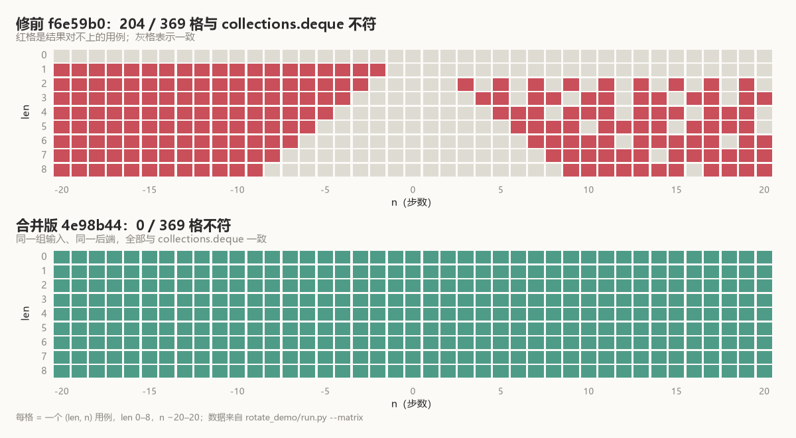

# Four steps, one element short

Ask the standard library to rotate `[1, 2, 3]` left by four:

```python
from collections import deque
deque([1, 2, 3]).rotate(-4)
# deque([2, 3, 1])
```

Ask Pottery's `RedisDeque` the same thing:

```python
q = RedisDeque([1, 2, 3], redis=redis)
q.rotate(-4)
list(q)          # [2, 3], before the fix
```

The `1` is not in the wrong place. It is gone.

Push the step count up to six, a full turn of a three-element deque, which should return it untouched:

```python
q = RedisDeque([1, 2, 3], redis=redis)
q.rotate(-6)
list(q)          # [], before the fix
```

The deque comes back empty.

## Three lines, two lengths

The pre-fix [`rotate()`](https://github.com/brainix/pottery/blob/f6e59b0127f3375278fd473450fff1152548f7c7/pottery/deque.py#L140-L167), in three lines:

```python
push_method_name = 'lpush' if n > 0 else 'rpush'
values = self[-n:][::-1] if n > 0 else self[:-n]
trim_indices = (0, len(self)-1) if n > 0 else (-n, len(self)-1-n)
```

`values` comes out of a Python slice. A slice that runs past the end does not raise; its endpoints are clamped to the valid range.

`trim_indices` is computed from `n` directly. It has no way to know the slice was clamped.

Work `n = -4` by hand:

- `self[:-n]` is `self[:4]`, and on three elements that slice gives all of `[1, 2, 3]`;
- after `RPUSH 1 2 3`, the list is `[1, 2, 3, 1, 2, 3]`;
- `LTRIM 4 6` keeps indices 4 and 5, which is `[2, 3]`.

Three values pushed, four assumed by the trim. The step where the slice clamped is a step the trim never heard about.

`n = -6` is blunter: `LTRIM 6 8` starts past the end of the pushed list and leaves nothing.

**`values` has length `min(|n|, len)`, while `trim_indices` is computed from `|n|`.** The two agree only while `|n| <= len`.

## 369 cells

Lengths 0 to 8, steps −20 to 20: 369 combinations. Each runs on a fresh fakeredis instance, reads the list back, and compares it against `collections.deque.rotate` on a deque of the same length.

Before the fix, 204 of them disagree.



The red cells cluster where `|n| > len`, with `|n| = len` as the boundary. The `len = 0` row has none: an empty deque returns early in both versions.

The two directions fail differently. Negative overflow loses elements:

| `n` (len=3) | stdlib | before | commands, before |
|---:|---|---|---|
| `4` | `[3, 1, 2]` | `[1, 2, 3]` | `LPUSH 3 2 1`; `LTRIM 0 2` |
| `-4` | `[2, 3, 1]` | `[2, 3]` | `RPUSH 1 2 3`; `LTRIM 4 6` |
| `6` | `[1, 2, 3]` | `[1, 2, 3]` | `LPUSH 3 2 1`; `LTRIM 0 2` |
| `-6` | `[1, 2, 3]` | `[]` | `RPUSH 1 2 3`; `LTRIM 6 8` |
| `7` | `[3, 1, 2]` | `[1, 2, 3]` | `LPUSH 3 2 1`; `LTRIM 0 2` |
| `-7` | `[2, 3, 1]` | `[]` | `RPUSH 1 2 3`; `LTRIM 7 9` |

Key names omitted.

Positive overflow is mostly a wrong order, with every element still present: `n = 4` returns `[1, 2, 3]` where the standard library returns `[3, 1, 2]`.

That happens because `LPUSH` inserts multiple arguments at the head in reverse order. `values` is `[3, 2, 1]`; `LPUSH 3 2 1` turns the list into `[1, 2, 3, 1, 2, 3]`, and `LTRIM 0 2` keeps the first three — back to where it started.

The result happens to equal "no rotation". The commands still ran.

## The previous fix touched a different layer

[#327](https://github.com/brainix/pottery/pull/327) had already edited `RedisDeque.rotate()` back in 2021. It fixed the argument order of `LPUSH` and the tail endpoint of `LTRIM`, so that ordinary ±2 rotations came out right; its test used ten elements and ±2.

±2 never reaches the `|n| > len` region.

In August 2026, [#849](https://github.com/brainix/pottery/issues/849) pointed at that hole using static analysis, and labelled itself "Static-analysis finding (not executed)". The `[2, 3]` in that issue was traced through the code path, not produced by running it. The 369 cases here produce it: 204 disagreements.

## Why not take the modulo

The issue suggested `n %= len(self)`. Mathematically that is equivalent.

The author did not take it:

> I did not use the bare `n %= len(self)` suggested in the issue, because it would turn a small negative rotation into a large positive one - e.g. `rotate(-2)` on a 10-element deque becomes `-2 % 10 == 8`, pushing 8 elements instead of 2.

`-2 % 10` is 8 in Python. Eight and −2 produce the same order, but not the same amount of work: the existing slice/trim structure would take 8 at face value, `LPUSH` eight values, and `LTRIM` a correspondingly longer span. On ten elements, two values were enough.

The merged version adds one step after the modulo:

```python
length = len(self)
n %= length
if n > length // 2:
    n -= length
if n == 0:
    # A whole number of turns is a no-op.
    return
```

`8 > 5`, so it goes back to −2.

## After the fold

With the patch, `-4` sends `RPUSH 1` and `LTRIM 1 3` — one value pushed. `-2` on ten elements still sends `RPUSH 0 1` and `LTRIM 2 11`, two values. A whole turn reaches `if n == 0: return`: two `LLEN` calls, then no push and no trim.

`rotate_demo/run.py --test` runs those 369 cells; `--matrix` exports every cell to JSON, which is what draws the matrix above.

369 cells green. The patch does not touch the slice or the trim; it folds the step count, in front of them, into the equivalent rotation that moves the fewest elements. How far to turn and how much to move were two things, and those three lines had packed both into the same `n`.
