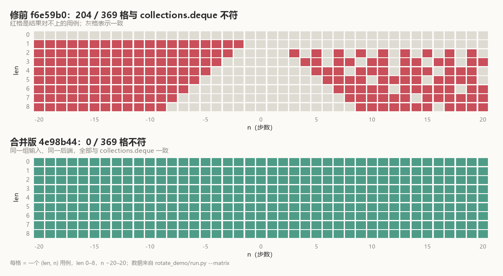

# 转四步，少了一个元素

`[1, 2, 3]` 左转四步，标准库给 `[2, 3, 1]`：

```python
from collections import deque
deque([1, 2, 3]).rotate(-4)
# deque([2, 3, 1])
```

Pottery 的 `RedisDeque` 在同样的输入上给 `[2, 3]`：

```python
q = RedisDeque([1, 2, 3], redis=redis)
q.rotate(-4)
list(q)          # [2, 3]      # 修前
```

`1` 不是排错了位置，它没了。

把步数加到六，三元素转六步本该原样不动：

```python
q = RedisDeque([1, 2, 3], redis=redis)
q.rotate(-6)
list(q)          # []          # 修前
```

整个清空。

## 三行里的两个长度

修前的 [`rotate()`](https://github.com/brainix/pottery/blob/f6e59b0127f3375278fd473450fff1152548f7c7/pottery/deque.py#L140-L167) 关键三行：

```python
push_method_name = 'lpush' if n > 0 else 'rpush'
values = self[-n:][::-1] if n > 0 else self[:-n]
trim_indices = (0, len(self)-1) if n > 0 else (-n, len(self)-1-n)
```

`values` 由 Python 切片取出。切片越界不报错，端点会被夹到有效范围。

`trim_indices` 由 `n` 直接算。它不知道切片被夹过。

手推 `n = -4`：

- `self[:-n]` 是 `self[:4]`，三元素的切片给全部 `[1, 2, 3]`；
- `RPUSH 1 2 3` 之后，列表是 `[1, 2, 3, 1, 2, 3]`；
- `LTRIM 4 6` 只保留索引 4 和 5，也就是 `[2, 3]`。

push 了三个，trim 按四个算。切片夹住的那一步，裁切不知道。

`n = -6` 更直接：`LTRIM 6 8` 的起点已经超过 push 后的列表长度，留下空列表。

**`values` 的长度是 `min(|n|, len)`，`trim_indices` 却按 `|n|` 算。** 两者只有在 `|n| <= len` 时才一致。

## 369 个格子

长度 0 到 8、步数 −20 到 20，一共 369 个组合。每个组合在一个新的 fakeredis 实例上跑一遍，读回列表，和同长度的 `collections.deque.rotate` 对照。

修前 204 格对不上。



红格集中在 `|n| > len` 的区域，边界就是 `|n| = len`。`len = 0` 那一行没有红格：空 deque 的旋转两版都提前返回，不做事。

正负两侧的形状不一样。负方向的越界会丢元素：

| `n`（len=3） | 标准库 | 修前 | 修前命令 |
|---:|---|---|---|
| `4` | `[3, 1, 2]` | `[1, 2, 3]` | `LPUSH 3 2 1`；`LTRIM 0 2` |
| `-4` | `[2, 3, 1]` | `[2, 3]` | `RPUSH 1 2 3`；`LTRIM 4 6` |
| `6` | `[1, 2, 3]` | `[1, 2, 3]` | `LPUSH 3 2 1`；`LTRIM 0 2` |
| `-6` | `[1, 2, 3]` | `[]` | `RPUSH 1 2 3`；`LTRIM 6 8` |
| `7` | `[3, 1, 2]` | `[1, 2, 3]` | `LPUSH 3 2 1`；`LTRIM 0 2` |
| `-7` | `[2, 3, 1]` | `[]` | `RPUSH 1 2 3`；`LTRIM 7 9` |

表里只写命令和参数，key 名省略。

正方向的越界多半是顺序错，元素还在。`n = 4` 给 `[1, 2, 3]`，标准库给 `[3, 1, 2]`。

这是因为 `LPUSH` 的多参数按参数逆序插到表头。`values` 是 `[3, 2, 1]`，`LPUSH 3 2 1` 之后列表变成 `[1, 2, 3, 1, 2, 3]`，再 `LTRIM 0 2` 保留前三项——正好回到原样。

结果碰巧等于"没转"，但命令确实执行了。

## 上一次修的是另一层

[#327](https://github.com/brainix/pottery/pull/327) 在 2021 年动过 `RedisDeque.rotate()`。那次改的是 `LPUSH` 的参数顺序和 `LTRIM` 的尾端点，让普通的 ±2 旋转正确，测试是 10 元素 ±2。

±2 不会走到 `|n| > len` 的区域。

2026 年 8 月，[#849](https://github.com/brainix/pottery/issues/849) 用静态分析指出了这个缺口，自己标了「Static-analysis finding (not executed)」。issue 里的 `[2, 3]` 是按代码路径推出来的，不是当时跑出来的。这次的 369 个用例把它跑出了 204 个不符。

## 为什么不直接取模

issue 建议的修法是 `n %= len(self)`。数学上等价。

作者没有直接用：

> I did not use the bare `n %= len(self)` suggested in the issue, because it would turn a small negative rotation into a large positive one - e.g. `rotate(-2)` on a 10-element deque becomes `-2 % 10 == 8`, pushing 8 elements instead of 2.

`-2 % 10` 在 Python 里是 8。8 和 -2 转出来的顺序一样，但搬运量不一样：原来的 slice/trim 结构会按 8 去搬，`LPUSH` 八个值，`LTRIM` 一段更长的列表。对 10 元素来说，本来搬两个就够了。

合并版在取模之后又加了一步：

```python
length = len(self)
n %= length
if n > length // 2:
    n -= length
if n == 0:
    # A whole number of turns is a no-op.
    return
```

`8 > 5`，所以折回 -2。

## 折短之后

补丁之后，`-4` 发的是 `RPUSH 1` 和 `LTRIM 1 3`——推一个值。`-2` 在十元素上仍是 `RPUSH 0 1`、`LTRIM 2 11`，两个值。整圈走到 `if n == 0: return`，两次 `LLEN` 之后不再发 push，也不发 trim。

`rotate_demo/run.py --test` 跑那 369 格；`--matrix` 把每一格的结果导成 JSON，上面那张矩阵图就是它画的。

369 格全绿。补丁没有碰 slice/trim，只在它前面把步数折成等价的、搬运量最小的那个。转多少是一件事，搬多少是另一件事，原来那三行把两件事塞进了同一个 `n` 里。
