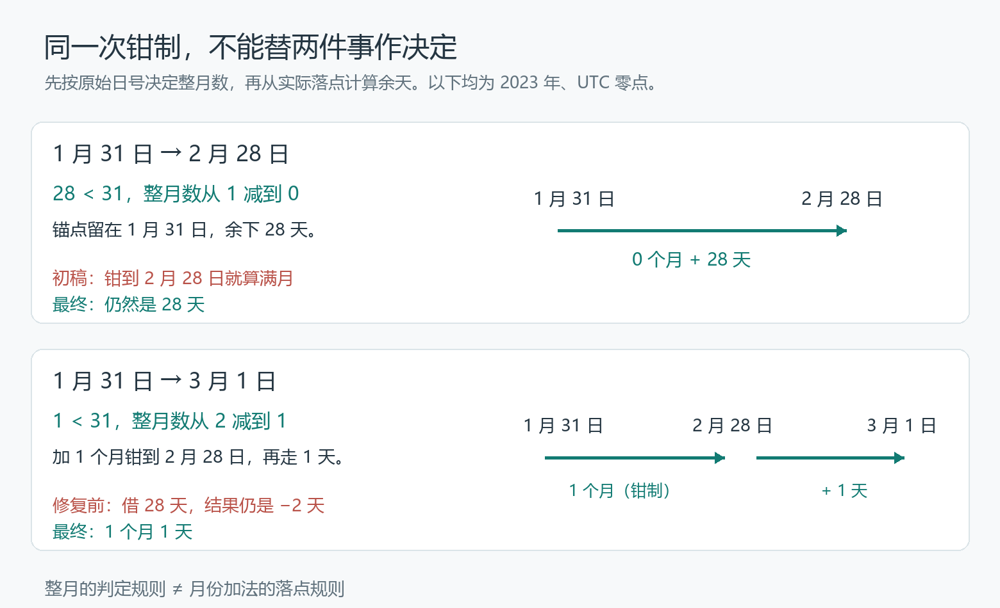

# 负天数消失以后，review 又找到了一个问题

1 月 31 日到 3 月 1 日，相差多久？

Nushell 的 `dt datetime-diff` 曾经给出这样的拆分：

```text
2023-01-31 → 2023-03-01
1 个月 −2 天
```

不是两个日期传反了。起点在前，终点在后，结果里却混进了负天数。如果把 1 月 31 日加一个月，落在 2 月 28 日，再减两天，甚至走不回 3 月 1 日。

我在 [Nushell #19109](https://github.com/nushell/nushell/pull/19109) 修的就是这个问题。但这次修复真正的转折，不是终于把负号消掉，而是负号消失之后，review 又拿来一对日期：

**1 月 31 日到 2 月 28 日，原来算 28 天，现在为什么变成了 1 个月？**

## 一、前一个补丁，其实没有借错月份

`datetime-diff` 不是简单地输出总秒数。它要把两个时刻之间的差，拆成年、月、日，一直拆到纳秒。月份长短不一，不能拿一个固定的秒数去除。

旧实现的办法很直观：各个字段相减，不够就向上一位借。天数不够，借一个月；小时不够，借一天。麻烦在于，一个月究竟能借来多少天。

这件事刚刚修过。另一位贡献者在 [#19064](https://github.com/nushell/nushell/pull/19064) 纠正了借月的对象：从 1 月 15 日算到 3 月 1 日，需要跨过的是二月，应该借二月的天数，而不是三月的 31 天。修复后的这版代码，正是本篇用来对照的「修复前」。

以平年为例，日号相减得到 `1 − 15 = −14`，补上二月的 28 天，就成了 1 个月 14 天。对这个例子，问题解决了。

但把起点从 15 日挪到 31 日，算式就变成：

```text
日号相减：1 − 31 = −30
借入二月：−30 + 28 = −2
```

[固定父提交中的借月代码](https://github.com/nushell/nushell/blob/c3b7a5aebea0119d88bba4608bc6a3f81bb54a45/crates/nu-std/std/dt/mod.nu#L20-L41) 确实只借一次：加上所跨月份的天数，月份减一，然后返回。借来的月份没选错，却短到填不平这个缺口。

这也是这次调查容易走偏的地方：看到负天数，很容易继续找「二月是不是查错了」「闰年是不是算错了」。可这一次，二月就是 28 天。需要换掉的，是把日号相减再补一个月的计算方式。

## 二、一个看起来很稳的答案

我送去评审的[那版实现](https://github.com/nushell/nushell/blob/ca90358650f1afa85a5bfb05645e87e04f52baaf/crates/nu-std/std/dt/mod.nu#L193-L210)，改用一个实际日期作落点。下文把它称为初稿。

先算出两端隔了几个月，把起点往后移动这些月；目标月份如果没有原来的日号，就钳到那个月的最后一天。例如，1 月 31 日加一个月，得到 2 月 28 日。这个落点叫锚点。

然后看锚点有没有超过终点。超过了，就少算一个月；剩下的天数，直接从锚点量到终点。

对最初的反例，这条路很顺：

- 1 月 31 日先加两个月，到 3 月 31 日，超过了 3 月 1 日；
- 退到一个月，落在 2 月 28 日；
- 再走一天，正好到 3 月 1 日。

答案成了「1 个月 1 天」，没有负数，也能加回原来的终点。新增的回归测试抓住了原来的错误。

但 reviewer fdncred 没有只看那个坏例子。他检查了那些原来并没有算错的输入，在[评审里](https://github.com/nushell/nushell/pull/19109#discussion_r4230030631)点出了关键：

> “Clamp semantics is a reasonable choice … but this is a user-visible change.”
>
> 钳制语义是合理的选择，但这是用户能看见的行为变化。

1 月 31 日加一个月，钳到 2 月 28 日。按照我的初稿，锚点已经到达终点，自然就算满了一个月。可是旧实现对这组日期给出的是 28 天。

初稿没有把一个对的答案改成荒谬的答案；它把一个约定换成了另一个也说得通的约定。这比负数难看出来。

评审里的四组输入，都有这个问题：

| 起点 → 终点 | 修复前 | 初稿 | 最终合并版 |
|---|---|---|---|
| 2023-01-31 → 2023-02-28 | 28 天 | 1 个月 | 28 天 |
| 2023-03-31 → 2023-04-30 | 30 天 | 1 个月 | 30 天 |
| 2024-02-29 → 2025-02-28 | 11 个月 30 天 | 1 年 | 11 个月 30 天 |
| 2023-01-31 12:00 → 2023-02-28 13:00 | 28 天 1 小时 | 1 个月 1 小时 | 28 天 1 小时 |

表中均为 UTC，省略为零的字段；三版输出可用文末的复现工程同场运行。

这次要修的是负天数，不是重新定义「一个月」。**能加回终点，只证明这份拆分自洽，还不能证明它保留了原来的行为。**

## 三、把一个问题，拆成两个决定

最终方案保留了锚点，却不再让锚点决定一切。

这里其实有两件不同的事：

1. 整月数算多少，沿用原来的日号判断；
2. 这些月加完实际落在哪里，用钳制后的日期计算。

先拿年份差乘 12，加上月份差，得到候选月数。如果终点的原始日号比起点小，就减一个月；如果日号相同，再比较时刻，终点时刻较早时也减一个月。只有整月数定下来以后，才建立钳制锚点，计算余天。

[最终代码](https://github.com/nushell/nushell/blob/996de1f9a48520c8679e6d791f3260b722d5116e/crates/nu-std/std/dt/mod.nu#L131-L153) 的关键部分是：

```nushell
mut total_months = (($from_expanded.year - $to_expanded.year) * 12) + ($from_expanded.month - $to_expanded.month)
if ($from_expanded.day < $to_expanded.day) or (($from_expanded.day == $to_expanded.day) and ($to_time_ns > $from_time_ns)) {
    $total_months = $total_months - 1
}
let anchor = (add-months-clamp $to_expanded.year $to_expanded.month $to_expanded.day $total_months)
```

这里 `from_expanded` 是终点，`to_expanded` 是起点，二者都已经转成 UTC。



1 月 31 日到 2 月 28 日，`28 < 31`，候选的一个月被减为零。锚点留在 1 月 31 日，剩下 28 天。

1 月 31 日到 3 月 1 日，`1 < 31`，候选的两个月减为一个月。锚点落在 2 月 28 日，剩下一天。

同一个钳制函数还在用，但它不再顺手把「这个月该落在哪天」解释成「已经过满一个月」。

时刻也要分清两层。例如，1 月 31 日中午到 2 月 28 日早上六点，先得到 28 个日历日，再因时钟少了六小时而借一天，输出 27 天 18 小时。这是小时向天借位；上面代码中「日号相等才比较时刻」的分支，是另一件事。只测零点到零点，覆盖不到这些边界。

## 四、修正方案以后，代码反而还能继续删

评审没有停在那一行判断上。

初稿为了计算锚点到终点相差多少天，放进了一套通用的日期序号算法：把公历日期换成连续的天数，再做减法。它能处理很远的日期，但这里的锚点根本不会那么远。

整月数最多减一，所以锚点只可能落在终点的同一个月，或者前一个月。[review 提醒](https://github.com/nushell/nushell/pull/19109#discussion_r4230030659)，余天只需两种情况：

```nushell
$result.day = if $anchor.month == $from_expanded.month {
    $from_expanded.day - $anchor.day
} else {
    (days-in-month $anchor.month $anchor.year) - $anchor.day + $from_expanded.day
}
```

同月就减日号，跨月就走完锚点月的剩余天数，再加终点日号。跨年也不需要额外一套天数换算：一月的前一个月是上一年的十二月，锚点自己带着年份。

另一段能删的是旧的借月链。

现在，整月数的选择保证锚点不晚于终点。如果锚点与终点落在同一天，前面的整月判断也已保证，终点的日内时刻不早于起点；只有确实还隔着日历日，小时不足时才需要借一天。于是，时分秒的借位仍然保留，却不会再把天借成负数、一路追到月份。

[这条评审](https://github.com/nushell/nushell/pull/19109#discussion_r4230030646)因此建议删除已经不可达的 `borrow-month`、`borrow-year`，连同仅仅为它们一路传递的参数。最终补丁不是在旧借月逻辑外多包一道防线，而是把那条走不到的路拆掉了。

## 五、扩大测试，又碰到了另一个问题

核对这次改动，不能只问「有没有负数」。还要问：

- 从起点先加钳制后的年月，再加日和更小单位，能否还原终点？
- 旧实现本来就能还原、也没有负数的输入，有没有被换成另一种拆分？
- 带时刻、跨年，以及 1 月 29 日这种不是月末却会被二月钳制的日期，是否也成立？

这些问题把测试范围带出了最初的 1 月 31 日。最终仓库里的[回归用例](https://github.com/nushell/nushell/blob/996de1f9a48520c8679e6d791f3260b722d5116e/crates/nu-std/tests/test_dt.nu#L73-L156)也保留了这些边界。

而在当时的扩测中，还冒出一个不属于这段减法的现象：某些世纪闰年的 2 月 29 日，在进入 `datetime-diff` 之前，就已经被字符串解析器改成了 2 月 28 日。我在[原讨论中报告了它](https://github.com/nushell/nushell/pull/19109#discussion_r4235740052)，并把它留在本补丁之外。

维护者的[回复](https://github.com/nushell/nushell/pull/19109#discussion_r4237714473)也是另开一件事：可以考虑寻找合适的替代解析器，但不在这个 PR 里做。

写这篇文章时，它又把复现拦了一次。第一次扫描走到 `2000-02-29T00:00:00Z`，官方 Nu 0.116.1 默认解析出来的日号是 28。复现程序先核对输入解析后的 UTC 字段，因此在这里停了下来，没有把已经变样的日期继续计入算法检查。[单独的解析探针](datetime_demo/parser_probe.nu)也保留了这个现象，以及 2024 年闰日正常的对照。

最终的三版对照明确使用 `into datetime --format '%+'` 解析 RFC3339 输入，逐项核对 UTC 字段后，再把 datetime 值交给原始模块。这样隔开的是输入解析与日期差计算，不是给三份算法偷偷打补丁。

这个插曲很容易写成「顺手又修了一个 bug」，可实际没有。输入在解析阶段就变了，日期差算法接到的已经不是原来的日期。这和如何分配年月日，是两个不同层次的问题；把替换解析器也塞进来，只会让已经收窄的修复再次膨胀。

## 六、把被否掉的初稿也留下来

这篇文章的 [datetime_demo](datetime_demo/) 不只放修复前后两版，也保留了 review 所针对的初稿。

它直接用 Nushell 执行固定提交中的三份模块，再由 Python 汇总输出和检查结果。最值得并排看的，其实是这两行：

| 起点 → 终点 | 修复前 | 初稿 | 最终合并版 |
|---|---|---|---|
| 2023-01-31 → 2023-03-01 | 1 个月 −2 天 | 1 个月 1 天 | 1 个月 1 天 |
| 2023-01-31 → 2023-02-28 | 28 天 | 1 个月 | 28 天 |

第一行证明旧实现为什么需要改；第二行解释初稿为什么还得改。只有修前、修后两列，最有价值的那次转弯就消失了。

本次复现还用同一个 Nu 0.116.1 进程跑了 6,580 条非逆序输入，覆盖选定年份中的月初、月中、月末和三组时刻。初稿没有负分量，也都能重构终点，却有 32 条输出不符合最终保留的拆分约定；最终版的这三项检查均为零失败，样本中旧版原本非负、单位范围正常且能重构的输出也都保持原样。具体取样规则和输出格式见 [demo README](datetime_demo/README.md)，具名回归和批量扫描都可离线重跑。

[#19109](https://github.com/nushell/nushell/pull/19109) 于 2026 年 10 月 10 日合并。回头看，真正让方案落定的不是找到了一个更像样的答案，而是把「修坏答案」和「换一个约定」分开了。

**这次补丁需要同时保住两组日期：一组说明旧代码确实错了，另一组提醒我，不是所有旧答案都等着被改。**

---

### 源码与复现

- 上游：[Nushell #19109](https://github.com/nushell/nushell/pull/19109)；前序修复 [#19064](https://github.com/nushell/nushell/pull/19064)。
- 修复前：[`c3b7a5a`](https://github.com/nushell/nushell/tree/c3b7a5aebea0119d88bba4608bc6a3f81bb54a45)；评审初稿：[`ca90358`](https://github.com/nushell/nushell/tree/ca90358650f1afa85a5bfb05645e87e04f52baaf)；最终合并：[`996de1f`](https://github.com/nushell/nushell/tree/996de1f9a48520c8679e6d791f3260b722d5116e)。
- 运行要求、固定源码及校验信息见 [demo README](datetime_demo/README.md)。本文表格与扫描数字使用三版模块的新跑输出；默认解析的闰日现象由独立探针复核，历史追查与处理范围见原始讨论。
