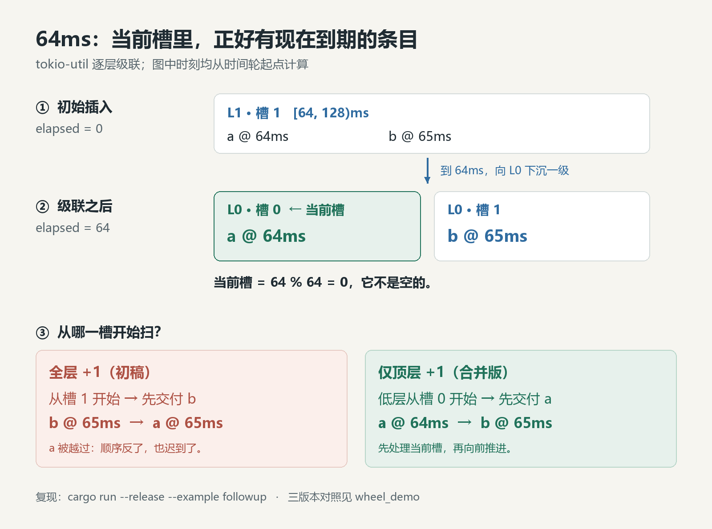

# 时间轮的 `+1`，为什么最后只留在顶层

上一篇[《时间轮里那行凭空出现的 `+1`》](时间轮_论文对照_tokio_中文版.md)发布时，#8519 还在审。我在文中写了一句很自信的话：

> 对低层来说，`+1` 是个无害的 no-op——`level_for` 保证条目永远不会落在 `now` 所在的低层槽（那个槽永远是空的），跳不跳都一样。所以这一行只在顶层生效，而顶层恰恰是唯一会出事的层。

这句话的结论——`+1` 最后只留在顶层——是对的；它给的理由错了：低层当前槽并不是永远为空，级联会把它填上。首篇的文字得出了结论，代码却把 `+1` 加到了每一层。

`level_for` 确实不会把新插入的条目放进低层的当前槽。但它不是唯一的写入路径。

**插入时成立的性质，不一定在级联之后仍然成立。** 我只验证了 `insert` 之后的状态，却把它写成了整个结构的不变式。

2026 年 10 月 10 日，维护者 Darksonn 在 [#8519 的 review](https://github.com/tokio-rs/tokio/pull/8519#discussion_r4237816039) 里贴了两组测试：`64ms / 65ms`，以及 `4096ms / 4160ms`。不需要等 12 天，也不需要超长 sleep；两组数的 deadline 都只隔一个槽宽：1ms 和 64ms。

10 月 11 日，PR 合并（提交 [`2fb5757`](https://github.com/tokio-rs/tokio/commit/2fb5757a97a94b3173f8fdd7b6280423b63da6e6)）。合进去的不是首篇里的全层 `+1`，而是只在顶层 `+1`。

两个小测试，正好把首篇的推理分成了两半：一半关于扫描从哪一槽开始，另一半关于条目怎样进入当前槽。后一半，我当时没有看。

## 一、最后合进去的代码

最终版的槽扫描起点是这样算的（[固定源码](https://github.com/tokio-rs/tokio/blob/2fb5757a97a94b3173f8fdd7b6280423b63da6e6/tokio-util/src/time/wheel/level.rs#L103-L122)）：

```rust
let mut now_slot = ((now / slot_range(self.level)) % LEVEL_MULT as u64) as usize;
// Only the top level acts as a pseudo-ring buffer, where the slot
// holding `now` may contain a timer a whole rotation away. Scan that
// slot last. Lower levels must include the current slot because
// cascading can place timers there that are ready to expire.
if self.level == super::NUM_LEVELS - 1 {
    now_slot += 1;
}
let occupied = self.occupied.rotate_right(now_slot as u32);
let zeros = occupied.trailing_zeros() as usize;
let slot = (zeros + now_slot) % LEVEL_MULT;
```

最重要的不是这个 `if` 本身，而是它把“当前槽”拆成了两种含义：

|位置|当前槽里可能是什么|扫描策略|
|---|---|---|
|顶层|伪环回绕后，逻辑上在整整一圈之后、物理上却落在当前槽的远期条目|从下一槽开始，当前槽排到最后|
|低层|刚刚从高层级联下来、现在就需要继续处理的条目|必须允许首先检查当前槽|

“排到最后”不是“永远不扫”。`rotate_right` 只旋转 `occupied` 位图，`trailing_zeros` 从最低位起找第一个置位的槽，没有任何一位被清掉。顶层如果只剩当前槽有条目，扫描绕一圈后仍会选中它。

首篇解释了顶层为什么必须让路。这次 review 补上的，是低层为什么不能让。

## 二、64ms：当前槽被级联写了进来

每层 64 个槽。L0 每槽 1ms，L1 每槽 64ms，顶层每槽 `2^30`ms（约 12 天）。

在 `elapsed = 0` 时插入两个条目：a 在 64ms 到期，b 在 65ms 到期。

`level_for` 取 `elapsed ^ when` 的最高有效位。`0 ^ 64` 和 `0 ^ 65` 的最高位都在 `2^6`，两者都进入 L1；又因为 `64 / 64 = 1`、`65 / 64 = 1`，它们都落在 L1 槽 1。这个槽覆盖 `[64, 128)`。

到 64ms，L1 槽 1 被处理。tokio-util 不在高层直接返回到期条目，而是先把它们搬到下一层。级联调用的是 `add_entry(when, ...)`，槽号只由 `when` 决定，不再经过 `level_for`：

|条目|`when`|L1 槽|级联后的 L0 槽|
|---|---|---|---|
|a|64|1|0|
|b|65|1|1|



随后，轮子的 `elapsed` 推进到 64。`64 % 64 = 0`，L0 的当前槽就是槽 0。

**L0 当前槽 0 里，正好有一个现在到期的 `a`。**

如果每一层都 `+1`，L0 的扫描从槽 1 开始，先选中 `b`。`a` 所在的槽 0 要等扫描绕回来才被选中；于是 `b` 先交付，`a` 后交付。

在本文的单调驱动模拟里，debug 和 release 都得到：

```text
全层 +1   b @ 65ms → a @ 65ms
合并版    a @ 64ms → b @ 65ms
```

`a` 的 deadline 是 64，它并不是“和 `b` 同时到期”。这个 1ms 的例子里，`a` 是在下一次 `poll` 时才被取走，观察到的 wake 也落在 65ms；但两个 deadline 不同的定时器，交付顺序不该由扫描起点决定。

写这个实验时还有一个坑。`Wheel::poll` 返回 L0 条目后，不一定把内部 `elapsed` 更新到调用者的 `now`。错误实现交付 `b` 之后，`poll_at` 仍可能报告 64。驱动不能因此把时间拨回去。模拟用 `wake = max(wake, poll_at)` 保持观测时间单调；否则会打印出“`b` 在 65ms，`a` 在 64ms”的假时间线。

维护者给出的原始反例，是公开 API 层的 `DelayQueue` 测试（[合入的测试](https://github.com/tokio-rs/tokio/blob/2fb5757a97a94b3173f8fdd7b6280423b63da6e6/tokio-util/tests/time_delay_queue.rs#L812-L832)）：

```rust
#[tokio::test(start_paused = true)]
async fn cascade_into_level_zero_slot_zero() {
    let mut queue = DelayQueue::new();

    queue.insert("a", ms(64));
    queue.insert("b", ms(65));

    assert_eq!(queue.next().await.unwrap().into_inner(), "a");
    assert_eq!(queue.next().await.unwrap().into_inner(), "b");
}
```

暂停的 Tokio 时钟可以直接检查 `next()` 的顺序。本文的小程序则把 wheel 单独抽出来，让每一次下沉和交付都能看清。

## 三、4096ms：跳过当前槽，可能把条目留在过去

第二组多跨一层：a 在 4096ms 到期，b 在 4160ms 到期。

在 `elapsed = 0` 插入时，`4096 = 2^12`，`4160 = 2^12 + 64`，最高差异位在 `2^12`；两者都进入 L2 槽 1，覆盖 `[4096, 8192)`。

4096ms 时，这个槽级联进 L1：`a` 进入槽 0，`b` 进入槽 1。L1 每槽 64ms，此时 `(4096 / 64) % 64 = 0`，L1 的当前槽也是槽 0。

全层 `+1` 从 L1 槽 1 开始，先处理 `b`。`b` 被下沉到 L0 槽 0，`a` 则留在 L1 槽 0。轮子的 `elapsed` 推进到 4160ms。L0 这时只有槽 0 占用，扫描从槽 1 出发，绕一圈仍会回到槽 0，所以 `b` 在 4160ms 被交付。

接下来，L1 槽 0 的起点是 4096，已经小于 4160。`Level::next_expiration` 里有一段专门处理“槽在当前时刻之前”的分支（去掉中间那段伪环注释，骨架是）：

```rust
let level_start = now - (now % level_range);
let mut deadline = level_start + slot as u64 * slot_range;
if deadline < now {
    // ... top-level pseudo-ring comments ...
    debug_assert_eq!(self.level, super::NUM_LEVELS - 1);
    deadline += level_range;
}
```

这个分支原本只允许顶层进入，因为只有顶层会把整整一圈之后的条目放进当前物理槽。全层 `+1` 把一个低层槽也带了进来。

debug 下，`Wheel::next_expiration` 在返回 L0 的 4160 之前，会先用 `no_expirations_before` 检查更高层；它去查 L1 的槽 0，算出 `deadline = 4096 < now = 4160`，`debug_assert_eq!(self.level, 5)` 失败：

```text
assertion `left == right` failed
  left: 1
 right: 5
```

release 下断言被编译掉，代码给这个起点加上 L1 的一整圈（4096ms），`a` 被排到 8192ms。实验输出：

```text
全层 +1   b @ 4160ms → a @ 8192ms
合并版    a @ 4096ms → b @ 4160ms
```

第一组的问题是顺序：`a` 本该先走，却被 `b` 抢先。这一组没有走到这个分支：`a` 留在 L0 槽 0，而 L0 的当前槽就是槽 0，槽的 deadline 等于 `now`，`< now` 不成立。第二组的问题更重：`a` 留在一个起点已经过去的槽里，下一次计算 `poll_at` 时，代码只能按伪环假设把它推到一整圈之后。

同样一行 `+1`，在顶层是把“下一个”往后挪一格；在低层却可能把“已经该处理”的条目推到下一圈。表面都是跳过当前槽，含义并不相同。

## 四、漏掉的第二条写入路径

首篇的推理只看了 `Wheel::insert`：先由 `level_for(elapsed, when)` 选层，再调用该层的 `add_entry`。

对 `level_for` 实际选中的非顶层来说，`elapsed ^ when` 的最高差异位就在该层槽号对应的那 6 位里，因此两个槽号不同。普通插入之后，低层当前槽确实是空的。

但这是一个状态，不是一条对所有写入路径都成立的不变式。tokio-util 还有第二条路径，在 [`poll_expiration`](https://github.com/tokio-rs/tokio/blob/2fb5757a97a94b3173f8fdd7b6280423b63da6e6/tokio-util/src/time/wheel/mod.rs#L206-L222) 里：

```rust
let next_level = expiration.level - 1;
self.levels[next_level].add_entry(when, item, store);
```

它**只下沉一级，不重新调用 `level_for`**。`add_entry` 只按 `when` 算槽号，所以刚从 L1 搬到 L0 的 `a`，可以正好落进 L0 的当前槽。

我把“普通插入的放置规则”当成了“所有写入路径都维持的性质”。旧工程里一个名叫 `lower_level_now_slot_is_empty` 的测试，只跑了一条没有触发反例的时间线；名字比它实际证明的事情大得多。现在它改名为 `historical_lower_level_smoke_case`，只作为历史冒烟用例保留，级联反例另行明确验证。

### 为什么 runtime 的全层 `+1` 还能留着？

runtime 和 tokio-util 的 wheel 长得像，但级联方式不同。

runtime 的 [`process_expiration`](https://github.com/tokio-rs/tokio/blob/2fb5757a97a94b3173f8fdd7b6280423b63da6e6/tokio/src/runtime/time/wheel/mod.rs#L223-L260) 不会直接 `level - 1`。它先把槽里的条目全部取出来，再逐个判断：到期的进入 `pending`，尚未到期的重新选层：

```rust
match unsafe { item.mark_pending(deadline) } {
    Ok(()) => self.pending.push_front(item),
    Err(expiration_tick) => {
        let level = level_for(expiration.deadline, expiration_tick);
        unsafe { self.levels[level].add_entry(item); }
    }
}
```

关键在最后两行：重新选层。`level_for` 的规则保证，非顶层的目标槽不会是 `expiration.deadline` 所在槽；处理完这个槽后，`elapsed` 正好推进到 `expiration.deadline`，所以那条不变式在 runtime 里仍然成立。在 `2fb5757` 这个合并提交里，runtime 的层扫描仍是全层 `+1`。

tokio-util 把这一步省成了 `level - 1`。扫描策略和级联方式是一套配合；只搬扫描，不搬级联，就会在低层当前槽上出错。

## 五、三份实现，两种失败

只保留最终版本，看不到修复边界；只保留首篇的两份，又看不到新增回归。验证工程现在并列三份实现：

|模块|扫描规则|用途|
|---|---|---|
|`wheel_buggy`|所有层都从当前槽开始|修复前的对照|
|`wheel_fixed`|所有层都 `+1`|首篇的初稿修复；保留历史命名，不代表最终正确|
|`wheel_merged`|只有顶层 `+1`|对应 #8519 合并版的扫描规则|

三份实现的 `add_entry`、`poll_expiration` 和 `level_for` 相同，区别集中在 `next_occupied_slot`。下面是 `cargo run --release --example followup` 的结果；数值都是从轮子起点算起的绝对毫秒：

|输入|无偏移|全层 `+1`|仅顶层 `+1`|
|---|---|---|---|
|顶层伪环：`elapsed=2`，near=`2^30+1000`，far=`2^36+1`|far@68719476737 → near@69793219560|near@1073742824 → far@68719476737|near@1073742824 → far@68719476737|
|64 / 65|a@64 → b@65|b@65 → a@65|a@64 → b@65|
|4096 / 4160|a@4096 → b@4160|b@4160 → a@8192|a@4096 → b@4160|

第一行保留首篇的核心结论：完全不加偏移，近端定时器仍然可能被顶层伪环条目挡住，推迟整整一圈。后两行则说明修复不能一概施加到每层。

debug 模式也跑了一遍：无偏移的顶层反例，以及全层 `+1` 的 4096/4160 反例，都会命中各自的断言；64/65 的顺序错误在两种模式下都能观察到。

另外补了两条边界：

- 顶层只有当前槽有条目时，合并版仍会处理它；“最后扫”不是“永不扫”。
- 在 L1 到 L5 的级联边界、轮次 `{1, 2, 63, 64, 65}` 和两种插入顺序下，共 50 条时间线，合并版都按 deadline 交付。

上游这次补了 10 个槽扫描单元测试和两个 `DelayQueue` 级联测试。单元测试覆盖空层、单槽、向前找最近的槽、跳过当前槽、当前槽是唯一占用、最后一槽，以及 `next_expiration` 对槽起点和顶层回绕的计算；两个 `DelayQueue` 测试就是 64/65 和 4096/4160。本文的三版本实验放在同一个小工程里，可以一起跑出上面的表格。

## 六、`+1` 留下了，适用范围变了

只写“PR 已合并”，会漏掉这次修正真正改变的东西。

最初的反例证明的是：顶层从当前槽起扫，会把远期条目误排到近端条目前面。它没有证明：所有层从下一槽起扫，都不会产生新问题。

64/65ms 和 4096/4160ms 两组数把这两件事分开了。第一组让低层当前槽里的 `a` 被 `b` 抢先；第二组让 `a` 留在一个起点已经过去的槽里，release 下被推到 8192ms。

最终，`+1` 没有被删掉。它只是回到了自己能被正确论证的位置：顶层。

声称某个槽永远为空之前，要先找齐所有能往它里面写东西的路径。`insert` 找到了，级联那条漏了。两个几十毫秒、几秒钟的测试，把它补了回来。

`+1` 还在，只是它站的位置比首篇写的更窄，也更准确。

## 复现与来源

从仓库根目录进入工程：

```sh
cd 时间轮_timing_wheel/wheel_demo
cargo test
cargo test --release
cargo run --example followup
cargo run --release --example followup
```

验证环境：Rust 1.98.1，Windows；不需要等待 12 天，也没有新增第三方 crate 依赖。工程说明与版本对应见 [`wheel_demo/README.md`](wheel_demo/README.md)。

- [上一篇：时间轮里那行凭空出现的 `+1`](时间轮_论文对照_tokio_中文版.md) / [本篇 English](Timing_Wheel_Followup_Top_Level_Only_EN.md)
- [#8519：最终 PR 与合并记录](https://github.com/tokio-rs/tokio/pull/8519)
- [Darksonn 的 review：仅顶层偏移与两个级联反例](https://github.com/tokio-rs/tokio/pull/8519#discussion_r4237816039)
- [我的修正回复](https://github.com/tokio-rs/tokio/pull/8519#discussion_r4238066023)
- [#8334：runtime 侧的原始修复与 pgdog 背景](https://github.com/tokio-rs/tokio/pull/8334)
- [上游 tokio-util 的槽扫描单元测试](https://github.com/tokio-rs/tokio/blob/2fb5757a97a94b3173f8fdd7b6280423b63da6e6/tokio-util/src/time/wheel/level.rs#L250-L360)

### 脚注

① 文中的交付时刻来自 `wheel_demo` 的单调驱动模拟；debug/release 的差异按两种构建分别记录。上游的 10 个单元测试和两个 `DelayQueue` 测试位于固定提交 `2fb5757`，本文工程抽取 wheel 时替换了存储类型并省去了模块内测试，测试数不与上游一一对应。

② runtime 的 [`next_expiration`](https://github.com/tokio-rs/tokio/blob/2fb5757a97a94b3173f8fdd7b6280423b63da6e6/tokio/src/runtime/time/wheel/level.rs#L52-L89) 用 `deadline <= now`，tokio-util 用 `deadline < now`。前者依赖“非顶层当前槽为空”；后者允许低层当前槽恰好在 `now` 到期。两个比较符分别配合各自的扫描策略。
