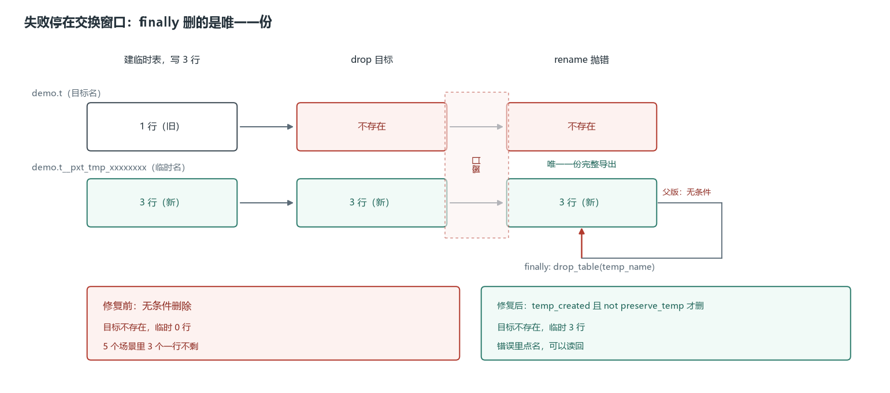

# 替换失败之后，旧表和新表都没了

用 `if_exists='replace'` 往 Iceberg 导出一张表，失败时最坏的结果不是「没换成」，而是：

```text
替换前：目标表 1 行
替换失败：目标表不存在
          临时表也不存在
```

写进临时表的三行数据一行不剩。报错信息只说 `failed to write Iceberg table 'demo.t': synthetic rename failure`，没有说数据去哪了——因为它被自己的清理逻辑删掉了。

这是 [pixeltable #1889](https://github.com/pixeltable/pixeltable/pull/1889) 修的问题。补丁不大，但它把「失败之后还剩什么」这件事重新定义了一遍。

问题最初记在 [issue #1885](https://github.com/pixeltable/pixeltable/issues/1885) 里。那份报告是在 pixeltable 0.7.16、Python 3.14.4、Ubuntu 24.04 上复现的：对 `rename_table` 注入一次 catalog IO 错误，命名空间里什么都不剩，旧表与新数据都不可恢复。这篇的复现换到 0.7.24、Python 3.12、Windows，五个场景里父版有三个以命名空间为空收尾。

## 先写临时表，是为了保住旧表

`export_iceberg()` 的 replace 路径不是原地重写。它先建一张临时表，名字是目标名加一段随机后缀：

```python
temp_name = f'{table_name}__pxt_tmp_{uuid.uuid4().hex[:8]}'
```

数据整份写进临时表，写完之后再动目标：`drop_table(table_name)`，然后 `rename_table(temp_name, table_name)`。代码里那行注释把意图写得很清楚（[父版 `iceberg.py:174-176`](https://github.com/pixeltable/pixeltable/blob/2eca8e44e31dc4ad6eee2c602615cb35e5d89dcc/pixeltable/io/iceberg.py#L174-L176)）：

> Write to a temp table and swap on success so a mid-stream failure leaves any existing original untouched. Drop-then-rename is two catalog calls and not truly atomic; a crash between them leaves the original gone but the data preserved under the temp name.

这句话的后半段是整件事的关键：作者知道两次 catalog 调用之间不是原子的，也知道这个窗口里旧表会先消失。设计上的兜底是「数据在临时表名下保留」。数据确实保留了，直到 `finally` 把它删掉。

## finally 删的是哪一份

父版的清理长这样（[`iceberg.py:199-205`](https://github.com/pixeltable/pixeltable/blob/2eca8e44e31dc4ad6eee2c602615cb35e5d89dcc/pixeltable/io/iceberg.py#L199-L205)）：

```python
finally:
    # Drop temp if it still exists; covers mid-stream errors and BaseException paths
    # like KeyboardInterrupt. On success, rename consumed temp_name, so swallow NoSuchTableError.
    try:
        catalog.drop_table(temp_name)
    except NoSuchTableError:
        pass
```

对两种情形，它都做了正确的事：

- 写入中途失败：临时表是半份数据，删掉是对的，旧表没动过。
- 成功：`rename` 已经把临时表改名成目标，原名字不存在，`NoSuchTableError` 被吞掉。

但还有第三种：

- 交换中途失败：临时表是**唯一一份完整数据**，旧表已经被 `drop` 了。这时候删掉它，等于把两边都清空。

问题就在这里：`finally` 不区分「临时表是垃圾」和「临时表是最后一根稻草」。它只知道「这个名字可能还在」。

失败停在交换窗口里时，两个名字上的数据：



## 失败发生在哪一步，结果不一样

`drop_table` 与 `rename_table` 是两次独立的 catalog 调用。失败可能发生在：

1. `drop_table` 抛错，但操作没有生效——目标还在，临时表该清掉。这是 `finally` 原本要覆盖的场景。
2. `drop_table` 抛错，但操作已经生效——目标没了，临时表是完整导出。
3. `rename_table` 抛错——目标已经在上一步被删，临时表是完整导出。
4. 交换之后想确认目标状态，`table_exists` 本身也失败——不能假设目标还在。

第 2 种不是理论上的边角：PR 正文的原话是「a catalog operation may take effect before reporting failure」——一次调用可能已经在服务端生效，再在回程上报错。修复后的错误信息也要求调用者「inspect both identifiers rather than assuming the temporary table still exists」。

## 修法：记两个状态，再问一次

合并版 ([`iceberg.py`](https://github.com/pixeltable/pixeltable/blob/b76619839123f2f4402fb78ee8348adcc6f87f2f/pixeltable/io/iceberg.py#L179-L224)) 加了两个布尔量：

```python
temp_created = False
preserve_temp = False

try:
    temp_tbl = catalog.create_table(temp_name, schema=arrow_schema)
    temp_created = True
    ...
    preserve_temp = True
    if existing_tbl is not None:
        catalog.drop_table(table_name)
    catalog.rename_table(temp_name, table_name)
    preserve_temp = False
except ...
```

- `temp_created` 只在**这次调用真的建出了临时表**之后才为真——避免在别的地方失败时误删别人的表。
- `preserve_temp` 在交换开始之前置真，`rename` 成功之后置假。交换窗口里的任何失败，默认都倾向于保留。

异常处理里再确认一次目标在不在：

```python
if preserve_temp:
    try:
        preserve_temp = not catalog.table_exists(table_name)
    except Exception:
        # If the catalog is unavailable, keep the possible recovery copy.
        pass
```

目标已经在了（比如 `drop` 没生效），说明临时表是多余的，改为清理；目标不在，或连查询都失败，就保留。最后 `finally` 只在 `temp_created and not preserve_temp` 时删除：

```python
finally:
    # Clean up only a temp table we know this call created and do not need for recovery.
    if temp_created and not preserve_temp:
        try:
            catalog.drop_table(temp_name)
        except NoSuchTableError:
            pass
```

有保留时，错误信息追加一句，点名目标与临时标识，让人知道去哪找数据。临时标识的格式是目标名加 `__pxt_tmp_` 和 8 个十六进制字符，例如 `demo.t__pxt_tmp_1a2b3c4d`；真实名字每次不同，以错误信息里的为准。

```text
...; the catalog swap may be incomplete. Inspect 'demo.t' and temporary
identifier 'demo.t__pxt_tmp_1a2b3c4d' before retrying.
```

## 复现：五个场景，两版对照

工程 `替换失败_pixeltable/iceberg_swap_demo/` 把两版 `iceberg.py` 原样 vendor，按文件加载后替换 `pixeltable.io.export_iceberg`；其余用 pixeltable 0.7.24，它的同文件与父提交逐字节相同。catalog 是本机 SQLite 的 `SqlCatalog`，外面包一层 `FailingCatalog`，在交换的不同步骤注入失败：

| 场景 | 注入 | 修复前 | 修复后 |
| --- | --- | --- | --- |
| `rename-fails/no-target` | 原本没有目标表，`rename` 抛错 | 临时 0 / 目标缺失 | 临时 1（3 行）/ 目标缺失 / 错误点名 |
| `drop-applied-then-raises` | `drop` 已生效后抛错 | 临时 0 / 目标缺失 | 临时 1（3 行）/ 目标缺失 / 错误点名 |
| `drop-fails-before-effect` | `drop` 未生效就抛错 | 临时 0 / 目标 1 行 | 临时 0 / 目标 1 行 |
| `target-check-fails` | `drop` 生效后抛错，`table_exists` 也抛错 | 临时 0 / 目标缺失 | 临时 1（3 行）/ 目标缺失 / 错误点名 |
| `replace-succeeds` | 不注入 | 临时 0 / 目标 3 行 | 临时 0 / 目标 3 行 |

汇总一句：

```text
parent left no copy after 3/5 failed swaps; merged failed 0/5 expectations
```

修复前，五个场景里有三个以「目标表不存在、临时表也不存在」结束——写完之后一行都读不回来。修复后，这三个场景各留下一张完整的临时表，错误信息里给出名字，可以 `load_table` 读回三行；`drop` 未生效的那个场景照旧清理，目标表还在，不堆积；成功路径也没有残留。

目标还在的时候，清理照常生效：上游的回归用例把这条路径连续跑了三次，目标表与临时表列表都保持干净——这正是 PR 修订时补的那组用例要守的。

复现时在环境上踩过一个坑：pixeltable 自带 PostgreSQL 16，这台机器是中文 locale，bundled `initdb` 建 UTF-8 集群时在 post-bootstrap 阶段报 `invalid byte sequence for encoding "UTF8"`；demo 先用 `-E SQL_ASCII --locale=C` 建簇，再把 `postgres` 与 `pixeltable` 两个库从 `template0` 重建为 UTF-8。换到 locale 正常的机器上不需要这一步。

## 取舍：保留的是数据，不是一个原子操作

补丁没有把两次调用包成事务，也不恢复旧目标：它阻止的是交换失败之后连临时表也被删掉。

也就是说，替换失败之后，调用方仍然要自己收拾：目标表可能已经不在了，旧数据不会自动回来；能恢复的是**新导出**，在临时表名下，行数是完整的。对「先把数据落住，再决定怎么办」的导出任务，这比两头都空好得多。

还有一个有意为之的保守选择：`table_exists` 查询失败时保留临时表。代价是极端情况下可能多留一张表；收益是绝不在「不知道目标在不在」的时候删掉唯一副本。错误信息会点名，运维可以据此决定是恢复还是删除。

上游：`pixeltable/pixeltable`，[#1889](https://github.com/pixeltable/pixeltable/pull/1889)，父提交 [`2eca8e44`](https://github.com/pixeltable/pixeltable/commit/2eca8e44e31dc4ad6eee2c602615cb35e5d89dcc)，合并提交 [`b7661983`](https://github.com/pixeltable/pixeltable/commit/b76619839123f2f4402fb78ee8348adcc6f87f2f)。
