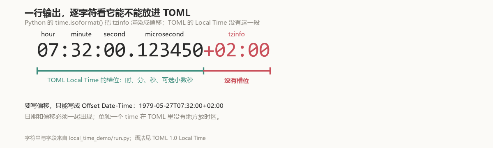

# The time it wrote, it could not read back

tomlkit's selling point is round-tripping: a document read in comes out the same. The last line of this snippet raises.

```python
from datetime import time, timedelta, timezone
from tomlkit import dumps, item, parse

t = time(7, 32, tzinfo=timezone(timedelta(hours=2)))
parse(dumps({"t": item(t)}))
# InvalidTimeError: Invalid time at line 1 col 18
```

The line it wrote was `t = 07:32:00+02:00`, which its own parser rejects.

## Six characters with nowhere to go

TOML 1.0 defines Local Time like this:

> If you include only the time portion of an RFC 3339 formatted date-time, it will represent that time of day without any relation to a specific day or any offset or timezone.

The spec's example is `lt1 = 07:32:00`.



`07:32:00` is a Local Time. **The six characters `+02:00` have no slot in that grammar.**

TOML can express an offset, but then it is an Offset Date-Time and must carry a date: `1979-05-27T07:32:00+02:00`. A bare time has nothing to hang it on.

## `raw` is not a copy of `isoformat()`

The `Time` item stores two things at once: the Python `tzinfo`, and the `raw` literal destined for the TOML text.

Keeping `tzinfo` on the Python object is fine — `datetime.time` is allowed to carry a zone. The trouble is that `raw` was treated as a copy of `isoformat()`. Before the fix, `item()` built `Time` like this:

```python
Time(
    value.hour,
    value.minute,
    value.second,
    value.microsecond,
    value.tzinfo,
    Trivia(),
    value.isoformat(),      # -> '07:32:00+02:00'
    fold=value.fold,
)
```

A few lines above, in the same function, the `datetime` branch writes `value.isoformat().replace("+00:00", "Z")`; the `time` branch writes `value.isoformat()` unmodified.

`isoformat()` is Python's format. It renders `tzinfo` as an offset, and a TOML Local Time has no such segment.

There is a second site: `Time._new()`, which `replace()` goes through, where `raw` is likewise `result.isoformat()`.

## Only the writing end changed

\#613 adds a `_format_time()`:

```python
def _format_time(value: time) -> str:
    # TOML local times carry no offset or timezone ...
    s = f"{value.hour:02d}:{value.minute:02d}:{value.second:02d}"
    if value.microsecond:
        s += f".{value.microsecond:06d}".rstrip("0")
    return s
```

Both `item()` and `Time._new()` now call it.

The merged version is [`items.py` at `ce8f8ee`](https://github.com/python-poetry/tomlkit/blob/ce8f8ee982411c4afef5cfb90df7313cc5f7d779/tomlkit/items.py#L209) and [`_format_time()`](https://github.com/python-poetry/tomlkit/blob/ce8f8ee982411c4afef5cfb90df7313cc5f7d779/tomlkit/items.py#L237-L246).

It reads hours, minutes, seconds and microseconds; it never reads `tzinfo`. A non-zero microsecond is padded to six digits and stripped of trailing zeros: `123450` prints as `.12345`, `0` prints no decimal point at all.

The parser was left alone. `parse("t = 07:32:00+02:00")` raises `InvalidTimeError` before and after — that syntax does not exist in TOML.

## The conflict came from next door

Before #613 merged, the maintainer left one line: "Please resolve the conflict".

The conflict came from #620, which added the standard library's `fold` argument to `Time` and `DateTime` and edited exactly the neighbourhood of `Time._new()`. The two PRs merged on the same day, #620 three and a half hours earlier. After rebasing onto the latest master, the author had `fold=result.fold` and `_format_time(result)` in the same constructor:

```python
def _new(self, result: time) -> Time:
    raw = _format_time(result)
    return Time(
        ...,
        raw,
        fold=result.fold,
    )
```

`fold` describes the second occurrence of a local time when daylight saving falls back; it is a property of the Python `time` object itself. `_format_time()` decides how that object is written into TOML. Two concerns, one constructor, no interaction.

## Seven rows of output

| Case | Before, `763bd66` | Merged, `ce8f8ee` |
|---|---|---|
| `item(time(7, 32, tzinfo=+02:00)).as_string()` | `07:32:00+02:00` | `07:32:00` |
| microsecond `123450` | `07:32:00.123450+02:00` | `07:32:00.12345` |
| `replace(hour=13)` | `13:32:00+02:00` | `13:32:00` |
| `dumps({"t": item(...)})` | `t = 07:32:00+02:00` | `t = 07:32:00` |
| `parse()` of the line above | `InvalidTimeError` | succeeds, reads `07:32:00` |
| a naive `time(7, 32)` | `07:32:00` | `07:32:00` |
| `parse("t = 07:32:00+02:00")` directly | `InvalidTimeError` | `InvalidTimeError` |

The last two rows are the boundary: a time without a zone comes out byte for byte the same, and the parser still refuses offsets.

The 0.15.2 release notes list #613 explicitly. Re-running against the published wheel `tomlkit-0.15.2-py3-none-any.whl` gives the same output as the merged tree: `07:32:00`, and it reads back.

## What comes back

```python
parse(dumps({"t": item(t)}))["t"]     # 07:32:00
```

It reads back now. What comes back is `07:32:00`, and its `tzinfo` is `None` — that line of text never carried the information.

`local_time_demo/run.py --test` runs the seven rows above.

Inside a `Time`, the Python `time` may carry a zone and a `fold`; the part written into TOML holds hours, minutes, seconds and optionally microseconds. Whatever is left over stays on the object and never reaches the file.
