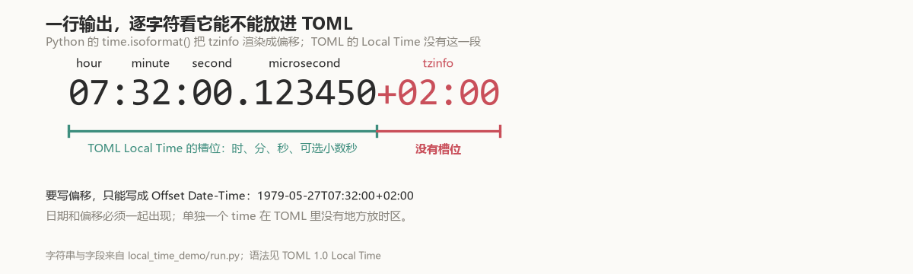
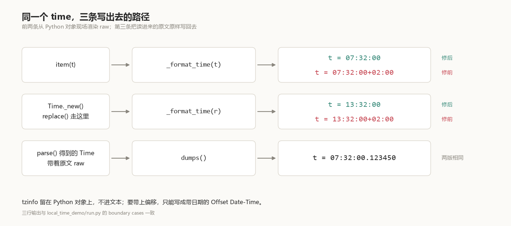

# tomlkit 写出的 07:32:00+02:00，为什么自己读不回来

把接口或数据库给的带时区时间写进配置文件，是这类代码里最普通的一步：

```python
from datetime import time, timedelta, timezone
from tomlkit import dumps, item, parse

t = time(7, 32, tzinfo=timezone(timedelta(hours=2)))
parse(dumps({"t": item(t)}))
# InvalidTimeError: Invalid time at line 1 col 18
```

写出的那一行是 `t = 07:32:00+02:00`，tomlkit 自己的解析器不认。这一行不是谁手写错的：库从 Python 的 `time` 对象渲染出它，从 0.1.0（2018-07-10）一直带到 0.15.1（2026-07-17）；0.15.2（2026-10-16）修掉。

下面沿着这条错误消息走：先看这六个字符为什么多余，再找写出它们的两个调用点，然后是补丁的取舍、升级会改变的字节，以及已经写坏的文件怎么处理。

## 六个字符，没有位置

[TOML 1.0](https://toml.io/en/v1.0.0#local-time) 对 Local Time 的定义是：

> If you include only the time portion of an RFC 3339 formatted date-time, it will represent that time of day without any relation to a specific day or any offset or timezone.

规范给的例子是 `lt1 = 07:32:00`。



`07:32:00` 是 Local Time。**`+02:00` 这六个字符，在 TOML 的 Local Time 语法里没有对应的位置。**

TOML 的日期时间一共四格，偏移只出现在第一格：

| 类型 | 例子 | 允许的部分 |
|---|---|---|
| [Offset Date-Time](https://toml.io/en/v1.0.0#offset-date-time) | `1979-05-27T07:32:00Z` | 日期 + 时间 + 偏移 |
| [Local Date-Time](https://toml.io/en/v1.0.0#local-date-time) | `1979-05-27T07:32:00` | 日期 + 时间 |
| [Local Date](https://toml.io/en/v1.0.0#local-date) | `1979-05-27` | 日期 |
| [Local Time](https://toml.io/en/v1.0.0#local-time) | `07:32:00` | 时间 |

想把 `+02:00` 带上，只能退回到带日期的那一格；单独的 time 没有地方挂它。这不是 tomlkit 一家的口径：标准库的 [`tomllib`](https://docs.python.org/3/library/tomllib.html) 把 `t = 07:32:00` 读成不带时区的 `datetime.time(7, 32)`，对 `t = 07:32:00+02:00` 报 `Expected newline or end of document after a statement`。RFC 3339 自己也是把时刻和偏移分成两段的（[§5.6](https://datatracker.ietf.org/doc/html/rfc3339#section-5.6)），TOML 只是没把第二段接在「只有时间」的这一格里。

## raw 不是 isoformat 的副本

`Time` 这个 item 同时存 Python 的值和要写进 TOML 的字面量。构造参数分成两半：

| 字段 | 是什么 | 写进 TOML 吗 |
|---|---|---|
| `hour` `minute` `second` | 时分秒 | 写 |
| `microsecond` | 微秒 | 写，非零时补六位再去尾零 |
| `tzinfo` | Python 侧的时区 | 不写 |
| `fold` | 夏令时回拨时同一个钟点出现两次的标记 | 不写 |
| `raw` | 直接落进文本的那串字符 | 它就是文本 |

问题出在 `raw` 被当成了 `isoformat()` 的副本。修前版里，`item()` 构造 `Time` 时这样写：

```python
Time(
    ...,
    value.tzinfo,           # 留在对象上，没问题
    Trivia(),
    value.isoformat(),      # -> '07:32:00+02:00'
    fold=value.fold,
)
```

`isoformat()` 是 Python 的格式。按[它的文档](https://docs.python.org/3/library/datetime.html#datetime.time.isoformat)，只要 `tzinfo` 不是 `None`，末尾就追加上 UTC 偏移——那正是 TOML 的 Local Time 没有的一段。同一段 `item()` 里，`datetime` 那一支就在上面几行，raw 是 `value.isoformat().replace("+00:00", "Z")`；`time` 这一支少了个 `.replace`，因为它本来就没有偏移可替。

另一处是 `Time._new()`，`replace()` 走那里，raw 同样是 `result.isoformat()`。

## 这一行写了八年

几处写的是同一句 `isoformat()`，它们不是同一天进去的：

| 日期 | 提交 | 位置 | 写法 |
|---|---|---|---|
| 2018-07-08 | [`4a09449`](https://github.com/python-poetry/tomlkit/commit/4a094491aae8fd0de32e8a19296fb4bb6b32bbc8) | `tomllib/api.py` 的 `item()` | `value.isoformat()` |
| 2018-07-18 | [`d02e9ec`](https://github.com/python-poetry/tomlkit/commit/d02e9ec2ef7543ad775b19f27f021be6f187d14a) | `tomlkit/items.py` 的 `item()` | 原样搬过去 |
| 2022-04-16 | [`5118514`](https://github.com/python-poetry/tomlkit/commit/5118514fa1f193ff92c3d26b4d4da2f0a94f70e2)（[#189](https://github.com/python-poetry/tomlkit/pull/189)） | `Time._new()` | `raw = result.isoformat()` |
| 2026-09-30 | [`ce8f8ee`](https://github.com/python-poetry/tomlkit/commit/ce8f8ee982411c4afef5cfb90df7313cc5f7d779) | 两处都改用 `_format_time()` | 不再读 `tzinfo` |

第一处提交比 0.1.0 的发布早两天（PyPI 上 0.1.0 是 2018-07-10），所以第一个上 PyPI 的版本就带着它；最后一个带着它的是 0.15.1（2026-07-17）。把两头的发布轮子拆开看，0.1.0 的 `tomlkit/api.py` 第 162 行是 `return time(value.isoformat())`，0.15.1 的 `tomlkit/items.py` 第 208 行还是 `value.isoformat()`——八年里换了包名、文件名和行号，表达式没换。

第一次写下的那天，包还叫 `tomllib`：`datetime` 那支已经带 `.replace("+00:00", "Z")`，`time` 那支直接是 `value.isoformat()`。十天后分派搬进 `tomlkit/items.py`，写法原样带过去。第二处隔了三年多，给 `Time` 补 `replace()` 与 `_new()` 时，同一条 `raw = result.isoformat()` 又写了一遍。

两次选中的都是同一个函数，因为它在 Python 这边就是「把时间写成字符串」的默认答案；只有 TOML 这边不接受。从 2018 年 7 月到 2026 年 9 月，这段代码换了包名、换了文件、换了构造函数，只有这一句没换。

它不容易被发现，是因为日常读写的路径根本不经过这两处：从 TOML 文本 `parse()` 出来的 `Time` 带着原文的 `raw`，`dumps()` 原样吐回去。只有拿 Python 的 `time` 对象去 `item()`，或者改一个 `Time` 的字段走 `replace()`，才会现场渲染。

## 只改写出端

[#613](https://github.com/python-poetry/tomlkit/pull/613) 增加了一个 `_format_time()`：

```python
def _format_time(value: time) -> str:
    # TOML local times carry no offset or timezone (the spec's examples
    # are plain ``07:32:00``); keeping the offset in the rendered raw
    # value would produce a literal this library's own parser rejects.
    # Built from the fields (not ``isoformat``/``replace``) so it stays
    # correct even when called on a ``Time`` from ``Time._new``.
    s = f"{value.hour:02d}:{value.minute:02d}:{value.second:02d}"
    if value.microsecond:
        s += f".{value.microsecond:06d}".rstrip("0")
    return s
```

注释里那句 "the spec's examples are plain 07:32:00" 是取舍的理由：不去猜 `isoformat()` 会输出什么，而是按规范里能出现的字符自己拼。

`item()` 和 `Time._new()` 都改用它，两个调用点各换一行：

```diff
-    value.isoformat(),
+    _format_time(value),
```

```diff
-    raw = result.isoformat()
+    raw = _format_time(result)
```

合并版见 [`ce8f8ee` 的 `items.py`](https://github.com/python-poetry/tomlkit/blob/ce8f8ee982411c4afef5cfb90df7313cc5f7d779/tomlkit/items.py#L209) 与 [`_format_time()`](https://github.com/python-poetry/tomlkit/blob/ce8f8ee982411c4afef5cfb90df7313cc5f7d779/tomlkit/items.py#L237-L246)。

只用时、分、秒、微秒，**不读 `tzinfo`**。微秒非零时补足六位再去尾零：`123450` 写成 `.12345`，`0` 不写小数点。



三条路径里只有前两条会现场渲染 `raw`；`parse()` 得到的 `Time` 带着原文，`dumps()` 照抄。所以补丁只需要动前两条，第三条连测试都只用来确认「没被碰到」。

解析器没有改。`parse("t = 07:32:00+02:00")` 修前修后都抛 `InvalidTimeError`——TOML 里没有这个语法，库不该替它发明一个。round-trip 的约定是「读进来什么，写出去什么」；这两个调用点不是 round-trip，是从 Python 对象凭空造文本，所以要修的只有造文本的那一端。

## 为什么不直接把偏移删掉

把这一行变合法，至少有四种写法，代价各不相同：

| 做法 | 写出的文本 | 卡在哪 |
|---|---|---|
| 对 `isoformat()` 的结果截掉偏移 | `07:32:00` | 先得认出偏移从哪里开始。`+00:00`、`-05:00`、微秒后面的偏移都要处理，等于把 Python 的格式化规则再实现一遍，还得跟着它变 |
| 见到 `tzinfo` 不是 `None` 就抛错 | 没有文本 | `item()` 在构造时就失败，连不落盘的用法也一起挡住；TOML 表示不了偏移，不代表 Python 对象不能带着 |
| 先转成 UTC 再写 | `07:32:00+00:00` | UTC 也是偏移，Local Time 还是不收；再转成 naive，就是悄悄改了值 |
| 补一个日期，写成 Offset Date-Time | `1970-01-01T07:32:00+02:00` | 日期是编出来的；类型也从 `time` 变成了 `datetime` |

补丁走的是另一条更窄的路：不去改 `isoformat()` 的输出，而是按 TOML 能出现的字符自己拼。输入只有时、分、秒、微秒四个整数，输出只有一种形状，不依赖 Python 在什么版本、什么 `timespec` 下怎么格式化。

代价是偏移真的丢了。这件事有实际影响，下面单独说。

## 哪些会变，哪些不会

改的是「从 Python 对象新建一个 `Time`」，所以能碰到它的输入和碰不到的输入得分清楚。表分四段：前四行是 `time` 自己的渲染，第五行是 `fold`，第六到八行是 `datetime`，第九行是数组元素，最后两行是读进来再写回去的路径。每个格子都出自 `local_time_demo/run.py` 的实跑输出：

| 输入 | 修前 `763bd66` | 合并版 `ce8f8ee` | 原因 |
|---|---|---|---|
| `time(7, 32, tzinfo=utc)` | `07:32:00+00:00` | `07:32:00` | UTC 的偏移也是偏移 |
| 微秒 `100000`，带时区 | `07:32:00.100000+02:00` | `07:32:00.1` | 补六位再去尾零 |
| 微秒 `1`，带时区 | `07:32:00.000001+02:00` | `07:32:00.000001` | 前导零要留着 |
| 微秒 `123450`，无时区 | `07:32:00.123450` | `07:32:00.12345` | 无时区也跟着去尾零，值不变 |
| `time(7, 32, fold=1)` | `07:32:00` | `07:32:00` | `fold` 不写进文本 |
| 带时区的 `datetime` | `2026-11-04T07:32:00+02:00` | 同左 | Offset Date-Time 合法 |
| UTC 的 `datetime` | `2026-11-04T07:32:00Z` | 同左 | `item()` 把 `+00:00` 写成 `Z` |
| `datetime.replace(hour=13)` | `2026-11-04T13:32:00+00:00` | 同左 | `_new()` 不换成 `Z`，两版都这样 |
| 数组里的带时区 `time` | `a = [07:32:00+02:00]` | `a = [07:32:00]` | 数组元素同样现场渲染 |
| `parse()` 后原样 `dumps()` | `t = 07:32:00.123450` | 同左 | 读进来的文本逐字保留 |
| `parse()` 后 `replace(minute=33)` | `t = 07:33:00.123450` | `t = 07:33:00.12345` | 改字段才重排 |

PR 描述里那句 "Naive times are byte-for-byte unchanged" 对整秒的时间成立；无时区但带微秒、末尾是 0 的，文本会短几位——读回来还是同一个 `time(7, 32, 0, 123450)`。这一格是实测出来的，PR 的总结句没有提它。

`datetime` 那一列全是「同左」，因为 Offset Date-Time 本来就收偏移，这里没有错误可修。修前修后唯一没变的是写法上的小地方：`item()` 把 UTC 写成 `Z`，`replace()` 写成 `+00:00`，两种都合法，两个版本都这样。

## 跑一遍

```powershell
python -B -S 本地时间_tomlkit/local_time_demo/run.py --test
```

两版完整源码都在工程里（`vendor/parent`、`vendor/merge`），不装 tomlkit、不联网，子进程用 `-I -B -S` 隔离并拒绝 `socket.*`。在 Windows、Python 3.12.14、PowerShell 7 上，预期是最后一行 `PASS`、退出码 0：

```text
Python 3.12.14  (two complete tomlkit snapshots, no install)
case                         parent 763bd66                   merge ce8f8ee
----------------------------------------------------------------------------------------------
aware.as_string()            07:32:00+02:00                   07:32:00
micro.as_string()            07:32:00.123450+02:00            07:32:00.12345
aware.replace(hour=13)       13:32:00+02:00                   13:32:00
dumps()                      t = 07:32:00+02:00               t = 07:32:00
parse(dumps())               InvalidTimeError                 ok
naive.as_string()            07:32:00                         07:32:00

PASS: parent writes 07:32:00+02:00 and cannot parse its own output; merge writes 07:32:00, parses it back, leaves whole-second naive times unchanged, and touches neither datetime nor parsed text.
```

断言逐条对应输出里的每一行，不只比「抛没抛」：修前必须写出带偏移的文本并且读不回；修后必须原样读回；整秒的无时区时间逐字节不变；`datetime` 两条路径与 `parse()` 后原样 `dumps()` 的文本一格都不许动。

同一份输出后面还有一节 `boundary cases`，就是上面那张表。`--json` 打完整报告，`--output PATH` 存一份，`--emit DIR` 让两版各写一个 TOML 文件，合并版另外留一份合法样例——下一节要用。

## 谁会踩到

把接口或数据库给的带时区时间写进配置文件的人。比如一个每天 23:30（UTC）跑的定时任务：

```python
from datetime import time, timezone
from tomlkit import dumps, item

start = time(23, 30, tzinfo=timezone.utc)
open("schedule.toml", "w", encoding="utf-8").write(dumps({"start": item(start)}))
```

修前写出 `start = 23:30:00+00:00`，合并版写出 `start = 23:30:00`（两版源码快照实跑）。**第一次出事不在写的时候，而在下一次读的时候**：`tomllib` 报 `Expected newline or end of document after a statement (at line 1, column 17)`，tomlkit 抛 `InvalidTimeError`。写的人看到的是一份保存成功的配置，读的人拿到的是一条语法错误——异常指向文档，不指向库。

不带时区的 `time(23, 30)` 两版都写 `start = 23:30:00`，逐字不变。`fold` 也一样：[它的语义](https://docs.python.org/3/library/datetime.html#datetime.time.fold)是夏令时回拨时同一个钟点出现两次，属于 Python 对象内部的事，两版都不写进文本。

## 升级前值得知道的两件事

第一件是字节。表里「微秒 `123450`，无时区」那一行：修前写 `07:32:00.123450`，修后写 `07:32:00.12345`，短两位。读回来还是 `time(7, 32, 0, 123450)`，值没变；但如果你的测试按文本比对快照，或者下游有按字节比较的步骤，升级时会看到差异。

第二件是语义。`+02:00` 不再进文件，`parse()` 读回来的 `Time.tzinfo` 是 `None`。如果那个偏移只是对象碰巧带着，丢掉没有损失；如果它是值的一部分——比如 23:30 指的是 UTC 的 23:30——Local Time 就装不下它。这种场景要写成带日期的 Offset Date-Time，或者存 UTC 时间戳，读的时候再换算。**补丁修的是语法，不是这种语义问题。**

没有开关可以退回旧写法。留在 0.15.1 的办法，是别把带时区的 `time` 交给 `item()` 或 `replace()`：先自己转成 naive，或者干脆存字符串。

## 你的文件是不是这一类

先看版本：

```powershell
python -c "import tomlkit; print(tomlkit.__version__)"
```

0.15.2 及以上不用改代码；0.15.1 及以前写出的文件，才需要下面这一步。

修前版写出的东西长这样：

```toml
[schedule]
start = 07:32:00+02:00
```

这种行只要出现过，多半是 tomlkit ≤0.15.1 从带时区的 `time` 写出来的；手写也会写错，形状一样。`scan_local_times.py` 扫一个目录里的 `*.toml`，找的就是这种形状：

```powershell
python -B -S 本地时间_tomlkit/local_time_demo/run.py --emit emitted
python -B -S 本地时间_tomlkit/local_time_demo/scan_local_times.py emitted
```

```text
emitted/legal.toml: clean
emitted/merge.toml: clean
emitted/parent.toml:2:9  07:32:00+02:00
emitted/parent.toml: tomllib rejects this file: TOMLDecodeError: Expected newline or end of document after a statement (at line 2, column 17)
--- 3 file(s) scanned, 1 hit(s), 1 rejected by tomllib
```

`legal.toml` 里两行容易误报的写法都没报：`note = "07:32:00+02:00"` 是字符串，`stamp = 1979-05-27T07:32:00+02:00` 是合法的 Offset Date-Time。扫描器报 `文件:行:列`，有命中或文件被 `tomllib` 拒绝时退出码 1。

**升级只保证以后写出的对。已经写坏的文件，0.15.2 也读不回来**——解析器对 `t = 07:32:00+02:00` 的态度两版一样，都抛 `InvalidTimeError`。那六个字符得手工删掉，按扫描器给的位置改。如果那份 TOML 本来就是程序生成的，更省事的做法是先升级再重跑生成器；扫描器用来确认哪些文件还得人看。

## 冲突来自隔壁

\#613 合并前，维护者留了一句 “Please resolve the conflict”。

冲突来自 [#620](https://github.com/python-poetry/tomlkit/pull/620)：它给 `Time` 和 `DateTime` 加了标准库的 `fold` 参数，改的正是 `Time._new()` 附近，起因是 [#619](https://github.com/python-poetry/tomlkit/issues/619)。两个 PR 在同一天合入，#620 早了三个半小时。作者 rebase 到最新 master 后，`fold=result.fold` 和 `_format_time(result)` 共存在同一个构造函数里：

```python
def _new(self, result: time) -> Time:
    raw = _format_time(result)
    return Time(
        ...,
        raw,
        fold=result.fold,
    )
```

两件事落在同一个构造函数里，互不相干：`fold` 是 Python 对象自身的语义，`_format_time()` 决定的是这个对象怎么写进 TOML。

## 读回来的是什么

```python
parse(dumps({"t": item(t)}))["t"]     # 07:32:00
```

能读回来了。读回来的 `Time` 是 `07:32:00`，`tzinfo` 是 `None`——那一行文本里没有这段信息。

`0.15.2` 的[发布说明](https://github.com/python-poetry/tomlkit/releases/tag/0.15.2)明确列出了 #613，[CHANGELOG](https://github.com/python-poetry/tomlkit/blob/0.15.2/CHANGELOG.md) 那一条写的是 “Fix a tz-aware `datetime.time` rendering with a UTC offset …; it now renders as a local time”。用发布轮子 `tomlkit-0.15.2-py3-none-any.whl` 加进 `sys.path` 直接跑，输出和合并版一致：`version: 0.15.2`、`as_string: 07:32:00`、`document: t = 07:32:00`、`parsed: 07:32:00`。

上游给这个行为补的测试在 [`tests/test_items.py` 第 847 行](https://github.com/python-poetry/tomlkit/blob/ce8f8ee982411c4afef5cfb90df7313cc5f7d779/tests/test_items.py#L847)：`item()` 出来是 `07:32:00`，`parse` 回来等于 `time(7, 32)`；`replace(hour=13)` 是 `13:32:00`，读回来等于 `time(13, 32)`。测的就是这两处出口。

所以这不是一个「把合法信息删掉」的修复。TOML 的 Local Time 从来就装不下偏移，以前是库硬塞了进去；现在多出来的部分留在 Python 对象上，不进文件。要带上时区，就得写成带日期的 Offset Date-Time，那是另一种类型。

文里的提交、PR、规范、Python 文档与发布说明都按上面的链接核对过；版本日期取自 PyPI 的 [`tomlkit` JSON 接口](https://pypi.org/pypi/tomlkit/json)（2026-11-05 查询，最新版 0.15.2，要求 Python 3.9+）。
