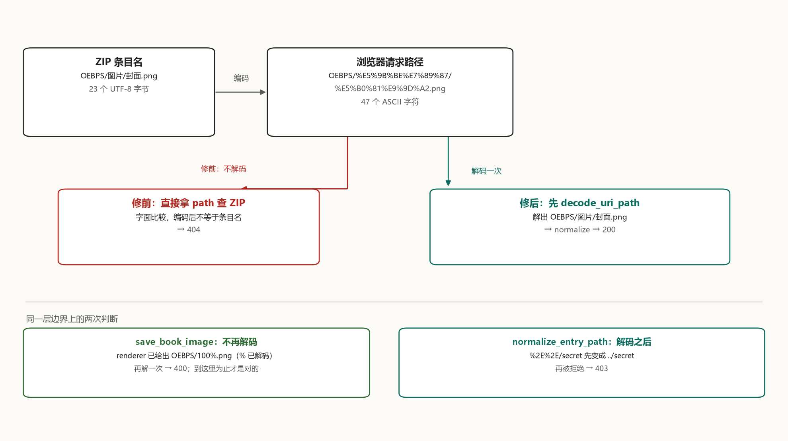

# Why the Chinese cover returns 404

`OEBPS/图片/封面.png` is a ZIP entry name of 23 UTF-8 bytes. The browser asks for it with a 47-character ASCII path:

```text
OEBPS/%E5%9B%BE%E7%89%87/%E5%B0%81%E9%9D%A2.png
```

Before the fix, the protocol handler took those 47 ASCII characters into the ZIP, looked for the 23-byte entry name, found nothing, and answered 404. Every resource whose name contains a space, a Chinese character, `#`, `?` or `%` was lost the same way.



## Two names

The problem sits in [epub-start's protocol handler](https://github.com/CaramelizedCUDA/epub-start/pull/2). Before the fix, `src-tauri/src/protocol/mod.rs` passed the URI through untouched:

```rust
let path = request.uri().path().trim_start_matches('/');
let result = serve_entry(ctx.app_handle(), path);
```

[These two lines](https://github.com/CaramelizedCUDA/epub-start/blob/ed7e300bfa894acc3854c2012db9e67a264bbd14/src-tauri/src/protocol/mod.rs#L13-L14) hand the URI path to `serve_entry` as it is. `serve_entry` runs `normalize_entry_path` for structural checks — it rejects empty paths, backslashes, `..`, absolute paths — but never changes a byte. Then `read_book_resource` compares that string with ZIP entry names literally.

A browser does not put `图` on the request line. Under [RFC 3986 §2.1](https://www.rfc-editor.org/rfc/rfc3986#section-2.1), data bytes in a URI are written as `%` followed by two hex digits, so the UTF-8 bytes of 图 become `%E5%9B%BE`. By the time the request reaches the handler, `request.uri().path()` is still in that encoded form. **The same entry name is not the same string inside a ZIP and inside a URI.**

## Who decodes

A URI crosses several layers between the browser and the ZIP, and each layer can rewrite the string. Decoding belongs to the layer where the URI stops being a URI and becomes an entry name — and it should happen exactly once.

The same runtime already had a correct example. Tauri's asset protocol does it at the entrance of [`crates/tauri/src/protocol/asset.rs`](https://github.com/tauri-apps/tauri/blob/tauri-v2.11.5/crates/tauri/src/protocol/asset.rs#L35-L38):

```rust
let path = percent_encoding::percent_decode(&request.uri().path().as_bytes()[1..])
    .decode_utf8_lossy()
    .to_string();
```

Decoded first, then handed to `SafePathBuf::new` for validation. The epub protocol handler was missing exactly this step.

The fix is [protocol/mod.rs, lines 136-172](https://github.com/CaramelizedCUDA/epub-start/blob/a349b9e1e4bed5b927b6a9dd3da56cc5ed74d19f/src-tauri/src/protocol/mod.rs#L136-L172): a byte-by-byte `decode_uri_path` that requires two hex digits after every `%` and valid UTF-8 from the decoded bytes, answering 400 otherwise. `epub_protocol` calls it first and passes the result to `serve_entry`.

## Decode before you validate

`normalize_entry_path` rejects `..`. That check only means something once it sees the decoded path.

Validate first, and `%2E%2E/secret` passes as an ordinary directory name: no backslash, not starting with `/`, not `..`. Only after decoding does it become `../secret` — by which point the lookup is already inside the ZIP. The fix flips the order: decode, then validate. `%2E%2E/secret` becomes `../secret`, is rejected in `normalize_entry_path`, and returns 403.

In the demo that row is `encoded dot-dot`: 404 before, because the literal entry `%2E%2E/secret` does not exist; 403 after. **Decoding has to come before validation**, otherwise the validation is looking at a disguise.

## Where not to decode again

`save_book_image` is a second door. It receives an `entry_path` from the frontend and at [`image_service.rs:25`](https://github.com/CaramelizedCUDA/epub-start/blob/a349b9e1e4bed5b927b6a9dd3da56cc5ed74d19f/src-tauri/src/services/image_service.rs#L25) only calls `normalize_entry_path`, with no decoding.

That is not an omission: the frontend has already decoded it. `imageInteractions.ts` calls `decodeURIComponent` when it builds the image target ([line 495](https://github.com/CaramelizedCUDA/epub-start/blob/a349b9e1e4bed5b927b6a9dd3da56cc5ed74d19f/src/features/reader/engine/imageInteractions.ts#L495) and [line 509](https://github.com/CaramelizedCUDA/epub-start/blob/a349b9e1e4bed5b927b6a9dd3da56cc5ed74d19f/src/features/reader/engine/imageInteractions.ts#L509)), so what reaches the backend is `图片/封面.png`. Decoding again would decode an already-decoded string.

The demo shows the cost. The entry `OEBPS/100%.png` is looked up literally before the fix: 200. Send it through the same decode path and the `%` in `100%` is followed by `.p`, not hex digits, so it returns 400. In the real app `save_book_image` is a different command that never passes through `epub_protocol`; the demo sends `100%.png` down the protocol path to make the boundary visible. When `100%.png` arrives from the viewer, its `%` is already decoded, and it must not meet the decoder a second time. RFC 3986 §2.4 states the rule:

> Implementations must not percent-encode or decode the same string more than once, as decoding an already decoded string might lead to misinterpreting a percent data octet as the beginning of a percent-encoding, or vice versa in the case of percent-encoding an already percent-encoded string.

**A layer that has already decoded must not decode again.**

## More than the cover

`src-tauri/src/lib.rs` [line 115](https://github.com/CaramelizedCUDA/epub-start/blob/a349b9e1e4bed5b927b6a9dd3da56cc5ed74d19f/src-tauri/src/lib.rs#L115) hands the whole `epub` scheme to this one handler:

```rust
.register_uri_scheme_protocol("epub", epub_protocol)
```

Once epub.js opens `epub://localhost/book/<id>/`, every relative address inside the book resolves onto that prefix. Chapter xhtml, stylesheets, fonts, images — each of them comes through the same entrance. What broke was not "that one cover image" but every entry whose name cannot sit verbatim in a URL.

Chinese books carry a fair number of those: `OEBPS/图片/封面.png`, `OEBPS/字体/正文.ttf`; a book with a hand-replaced cover often keeps a `cover v2.png` with a space in it. On the other hand `META-INF/container.xml` and `OEBPS/chapter.xhtml` were always fine, which is why the symptom reads as "text opens, all images are broken" and sends people off to image formats and decoders.

## The other half, found in review

In the PR discussion the maintainer did not stop at the protocol entrance. [He pointed out](https://github.com/CaramelizedCUDA/epub-start/pull/2#issuecomment-5852183429) that `resolveImageTarget` decodes the pathname first and then concatenates `${epubRootUrl}${entryPath}` for the viewer's image URL. An entry named `100%.png` becomes a broken percent sequence; the tail of `a#b.png` turns into a URL fragment; `a?b.png` turns into a query. Once the protocol entrance is fixed, images inside a chapter load, but opening the same image in the viewer still breaks.

He asked for percent-encoding on every path segment of the viewer URL, while `save_book_image` keeps receiving the decoded `entryPath`. In the end both agreed that the viewer-side encoding would be a separate follow-up by the maintainer, rather than widening this protocol PR. So the merge fixes the "URI to entry name" layer; the viewer side stays a known gap. Reading the merge as a full-chain fix misses half a page of that review.

## Nine cases

The demo takes the path handling from each of the two fixed commits, pairs it with the same `sample.epub` (8 entries, including a Chinese directory, a space, `#`, `?` and `%`), and issues 9 requests:

| Case | Before | After |
| --- | ---: | ---: |
| Chinese directory `%E5%9B%BE...` | 404 | 200 |
| space `cover%20v2.png` | 404 | 200 |
| `a%23b.png` | 404 | 200 |
| `a%3Fb.png` | 404 | 200 |
| `100%25.png` | 404 | 200 |
| raw `100%.png` | 200 | 400 |
| encoded traversal `%2E%2E/secret` | 404 | 403 |
| invalid escape `%zz.png` | 404 | 400 |
| plain path | 200 | 200 |

Run it:

```powershell
python make_sample.py
rustc -O main.rs -o epub_decode_demo.exe
./epub_decode_demo.exe --test
```

The output ends with three counter lines:

```text
before status counts: {200: 2, 404: 7}
after  status counts: {200: 6, 400: 2, 403: 1}
cases: 9  mismatches: 0
```

Before the fix only 2 requests came back 200 and 7 were 404; after it, 6 are 200, two are 400 and one is 403, with no case off its expectation. The layout, the provenance of the two source versions and the boundaries are in `percent_decode_demo/README.md`; the full output of this run is in `.yan/epub-percent/runs/epub-demo-publish-20261103.txt`.

## Is your book affected

One command, nothing to install:

```python
import zipfile
names = zipfile.ZipFile("book.epub").namelist()
print([n for n in names if any(ord(c) > 127 or c in " #?%" for c in n)])
```

On the sample book it prints exactly the five names:

```text
['OEBPS/图片/封面.png', 'OEBPS/cover v2.png', 'OEBPS/a#b.png', 'OEBPS/a?b.png', 'OEBPS/100%.png']
```

Those five are the 404 list from before the fix; the other three ASCII entries were always fine. The test is a single question: does the entry name contain any byte above ASCII, or a space, `#`, `?` or `%`. If it does, the name turns into `%XX` form on the request line and no longer matches what the ZIP stores.

## Will the new 400 hit anything

400 is the only new status code, and three situations reach it: fewer than two characters after `%`, a non-hex digit, or decoded bytes that are not valid UTF-8. A real browser cannot send the first two — it always writes `%` as `%25`, so the entry `100%.png` travels as `100%25.png`, decodes back to `100%.png` and returns 200 as usual. The row "raw `100%.png`" answers 400 because the demo deliberately puts `100%.png` on the line unencoded; no browser does that.

403 is not new, it simply was unreachable before: `%2E%2E` decodes to `..` and `normalize_entry_path` stops it. Before the fix it became a 404 first (the literal lookup missed), so it never got as far as validation.

## How upstream verified it

The merge adds three tests in the same file, one for each of the positions above: decoding ([`uri_path_decodes_percent_encoded_entries`, line 381](https://github.com/CaramelizedCUDA/epub-start/blob/a349b9e1e4bed5b927b6a9dd3da56cc5ed74d19f/src-tauri/src/protocol/mod.rs#L381)), decode failure ([`uri_path_rejects_invalid_percent_encoding`, line 401](https://github.com/CaramelizedCUDA/epub-start/blob/a349b9e1e4bed5b927b6a9dd3da56cc5ed74d19f/src-tauri/src/protocol/mod.rs#L401)) and decode-then-validate ([`percent_encoded_traversal_is_decoded_then_rejected`, line 409](https://github.com/CaramelizedCUDA/epub-start/blob/a349b9e1e4bed5b927b6a9dd3da56cc5ed74d19f/src-tauri/src/protocol/mod.rs#L409)).

The maintainer ran `cargo fmt --check`, `cargo check --locked` and `cargo test --locked protocol::tests` on an isolated snapshot of the PR head — 15 tests, including the 3 new ones. Loading inside a WebView was not run, so "the viewer side still breaks" rests on the reasoning in that review comment, not on an upstream measurement.

The patch is small, and only three positions really need a decision: decode once at the entrance, validate what was decoded, and never decode a layer twice. Move any one of them and a group of numbers in the table flips.
