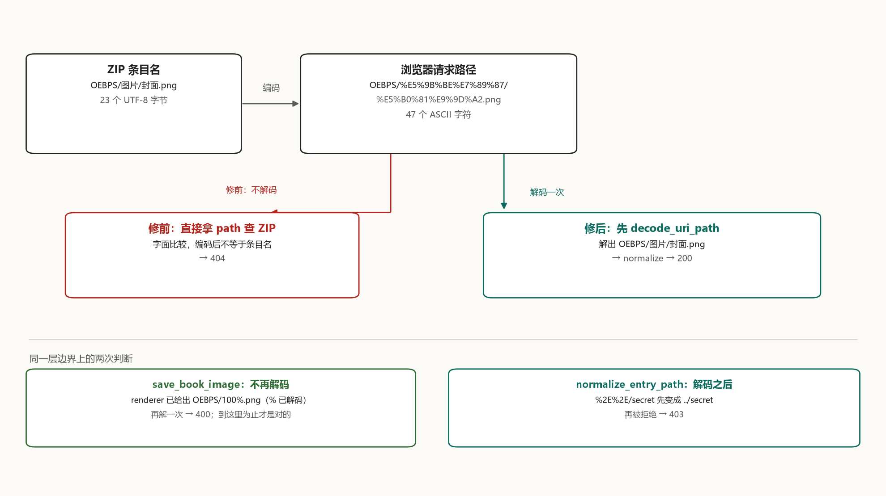

# 中文封面为什么 404

`OEBPS/图片/封面.png` 这个 ZIP 条目名是 23 个 UTF-8 字节。浏览器为它发出的请求路径是 47 个 ASCII 字符：

```text
OEBPS/%E5%9B%BE%E7%89%87/%E5%B0%81%E9%9D%A2.png
```

修复前，协议处理器拿这 47 个 ASCII 字符去 ZIP 里找那个 23 字节的条目名，找不到，返回 404。名字里带空格、中文、`#`、`?` 或 `%` 的资源，都是这样丢的。



## 两串名字

问题出在 [epub-start 的协议处理器](https://github.com/CaramelizedCUDA/epub-start/pull/2)。修前它在 `src-tauri/src/protocol/mod.rs` 里把 URI 原样往下传：

```rust
let path = request.uri().path().trim_start_matches('/');
let result = serve_entry(ctx.app_handle(), path);
```

[这两行](https://github.com/CaramelizedCUDA/epub-start/blob/ed7e300bfa894acc3854c2012db9e67a264bbd14/src-tauri/src/protocol/mod.rs#L13-L14)把 URI 的 path 原样交给 `serve_entry`。`serve_entry` 再用 `normalize_entry_path` 做结构规范化——拒绝空路径、反斜杠、`..`、绝对路径——但它不改变字符串的字节。后面的 `read_book_resource` 拿这个字符串去 ZIP 里按字面比较条目名。

浏览器不会把 `图` 直接放进请求行。按 [RFC 3986 §2.1](https://www.rfc-editor.org/rfc/rfc3986#section-2.1)，URI 里的数据字节要先写成 `%` 加两个十六进制数字；中文的 UTF-8 字节因此变成 `%E5%9B%BE` 这样的三元组。请求到达处理器时，`request.uri().path()` 仍是这种编码形式。**同一个条目名，在 ZIP 里和 URI 里不是同一种字符串。**

## 谁该解码

URI 从浏览器到 ZIP 要经过几层，每一层都可能改字符串。解码应该发生在"URI 不再是 URI、而要变成条目名"的那一层，而且只发生一次。

同一个运行时里已经有一个正确样例。Tauri 的 asset 协议在 [`crates/tauri/src/protocol/asset.rs`](https://github.com/tauri-apps/tauri/blob/tauri-v2.11.5/crates/tauri/src/protocol/asset.rs#L35-L38) 的入口处这么做：

```rust
let path = percent_encoding::percent_decode(&request.uri().path().as_bytes()[1..])
    .decode_utf8_lossy()
    .to_string();
```

解完再交给 `SafePathBuf::new` 做校验。epub 协议处理器缺的就是这一步。

修复在 [protocol/mod.rs 的 136-172 行](https://github.com/CaramelizedCUDA/epub-start/blob/a349b9e1e4bed5b927b6a9dd3da56cc5ed74d19f/src-tauri/src/protocol/mod.rs#L136-L172)：一个逐字节扫描的 `decode_uri_path`，`%` 后必须跟两个十六进制数字，解出的字节必须是合法 UTF-8；不满足就返回 400。`epub_protocol` 先调用它，再把结果交给 `serve_entry`。

## 解码要走在校验前面

`normalize_entry_path` 会拒绝 `..`。这个检查只有看到解码后的路径才有意义。

如果先校验再解码，`%2E%2E/secret` 里的 `%2E%2E` 会被当成一个普通目录名——没有反斜杠、不以 `/` 开头、不是 `..`——顺利通过；解码之后它才变成 `../secret`，而这时已经进了 ZIP 查找。修复把顺序反过来：先解码，再校验。`%2E%2E/secret` 解开成 `../secret`，在 `normalize_entry_path` 里被拒绝，返回 403。

复现工程里这一行是 `encoded dot-dot`：修前 404（字面查 `%2E%2E/secret` 没命中），修后 403。**解码必须在校验之前**，否则校验看到的是一层伪装。

## 哪里不能再解一次

`save_book_image` 是另一个入口。它接收前端传来的 `entry_path`，在 [`image_service.rs:25`](https://github.com/CaramelizedCUDA/epub-start/blob/a349b9e1e4bed5b927b6a9dd3da56cc5ed74d19f/src-tauri/src/services/image_service.rs#L25) 只调用 `normalize_entry_path`，没有解码。

这不是漏了，而是因为前端已经解过。`imageInteractions.ts` 在构造图片目标时调用 `decodeURIComponent`（[495 行](https://github.com/CaramelizedCUDA/epub-start/blob/a349b9e1e4bed5b927b6a9dd3da56cc5ed74d19f/src/features/reader/engine/imageInteractions.ts#L495) 和 [509 行](https://github.com/CaramelizedCUDA/epub-start/blob/a349b9e1e4bed5b927b6a9dd3da56cc5ed74d19f/src/features/reader/engine/imageInteractions.ts#L509)），传给后端的是 `图片/封面.png` 这种形态。后端如果再解一次，等于对已经解过的字符串再解一次。

代价在 demo 里能看到：条目 `OEBPS/100%.png` 在修前走字面查找，200；修后如果走同一条解码路径，`100%` 里的 `%` 后跟的是 `.p`，不是十六进制，直接 400。真实请求里 `save_book_image` 是另一条命令，不经过 `epub_protocol`；demo 把 `100%.png` 当协议请求跑，是为了让这条边界显形。`100%.png` 从 viewer 来时带的是已解码的 `%`，它不该再过解码器。RFC 3986 §2.4 把这条写成规则：

> Implementations must not percent-encode or decode the same string more than once, as decoding an already decoded string might lead to misinterpreting a percent data octet as the beginning of a percent-encoding, or vice versa in the case of percent-encoding an already percent-encoded string.

**已经解码过的层不能再解一次。**

## 丢的不止封面

`src-tauri/src/lib.rs` [第 115 行](https://github.com/CaramelizedCUDA/epub-start/blob/a349b9e1e4bed5b927b6a9dd3da56cc5ed74d19f/src-tauri/src/lib.rs#L115)把整个 `epub` scheme 交给这一个处理器：

```rust
.register_uri_scheme_protocol("epub", epub_protocol)
```

epub.js 打开 `epub://localhost/book/<id>/` 之后，书里所有相对地址都解析到这个前缀上。章节 xhtml、样式表、字体、图片，取任何一样都经过同一个入口——坏掉的不是"封面那张图"，而是这本书里所有条目名不能原样放进 URL 的东西。

中文书里这类条目不少：`OEBPS/图片/封面.png`、`OEBPS/字体/正文.ttf`；手工换过封面的书还常留下 `cover v2.png` 这种带空格的版本。反过来，`META-INF/container.xml`、`OEBPS/chapter.xhtml` 这些全 ASCII 的条目一直是好的，于是症状很容易被读成"正文能打开，图全裂了"，然后往图片格式、解码器那边查。

## review 指出的另一半

这个 PR 的讨论里，维护者没有停在协议入口。[他指出](https://github.com/CaramelizedCUDA/epub-start/pull/2#issuecomment-5852183429) `resolveImageTarget` 先解码 pathname，再用 `${epubRootUrl}${entryPath}` 拼 viewer 的图片地址。条目名 `100%.png` 会被浏览器当成一个坏的百分号序列；`a#b.png` 的后半段会变成 URL fragment；`a?b.png` 会变成 query。协议入口修好之后，章节里的图片能加载了，但在 viewer 里点开同一张图仍会坏。

他要求对 viewer URL 的每个路径段编码，同时保留传给 `save_book_image` 的已解码 `entryPath`。最后双方同意：viewer 的编码另开一次维护者跟进，不扩大这个协议 PR。所以这个合并提交修的是"URI 到条目名"这一层；viewer 侧仍是一个已知缺口。把合并当成全链路修好，会漏掉 review 里的这半页。

## 九个用例

复现工程从两个固定提交各取一份路径处理，配上同一份 `sample.epub`（8 个条目，含中文目录、空格、`#`、`?`、`%`），跑 9 个请求：

| 用例 | 修前 | 修后 |
| --- | ---: | ---: |
| 中文目录 `%E5%9B%BE...` | 404 | 200 |
| 空格 `cover%20v2.png` | 404 | 200 |
| `a%23b.png` | 404 | 200 |
| `a%3Fb.png` | 404 | 200 |
| `100%25.png` | 404 | 200 |
| 未编码 `100%.png` | 200 | 400 |
| 编码穿越 `%2E%2E/secret` | 404 | 403 |
| 非法序列 `%zz.png` | 404 | 400 |
| 普通路径 | 200 | 200 |

跑一遍：

```powershell
python make_sample.py
rustc -O main.rs -o epub_decode_demo.exe
./epub_decode_demo.exe --test
```

输出末尾是三行计数：

```text
before status counts: {200: 2, 404: 7}
after  status counts: {200: 6, 400: 2, 403: 1}
cases: 9  mismatches: 0
```

修前 200 只有 2 个，404 有 7 个；修后 200 是 6 个，400 两个，403 一个。九个用例零个不符合预期。工程结构、两版源码的来历和边界写在 `percent_decode_demo/README.md`，这次运行的完整输出在 `.yan/epub-percent/runs/epub-demo-publish-20261103.txt`。

## 你的书会不会中招

一条命令，不用装任何东西：

```python
import zipfile
names = zipfile.ZipFile("book.epub").namelist()
print([n for n in names if any(ord(c) > 127 or c in " #?%" for c in n)])
```

样例书跑出来正好是那五条：

```text
['OEBPS/图片/封面.png', 'OEBPS/cover v2.png', 'OEBPS/a#b.png', 'OEBPS/a?b.png', 'OEBPS/100%.png']
```

这五条就是修复前的 404 名单，另外三条 ASCII 条目一直是好的。判断标准只有一条：条目名里有没有超出 ASCII 的字节，或者空格、`#`、`?`、`%`。有，它在请求行里就会变成 `%XX` 的形式，和 ZIP 里存的名字对不上。

## 新出现的 400 会不会误伤

400 是这次修复带进来的新状态码，只有三种情况触发：`%` 后面不足两位、十六进制不合法、解出来的字节不是合法 UTF-8。真实浏览器发不出前两种请求——它总把 `%` 写成 `%25`，所以条目 `100%.png` 在请求行里是 `100%25.png`，解回 `100%.png`，照常 200。表里「未编码 `100%.png`」那一行返回 400，是因为那里故意把 `100%.png` 原样发了过去，没有浏览器会这样发。

403 不是新的，只是以前轮不到它：`%2E%2E` 解出来是 `..`，在 `normalize_entry_path` 里被拦下。修前它先变成 404（字面查找没命中），根本走不到校验。

## 上游怎么验的

合并提交在同一个文件里加了三个测试，正好对应上面三个位置：解码（[`uri_path_decodes_percent_encoded_entries`，381 行](https://github.com/CaramelizedCUDA/epub-start/blob/a349b9e1e4bed5b927b6a9dd3da56cc5ed74d19f/src-tauri/src/protocol/mod.rs#L381)）、解码失败（[`uri_path_rejects_invalid_percent_encoding`，401 行](https://github.com/CaramelizedCUDA/epub-start/blob/a349b9e1e4bed5b927b6a9dd3da56cc5ed74d19f/src-tauri/src/protocol/mod.rs#L401)）、解码后再校验（[`percent_encoded_traversal_is_decoded_then_rejected`，409 行](https://github.com/CaramelizedCUDA/epub-start/blob/a349b9e1e4bed5b927b6a9dd3da56cc5ed74d19f/src-tauri/src/protocol/mod.rs#L409)）。

维护者在 PR head 的隔离快照上跑过 `cargo fmt --check`、`cargo check --locked` 和 `cargo test --locked protocol::tests`——15 个测试，含这 3 个新增。WebView 里的实际加载没有跑，所以"viewer 侧仍会坏"这件事，只有 review 那段推理，没有上游的实测。

补丁不大，真正要判断的只有三个位置：入口解码一次、校验看解码后的路径、已经解码过的层不再解。三处里任何一处换个位置，表里就会有一组数字翻过来。
