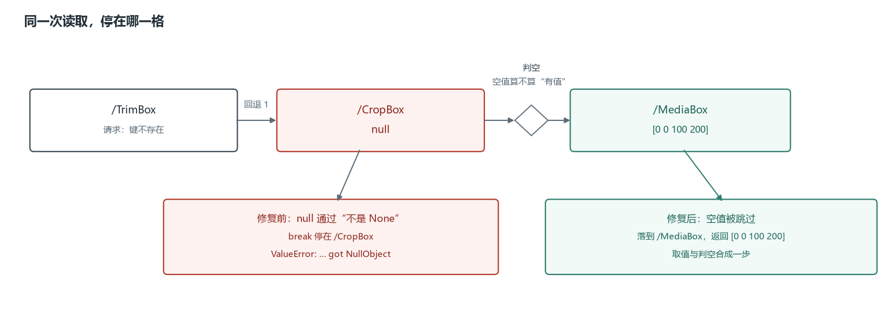
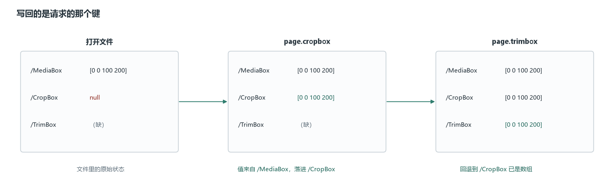

# The crop box says null. Why do the other three boxes fail?

A page whose dictionary carries `/CropBox null` answers like this:

```text
>>> page.trimbox
ValueError: Expected an array of four values for /TrimBox, got NullObject
```

The error names `/TrimBox`. What is broken in the file is `/CropBox`. And the same page in the same file passes if the crop box is touched first:

```text
>>> page.cropbox
RectangleObject([0, 0, 100, 200])
>>> page.trimbox
RectangleObject([0, 0, 100, 200])
```

Before the fix this is not a file that cannot be read. It is **a file whose readability depends on which box you ask for first**. The patch is [pypdf #4375](https://github.com/py-pdf/pypdf/pull/4375), and it only touches the lines that look a value up: the question of what counts as a usable candidate in the fallback chain.

## Four boxes, two fallbacks

A PDF page can declare four boxes: `/MediaBox` is the mandatory page size, `/CropBox` is the region displayed or printed, and `/TrimBox`, `/ArtBox`, `/BleedBox` describe the finished size, the content region and the bleed area. ISO 32000-1 §14.11.2 makes the last three default to `/CropBox`, and `/CropBox` default to `/MediaBox`. pypdf writes that rule as a fallback list per attribute ([`_page.py:2388-2398`](https://github.com/py-pdf/pypdf/blob/8eeb0509d712e324e68e2bd38aff69e3b672e0cd/pypdf/_page.py#L2388-L2398)):

```python
bleedbox = _create_rectangle_accessor("/BleedBox", ("/CropBox", PG.MEDIABOX))
trimbox = _create_rectangle_accessor("/TrimBox", ("/CropBox", PG.MEDIABOX))
artbox = _create_rectangle_accessor("/ArtBox", ("/CropBox", PG.MEDIABOX))
```

Every read goes through the same function, [`_get_rectangle()`](https://github.com/py-pdf/pypdf/blob/8eeb0509d712e324e68e2bd38aff69e3b672e0cd/pypdf/_page.py#L131-L163):

```python
retval: PdfObject | None = self.get(name)
if isinstance(retval, RectangleObject):
    return retval
if is_null_or_none(retval):
    for d in defaults:
        retval = self.get(d)
        if retval is not None:
            break
if isinstance(retval, IndirectObject):
    retval = retval.get_object()
if not isinstance(retval, ArrayObject):
    raise ValueError(f"Expected an array of four values for {name}, got {retval}")
```

## Null is not None

A PDF can spell "no value" as `null`. pypdf parses that into `NullObject()`, a real Python object, not `None`. So `/CropBox null` satisfies `retval is not None` inside the loop, the `break` fires at once, and the fallback stops on the empty value. The next line, `isinstance(retval, ArrayObject)`, is false, and the error is the one from the top: `got NullObject`.

Read as intent, that line should ask "does this candidate hold a usable array". What it asks is "does this key exist". **`None` covers "the key is absent"; `NullObject()` covers "the key is present and empty"** — the first is what `self.get(d)` returns for a missing key, the second is what the file holds. This bug is the second.

The chain and where the emptiness test sits:



## Read once, written back

If the story ended at "an empty value stops the fallback", it would be one unreadable file. What makes the behaviour awkward is the last line of the function:

```python
_set_rectangle(self, name, retval)
```

`_get_rectangle()` stores its result back into the page dictionary. **Read `/CropBox` once and the `[0, 0, 100, 200]` that came from `/MediaBox` is saved as the new `/CropBox`**; every later read of a dependent box sees an ordinary array. That is why reading the crop box first gets around the bug — nothing is repaired, the empty value is overwritten.

One page dictionary at three moments, and which key the write-back lands on:



Running both versions on the same cases, order and result side by side:

| read order | before the fix | after the fix |
| --- | --- | --- |
| `/TrimBox` first | `ValueError … got NullObject` | `[0, 0, 100, 200]` |
| `/ArtBox` first | `ValueError … got NullObject` | `[0, 0, 100, 200]` |
| `/BleedBox` first | `ValueError … got NullObject` | `[0, 0, 100, 200]` |
| `/CropBox` first, then `/TrimBox` | both fine | both fine |
| `/CropBox` an indirect null, then `/TrimBox` | `ValueError … got NullObject` | `[0, 0, 100, 200]` |

## An indirect null is not even tested

The last row is a different spelling: `/CropBox 12 0 R`, where the object itself is `null`. On the parent, the second `self.get(d)` returns an `IndirectObject`, which is also "not `None`", so the loop breaks as before; the dereference happens after the loop, yields `NullObject`, and walks into the same `ValueError`.

So the chain has two kinds of emptiness: a literal `null`, and an indirect reference to one. The parent tests the wrong object for the first and never reaches the test for the second.

## Who runs into it

`PageObject.scale_by()` reads all four boxes. It forwards to `scale()`, which starts at `/BleedBox` and resets bleed, trim, art and crop in turn ([`_page.py:1698-1701`](https://github.com/py-pdf/pypdf/blob/8eeb0509d712e324e68e2bd38aff69e3b672e0cd/pypdf/_page.py#L1698-L1701)). In the demo, `writer.add_page(...).scale_by(0.5)` on a page with `/CropBox null` hits this first:

```text
ValueError: Expected an array of four values for /BleedBox, got NullObject
```

A call that only wanted to halve the page fails outright because of one empty value. Merging pages, scaling pages, resizing pages all arrive here; the more of it is batched, the more likely one page stops the run.

## The patch only touches the lookup

The merged [`_get_rectangle()`](https://github.com/py-pdf/pypdf/blob/049dbfb366931b0f86ea6956951b5b7d6f27b01e/pypdf/_page.py#L140-L171) folds lookup and emptiness into one step:

```python
retval: PdfObject = self.get(name, NullObject()).get_object()
...
for d in defaults:
    retval = self.get(d, NullObject()).get_object()
    if not is_null_or_none(retval):
        break
```

`get(..., NullObject())` gives a missing key the same empty value, `.get_object()` dereferences on the spot, and `is_null_or_none()` accepts both `None` and `NullObject`. The loop changes from "the first key that exists" to "the first key that has a value".

The write-back in `_set_rectangle()` is untouched: it is existing getter behaviour, and changing it would affect code paths that count on the read-once cache. The patch moves only the emptiness test; the behaviour change is confined to "an empty value no longer ends the fallback".

That is also why the reproduction opens a new reader per case. The write-back mutates the in-memory page dictionary, so a second case on the same reader would not see the original file. Eight cases, eight separate processes, so each starts from "the file says null" rather than from the array the previous case left behind.

## Telling this one apart

The error text is fixed: `Expected an array of four values for /…, got NullObject`, naming `/TrimBox`, `/ArtBox` or `/BleedBox`, while the entry that is actually broken is `/CropBox`. If the name in the error is `/CropBox`, it is something else: `/CropBox` itself cannot fall back to `/MediaBox`, which usually means `/MediaBox` is missing or is not an array either.

The workaround is easy: read `page.cropbox` once so the write-back replaces the empty value, or delete the `/CropBox` key from the dictionary. Both only move the problem — the null is still in the file, and another read order or another toolchain will bring the same failure back.

## The line review added

The maintainer, stefan6419846, asked one question first:

> We do not check the "interesting" cropbox?

The original test only asserted the three dependent boxes — `trimbox`, `artbox`, `bleedbox` — and never that `/CropBox` itself can fall back to `/MediaBox`, which is exactly where the write-back happens. The author added `assert page.cropbox == RectangleObject([0, 0, 100, 200])` and replaced the hand-built indirect reference in the test with `writer._add_object(NullObject())`.

The review carried two simplifications besides. Writing lookup and emptiness as `self.get(..., NullObject()).get_object()` uses one expression for both the first lookup and the loop; and the half-assembled `IndirectObject` in the test goes away in favour of the writer's own `_add_object()`. The first turns the patch from "a test in two places" into one expression used twice; the second makes the indirect case come from the writer's real output instead of an object the test stitched together.

After the review, the author said in a comment that the PR was "not ready" and should have been rechecked before being pushed. That is why the final diff is shorter than the first: the first was "add a test inside the loop", the review made it "unify the lookup step".

## Reproduction

The project lives in `空裁剪框_pypdf/null_box_demo/`, with both `pypdf/` trees vendored byte for byte; each of the 8 cases runs in its own `python -I -B` subprocess:

```text
python -B run.py --test
```

Output (archived in `.yan/pypdf-nullbox/runs/`):

```text
parent snapshot failed 5/8 cases; merged snapshot failed 0/8
```

- Before the fix: 5 of 8 cases raise `ValueError … got NullObject`; `cropbox-first` and `healthy` are fine.
- After the fix: all 8 return `[0, 0, 100, 200]`, and `[0, 0, 50, 100]` after `scale_by(0.5)`.
- Write-back evidence: after one read of `/CropBox`, the dictionary holds a `RectangleObject` with `[0, 0, 100, 200]`.

Upstream: `py-pdf/pypdf`, [#4375](https://github.com/py-pdf/pypdf/pull/4375), parent commit [`8eeb0509`](https://github.com/py-pdf/pypdf/commit/8eeb0509d712e324e68e2bd38aff69e3b672e0cd), merge commit [`049dbfb3`](https://github.com/py-pdf/pypdf/commit/049dbfb366931b0f86ea6956951b5b7d6f27b01e).
