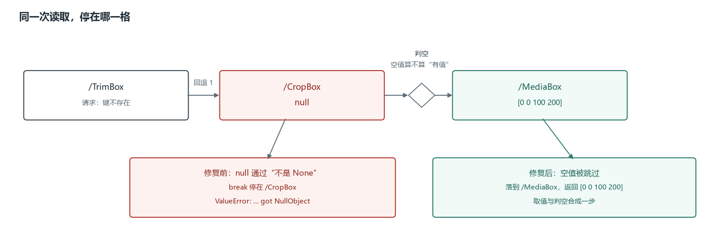
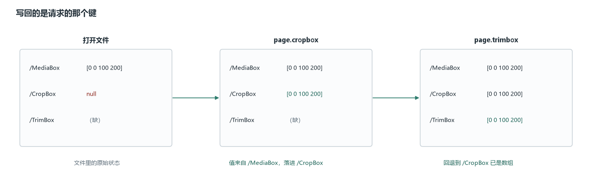

# 裁剪框写着 null，为什么另外三个框也读不出来

一个只写了 `/CropBox null` 的页面，读 `/TrimBox` 会这样：

```text
>>> page.trimbox
ValueError: Expected an array of four values for /TrimBox, got NullObject
```

报错说的是 `/TrimBox`，文件里写坏的却是 `/CropBox`。更奇怪的是同一份文件、同一个页面，先读一次裁剪框，这一句就过去了：

```text
>>> page.cropbox
RectangleObject([0, 0, 100, 200])
>>> page.trimbox
RectangleObject([0, 0, 100, 200])
```

修前不是「这个文件读不了」，而是「**先读哪个框决定读不读得了**」。这篇文章拆的是 [pypdf #4375](https://github.com/py-pdf/pypdf/pull/4375)，补丁只碰了取值那几行，补的是回退链上「空值也算有值」这一处判断。

## 四个框，两条回退

PDF 的页面可以声明四个框：`/MediaBox` 是必填的页面尺寸，`/CropBox` 是显示/打印的裁剪区，`/TrimBox`、`/ArtBox`、`/BleedBox` 分别是成品尺寸、内容区与出血区。ISO 32000-1 §14.11.2 规定后三个缺省时等于 `/CropBox`，`/CropBox` 缺省时等于 `/MediaBox`。pypdf 把这条规则写成了属性的回退名单（[`_page.py:2388-2398`](https://github.com/py-pdf/pypdf/blob/8eeb0509d712e324e68e2bd38aff69e3b672e0cd/pypdf/_page.py#L2388-L2398)）：

```python
bleedbox = _create_rectangle_accessor("/BleedBox", ("/CropBox", PG.MEDIABOX))
trimbox = _create_rectangle_accessor("/TrimBox", ("/CropBox", PG.MEDIABOX))
artbox = _create_rectangle_accessor("/ArtBox", ("/CropBox", PG.MEDIABOX))
```

读取时走同一个函数 [`_get_rectangle()`](https://github.com/py-pdf/pypdf/blob/8eeb0509d712e324e68e2bd38aff69e3b672e0cd/pypdf/_page.py#L131-L163)：

```python
retval: PdfObject | None = self.get(name)
if isinstance(retval, RectangleObject):
    return retval
if is_null_or_none(retval):
    for d in defaults:
        retval = self.get(d)
        if retval is not None:
            break
if isinstance(retval, IndirectObject):
    retval = retval.get_object()
if not isinstance(retval, ArrayObject):
    raise ValueError(f"Expected an array of four values for {name}, got {retval}")
```

## null 不是 None

PDF 里的「没有值」可以明写成 `null`。pypdf 把它解析成 `NullObject()`，一个真实的 Python 对象，不是 `None`。于是 `/CropBox null` 在循环里满足 `retval is not None`，`break` 立刻发生，回退停在空值上。下一行 `isinstance(retval, ArrayObject)` 为假，抛出的就是开头那句 `got NullObject`。

从代码的意图看，这一行本该问「这个候选箱有没有可用的数组」，问出来的却是「这个键在不在」。**`None` 只覆盖「键不存在」，`NullObject()` 覆盖「键存在但值是空」**——前者在 `self.get(d)` 的默认返回值里，后者在文件里。这次出问题的是后者。

回退链和判空所在的位置：



## 读一次，写回一次

如果只是「空值停住回退」，那也只是一个读不出来的文件。真正让现象变得别扭的是函数末尾这一句：

```python
_set_rectangle(self, name, retval)
```

`_get_rectangle()` 解析完会把结果写回页面字典。**读一次 `/CropBox`，回退到 `/MediaBox` 得到的 `[0, 0, 100, 200]` 就被存成了新的 `/CropBox`**；之后任何依赖框再读，看到的已经是一个正常数组。这也是为什么「先读裁剪框」能绕过这个 bug——不是修好了，是空值被覆盖了。

同一份页面字典的三个时刻，写回落在哪个键上：



修复前后各跑一遍，把顺序与结果并排放：

| 读取顺序 | 修复前 | 修复后 |
| --- | --- | --- |
| 先读 `/TrimBox` | `ValueError … got NullObject` | `[0, 0, 100, 200]` |
| 先读 `/ArtBox` | `ValueError … got NullObject` | `[0, 0, 100, 200]` |
| 先读 `/BleedBox` | `ValueError … got NullObject` | `[0, 0, 100, 200]` |
| 先读 `/CropBox`，再读 `/TrimBox` | 两句都正常 | 两句都正常 |
| `/CropBox` 指向间接 null，读 `/TrimBox` | `ValueError … got NullObject` | `[0, 0, 100, 200]` |

## 间接的 null 连「空」都没判到

表里最后一行是另一种写法：`/CropBox 12 0 R`，那个对象本身是 `null`。父版里第二次 `self.get(d)` 拿到的是 `IndirectObject`，同样「不是 `None`」，循环照旧 `break`；解引用写在循环之后，解出来是 `NullObject`，然后走到同一个 `ValueError`。

也就是说，回退链上有两种「空」：直接写 `null`，和指向 `null` 的间接引用。父版对前者判断错了对象，对后者连判断都没轮到。

## 谁在踩这个坑

`PageObject.scale_by()` 会读四个框。它转给 `scale()`，后者从 `/BleedBox` 开始，依次重设出血、裁切、内容、裁剪四个框（[`_page.py:1698-1701`](https://github.com/py-pdf/pypdf/blob/8eeb0509d712e324e68e2bd38aff69e3b672e0cd/pypdf/_page.py#L1698-L1701)）。demo 里对一个 `/CropBox null` 的页面执行 `writer.add_page(...).scale_by(0.5)`，修复前先撞上的是 `/BleedBox`：

```text
ValueError: Expected an array of four values for /BleedBox, got NullObject
```

一个只想把页面缩到一半的调用，因为这个空值整个失败。合成/合并页面、改尺寸这类操作都会走到这里；越是批处理，越容易在某一页上突然停下。

## 补丁只改了取值这一步

合并后的 [`_get_rectangle()`](https://github.com/py-pdf/pypdf/blob/049dbfb366931b0f86ea6956951b5b7d6f27b01e/pypdf/_page.py#L140-L171) 把「取值」与「判空」合到了一处：

```python
retval: PdfObject = self.get(name, NullObject()).get_object()
...
for d in defaults:
    retval = self.get(d, NullObject()).get_object()
    if not is_null_or_none(retval):
        break
```

`get(..., NullObject())` 让「键不存在」也得到同一个空值，`.get_object()` 当场解掉间接引用，`is_null_or_none()` 同时认 `None` 和 `NullObject`。循环从「找到第一个存在的键」变成「找到第一个有值的键」。

`_set_rectangle()` 的写回没有动：它是 getter 的既有行为，改掉会影响别处依赖「读一次就缓存」的代码路径。补丁只动判空，行为变化收在「空值不再终止回退」这一点上。

这也解释了复现为什么要给每个用例开一个新的 reader：写回会改掉内存里的页面字典，同一个 reader 上先跑一个用例，后一个用例看到的就不是原始文件了。八行用例、八个独立进程，是为了让每一行都从「文件里写着 null」开始，而不是从上一行留下的数组开始。

## 怎么判断自己遇到的是这一个

错误文本是固定的 `Expected an array of four values for /…, got NullObject`，点名的框是 `/TrimBox`、`/ArtBox` 或 `/BleedBox`，而文件里真正写坏的是 `/CropBox`。如果点名的就是 `/CropBox`，那是另一种情况：`/CropBox` 自己也读不到 `/MediaBox`，通常意味着 `/MediaBox` 缺失或也不是数组。

临时绕过并不难：先读一次 `page.cropbox`，让写回把空值替换掉，后面的框就能读；或者直接在字典里删掉 `/CropBox` 这个键。两种做法都只是把问题挪开——文件里的 null 还在，换个读取顺序、换一份工具链，同样的失败会再出现。

## review 补的那一行

维护者 stefan6419846 在 review 里先问了一句：

> We do not check the "interesting" cropbox?

原始测试只断言了 `trimbox`、`artbox`、`bleedbox` 三个依赖框，没有断言 `/CropBox` 自己能否回退到 `/MediaBox`——而那正是写回发生的地方。作者随后补了 `assert page.cropbox == RectangleObject([0, 0, 100, 200])`，并把测试里手工构造的间接引用换成了 `writer._add_object(NullObject())`。

review 里另有两处简化：把「取值 + 判空」写成 `self.get(..., NullObject()).get_object()`，第一处取键和循环里的取键都用同一种写法；测试里那半截手工拼的 `IndirectObject` 删掉，用 writer 现成的 `_add_object()`。前者让补丁从「在两个地方各加一层判断」收成两步一样的表达式，后者让间接 null 这个用例不再依赖测试自己拼出来的对象，和真实写出再读回的路径一致。

作者在 review 后的评论里说，这个 PR 当时「还没准备好」，应该先自己复核再推。最终 diff 比初版短，也是这个缘故：初版是「在循环里补一个判断」，review 之后变成「取值这一步就统一」。

## 复现

工程在 `空裁剪框_pypdf/null_box_demo/`，两版 `pypdf/` 原样 vendor，8 个用例各在自己的 `python -I -B` 子进程里跑：

```text
python -B run.py --test
```

输出（存档 `.yan/pypdf-nullbox/runs/`）：

```text
parent snapshot failed 5/8 cases; merged snapshot failed 0/8
```

- 修复前：8 个用例里 5 个抛 `ValueError … got NullObject`，`cropbox-first` 与 `healthy` 正常。
- 修复后：8 个都返回 `[0, 0, 100, 200]`，`scale_by(0.5)` 后是 `[0, 0, 50, 100]`。
- 写回证据：读过一次 `/CropBox` 之后，字典里留下的是 `RectangleObject`，值 `[0, 0, 100, 200]`。

上游：`py-pdf/pypdf`，[#4375](https://github.com/py-pdf/pypdf/pull/4375)，父提交 [`8eeb0509`](https://github.com/py-pdf/pypdf/commit/8eeb0509d712e324e68e2bd38aff69e3b672e0cd)，合并提交 [`049dbfb3`](https://github.com/py-pdf/pypdf/commit/049dbfb366931b0f86ea6956951b5b7d6f27b01e)。

