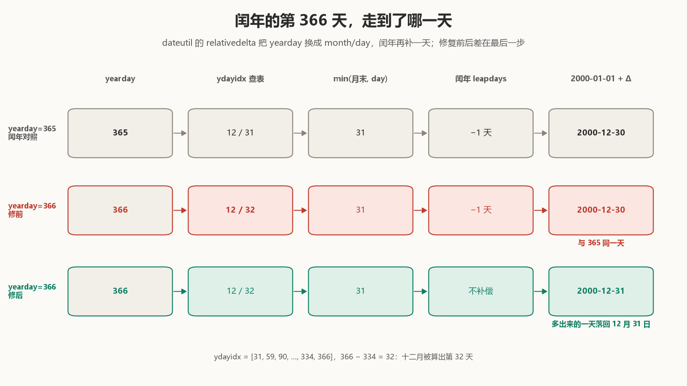

# The 366th day of the year lands on December 30

December 30, 2000 is the 365th day of that year.

Count from January 1, 2000, and ask dateutil's `relativedelta` for day 366. It returns December 30 as well:

```python
>>> date(2000, 1, 1) + relativedelta(yearday=365)
datetime.date(2000, 12, 30)
>>> date(2000, 1, 1) + relativedelta(yearday=366)
datetime.date(2000, 12, 30)   # before dateutil 4.0.0
```

The extra day of the leap year never reaches the calendar. Day 366 is the legal maximum of `yearday` — one more, `relativedelta(yearday=367)`, raises `ValueError` — yet it gives the same date as the day before.

That is the one spot I changed in [dateutil #1583](https://github.com/dateutil/dateutil/pull/1583). The patch tightens a condition from `yearday > 59` to `59 < yearday < 366`, plus ten lines of tests. To see why it had to change this way, start with what `relativedelta(yearday=366)` actually stores.

## December 32

`relativedelta(yearday=N)` does not keep N. The constructor turns it into a month, a day and a `leapdays` offset:

```python
ydayidx = [31, 59, 90, 120, 151, 181, 212,
           243, 273, 304, 334, 366]
for idx, ydays in enumerate(ydayidx):
    if yday <= ydays:
        self.month = idx+1
        if idx == 0:
            self.day = yday
        else:
            self.day = yday-ydayidx[idx-1]
        break
```

`ydayidx` is the cumulative day table for a common year. `366 - 334 = 32`, so `relativedelta(yearday=366)` holds `month=12, day=32`, a date that does not exist. The object raises nothing; an out-of-range `day` is left for the clamp at application time.

`repr` shows month, day and `leapdays` together:

```python
>>> relativedelta(yearday=366)
relativedelta(leapdays=-1, month=12, day=32)   # before dateutil 4.0.0
>>> relativedelta(yearday=366)
relativedelta(month=12, day=32)                # 4.0.0
```

`leapdays=-1` is the second piece. The common-year table is one day short in February: March 1 of a leap year is day 61, but the table counts it as day 60. So the constructor records `-1` for day numbers past February, and application subtracts one day when the year is a leap year.

This is not an ad-hoc patch: `if yearday > 59` has been in [`dateutil/relativedelta.py`](https://github.com/dateutil/dateutil/blob/68ae2757ae15c84bf947d47a82a314b3b975bc9b/dateutil/relativedelta.py#L147-L148) since the initial import in 2003, and `ydayidx` came with it. For day numbers 60 through 365 the compensation is correct. `date(2000, 1, 1) + relativedelta(yearday=60)` gives February 29: the table maps 60 to March 1, and one day back is the leap day.



The problem is in application. [`__add__` in the merged version](https://github.com/dateutil/dateutil/blob/d23ff760f8448b51579016d96f39590018445724/src/dateutil/relativedelta.py#L379-L388) computes the month, clamps the day, then applies `leapdays`:

```python
day = min(calendar.monthrange(year, month)[1],
          self.day or other.day)
...
days = self.days
if self.leapdays and month > 2 and calendar.isleap(year):
    days += self.leapdays
```

For 366 both steps fire: `day=32` is clamped by `min(31, 32)` back to December 31, and the leap year's `leapdays=-1` takes that 31 down to 30. **The clamp has already folded December 32 back to the end of the month; the compensation pushes it off the end again.** Each correction is right on its own; stacked, they subtract one day too many.

365 is spared: the table maps 365 to `day=31`, the clamp does nothing, and the minus one gives December 30, day 365 of a leap year. **366 is the only day number computed as the 32nd and then pulled back to the 31st; compensating it is redundant.**

## The tests guarded 367, not 366

The 2016 [`testYearDay`](https://github.com/dateutil/dateutil/blob/5391455e7c7839e300b63649041806fb5219432e/tests/test_relativedelta.py#L168-L190) covers three day numbers:

- 260, past February, across leap and common years, which shows the direction of `leapdays=-1`;
- 261, the fixture's `today`;
- 15, before February, where `leapdays` never fires.

The same test class also has `nlyearday=260`, which goes through the other path that never sets `leapdays`. [`testInvalidYearDay`](https://github.com/dateutil/dateutil/blob/5391455e7c7839e300b63649041806fb5219432e/tests/test_relativedelta.py#L581-L583) in the same file only checks the boundary:

```python
with self.assertRaises(ValueError):
    relativedelta(yearday=367)
```

**The success path at the legal limit, 366, has no case; 367, one past it, has one.** This is not to say the tests were careless — 260 covers leap and common years at once and checks the direction of the compensation; only the 366 cell was left empty.

In a common year 366 even looks right:

```python
>>> date(1999, 1, 1) + relativedelta(yearday=366)
datetime.date(1999, 12, 31)   # same in both versions
```

A common year never applies `leapdays`; the clamp alone presses the 32nd back to the 31st, and the answer is right. Only when a leap year and day 366 meet do the clamp and the compensation collide.

## Taking back one cell

The fix tightens the compensation by one day:

```diff
- if yearday > 59:
+ if 59 < yearday < 366:
      self.leapdays = -1
```

The merged version also leaves four lines of comment spelling the chain out: day numbers past February are converted on a common-year basis, `leapdays=-1` moves them back to February 29 in a leap year; day 366 becomes December 32, already clamped to December 31, and must not be moved again.

366 no longer sets `leapdays`. Common-year behaviour is unchanged (it never applied), the 59/60 boundary is unchanged, 365 and below are unchanged; the change lands on exactly one cell — day 366 of a leap year.

Why not reorder `__add__`, applying `leapdays` before the clamp? Judging from the code structure (this is an inference), `leapdays` is a public `relativedelta` argument; a user can pass it explicitly and combine it freely with something like `day=32`. Merging the two steps into one would change the meaning of every explicit combination. The constructor condition only affects the `leapdays` derived from `yearday`, the smallest surface.

The new test does not pin 366 alone ([merged test](https://github.com/dateutil/dateutil/blob/d23ff760f8448b51579016d96f39590018445724/tests/test_relativedelta.py#L725-L731)):

```python
@pytest.mark.parametrize("year", [1900, 2000, 2001, 2024])
def test_yearday_is_ordinal_day(year):
    first = date(year, 1, 1)
    days = range(1, 366 + calendar.isleap(year))
    assert [first + relativedelta(yearday=n) for n in days] == [
        first + timedelta(days=n - 1) for n in days
    ]
```

1900 is a common century year, 2000 a leap century year, 2001 common, 2024 leap; the `range` upper bound follows `calendar.isleap`, stopping at 365 in common years and running to 366 in leap years. The assertion is not "366 is December 31" but "every day number is its ordinal day" — the whole table is pinned, and 366 is one cell in it.

## 146,097 dates

The demo uses pinned snapshots of the parent commit and the merge commit and enumerates 2000–2399: 400 years, 97 leap years, 146,097 date cases. For each, `date(year, 1, 1) + relativedelta(yearday=n)` is compared with `date(year, 1, 1) + timedelta(days=n - 1)`:

| Version | Mismatches |
| --- | --- |
| before (parent `5391455e`) | 97 |
| after (merge `d23ff760`) | 0 |

All 97 mismatches are day 366 of a leap year, the first 2000 and the last 2396. The old error was not random: every leap year was wrong on the same day.

In review, [Wkhanex independently ran the same range](https://github.com/dateutil/dateutil/pull/1583#pullrequestreview-5498927830):

> I checked every valid `yearday` for every year 2000–2399 (146,097 date cases) against `date(year, 1, 1) + timedelta(days=ordinal - 1)`. All matched, including day 366 in every leap year and the day-59/day-60 boundary. I used Python 3.12.14 against commit `2a14487`.

He tested the fixed version; the two numbers agree, computed separately. He also called out the 59/60 boundary, where `leapdays` starts to apply — the fix does not touch it.

A little over two hours after the merge, dateutil 4.0.0 was released. [Line 38 of `NEWS`](https://github.com/dateutil/dateutil/blob/4.0.0/NEWS#L38-L40) reads:

> `relativedelta(yearday=366)` now resolves to December 31 in leap years. Previously it gave December 30, the same date as `yearday=365`. Reported and fixed by @Master-Norna (gh pr #1583).

In the 4.0.0 sdist, `relativedelta.py` matches the merge commit line for line.

`testInvalidYearDay` is still there, and 367 still raises. 366 now has a success assertion of its own: in a leap year, `first + relativedelta(yearday=366)` must equal `first + timedelta(days=365)`. That side of the boundary had nobody watching.
