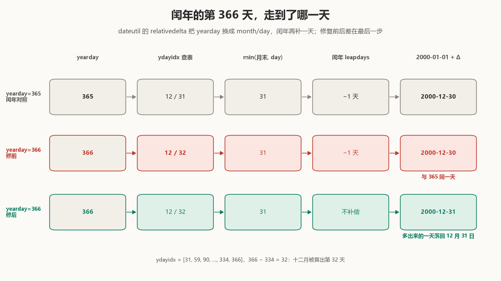

# 第 366 天，落回了 12 月 30 日

2000 年 12 月 30 日，是这一年的第 365 天。

从 2000 年 1 月 1 日起算，用 dateutil 的 `relativedelta` 取第 366 天，返回的仍是 12 月 30 日：

```python
>>> date(2000, 1, 1) + relativedelta(yearday=365)
datetime.date(2000, 12, 30)
>>> date(2000, 1, 1) + relativedelta(yearday=366)
datetime.date(2000, 12, 30)   # dateutil 4.0.0 之前
```

闰年多出来的那一天，没有落到日历上。第 366 天是 `yearday` 的合法上限——再大一天，`relativedelta(yearday=367)` 会抛 `ValueError`——它却和前一天给出同一个结果。

我在 [dateutil #1583](https://github.com/dateutil/dateutil/pull/1583) 改的就是这一处。补丁把条件从 `yearday > 59` 收紧成 `59 < yearday < 366`，外加十行测试。要说清它为什么非这样改，得先看构造 `relativedelta(yearday=366)` 时到底存了什么。

## 一、十二月三十二日

`relativedelta(yearday=N)` 不保存 N。构造函数把 N 换成月份、日期和一个 `leapdays` 偏移：

```python
ydayidx = [31, 59, 90, 120, 151, 181, 212,
           243, 273, 304, 334, 366]
for idx, ydays in enumerate(ydayidx):
    if yday <= ydays:
        self.month = idx+1
        if idx == 0:
            self.day = yday
        else:
            self.day = yday-ydayidx[idx-1]
        break
```

`ydayidx` 是平年的累计天数表。`366 - 334 = 32`，所以 `relativedelta(yearday=366)` 里存的是 `month=12, day=32`——一个日历上不存在的日期。对象在这里不报错，`day` 越界留给应用时的 clamp 处理。

`repr` 把 month、day 和 `leapdays` 一起显示出来：

```python
>>> relativedelta(yearday=366)
relativedelta(leapdays=-1, month=12, day=32)   # dateutil 4.0.0 之前
>>> relativedelta(yearday=366)
relativedelta(month=12, day=32)                # 4.0.0
```

`leapdays=-1` 是第二件事。平年表在二月少一天，闰年的 3 月 1 日是第 61 天，表却按第 60 天算；构造时对二月之后的日号记下 `-1`，应用时若当年是闰年就减一天补回来。

这不是随手加的补丁：`if yearday > 59` 从 2003 年 dateutil 初始导入起就在 [`dateutil/relativedelta.py`](https://github.com/dateutil/dateutil/blob/68ae2757ae15c84bf947d47a82a314b3b975bc9b/dateutil/relativedelta.py#L147-L148)，`ydayidx` 也在同一版。对 60 到 365 的日号，这个补偿是对的。`date(2000, 1, 1) + relativedelta(yearday=60)` 给出 2 月 29 日：表里 60 对应 3 月 1 日，减一天正好落到闰日。



问题在应用。合并版的 [`__add__`](https://github.com/dateutil/dateutil/blob/d23ff760f8448b51579016d96f39590018445724/src/dateutil/relativedelta.py#L379-L388) 先算月、再 clamp 日、最后处理 `leapdays`：

```python
day = min(calendar.monthrange(year, month)[1],
          self.day or other.day)
...
days = self.days
if self.leapdays and month > 2 and calendar.isleap(year):
    days += self.leapdays
```

对 366，两步都生效：`day=32` 被 `min(31, 32)` 压回 12 月 31 日，闰年的 `leapdays=-1` 又把这个 31 日减成 30 日。**clamp 已经把十二月三十二日折回月末，补偿又把它推离了月末。** 两个修正各自都对，叠在一起多减了一天。

365 没有这个问题：表里 365 对应 `day=31`，clamp 什么也不做，减一天得到 12 月 30 日，正是闰年的第 365 天。**366 是唯一一个先算出 32 日、再被 clamp 拉回 31 日的日号；对它的补偿是多余的。**

## 二、测试守住了 367，却没守住 366

2016 年补的 [`testYearDay`](https://github.com/dateutil/dateutil/blob/5391455e7c7839e300b63649041806fb5219432e/tests/test_relativedelta.py#L168-L190) 覆盖三个日号：

- 260，在二月之后，跨闰年和平年，能测出 `leapdays=-1` 的方向；
- 261，当时的「今天」；
- 15，在二月之前，`leapdays` 不触发。

同一个测试类里还有 `nlyearday=260`，走的是另一条不设 `leapdays` 的路径。同月的 [`testInvalidYearDay`](https://github.com/dateutil/dateutil/blob/5391455e7c7839e300b63649041806fb5219432e/tests/test_relativedelta.py#L581-L583) 只管越界：

```python
with self.assertRaises(ValueError):
    relativedelta(yearday=367)
```

**合法上限 366 的成功路径没有用例，越界一天的 367 有。** 这不是说测试写得随意——260 同时覆盖了闰年和平年，正好能验证补偿的方向；只是 366 那一格空着。

平年的 366 还会让症状看起来正常：

```python
>>> date(1999, 1, 1) + relativedelta(yearday=366)
datetime.date(1999, 12, 31)   # 两版相同
```

平年不应用 `leapdays`，clamp 独自把 32 日压回 31 日，结果对。只有「闰年」与「第 366 天」同时出现，clamp 和补偿才会撞在一起。

## 三、收回一格

修复是把补偿条件收紧一天：

```diff
- if yearday > 59:
+ if 59 < yearday < 366:
      self.leapdays = -1
```

合并版还留了四行注释，把上面那条链写清楚：二月之后的日号按平年转换，`leapdays=-1` 在闰年把它们移回 2 月 29 日；第 366 天变成 12 月 32 日，已经被 clamp 到 12 月 31 日，不能再移。

366 不再设 `leapdays`。平年的行为不变（本来就不应用），59/60 边界不变，365 及以下不变；改动只落在「闰年的第 366 天」这一格。

为什么不去改 `__add__` 里的顺序，比如先减 `leapdays` 再 clamp？从代码结构看（这是推论），`leapdays` 是 `relativedelta` 的公开参数，用户可以显式传入，也可以和 `day=32` 这样的字段自由组合；把两步合并成一步，会改变所有显式组合的语义。而构造时的这条条件只影响「由 `yearday` 推导出的 `leapdays`」，面最小。

新测试没有只钉 366（[合并版测试](https://github.com/dateutil/dateutil/blob/d23ff760f8448b51579016d96f39590018445724/tests/test_relativedelta.py#L725-L731)）：

```python
@pytest.mark.parametrize("year", [1900, 2000, 2001, 2024])
def test_yearday_is_ordinal_day(year):
    first = date(year, 1, 1)
    days = range(1, 366 + calendar.isleap(year))
    assert [first + relativedelta(yearday=n) for n in days] == [
        first + timedelta(days=n - 1) for n in days
    ]
```

1900 是非闰的世纪年，2000 是闰的世纪年，2001 平年，2024 闰年；`range` 的上限按 `calendar.isleap` 走，平年停在 365，闰年走到 366。断言不是「366 等于 12 月 31 日」，而是「每个日号都等于序号日」——把整张表钉住，366 只是其中一个。

## 四、146,097 个日期

demo 用固定父提交和合并提交的源码快照，枚举 2000–2399：400 年，97 个闰年，146,097 个日期用例。逐日比较 `date(year, 1, 1) + relativedelta(yearday=n)` 与 `date(year, 1, 1) + timedelta(days=n - 1)`：

| 版本 | 失配 |
| --- | --- |
| 修前（父提交 `5391455e`） | 97 |
| 修后（合并提交 `d23ff760`） | 0 |

97 个失配全是闰年的第 366 天，第一个是 2000，最后一个是 2396。修前的错误不是随机的：每一个闰年都错在同一天。

review 里 [Wkhanex 独立跑了同一范围](https://github.com/dateutil/dateutil/pull/1583#pullrequestreview-5498927830)：

> I checked every valid `yearday` for every year 2000–2399 (146,097 date cases) against `date(year, 1, 1) + timedelta(days=ordinal - 1)`. All matched, including day 366 in every leap year and the day-59/day-60 boundary. I used Python 3.12.14 against commit `2a14487`.

他测的是已经修好的版本。两边数字一样，各算各的。他还特意点了 59/60 边界——那是 `leapdays` 开始生效的位置，修复没有碰它。

合并两个多小时后，dateutil 4.0.0 发布。[`NEWS` 第 38 行](https://github.com/dateutil/dateutil/blob/4.0.0/NEWS#L38-L40)写着：

> `relativedelta(yearday=366)` now resolves to December 31 in leap years. Previously it gave December 30, the same date as `yearday=365`. Reported and fixed by @Master-Norna (gh pr #1583).

4.0.0 的 sdist 里，`relativedelta.py` 与合并提交逐行一致。

`testInvalidYearDay` 还在，367 照旧抛错。现在 366 也有了自己的成功断言：`first + relativedelta(yearday=366)` 在闰年必须等于 `first + timedelta(days=365)`。边界的这一侧，原来没有人看。
