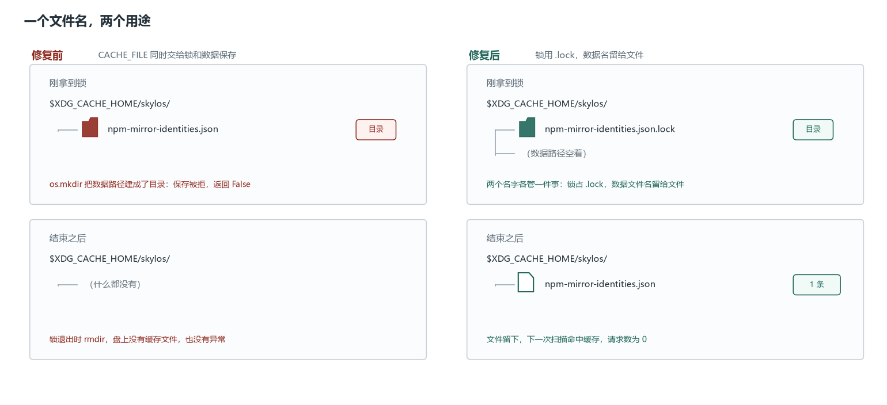

# The cache file was never written: a `.json` name that became a directory

Scan the same dependency twice in a row and the receipt looks like this:

```text
run 1  metadata_requests=1  cache_hits=0
run 2  metadata_requests=1  cache_hits=0
```

skylos's SCA stage checks a lockfile dependency against the public registry when it points at a configured npm mirror: name, version, integrity. Results are cached for seven days (`MAX_CACHE_AGE_SECONDS = 7 * 24 * 3600`). By the documentation the second scan should hit the cache. In practice every scan re-requests, and there is no cache file on disk at all.

**On the write path a data file name was handed to something that only handles directories**, and the lock made it one with `mkdir`; the save function then found a directory sitting where the file needed to go, returned `False` quietly, and the caller never looked. This is one of the two things [skylos #1224](https://github.com/duriantaco/skylos/pull/1224) fixes; the other is in the lines that pick the cache directory, and comes later.

## Two steps to write the cache

The parent's [`_save_cache()`](https://github.com/duriantaco/skylos/blob/3f47e36da352caae19acd789690094ce9e372fd0/skylos/rules/sca/npm_mirrors.py#L125-L157) is short, and does two things: take a lock, save.

```python
directory.mkdir(parents=True, exist_ok=True, mode=0o700)
with project_cache_lock(directory, CACHE_FILE, timeout_seconds=0.25) as owned:
    if not owned:
        return
    entries = _load_cache(directory, int(time.time()))
    ...
    save_project_json_cache(directory, CACHE_FILE, {...}, indent=None)
```

`CACHE_FILE` is `"npm-mirror-identities.json"`. The second line passes it as the second argument to `project_cache_lock()`, which by that function's contract is the path of the lock, not the data file it protects.

The cache file holds `{schema_version, provider, entries}`, each entry recording `name`, `version`, `integrity`, `verified_at`. Reading it back, [`_load_cache()`](https://github.com/duriantaco/skylos/blob/3f47e36da352caae19acd789690094ce9e372fd0/skylos/rules/sca/npm_mirrors.py#L117-L122) rebuilds `(name, version) → PublicNpmIdentity` and drops entries older than seven days by `verified_at`. Identities that survive go into `answers`; the rest go into `pending` for a registry request. A cache hit or miss decides the length of `pending`, which is `metadata_requests` in the receipt.

## Why the lock is a directory

`safe_cache_io.project_cache_lock()` gets cross-process exclusion out of creating a directory: `os.mkdir()` is atomic on a filesystem, whoever creates it holds the lock, and `rmdir` releases it. The path is `mkdir`'d directly in [`_acquire_project_cache_lock()`](https://github.com/duriantaco/skylos/blob/3f47e36da352caae19acd789690094ce9e372fd0/skylos/core/safe_cache_io.py#L672):

```python
os.mkdir(path, mode=0o700)
```

So from the moment the lock is taken until it is released, that path is a directory on disk. Pass in `npm-mirror-identities.json` and for that window there really is a directory called `npm-mirror-identities.json`. **One string: a directory name to the lock, a file name to the save function.**

The same cache directory at four moments, one cell per version:



The other fifteen `project_cache_lock()` calls in the repository all pass a second argument ending in `.lock`; `review_decisions.py` computes it on the spot as `path.with_suffix(path.suffix + ".lock")` ([`review_decisions.py:848`](https://github.com/duriantaco/skylos/blob/3f47e36da352caae19acd789690094ce9e372fd0/skylos/core/review_decisions.py#L848-L849)). Only `_save_cache()` passed the data file name through unchanged.

Inside that lock, `save_project_json_cache()` goes `_project_cache_path()` → `_is_regular_cache_file()`: the path exists but is not a regular file, so it returns `False`; the save does not write and returns `False`. `_save_cache()` never looks at the return value, and nothing is logged.

The check itself is a few lines ([`safe_cache_io.py:624`](https://github.com/duriantaco/skylos/blob/3f47e36da352caae19acd789690094ce9e372fd0/skylos/core/safe_cache_io.py#L624)):

```python
def _is_regular_cache_file(path: Path) -> bool:
    try:
        if path.is_symlink():
            return False
        if path.exists():
            path.resolve(strict=True).relative_to(path.parent.resolve(strict=True))
            return path.is_file()
    except (OSError, ValueError):
        return False
    return True
```

The intent is to keep the cache path from being hijacked by a symlink or a directory: only a regular file that still resolves inside its parent is accepted. The lock happens to create a directory at exactly that spot, so the anti-hijack check treats the lock as the hostile input. Two rules that are each correct meet on one path and produce a third outcome: no error, no write, no trace.

The lock's `rmdir` removes the directory on exit. When the whole thing finishes, the disk is cleaner than it started: no cache file, no leftover directory, no exception. The next scan does it again.

## Why nobody noticed

Because everything visible was fine. The second pass of `verify_npm_mirrors()` still returns `status: "complete"`, `proofs` still list the verified identities, `verified_occurrences` is still 1. The only difference is `cache_hits` sitting at 0 — a plausible-looking statistic, especially in a process that ran once.

The PR body sums the outcome up in one sentence:

> The identity file was never written: `cache_hits` stayed 0 and every scan re-requested all metadata, contrary to the documented seven-day cache.

What actually shows it is that the request count does not go down when the same input runs twice. That is why the reproduction counts requests through a fake HTTP transport and runs the scan twice: run it once and a broken cache looks like a working one.

If you suspect the same path in your own project, three places to look: whether `cache_hits` rises on the second scan; whether `npm-mirror-identities.json` exists under `$XDG_CACHE_HOME/skylos` (or `~/.cache/skylos` when that is unset); and how many requests one scan makes to `registry.npmjs.org`. Two of the three out of line puts you here.

## The second hole: hosts without a home

The same PR fixes another spot. The parent's [`_cache_directory()`](https://github.com/duriantaco/skylos/blob/3f47e36da352caae19acd789690094ce9e372fd0/skylos/rules/sca/npm_mirrors.py#L66-L84) reads:

```python
base = os.environ.get("XDG_CACHE_HOME")
path = Path(base) if base else Path.home() / ".cache"
if not path.is_absolute():
    return None
try:
    ...
except (OSError, RuntimeError, ValueError):
    return None
```

`Path.home()` sits outside the `try`. On a host with no `HOME` / `USERPROFILE` — containers, service accounts — it raises `RuntimeError`, and the `except` below lists `RuntimeError` already; the exception just happens before the `try` is entered.

The consequence is more direct than a broken cache: a scan with `npm_registry_mirrors` configured fails before it sends a single request, and the caller gets a `scanner_exception` instead of a dependency list. The cache is the thing that should be disabled first in such an environment; instead it stops the whole stage.

## The patch: a new name, two lines moved

The merged version ([`npm_mirrors.py`](https://github.com/duriantaco/skylos/blob/89b88730c8c2c6fe952c8d61d06975f8422a9925/skylos/rules/sca/npm_mirrors.py#L125-L160)) changes two places:

```python
with project_cache_lock(
    directory, CACHE_FILE + ".lock", timeout_seconds=0.25
) as owned:
```

The lock now takes `npm-mirror-identities.json.lock`, apart from the data file; the data name is not occupied while the lock is held, and the save function sees a path it can create.

The other is moving those three `Path.home()` lines inside the `try`:

```python
try:
    base = os.environ.get("XDG_CACHE_HOME")
    path = Path(base) if base else Path.home() / ".cache"
    if not path.is_absolute():
        return None
    ...
except (OSError, RuntimeError, ValueError):
    return None
```

With no home it returns `None`, `_save_cache` / `_load_cache` skip on `None`, and verification runs as usual without caching. The cache goes from a precondition that has to succeed to an optimization that is used when it can be.

## Both versions, side by side

The reproduction trims both versions down to the import chain, stubs out the unrelated `hook_locked_packages` with a function that always says "not an internal package", and keeps the rest byte for byte identical. Two `verify_npm_mirrors()` calls on one dependency:

| metric | before the fix | after the fix |
| --- | --- | --- |
| first scan | requests 1 / hits 0 | requests 1 / hits 0 |
| second scan | requests 1 / hits 0 | requests 0 / hits 1 |
| requests in total | 2 | 1 |
| cache path after the run | missing | a file, 1 entry |
| argument the lock receives | `npm-mirror-identities.json` | `npm-mirror-identities.json.lock` |
| data path while the lock is held | a directory | absent (created on save) |
| host without a home | `RuntimeError` | returns `None`, cache disabled |

```text
python -B run.py --test
```

Output (archived in `.yan/skylos-npm-cache/runs/`):

```text
parent 3f47e36  … second scan metadata_requests=1 cache_hits=0; cache path missing
merged 89b8873  … second scan metadata_requests=0 cache_hits=1; cache path file, 1 entry
0 failing check(s)
```

## What it costs

`verify_npm_mirrors()` has a request budget of one per identity, up to 5000 identities, 8 threads, 120 seconds. With the cache dead, **every scan spends that budget again**: slower, more traffic to the public registry, and in a rate-limited or offline environment a request that does not come back is more likely to be recorded as `metadata_unavailable`, turning a complete receipt into `partial`.

The cache has one more disable condition: a directory inside the scan root or under any Git ancestor returns `None`, so a scan of a subdirectory does not read proofs written by a sibling. Both versions behave the same there.

The lock times out after 0.25 seconds: if another process holds it, `owned` is false, this run does not write, and the next scan tries again. Also silent — except that the next scan does come back.

Upstream: `duriantaco/skylos`, [#1224](https://github.com/duriantaco/skylos/pull/1224), parent commit [`3f47e36d`](https://github.com/duriantaco/skylos/commit/3f47e36da352caae19acd789690094ce9e372fd0), merge commit [`89b88730`](https://github.com/duriantaco/skylos/commit/89b88730c8c2c6fe952c8d61d06975f8422a9925).
