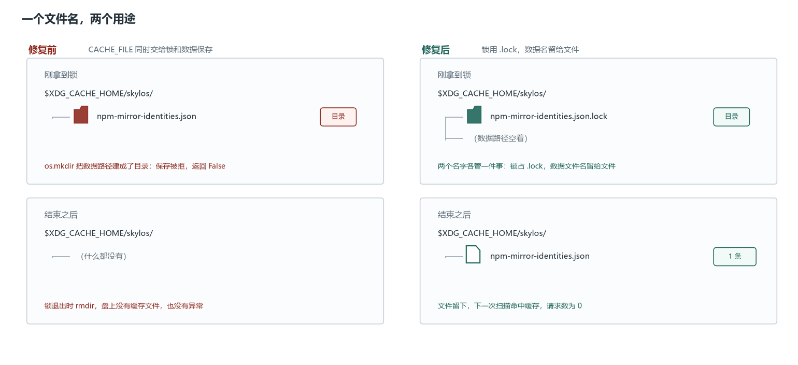

# 缓存文件从没写出来：一个 `.json` 被当成目录用了

同一个依赖，连跑两次扫描，回执是这样：

```text
第一次  metadata_requests=1  cache_hits=0
第二次  metadata_requests=1  cache_hits=0
```

skylos 的 SCA 阶段会在锁文件里的依赖指向配置好的 npm 镜像时，去公共 registry 核对一次身份（名称、版本、integrity），核对结果缓存七天（`MAX_CACHE_AGE_SECONDS = 7 * 24 * 3600`）。按文档，第二次扫描应该命中缓存；实际是每次都重新请求，而且盘上根本没有缓存文件。

**缓存写入的那条路上，一个数据文件名被交给了「按目录处理」的锁**，锁把它 `mkdir` 成了目录；保存函数看见同名路径是个目录，安静地返回 `False`，调用方没有看返回值。这是 [skylos #1224](https://github.com/duriantaco/skylos/pull/1224) 修的两处之一；另一处在取缓存目录的那几行，后面再说。

## 缓存写入的两步

父版 [`_save_cache()`](https://github.com/duriantaco/skylos/blob/3f47e36da352caae19acd789690094ce9e372fd0/skylos/rules/sca/npm_mirrors.py#L125-L157) 不长，核心是两件事：拿锁，保存。

```python
directory.mkdir(parents=True, exist_ok=True, mode=0o700)
with project_cache_lock(directory, CACHE_FILE, timeout_seconds=0.25) as owned:
    if not owned:
        return
    entries = _load_cache(directory, int(time.time()))
    ...
    save_project_json_cache(directory, CACHE_FILE, {...}, indent=None)
```

`CACHE_FILE` 是 `"npm-mirror-identities.json"`。第二行把它作为第二个参数交给 `project_cache_lock()`——按这个函数的约定，那是锁的路径，不是要保护的数据文件。

缓存文件里存的是一份 `{schema_version, provider, entries}`，每条 entry 记 `name`、`version`、`integrity`、`verified_at`。读取时 [`_load_cache()`](https://github.com/duriantaco/skylos/blob/3f47e36da352caae19acd789690094ce9e372fd0/skylos/rules/sca/npm_mirrors.py#L117-L122) 把它还原成 `(name, version) → PublicNpmIdentity`，再按 `verified_at` 过滤掉超过七天的条目。命中的身份直接进 `answers`，没命中的进 `pending` 去请求公共 registry。缓存命中与否，决定的是 `pending` 的长度，也就是回执里的 `metadata_requests`。

## 锁为什么是一个目录

`safe_cache_io.project_cache_lock()` 用「创建一个目录」实现跨进程互斥：`os.mkdir()` 在文件系统上是原子的，谁建成功谁持有锁，退出时 `rmdir`。路径在 [`_acquire_project_cache_lock()`](https://github.com/duriantaco/skylos/blob/3f47e36da352caae19acd789690094ce9e372fd0/skylos/core/safe_cache_io.py#L672) 里被直接 `mkdir`：

```python
os.mkdir(path, mode=0o700)
```

所以从拿到锁到释放锁，这段路径在盘上是一个目录。传进去的是 `npm-mirror-identities.json`，持有期间它就真的是一个叫 `npm-mirror-identities.json` 的目录。**同一个字符串，在锁的眼里是目录名，在保存函数眼里是文件名。**

锁持有期间与退出之后，两版各一格：



仓库里另外十五处 `project_cache_lock()` 调用，第二个参数无一例外以 `.lock` 结尾，`review_decisions.py` 干脆当场算 `path.with_suffix(path.suffix + ".lock")`（[`review_decisions.py:848`](https://github.com/duriantaco/skylos/blob/3f47e36da352caae19acd789690094ce9e372fd0/skylos/core/review_decisions.py#L848-L849)）。只有 `_save_cache()` 把数据文件名原样递了进去。

在这把锁里面，`save_project_json_cache()` 走 `_project_cache_path()` → `_is_regular_cache_file()`：路径存在、但不是普通文件，返回 `False`；保存函数于是也不写，返回 `False`。`_save_cache()` 没有接这个返回值，也没有任何日志。

判定本身只有几行（[`safe_cache_io.py:624`](https://github.com/duriantaco/skylos/blob/3f47e36da352caae19acd789690094ce9e372fd0/skylos/core/safe_cache_io.py#L624)）：

```python
def _is_regular_cache_file(path: Path) -> bool:
    try:
        if path.is_symlink():
            return False
        if path.exists():
            path.resolve(strict=True).relative_to(path.parent.resolve(strict=True))
            return path.is_file()
    except (OSError, ValueError):
        return False
    return True
```

这段代码的本意是防止缓存路径被符号链接或目录劫持——只认「解析后仍在父目录里的普通文件」。锁恰好在这个位置造了一个目录，于是「防劫持」的判断把自家锁当成了异常输入。两条各自正确的规则，在同一个路径上撞出了第三种结果：不报错，不写，也不留痕迹。

锁退出时 `rmdir` 把那个目录删掉。整个过程结束时，盘上比开始时还干净：没有缓存文件，没有残留目录，没有异常。下一次扫描重复一遍。

## 为什么这么久没人发现

因为对外的一切都正常。`verify_npm_mirrors()` 的第二趟仍然返回 `status: "complete"`，`proofs` 里仍然有核对过的身份，`verified_occurrences` 也还是 1。唯一的差别是 `cache_hits` 一直是 0——一个看起来完全合理的统计值，尤其在只跑过一次的进程里。

PR 正文用一句话概括了这个结果：

> The identity file was never written: `cache_hits` stayed 0 and every scan re-requested all metadata, contrary to the documented seven-day cache.

真正能看出问题的是「同一份输入跑两次，请求数不降」。这也是复现工程用记账的假 HTTP 传输层、连续跑两次的原因：只跑一次，缓存坏没坏看不出来。

如果在自己的项目里怀疑碰到同一条路，可以看三个地方：回执里的 `cache_hits` 是否随第二次扫描上升；`$XDG_CACHE_HOME/skylos`（没有设置时是 `~/.cache/skylos`）下有没有 `npm-mirror-identities.json`；以及一次扫描里对 `registry.npmjs.org` 的请求次数。三者里有两个不对，基本就落在这条路径上。

## 第二个洞：没有 home 的机器

同一个 PR 还修了另一处。父版的 [`_cache_directory()`](https://github.com/duriantaco/skylos/blob/3f47e36da352caae19acd789690094ce9e372fd0/skylos/rules/sca/npm_mirrors.py#L66-L84) 是这样：

```python
base = os.environ.get("XDG_CACHE_HOME")
path = Path(base) if base else Path.home() / ".cache"
if not path.is_absolute():
    return None
try:
    ...
except (OSError, RuntimeError, ValueError):
    return None
```

`Path.home()` 在 `try` 外面。没有 `HOME` / `USERPROFILE` 的主机（容器、服务账号）上，它抛 `RuntimeError`，而下面的 `except` 明明列了 `RuntimeError`——只是异常在进入 `try` 之前就发生了。

后果比缓存坏掉更直接：配置了 `npm_registry_mirrors` 的扫描，在发出任何请求之前就失败，调用方拿到的是 `scanner_exception`，不是依赖清单。缓存本该在这类环境里最先被停用，结果它先让整个阶段停摆。

## 补丁：换个名字，挪两行

合并版 ([`npm_mirrors.py`](https://github.com/duriantaco/skylos/blob/89b88730c8c2c6fe952c8d61d06975f8422a9925/skylos/rules/sca/npm_mirrors.py#L125-L160)) 改了两处：

```python
with project_cache_lock(
    directory, CACHE_FILE + ".lock", timeout_seconds=0.25
) as owned:
```

锁拿到的是 `npm-mirror-identities.json.lock`，和数据文件分开；数据名在锁持有期间不再被占用，保存函数看到的是一个可以创建的文件路径。

另一处是把 `Path.home()` 那三行移进 `try`：

```python
try:
    base = os.environ.get("XDG_CACHE_HOME")
    path = Path(base) if base else Path.home() / ".cache"
    if not path.is_absolute():
        return None
    ...
except (OSError, RuntimeError, ValueError):
    return None
```

没有 home 时返回 `None`，`_save_cache` / `_load_cache` 见到 `None` 直接跳过，验证照常进行，只是不缓存。缓存从「必须成功的前置条件」变成「能就用的优化」。

## 两版对照

复现工程把两版裁到导入链最小集，用一个恒返回「不是内部包」的桩替掉与缓存无关的 `hook_locked_packages`，其余代码两版逐字节相同。连续两次 `verify_npm_mirrors()`，同一个依赖：

| 指标 | 修复前 | 修复后 |
| --- | --- | --- |
| 第一次扫描 | requests 1 / hits 0 | requests 1 / hits 0 |
| 第二次扫描 | requests 1 / hits 0 | requests 0 / hits 1 |
| 两次合计请求 | 2 | 1 |
| 跑完后的缓存路径 | 不存在 | 文件，1 条记录 |
| 锁收到的参数 | `npm-mirror-identities.json` | `npm-mirror-identities.json.lock` |
| 持锁期间的数据路径 | 目录 | 不存在（保存时才创建） |
| 主机没有 home | `RuntimeError` | 返回 `None`，缓存停用 |

```text
python -B run.py --test
```

输出（存档 `.yan/skylos-npm-cache/runs/`）：

```text
parent 3f47e36  … second scan metadata_requests=1 cache_hits=0; cache path missing
merged 89b8873  … second scan metadata_requests=0 cache_hits=1; cache path file, 1 entry
0 failing check(s)
```

## 影响面

`verify_npm_mirrors()` 的请求预算是每个身份一次、最多 5000 个身份、8 个线程、120 秒。缓存失效时，**每次扫描都按这个预算重来**：慢、多打公共 registry，在限流或离线环境里更容易把「请求没回来」记成 `metadata_unavailable`，让本该完整的回执变成 `partial`。

缓存另有一条停用条件：目录落在扫描根之内，或在某个 Git 仓库祖先目录下，函数返回 `None`，免得同一仓库的子目录扫描读到兄弟目录写的证明。两版这里一样。

锁是 0.25 秒超时的：另一个进程正持锁时，`owned` 为假，这次不写，下一趟扫描再试。同样不声不响，区别是下一趟还会重来。

上游：`duriantaco/skylos`，[#1224](https://github.com/duriantaco/skylos/pull/1224)，父提交 [`3f47e36d`](https://github.com/duriantaco/skylos/commit/3f47e36da352caae19acd789690094ce9e372fd0)，合并提交 [`89b88730`](https://github.com/duriantaco/skylos/commit/89b88730c8c2c6fe952c8d61d06975f8422a9925)。

