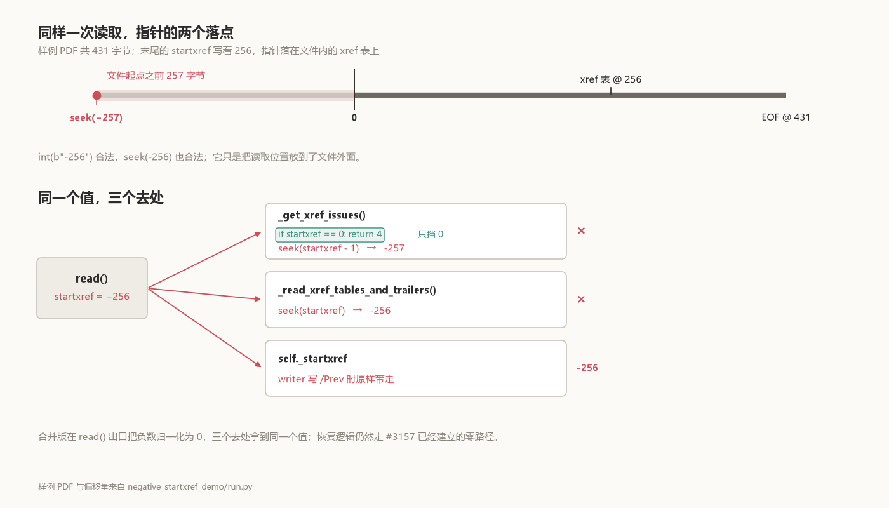

# The error says −257. The file says −256.

Change the `startxref` at the end of a PDF to `-256`, and pypdf raises:

```text
ValueError: negative seek value -257
```

The file says −256. The message says −257. That missing 1 is not a typo; it points at the line that touches the value first.

The number after `startxref` is a byte offset to the xref table. [§7.5.5 of ISO 32000-1](https://opensource.adobe.com/dc-acrobat-sdk-docs/pdfstandards/PDF32000_2008.pdf) calls it "the byte offset in the decoded stream from the beginning of the file to the beginning of the xref keyword in the last cross-reference section" — offsets are measured from the file header, so a negative one has nowhere to land. The sample below is 431 bytes: the xref table starts at 256, and the `startxref` keyword itself sits at 411. pypdf does not seek straight to that offset. It steps back one byte first, to see whether the table is preceded by whitespace. 256 becomes 255, still inside the file. −256 becomes −257, which is 257 bytes before the first byte.



## One value, three destinations

`read()` stores what `_find_startxref_pos()` returns in `self._startxref`, and three places consume it:

- [`_get_xref_issues()`](https://github.com/py-pdf/pypdf/blob/b78c2aa5301ee4fb1ee024b9838923945ab357b6/pypdf/_reader.py#L1310-L1313) runs `stream.seek(startxref - 1)` to look for leading whitespace;
- [`_read_xref_tables_and_trailers()`](https://github.com/py-pdf/pypdf/blob/b78c2aa5301ee4fb1ee024b9838923945ab357b6/pypdf/_reader.py#L1090) runs `stream.seek(startxref)` to actually read the table;
- the writer, on an incremental update, copies `self._startxref` into the trailer's [`/Prev`](https://github.com/py-pdf/pypdf/blob/91a73b5e8e9701efdad26b865964c2a53cb110b3/pypdf/_writer.py#L1519-L1520).

`int(b"-256")` is perfectly valid. `seek(-256)` is a valid Python call too — it just puts the position outside the file. So the first `seek()` raises `ValueError` at −257; get past it and the second raises the same error at −256. The third destination is further along: a file that cannot be read never reaches the writer, but as long as `self._startxref` is negative, the `/Prev` it writes out will be the same number — and `/Prev` in the spec (Table 15) is likewise "the byte offset in the decoded stream from the beginning of the file to the beginning of the previous cross-reference section".

## The 2025 guard stopped zero

On 24 February 2025, [#3151](https://github.com/py-pdf/pypdf/issues/3151) reported a PDF with two xref tables, where `PdfReader` raised `ValueError: negative seek value -1`. The report said:

> It would be nice if this file was parsed, but IMO at least if it can't be parsed, it should return a malformed error.

That file's `startxref` was 0, and zero minus one is −1. Two days later [#3157](https://github.com/py-pdf/pypdf/pull/3157) landed four lines in `_get_xref_issues()`:

```python
if startxref == 0:
    return 4
```

Zero was stopped. Negative numbers were not. `return 4` means "this xref is broken", and the caller rebuilds the table — which is why a zero pointer still yields one page.

**That gate sits at one of the three destinations, and it recognises one value.**

The question of exception type is much older than this fix. [#584](https://github.com/py-pdf/pypdf/issues/584), in November 2020, was titled "Is it ok to throw non-PyPDF2 exceptions (e.g. ValueError) on malformed PDFs?". The thread ran into 2022: one position was that raising `ValueError` is acceptable as long as it is documented, the other that the problem is precisely that the exception is not a documented one. It ended up converted to a discussion. In April 2023, someone in [#1791](https://github.com/py-pdf/pypdf/issues/1791) ran a thousand PDFs through `except PdfReadError`; one of them, an object exported from a Wireshark capture, tripped the same `negative seek value -1`, and the loop died there. That file's pointer was 0 as well. In January 2024 another person added that the docs say `PyPdfError` can be caught. The maintainer's reply was "PRs welcome".

The zero cell was filled by #3157 in 2025; the non-zero negative cell stayed empty. [#4144](https://github.com/py-pdf/pypdf/pull/4144), in October 2026, fills it. The patch is ten lines, and the merge commit says explicitly that no upstream issue had ever recorded a non-zero negative variant.

## Fixed at the exit

\#4144 changes `read()`, right after `_find_startxref_pos()`:

```python
startxref = self._find_startxref_pos(stream)
if startxref < 0:
    # A negative offset cannot point into the file. Treat it like the
    # zero case (#3157) so the xref table is repaired instead of
    # leaking a ValueError from a negative seek.
    logger_warning(
        "Negative startxref pointer (%(startxref)d), treating it as zero.",
        source=__name__,
        startxref=startxref,
    )
    startxref = 0
self._startxref = startxref
```

The merged version is [`read()` at `91a73b5`](https://github.com/py-pdf/pypdf/blob/91a73b5e8e9701efdad26b865964c2a53cb110b3/pypdf/_reader.py#L713-L738).

Why not widen the old gate to `< 1`? Because that fixes one call site out of three. `_read_xref_tables_and_trailers()` would still receive a negative number and seek to it, and `self._startxref` would still be negative.

Normalised here, a negative number takes the zero path #3157 already paved: `_get_xref_issues()` returns 4, non-strict mode logs a warning and calls `_rebuild_xref_table()`, strict mode raises `PdfReadError("Broken xref table")`. The recovery code is the same one, unchanged.

**Normalise at the single entrance, and all three destinations get 0.**

## The same file, both versions

The reproduction keeps two complete pypdf source trees at fixed commits side by side, generates a one-page PDF with the same `PdfWriter`, and rewrites only the digits after `startxref`. This sample's offset is 256, so the negative pointer is −256.

| Input | Before, `b78c2aa` | Merged, `91a73b5` |
|---|---|---|
| ordinary `256` | one page, no warnings | one page, no warnings |
| `0` | one page; `incorrect startxref pointer(4)`, `parsing for Object Streams` | same |
| `-256`, non-strict | `ValueError: negative seek value -257` | one page; `Negative startxref pointer (-256), treating it as zero.`, `incorrect startxref pointer(4)`, `parsing for Object Streams` |
| `-256`, strict | `ValueError: negative seek value -257` | `PdfReadError: Broken xref table`, after the negative-pointer warning |
| `0`, strict | `PdfReadError: Broken xref table`, no warning | same |
| `/Prev -1` in the trailer | `ValueError: negative seek value -1` | same |

The `0` rows are the control group: they show the pre-fix tree already contains #3157, so the failure is specific to negative numbers. The two strict rows behave identically — a broken file still fails, but with pypdf's own exception, the same one a zero pointer gets.

The last row is the boundary. `/Prev` in the trailer is a separate offset from the pointer at the end of the file, and the normalisation never reaches it: splice `/Prev -1` into the trailer and both versions raise `ValueError: negative seek value -1`. This patch closes one entrance; the same disease on the `/Prev` chain is a different job.

## Run it

```powershell
python -B -S 负指针_pypdf/negative_startxref_demo/run.py --test
```

The project holds the `b78c2aa` and `91a73b5` source trees; subprocesses run with `-I -B -S` and refuse `socket.*`, and nothing is installed. These six rows come from one run:

```text
Python 3.12.14  (two complete pypdf snapshots, no install)
case                   parent b78c2aa                   merge 91a73b5
------------------------------------------------------------------------------------------
healthy                ok pages=1 warnings=0            ok pages=1 warnings=0
zero                   ok pages=1 warnings=2            ok pages=1 warnings=2
negative               ValueError: negative seek value -257 ok pages=1 warnings=3
negative_strict        ValueError: negative seek value -257 PdfReadError: Broken xref table
zero_strict            PdfReadError: Broken xref table  PdfReadError: Broken xref table
prev_negative          ValueError: negative seek value -1 ValueError: negative seek value -1

PASS: parent leaks ValueError(-257); merge warns, recovers one page, and raises PdfReadError in strict mode.
```

`--json` prints the full warning text, `--output PATH` saves the same report; the assertions in `run.py` say what each case must produce, rather than only whether it raised. Project notes are in [`negative_startxref_demo/README.md`](negative_startxref_demo/README.md).

## Is this your file?

The number in the error is the clue: `-257` corresponds to `-256` written in the file (the first `seek` is `startxref - 1`), `-1` corresponds to `0`. A file you suspect needs no pypdf install first; the last 1 KiB is enough:

```powershell
python -B -S 负指针_pypdf/negative_startxref_demo/run.py --test --emit $env:TEMP\ptr
python -B -S 负指针_pypdf/negative_startxref_demo/scan_startxref.py $env:TEMP\ptr\*.pdf
```

`--emit` writes the project's four samples to disk, and the scanner says of them:

```text
healthy.pdf          startxref 256: inside file, starts 'xref 0 5 000'
negative.pdf         startxref -256: negative, 256 bytes before the file starts
prev-negative.pdf    startxref 256: inside file, starts 'xref 0 5 000'; /Prev -1: negative, 1 byte before the file starts
zero.pdf             startxref 0: zero, points at byte 0
```

It reads only the end of the file and looks at two numbers, `startxref` and `/Prev`. A positive number landing inside the file does not mean it points at the right place — it may point into the middle of an object. It answers "could this number point into the file", not "is this PDF valid". The fixed pypdf treats a negative end pointer as zero and rebuilds the xref in non-strict mode; whether to repair the file itself is a separate decision.

No real file with a non-zero negative pointer appears in the public record. Both real reports — `bible.pdf` in #3151 and the capture export in #1791 — had a pointer of 0. Which software writes negative numbers, we have no sample, so we won't guess; what is certain is how it gets read: it sits at the end of the file as decimal text, and `int()` takes it as given.

## Blast radius: the exception type matters more than the number

A service that feeds PDFs to a parser in bulk — search indexing, archiving, batch text extraction — is worst served by this kind of error: what comes out is not the library's own exception, so neither retry nor skip can catch it. pypdf's documentation lists [`PyPdfError`](https://pypdf.readthedocs.io/en/stable/user/suppress-warnings.html#exceptions) as the base class to catch "when you want to be more specific". `PdfReadError` is its subclass; `ValueError` is not. So `except PdfReadError` does not catch this error, and `except Exception` swallows every other error with it — the script in #1791 sits exactly between the two.

`strict=False` doesn't help either. Strict only decides, inside `read()`, whether to repair or to raise a pypdf exception, while the crash happens earlier, in the `seek()` inside `_get_xref_issues()`.

After the fix, non-strict reads back one page with three warnings, and strict raises `PdfReadError: Broken xref table` — the same as the zero path, row for row.

Negative numbers reaching `seek()` is not confined to this one place. [#4224](https://github.com/py-pdf/pypdf/pull/4224), merged in October 2026, handles negative `/N`, `/First` and negative entry offsets inside object streams, with the same `ValueError: negative seek value` symptom; it raises `PdfReadError` in strict mode and warns and skips that section otherwise. **The same exception showing up elsewhere does not mean this patch fixed it.**

## The review

The patch drew exactly one substantive review comment: stefan6419846 asked why the test didn't assert the full warning messages. The author tightened the assertions, forgot to push them, and was asked `Did you forget to push these changes?`, answered `Yes..`, and pushed. The merged test at [`tests/test_reader.py#L2098`](https://github.com/py-pdf/pypdf/blob/91a73b5e8e9701efdad26b865964c2a53cb110b3/tests/test_reader.py#L2098) checks the three warnings in order, plus one more case: a healthy file produces none. Zero and negative now take the same repair path, and the warning carries only the original value as an extra.
