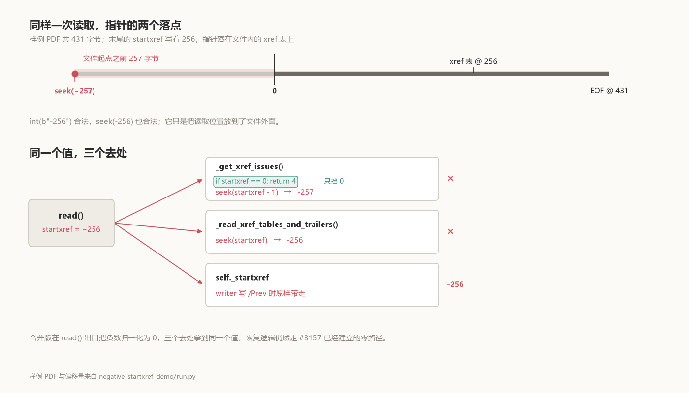

# 报错是 −257，文件里写的是 −256

把一份 PDF 末尾的 `startxref` 改成 `-256`，pypdf 抛出的是：

```text
ValueError: negative seek value -257
```

文件里写的是 −256，错误消息说的是 −257。差的那 1 不是笔误，它指出了哪一行先碰到这个值。

`startxref` 后面的数字是 xref 表的字节偏移。[ISO 32000-1 的 §7.5.5](https://opensource.adobe.com/dc-acrobat-sdk-docs/pdfstandards/PDF32000_2008.pdf) 把它定义为"从文件开头算起的字节偏移"——偏移是相对文件头量的，负数没有落点。复现用的样例一共 431 字节，xref 表在 256，`startxref` 这个关键字本身在 411。pypdf 读到这个数，并不直接 `seek` 过去——它先往回退一个字节，看 xref 前面是不是空白。256 退到 255，落在文件里；−256 退到 −257，落在文件开头之前 257 个字节。



## 一个值，三个去处

`read()` 把 `_find_startxref_pos()` 的返回值存进 `self._startxref`，之后这个值被三个地方用：

- [`_get_xref_issues()`](https://github.com/py-pdf/pypdf/blob/b78c2aa5301ee4fb1ee024b9838923945ab357b6/pypdf/_reader.py#L1310-L1313) 执行 `stream.seek(startxref - 1)`，检查前导空白；
- [`_read_xref_tables_and_trailers()`](https://github.com/py-pdf/pypdf/blob/b78c2aa5301ee4fb1ee024b9838923945ab357b6/pypdf/_reader.py#L1090) 执行 `stream.seek(startxref)`，真正去读表；
- writer 走增量更新时，[`_write_increment()`](https://github.com/py-pdf/pypdf/blob/91a73b5e8e9701efdad26b865964c2a53cb110b3/pypdf/_writer.py#L1519-L1520) 把它原样写进 trailer 的 `/Prev`。

`int(b"-256")` 是合法的。`seek(-256)` 也是合法的 Python 调用——它只是把位置放到文件外面。所以第一个 `seek()` 在 −257 上抛 `ValueError`；就算绕过它，第二个会在 −256 上抛同样的错。第三个去处更远一点：读不进来的文件走不到 writer，但只要 `self._startxref` 是负数，写出去的 `/Prev` 就会是同一个数，而规范里的 `/Prev` 同样是"从文件开头算起的字节偏移"。

## 2025 年挡住过一次，挡的是 0

2025 年 2 月 24 日，[#3151](https://github.com/py-pdf/pypdf/issues/3151) 报告了一份有两个 xref 表的 PDF，`PdfReader` 抛 `ValueError: negative seek value -1`。报告里写：

> It would be nice if this file was parsed, but IMO at least if it can't be parsed, it should return a malformed error.

那份文件的 `startxref` 是 0，减一得 −1。两天后 [#3157](https://github.com/py-pdf/pypdf/pull/3157) 合入，在 `_get_xref_issues()` 里加了四行：

```python
if startxref == 0:
    return 4
```

零被挡住了，负数没有。`return 4` 的意思是"这个 xref 有问题"，调用方会转去重建表——所以 0 指针能读出一页。

**这道门只装在三个去处中的一个上，而且只认一个值。**

异常类型这件事，比这次修复早得多。[#584](https://github.com/py-pdf/pypdf/issues/584) 在 2020 年 11 月的标题就是 "Is it ok to throw non-PyPDF2 exceptions (e.g. ValueError) on malformed PDFs?"。讨论到 2022 年，一种意见是抛 `ValueError` 可以接受、只要写进文档，另一种是问题恰恰在于抛的不是有文档的异常，最后转成了 discussion。2023 年 4 月，[#1791](https://github.com/py-pdf/pypdf/issues/1791) 里有人拿 `except PdfReadError` 扫一千个 PDF，其中一个从 Wireshark 抓包里导出的对象触发了同一个 `negative seek value -1`，循环断在那里；那份文件的指针也是 0。2024 年 1 月，又有人在下面补了一句：文档说可以捕获 `PyPdfError`。维护者回的是"欢迎提 PR"。

指针为 0 的那一格，2025 年被 #3157 补上；非零负数这一格一直空着。2026 年 10 月 [#4144](https://github.com/py-pdf/pypdf/pull/4144) 补的就是它。补丁十行，合并提交的正文里写明：上游没有任何 issue 记录过非零负值的变体。

## 修在出口

\#4144 的改动在 `read()` 里，紧跟 `_find_startxref_pos()`：

```python
startxref = self._find_startxref_pos(stream)
if startxref < 0:
    # A negative offset cannot point into the file. Treat it like the
    # zero case (#3157) so the xref table is repaired instead of
    # leaking a ValueError from a negative seek.
    logger_warning(
        "Negative startxref pointer (%(startxref)d), treating it as zero.",
        source=__name__,
        startxref=startxref,
    )
    startxref = 0
self._startxref = startxref
```

合并版见 [`91a73b5` 的 `read()`](https://github.com/py-pdf/pypdf/blob/91a73b5e8e9701efdad26b865964c2a53cb110b3/pypdf/_reader.py#L713-L738)。

为什么不把原来那道门改成 `< 1`？因为那只改了 `_get_xref_issues()` 一个调用点。`_read_xref_tables_and_trailers()` 仍然会拿到负数并 `seek()`；`self._startxref` 也仍然是负数。

归一化之后，负数走的是 #3157 已经铺好的零路径：`_get_xref_issues()` 返回 4，非 strict 模式记一条警告并调用 `_rebuild_xref_table()`，strict 模式抛 `PdfReadError("Broken xref table")`。恢复用的还是同一套代码。

**归一化放在唯一的入口，三个去处就都拿到了 0。**

## 同一个文件，两版对照

复现工程把两版固定提交的 pypdf 源码包放在一起，用同一个 `PdfWriter` 生成一页 PDF，只改写末尾 `startxref` 后面的数字。这份样例的偏移是 256，所以负指针是 −256。

| 输入 | 修前 `b78c2aa` | 合并版 `91a73b5` |
|---|---|---|
| 正常 `256` | 一页，无警告 | 一页，无警告 |
| `0` | 一页；`incorrect startxref pointer(4)`、`parsing for Object Streams` | 同左 |
| `-256`，非 strict | `ValueError: negative seek value -257` | 一页；`Negative startxref pointer (-256), treating it as zero.`、`incorrect startxref pointer(4)`、`parsing for Object Streams` |
| `-256`，strict | `ValueError: negative seek value -257` | `PdfReadError: Broken xref table`，先记一条负数警告 |
| `0`，strict | `PdfReadError: Broken xref table`，无警告 | 同左 |
| trailer 里 `/Prev -1` | `ValueError: negative seek value -1` | 同左 |

`0` 那一行是控制组：它证明修前版确实已经包含 #3157 的修复，失败只发生在负数上。strict 那两行是同一个行为：坏文件仍然读不出来，但抛的是 pypdf 自己的异常，和零指针一致。

最后一行是边界。trailer 里的 `/Prev` 是另一条偏移，不是文件末尾那个指针，归一化碰不到它；把 `/Prev -1` 插进 trailer，两版都抛 `ValueError: negative seek value -1`。这条补丁关的是末尾指针这一个入口，`/Prev` 链上的同一个毛病另算。

## 跑一遍

```powershell
python -B -S 负指针_pypdf/negative_startxref_demo/run.py --test
```

工程里放着 `b78c2aa` 和 `91a73b5` 两版源码包，子进程用 `-I -B -S` 隔离、禁 socket，不安装 pypdf。六行输出来自同一次运行：

```text
Python 3.12.14  (two complete pypdf snapshots, no install)
case                   parent b78c2aa                   merge 91a73b5
------------------------------------------------------------------------------------------
healthy                ok pages=1 warnings=0            ok pages=1 warnings=0
zero                   ok pages=1 warnings=2            ok pages=1 warnings=2
negative               ValueError: negative seek value -257 ok pages=1 warnings=3
negative_strict        ValueError: negative seek value -257 PdfReadError: Broken xref table
zero_strict            PdfReadError: Broken xref table  PdfReadError: Broken xref table
prev_negative          ValueError: negative seek value -1 ValueError: negative seek value -1

PASS: parent leaks ValueError(-257); merge warns, recovers one page, and raises PdfReadError in strict mode.
```

`--json` 输出完整警告文本，`--output PATH` 把同一份报告存盘；断言在 `run.py` 里逐条写明，不只比"抛没抛"。工程说明见 [`negative_startxref_demo/README.md`](negative_startxref_demo/README.md)。

## 你的文件是不是这一类

报错里那个数就是线索：`-257` 对应文件里写的 `-256`（第一次 `seek` 是 `startxref - 1`），`-1` 对应 `0`。有怀疑的文件不必先装 pypdf，读最后 1 KiB 就能看到：

```powershell
python -B -S 负指针_pypdf/negative_startxref_demo/run.py --test --emit $env:TEMP\ptr
python -B -S 负指针_pypdf/negative_startxref_demo/scan_startxref.py $env:TEMP\ptr\*.pdf
```

`--emit` 把工程里那四份样例写到磁盘，扫描器对它们说：

```text
healthy.pdf          startxref 256: inside file, starts 'xref 0 5 000'
negative.pdf         startxref -256: negative, 256 bytes before the file starts
prev-negative.pdf    startxref 256: inside file, starts 'xref 0 5 000'; /Prev -1: negative, 1 byte before the file starts
zero.pdf             startxref 0: zero, points at byte 0
```

它只读文件末尾，看 `startxref` 和 `/Prev` 两个数；正数落在文件里也不代表指对了地方，可能指向半个对象。它回答的是"这个数有没有可能指进文件"，不是"这份 PDF 合不合法"。修后的 pypdf 在非 strict 下会把负的末尾指针当 0 处理、重建 xref；要不要连文件本身一起修，是另一个决定。

公开记录里没有一份非零负值的真实文件。两例真实报错——#3151 的 `bible.pdf` 和 #1791 的抓包导出对象——指针都是 0。负数从哪种软件里写出来，我们没有样本，也就不猜；能确定的是它怎么被读到：以十进制文本躺在文件末尾，`int()` 照单全收。

## 影响面：异常类型比数值更要紧

把 PDF 批量喂给解析器的服务——搜索索引、归档、批量转文本——最怕这种错：抛出来的不是库自己的异常，重试和跳过都接不住。pypdf 的文档把 [`PyPdfError`](https://pypdf.readthedocs.io/en/stable/user/suppress-warnings.html#exceptions) 列为"想更具体时"可以捕获的基类。`PdfReadError` 是它的子类；`ValueError` 不是。所以 `except PdfReadError` 接不住这个错，而 `except Exception` 又会把别的错误一起吞掉——#1791 里那段脚本正好卡在两者之间。

`strict=False` 也没用。strict 只在 `read()` 里决定"修复还是抛 pypdf 异常"，而崩溃发生在更早的 `_get_xref_issues()` 里那次 `seek()`。

修后非 strict 读回一页、三条警告，strict 抛 `PdfReadError: Broken xref table`，与 0 的路径逐条一致。

负数流进 `seek()` 也不止这一处。2026 年 10 月合入的 [#4224](https://github.com/py-pdf/pypdf/pull/4224) 处理对象流里的负 `/N`、`/First` 和负的条目偏移，症状同样是 `ValueError: negative seek value`；它的修法是 strict 抛 `PdfReadError`，非 strict 警告后忽略那一段。**同一个异常在别处出现，不代表这条补丁修了它。**

## 补丁的 review

补丁的 review 只有一处实质意见，stefan6419846 问为什么不把完整的警告消息写进断言。作者改了断言，忘了 push，又被追了一句 `Did you forget to push these changes?`，回了个 `Yes..`，补推之后才通过。

最终版本在 [`tests/test_reader.py#L2098`](https://github.com/py-pdf/pypdf/blob/91a73b5e8e9701efdad26b865964c2a53cb110b3/tests/test_reader.py#L2098) 里逐条比对三条警告的顺序，另外加了一条：健康文件一条警告都不产生。现在 0 和负数走同一条修复路径，警告里只多一句原始值。
