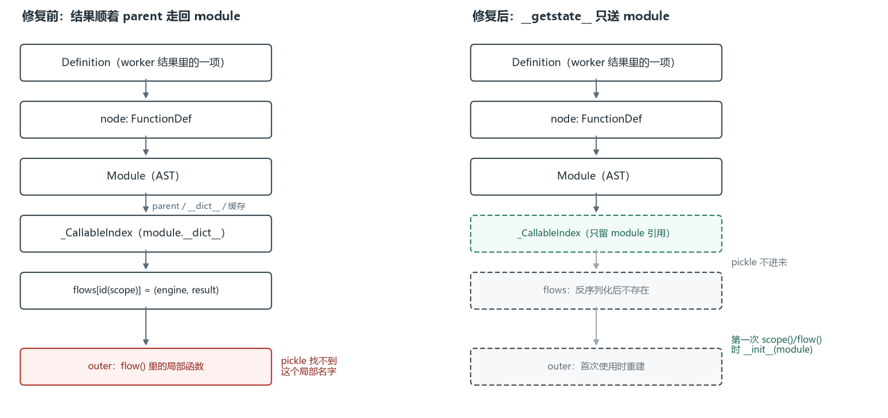

# Twenty files, seventeen computed again in the parent

Run a parallel static analysis once and every file in the log comes with a line like this:

```text
WARNING  Parallel static worker failed for skylos/rules/danger/calls.py;
         retrying in parent process
AttributeError: Can't get local object '_CallableIndex.flow.<locals>.outer'
```

The exit code is 0, and the analysis is correct. The file was computed in a worker, the result would not come back, the parent caught the exception and computed it again. Seventeen of twenty files went that way: with `jobs=2`, one worker is computing a new file while the other has finished but cannot send its result, and the parent takes the exception and redoes the work itself.

## Where the pool collects results

When skylos scans a directory with enough files, it goes through `run_proc_file_parallel`: `jobs=0` becomes `max(1, (os.cpu_count() or 4) - 1)`, one future per file, `proc_file` in the worker returning a tuple (definitions, findings of each kind, architecture metrics and so on). The parent collects in `as_completed`, and [`_drain_pool`](https://github.com/duriantaco/skylos/blob/a10d85d31fbad2e4ad4c5059c3106c00625880fb/skylos/scale/parallel_static.py#L91) matches futures back to files and reassembles the results in input order.

When a worker raises, this is what happens:

```python
except Exception:
    logger.warning(
        "Parallel static worker failed for %s; retrying in parent process",
        file_str,
        exc_info=True,
    )
    out = _retry_in_parent(f, modmap, changed_files, proc_kwargs)
```

That `except` was not written for pickle. It is there for "this file hit an ordinary exception in the worker", and the fallback is to compute it again in the parent. [`_retry_in_parent`](https://github.com/duriantaco/skylos/blob/a10d85d31fbad2e4ad4c5059c3106c00625880fb/skylos/scale/parallel_static.py#L143) takes the same arguments the worker had, and the parent re-parses the module and re-runs the rules. A pickle failure is an ordinary `Exception` too, so it takes the same road.

The exception is raised at `fut.result()`. Results are taken inside `for fut in as_completed(...)`, and that step is what deserialises the worker's return value; when deserialisation fails, control lands in the `except` above. The analysis in the worker is already done; it is the return value that will not cross. All the parent gets is the exception, not the result that was computed.

Every parallel scan goes through this path; whether it fails depends on whether the result carries an index that holds a closure.

## The result carries a module

skylos' danger rules need to know, inside a function scope, what a call finally points at. [`_CallableIndex`](https://github.com/duriantaco/skylos/blob/a10d85d31fbad2e4ad4c5059c3106c00625880fb/skylos/rules/danger/callable_bindings.py#L143) walks a module once in source order, records the binding of each name in each scope, and computes a flow on demand.

The index does not live on the rule object; it hangs off the AST module:

```python
index = getattr(module, "_skylos_danger_callable_index", None)
if index is None:
    index = module._skylos_danger_callable_index = _CallableIndex(module)
```

`_RandomBindings` does the same, on `module._skylos_random_bindings`, keyed by `(filename, project_root)`.

The upside of hanging it on the module is that one module builds one index, shared by every rule. The price is a heavier `module.__dict__` that nobody notices until the module is serialised along with some result.

Every `Definition` in the analysis result carries its AST node, and a node can walk back to the module through `parent` pointers. That chain exists for the rules: from any call node, look upward for the scope. At a process boundary it becomes the entrance to serialisation — pickle a `Definition` and it drags in the whole module through `node.parent`, along with the index hanging on it.

## The cache holds a local function

`_CallableIndex.flow(scope)` computes a flow per scope. Both the module level and the function scope define a local `outer`; the second one closes over `parent_engine`, `snapshot` and `anchor`:

```python
# module scope
def outer(name):
    if name.startswith(_MEMBER):
        return {name.removeprefix(_MEMBER)}
    return {name} if name in _BUILTINS else {_UNKNOWN}

# function scope
def outer(name):
    labels = snapshot.get(name, parent_engine._absent(name))
    for line, assigned in parent_engine.bindings.get(name, ()):
        if line >= getattr(anchor, "lineno", 0):
            labels |= assigned
    if name in self.mutable_outer:
        labels |= {_UNKNOWN}
    return labels
```

When it finishes, `self.flows[key] = (engine, result)`, and `engine` holds this `outer`. [Python's pickle](https://docs.python.org/3/library/pickle.html#what-can-be-pickled-and-unpickled) can only find objects by name at module level; `flow.<locals>.outer` is a local name, so it is not found:

```text
AttributeError: Can't get local object '_CallableIndex.flow.<locals>.outer'
```

`_RandomBindings._flow` has a local `outer` too, and the message changes to `_RandomBindings._flow.<locals>.outer`.

The chain needs three things at once: a `Definition` in the result, a `parent` pointer on `Definition.node`, and an index once attached to the module. Take any one away and you never arrive here, which is why it only shows up on files where a flow was computed inside a function scope — only those leave a closure-valued entry in `flows`.



## The fallback keeps the result, at two passes per file

The PR lists three consequences: every affected file is analysed twice, once in a worker and once in the parent; the parent pass runs serially, so with `jobs=2` the other worker sits idle waiting for the parent to free up; and every file gets a WARNING with a full traceback, stretching CI logs.

The result is right every time, and the cost is all in time and logs. Another sample in the PR: 124 standard-library and project files, still failing on 6 of them in the intermediate state where `_CallableIndex` was fixed and `_RandomBindings` was not. The trigger is specific — files with module-level calls, files without danger calls, and files where the danger rules are off all pickle fine; only a result that computed a flow inside a function scope fails to cross.

`_retry_in_parent` was not written for pickle, so it does not distinguish exception types. Adding an `except AttributeError` or matching on the message would pull pickle failures out separately — but that only turns "compute again" into "report an error", and the file still has no result. To get a result across the boundary, the object itself has to change.

Nor is the retry bottomless: if the parent pass fails too, `_retry_in_parent` logs `Parent-process static retry failed` and returns `None`. It is one layer of fallback, not a guarantee.

## Send only the module

Merge commit `a10d85d3` adds three methods to each of the two classes. [`__getstate__`](https://github.com/duriantaco/skylos/blob/a10d85d31fbad2e4ad4c5059c3106c00625880fb/skylos/rules/danger/callable_bindings.py#L207) on `_CallableIndex`:

```python
def __getstate__(self):
    return {"module": self.module}

def __setstate__(self, state):
    self.module = state["module"]
    self._ready = False

def _ensure_ready(self):
    if not self._ready:
        self.__init__(self.module)
```

`scope`, `free_names`, `flow`, `names` and `provider_available` each call `_ensure_ready()` first. The deserialised object holds only a module and `_ready=False`; the first real use runs `__init__`, which walks the module's AST to rebuild `parents` and `watched`, with `flows` and `reads` starting empty.

Those caches can be dropped because the keys are `id(node)`. After deserialisation the addresses have changed, so the old keys point at nothing anyway; keeping them would not reuse anything and would fail pickle besides.

Default pickling goes through `__dict__`, serialising every attribute recursively. `_CallableIndex.__dict__` holds `module`, `parents`, `flows`, `watched` and `reads`; the last four are derived from the module and carry closures and `id()` keys, and `__getstate__` replaces exactly that state. The PR also adds `test_unpickler_callable_bindings.py`, which tests the other half: that the object still works after deserialisation.

[`__getstate__`](https://github.com/duriantaco/skylos/blob/a10d85d31fbad2e4ad4c5059c3106c00625880fb/skylos/rules/danger/calls.py#L507) on `_RandomBindings` keeps two more fields: besides `module`, there are `filename` and `project_root`. Its cache key is `(filename, project_root)` plus a scope id, and the first two are constructor arguments rather than something derived from the module, so they have to travel.

## The same files through both versions

The project in `跨进程结果_skylos/danger_pickle_demo/` takes both versions of `callable_bindings.py` and `flow_env.py`, builds the same fixture, and pickles the index object directly:

```console
$ python -B 跨进程结果_skylos/danger_pickle_demo/run.py --test
{
  "parent": {
    "pickle": {
      "ok": false,
      "error": "AttributeError: Can't get local object '_CallableIndex.flow.<locals>.outer'"
    }
  },
  "merged": {
    "pickle": {"ok": true, "bytes": 1579},
    "roundtrip": {
      "before_first_use": {"ready": false, "has_flows": false},
      "after_first_use": {"ready": true, "flows": 2},
      "names": ["os.system"]
    }
  }
}
ALL PASS
```

The parent fails on dump; the merge goes through in 1579 bytes, rebuilds 2 flows on first use, and still recognises `os.system`.

The full pool numbers come from running `run_proc_file_parallel` with both versions of the full source. The merge's [`test/test_parallel_static.py`](https://github.com/duriantaco/skylos/blob/a10d85d31fbad2e4ad4c5059c3106c00625880fb/test/test_parallel_static.py) has another case that runs a real pool with `jobs=2`, replaces `_retry_in_parent` with a recorder, and asserts it is never called:

| sample | parent retries | merged retries | result |
| --- | --- | --- | --- |
| 2 fixture files | 2/2 | 0/2 | both give 8 definitions and 2 findings |
| first 20 files under `skylos/rules/danger` | 17/20 | 0/20 | — |

On the same machine, the 20-file group took 23.7 s in the parent and 11.4 s merged. There was other load before and after both runs, so read the gap as an order of magnitude: the same files computed twice is visible in wall time.

## The cost of the rerun

The 1579 bytes are themselves a reading of this fix: the worker result now carries only the module, and `parents`, `flows`, `watched` and `reads` are all dropped. The cost moves to the receiving side — the first call into `scope`, `flow`, `names` or the like after deserialisation has to rebuild the index from the module. Rebuilding walks the AST, which is what `__init__` does, but it does not re-parse the file; that first call is slower than the ones after it.

That `_RandomBindings` needed its own two fields says the pattern is not in one place: a class that hangs on a module and caches closures needs its own `__getstate__`. The upstream CHANGELOG lists this under `scale`, one line.

## When it arrived, when it was fixed

The module-level index was not there from the start. The file that holds it, `skylos/rules/danger/callable_bindings.py`, was added in [#1189](https://github.com/duriantaco/skylos/pull/1189), 326 lines; that merge landed on 2026-11-08 at 01:43Z and touched 133 files. [#1200](https://github.com/duriantaco/skylos/pull/1200) sent it across a process boundary 29 hours 15 minutes later.

No package on PyPI covers that window. The 5.4.0 wheel does not contain `callable_bindings.py` at all; in [5.5.0](https://pypi.org/project/skylos/5.5.0/), `__getstate__` and `_ensure_ready` are already there.

| Time (UTC) | Event | PyPI |
| --- | --- | --- |
| 11-02 15:33 | [v5.4.0](https://github.com/duriantaco/skylos/releases/tag/v5.4.0) released | no `callable_bindings.py` |
| 11-08 01:43 | [#1189](https://github.com/duriantaco/skylos/pull/1189) merged, module-level index added | unchanged |
| 11-09 06:59 | [#1200](https://github.com/duriantaco/skylos/pull/1200) merged | unchanged |
| 11-10 08:27 | [v5.5.0](https://github.com/duriantaco/skylos/releases/tag/v5.5.0) released | wheel already carries `__getstate__` |

The bug lived on main for 29 hours and never left in a PyPI release. Anyone who ran `pip install skylos` got 5.4.0 and never saw it; builds taken from main between 11-08 and 11-09 did.

## Check your own scan

You do not have to read code to tell whether you hit this; count the log lines:

```powershell
skylos . 2>&1 | Select-String -SimpleMatch "retrying in parent process" | Measure-Object
```

A `Count` of 0 means nothing was computed twice in that run; anything above 0 means a batch of files went through a second pass, with the exit code still 0. On the 20-file sample above, the count was 17 for the parent and 0 for the merge.

The fallback keeps the result; it does not keep the count. A worker that cannot compute and a worker that computed but cannot send are two different failures, and one `except Exception` catches both, leaving a single WARNING line — the repeated work is yours to count.

Upstream: `duriantaco/skylos`, [#1200](https://github.com/duriantaco/skylos/pull/1200), parent commit [`c05b6305`](https://github.com/duriantaco/skylos/commit/c05b6305c5fe5167d94d24c95f88c8891052a6a5), merge commit [`a10d85d3`](https://github.com/duriantaco/skylos/commit/a10d85d31fbad2e4ad4c5059c3106c00625880fb).
