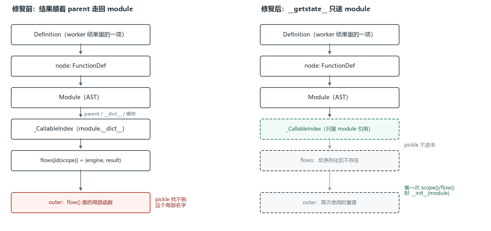

# 20 个文件，17 个在父进程里又算了一遍

跑一次并行静态分析，日志里每个文件都跟着一条：

```text
WARNING  Parallel static worker failed for skylos/rules/danger/calls.py;
         retrying in parent process
AttributeError: Can't get local object '_CallableIndex.flow.<locals>.outer'
```

退出码是 0，分析结果也是对的。文件在 worker 里算过一遍，结果送不回来，父进程接住异常又算了一遍。20 个文件里有 17 个走了这条路：`jobs=2` 时，一个 worker 在算新文件，另一个算完却送不回结果，父进程接过异常自己再算一遍。

## 进程池收结果的地方

skylos 扫描一个目录时，文件多就走 `run_proc_file_parallel`：`jobs=0` 时取 `max(1, (os.cpu_count() or 4) - 1)`，每个文件一个 future，worker 里调 `proc_file`，返回一个 tuple（definitions、各类 findings、架构指标等）。父进程在 `as_completed` 里收结果，[`_drain_pool`](https://github.com/duriantaco/skylos/blob/a10d85d31fbad2e4ad4c5059c3106c00625880fb/skylos/scale/parallel_static.py#L91) 负责把 future 和文件对上，最后按输入顺序拼回去。

worker 抛异常时，它的处理是：

```python
except Exception:
    logger.warning(
        "Parallel static worker failed for %s; retrying in parent process",
        file_str,
        exc_info=True,
    )
    out = _retry_in_parent(f, modmap, changed_files, proc_kwargs)
```

这个 `except` 不是为 pickle 写的。它要接的是「worker 里这个文件出了普通异常」，兜底办法是在父进程里再算一次。[`_retry_in_parent`](https://github.com/duriantaco/skylos/blob/a10d85d31fbad2e4ad4c5059c3106c00625880fb/skylos/scale/parallel_static.py#L143) 拿到的参数和 worker 那份一样，父进程重新解析 module、重新跑规则。pickle 失败也是普通 `Exception`，于是走了同一条路。

异常抛在 `fut.result()`。结果是在 `for fut in as_completed(...)` 里取的，这一步会把 worker 的返回值反序列化：

```python
for fut in as_completed(fut_to_file):
    f = fut_to_file[fut]
    try:
        file_str, out = fut.result()
    except Exception:
        logger.warning(...)
        out = _retry_in_parent(f, modmap, changed_files, proc_kwargs)
```

worker 里的分析其实已经做完，是返回值过不去。父进程这边拿到的只有异常，没有那个算好的结果。

`run_proc_file_parallel` 是并行扫描的入口，`skylos` 扫目录时文件一多就走这里。每个并行扫描都会经过这条路径；会不会失败，取决于结果里有没有那个带闭包的索引。

## 结果里带着一个 module

skylos 的 danger 规则要在函数作用域里判断一个调用最终指向谁。[`_CallableIndex`](https://github.com/duriantaco/skylos/blob/a10d85d31fbad2e4ad4c5059c3106c00625880fb/skylos/rules/danger/callable_bindings.py#L143) 按源码顺序走一遍 module，记下每个作用域里名字的绑定，再按需算 flow。

索引不放在规则对象上，挂在 AST module 上：

```python
index = getattr(module, "_skylos_danger_callable_index", None)
if index is None:
    index = module._skylos_danger_callable_index = _CallableIndex(module)
```

`_RandomBindings` 也一样，挂在 `module._skylos_random_bindings`，键是 `(filename, project_root)`。

挂 module 上的好处是同一个 module 只建一次，所有规则共用。代价是 `module.__dict__` 变重，平时没人注意，直到 module 跟着某个结果一起被序列化。

分析结果里每个 `Definition` 带着自己的 AST 节点，节点通过 `parent` 指针能走回 module。这条链本来是给规则用的：从任意一个调用节点向上找作用域。到了进程边界上，它成了序列化的入口——pickle 一个 `Definition`，会顺着 `node.parent` 把整个 module 拖进来，连同挂在 module 上的索引。

## 缓存里有一个局部函数

`_CallableIndex.flow(scope)` 为每个作用域算一份 flow。module 层的作用域里，`outer` 长这样：

```python
if scope is self.module:

    def outer(name):
        if name.startswith(_MEMBER):
            return {name.removeprefix(_MEMBER)}
        return {name} if name in _BUILTINS else {_UNKNOWN}
```

函数作用域里还有另一个 `outer`，它闭包捕获 `parent_engine`、`snapshot`、`anchor`：

```python
def outer(name):
    labels = snapshot.get(name, parent_engine._absent(name))
    for line, assigned in parent_engine.bindings.get(name, ()):
        if line >= getattr(anchor, "lineno", 0):
            labels |= assigned
    if name in self.mutable_outer:
        labels |= {_UNKNOWN}
    return labels
```

算完以后，`self.flows[key] = (engine, result)`，`engine` 持有这个 `outer`。[Python 的 pickle](https://docs.python.org/3/library/pickle.html#what-can-be-pickled-and-unpickled) 只能按名字找模块级对象，`flow.<locals>.outer` 是一个局部名字，找不到，于是：

```text
AttributeError: Can't get local object '_CallableIndex.flow.<locals>.outer'
```

`_RandomBindings._flow` 里同样是局部 `outer`，错误消息换成 `_RandomBindings._flow.<locals>.outer`。

这条链要三个条件同时在场：结果里有 `Definition`，`Definition.node` 有 `parent` 指针，module 上挂过索引。缺一个都到不了这里，所以它只在「函数作用域里算过 flow」的文件上出现——只有这类文件会在 `flows` 里留下带闭包的值。



## 兜底保住了结果，代价是每个文件两遍

PR 正文列了三条后果：每个受影响文件被分析两次，一次 worker、一次父进程；父进程那次是串行执行的，`jobs=2` 时另一个 worker 空着等父进程腾出手来；每个文件一条 WARNING，带完整 traceback，CI 日志被撑长。

结果每次都对，代价全在时间和日志上。PR 里另一组样本：124 个标准库和项目文件，在 `_CallableIndex` 修好、`_RandomBindings` 还没补上的中间状态，仍有 6 个失败。触发条件很具体——模块层调用、没有 danger 调用的文件、没开 danger 规则的文件都能正常 pickle；只有「函数作用域里算过 flow」的结果过不去。

`_retry_in_parent` 不是为 pickle 写的，所以它没区分异常类型。加一个 `except AttributeError` 或者检查消息字符串，能把 pickle 失败单独拎出来——但那只是把「重算」变成「报错」，文件还是没结果。要让结果过边界，只能改对象本身。

它自己也不是无底的：父进程重算再失败，`_retry_in_parent` 打一条 `Parent-process static retry failed`，返回 `None`。重试是一层兜底，不是保证。

## 只把 module 送过去

合并提交 `a10d85d3` 给两个类各加了三个方法。`_CallableIndex` 的 [`__getstate__`](https://github.com/duriantaco/skylos/blob/a10d85d31fbad2e4ad4c5059c3106c00625880fb/skylos/rules/danger/callable_bindings.py#L207)：

```python
def __getstate__(self):
    return {"module": self.module}

def __setstate__(self, state):
    self.module = state["module"]
    self._ready = False

def _ensure_ready(self):
    if not self._ready:
        self.__init__(self.module)
```

`scope`、`free_names`、`flow`、`names`、`provider_available` 每个入口先调一次 `_ensure_ready()`。反序列化出来的对象只有一个 module 和 `_ready=False`；第一次真正用到索引时，`__init__` 遍历 module 的 AST 重建 `parents` 和 `watched`，`flows`、`reads` 从空开始。

可以丢掉这些缓存，是因为键是 `id(node)`。反序列化以后对象地址变了，旧键本来就不再指向任何东西；留着不但不能复用，还会让 pickle 失败。

默认的 pickling 按 `__dict__` 走，对象上挂着的属性会被逐个递归序列化。`_CallableIndex` 的 `__dict__` 里有 `module`、`parents`、`flows`、`watched`、`reads`，后四个都从 module 派生，又带着闭包和 `id()` 键；`__getstate__` 换掉的就是这一份状态。PR 还带了 `test_unpickler_callable_bindings.py`，专门测「反序列化出来的对象还能用」这件事。

`_RandomBindings` 的 [`__getstate__`](https://github.com/duriantaco/skylos/blob/a10d85d31fbad2e4ad4c5059c3106c00625880fb/skylos/rules/danger/calls.py#L507) 多留了两个字段：

```python
return {
    "module": self.module,
    "filename": self.filename,
    "project_root": self.project_root,
}
```

它的缓存键是 `(filename, project_root)` 加上作用域 id，前两个是构造参数，不是从 module 推出来的，所以要一起送过去。

## 同一批文件，两版各跑一遍

工程 `跨进程结果_skylos/danger_pickle_demo/` 取两版 `callable_bindings.py` 与 `flow_env.py`，构造同一个 fixture，直接 pickle 索引对象：

```console
$ python -B 跨进程结果_skylos/danger_pickle_demo/run.py --test
{
  "parent": {
    "pickle": {
      "ok": false,
      "error": "AttributeError: Can't get local object '_CallableIndex.flow.<locals>.outer'"
    }
  },
  "merged": {
    "pickle": {"ok": true, "bytes": 1579},
    "roundtrip": {
      "before_first_use": {"ready": false, "has_flows": false},
      "after_first_use": {"ready": true, "flows": 2},
      "names": ["os.system"]
    }
  }
}
ALL PASS
```

父版在 dump 时失败；合并版 1579 字节过一个来回，第一次调用后重建出 2 个 flow，`os.system` 的识别结果不变。

完整进程池的数字用两版完整源码跑 `run_proc_file_parallel`。合并提交的 [`test/test_parallel_static.py`](https://github.com/duriantaco/skylos/blob/a10d85d31fbad2e4ad4c5059c3106c00625880fb/test/test_parallel_static.py) 里另有一个 `jobs=2` 的真进程池用例，把 `_retry_in_parent` 换成记录器，断言它一次都没被调用：

| 样本 | 父版重试 | 合并版重试 | 结果 |
| --- | --- | --- | --- |
| 2 个 fixture 文件 | 2/2 | 0/2 | 两边都是 8 个 definition、2 条 finding |
| `skylos/rules/danger` 前 20 个文件 | 17/20 | 0/20 | — |

同一台机器上，20 文件那组父版用了 23.7 秒，合并版 11.4 秒。这不是基准测试，两次运行也没有隔离其他负载；它只能说明「同一批文件被算了两遍」这件事在时间上看得见。

## 重走的代价

1579 字节本身也是这次修复的一个读数：worker 结果里只带着 module，原来跟着走的 `parents`、`flows`、`watched`、`reads` 全部丢掉。代价挪到了接收方——反序列化后第一次调用 `scope`、`flow`、`names` 之类的入口，要先把索引从 module 重建一遍。重建要遍历 AST，`__init__` 就是这一步，但它不重新解析文件；第一次调用的延迟会比后续高。

`_RandomBindings` 的两个字段也要跟着改，说明这个模式不止一处：挂在 module 上、缓存里带闭包的类，都要单独写一遍 `__getstate__`。上游的 CHANGELOG 把这条列在 `scale` 下，一行。

上游：`duriantaco/skylos`，[#1200](https://github.com/duriantaco/skylos/pull/1200)，父提交 [`c05b6305`](https://github.com/duriantaco/skylos/commit/c05b6305c5fe5167d94d24c95f88c8891052a6a5)，合并提交 [`a10d85d3`](https://github.com/duriantaco/skylos/commit/a10d85d31fbad2e4ad4c5059c3106c00625880fb)。
