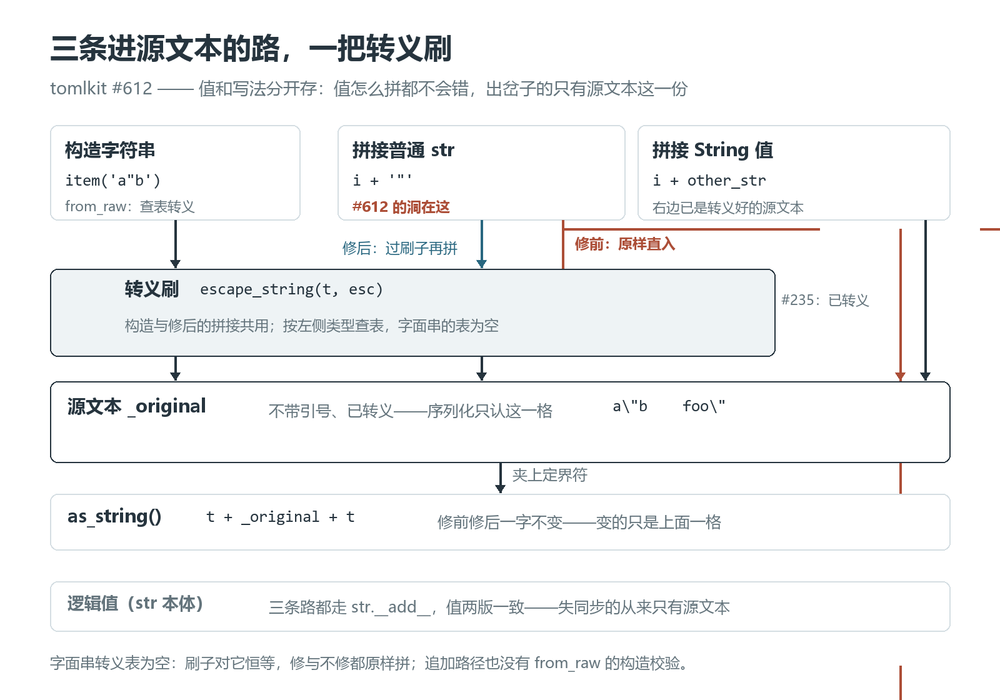

# 追加一个引号，自己写出的 TOML 自己读不回

[tomlkit](https://github.com/python-poetry/tomlkit) 的自我介绍是「style-preserving TOML library」：解析进来的注释、缩进、空白和元素顺序都原样保留，改完再写出去，文件尽量还是原来那个样子。要兑现这个承诺，它的每个字符串值在内存里存的东西就不止一个。

先看现象。三行代码，给一个已有的字符串值追加一个引号：

```python
from tomlkit import item, parse

i = item("foo")
i += '"'

i == 'foo"'                   # True —— 值是对的
i.as_string()                 # '"foo""' —— 序列化出来是它
parse(f'k = {i.as_string()}')
# UnexpectedCharError: Unexpected character: '"' at line 1 col 9
```

`"foo""` 这串文本不是谁手滑多敲了一个引号——它是 tomlkit 自己序列化出来的，而第一个读它的是 tomlkit 自己的解析器。这就是我在 [tomlkit #612](https://github.com/python-poetry/tomlkit/pull/612) 修复的问题，2026 年 9 月 30 日合并，生产代码加了七行、删了一行。本文沿着这多出来的一个引号，看字符串的「值」和「写法」是在哪一步分的手。

## 一、一个值，两份文本

tomlkit 里的 `String` 同时继承 `str` 和 `Item`（[items.py L2199](https://github.com/python-poetry/tomlkit/blob/61941deb3c7155e88d5f038148b33a599c04a530/tomlkit/items.py#L2199-L2213)）：`str` 本体当逻辑值，构造时另存一份 `_original`——源文本，写进文件时夹在定界符之间的那串，转义过的、不带引号的形态。`as_string()` 的全部工作就是把它夹回去（[L2226-L2227](https://github.com/python-poetry/tomlkit/blob/61941deb3c7155e88d5f038148b33a599c04a530/tomlkit/items.py#L2226-L2227)）：

```python
def as_string(self) -> str:
    return f"{self._t.value}{decode(self._original)}{self._t.value}"
```

为什么要存两份：TOML 里同一个值有多种合法写法。值 `foo` 可以写成 `"foo"`，也可以写成 `'foo'`；值 `foo"` 可以写成 `"foo\""`，也可以写成 `'foo"'`。round-trip 要保真——解析进来是什么写法，写回去最好还是那个写法——就得把写法本身记下来。

**构造**一个字符串时，两份是同步的。`item()` 走到 [api.py L153](https://github.com/python-poetry/tomlkit/blob/61941deb3c7155e88d5f038148b33a599c04a530/tomlkit/api.py#L152-L153) 的 `String.from_raw()`，后者把内容按类型查转义表转义后存进 `_original`（[items.py L2251-L2271](https://github.com/python-poetry/tomlkit/blob/61941deb3c7155e88d5f038148b33a599c04a530/tomlkit/items.py#L2251-L2271)）：basic 串（`"…"`）的转义表是引号、反斜杠和控制字符（[escaped_sequences，L256-L266](https://github.com/python-poetry/tomlkit/blob/61941deb3c7155e88d5f038148b33a599c04a530/tomlkit/items.py#L256-L266)，对应 [TOML v1.0.0 规范](https://toml.io/en/v1.0.0#string)的转义集合）。实测 `item('a"b')` 得到的对象：逻辑值 `a"b`，源文本 `a\"b`，`as_string()` 输出 `"a\"b"`——一个 TOML 解析器读得回的写法。

出事的不是构造，是**追加**。

## 二、2022 年修过一半

字符串拼接 `+` 由 `String.__add__` 接管。修复前的实现（父提交 [`7903965`](https://github.com/python-poetry/tomlkit/blob/79039653cbe5ff2a2e23042717455a2ac4875539/tomlkit/items.py#L2233-L2237)）：

```python
def __add__(self, other: str) -> String:
    result = super().__add__(other)
    original = self._original + getattr(other, "_original", other)
    return self._new(result, original)
```

第一行永远正确：`super().__add__` 走 `str.__add__`，逻辑值正常更新。问题全在第二行拼源文本的方式上，而这一行是有来历的。

2022 年 9 月，[#231](https://github.com/python-poetry/tomlkit/issues/231) 报告「拼接字符串后转义字符丢失」——报告里连着一个 AWS samconfig.toml 的实际场景，转义一丢，中间的引号就把整个参数拆断了。两星期后 [#235](https://github.com/python-poetry/tomlkit/pull/235) 合并，写下上面这行：右操作数如果是 `String`，`getattr` 取到它的 `_original`（已经转义好的源文本），直接拼——对，再转义一遍就是双重转义；右操作数是普通 `str` 时，`getattr` 落到默认值，**原样拼进源文本**。

那次修复保住的是左半边：左侧已转义的内容不再因为拼接而丢失，配套的 [test_string_add_preserve_escapes](https://github.com/python-poetry/tomlkit/blob/61941deb3c7155e88d5f038148b33a599c04a530/tests/test_items.py#L867-L873) 钉住了它。但它的追加用例是 `" baz"`——一个特殊字符都没有，右半边的问题恰好测不出来。于是这行代码安安稳稳待了四年。

同一份追加，逻辑值吃进了 `"`、源文本没有，两份表示当场分家。PR 里我把这层意思写成一句：

> String.__add__ spliced the appended text into the raw literal without escaping it, so appending a quote or backslash to a basic string produced a literal that is not valid TOML - including to this library's own parser.
> —— [#612 描述](https://github.com/python-poetry/tomlkit/pull/612)

## 三、七行补在拼接处

修复（合并提交 [`61941de`](https://github.com/python-poetry/tomlkit/blob/61941deb3c7155e88d5f038148b33a599c04a530/tomlkit/items.py#L2233-L2243)）把那行 getattr 换成显式的两个分支：

```python
def __add__(self, other: str) -> String:
    result = super().__add__(other)
    if isinstance(other, String):
        original = self._original + other._original
    else:
        escaped = self._t.escaped_sequences
        original = self._original + (
            escape_string(other, escaped) if escaped else other
        )
    return self._new(result, original)
```

两个分支各有讲究：

- 右侧本来就是 `String`：拼它的 `_original`，#235 定下的语义原样保留——它已经按它自己的类型转义过了。
- 右侧是普通 `str`：用 [`escape_string`](https://github.com/python-poetry/tomlkit/blob/61941deb3c7155e88d5f038148b33a599c04a530/tomlkit/_utils.py#L128) 按**左侧字符串自己的类型**查表转义。追加进来的内容将住在 `i` 的定界符里，所以按 `i` 的类型（`self._t`）转义，而不是别的什么。字面串（`'…'`）的转义表为空，走 `else` 原样拼——TOML 的字面串本就不设转义（见第四节）。

这把刷子和构造路径用的是同一把：`from_raw` 写入时调的也是 `escape_string`。改动实际立起的规则是一句话：**同步逻辑值和源文本的义务，从构造时扩展到了追加时。** 上游为此加了一个四组断言的回归测试 [test_string_add_escapes_appended_content](https://github.com/python-poetry/tomlkit/blob/61941deb3c7155e88d5f038148b33a599c04a530/tests/test_items.py#L875-L902)：追加 `"`、追加 `\`、右侧是 `String`、追加普通文本，一一钉住。

把进「源文本」的三条路画在一起，这次修复的位置就清楚了：构造那一路从 `from_raw` 起就过转义刷；拼 `String` 拼的是右边已经刷过的源文本；唯独拼普通 `str`，修前绕开刷子直插 `_original`，#612 做的只是把这一路领回刷子前——至于序列化，`as_string()` 夹上定界符就写出去，修前修后一字不变：



不过「右边已经按它自己的类型刷过了」这句话，藏着一个前提：两边定界符一样。都是 basic 串、都是字面串，前提成立；一边 basic、一边字面串，就没人问过这一句——`__add__` 只判断 `isinstance(other, String)`，不比较类型。

我拿这个前提试了一组：左边 basic 串，右边字面串，字面串里带一个双引号。

```python
from tomlkit import string, parse

a = string("foo")                  # _original: foo
b = string('ba"r', literal=True)   # 字面串不转义，_original 就是 ba"r
combined = a + b
combined.as_string()               # '"fooba"r"'
parse(f"k = {combined.as_string()}")   # UnexpectedCharError
```

`"fooba"r"` 里的第二个引号提前把字符串收了尾，和开头那三行是同一种坏法：逻辑值 `fooba"r` 是对的，写出来的文本自己读不回。字面串里的裸引号落进 basic 串的定界符，不需要谁手滑。

这也不是「异类型必坏」。两侧都没有特殊字符时，basic 串接字面串读回来好好的：`string("foo") + string("bar", literal=True)` 输出 `"foobar"`，一点问题都没有。坏不坏，取决于右半边恰好有没有那几种字符——这才是「不保证」的意思。

反方向一样坏，只是更安静。字面串接 basic 串，basic 串里的转义序列进了字面串就没人解释：

```python
l = string("bar", literal=True)
s = string("it's")     # basic 串不转义单引号，_original 是 it's
(l + s).as_string()    # "'barit's'" —— 读不回

n = string("a\nb")     # _original 是 a\nb
(l + n).as_string()    # "'bara\nb'" —— 读得回，值是 bara\nb 这七个可见字符
```

后一种连异常都没有：解析成功，值却和逻辑值分了家。硬炸至少有人当场发现。

这几组例子，我拿两版快照和 PyPI 上 0.15.2 的轮子各跑了一遍，输出一字不差。要让异类型拼接也守住 round-trip，得在 `__add__` 里比较两侧类型、必要时换定界符或转义，那是另一个设计决定，不是这七行顺手能捎上的。

## 四、哪条路没被修到

这七行管不到的角落，也一并摆出来：

- **字面串追加自己的定界符，两版都坏。** `value("'foo'")` 造出字面串 `'foo'`，追加一个 `'`，输出 `'foo''`，读不回——修前修后一个样。转义帮不上忙，因为字面串压根没有转义机制；要救它只能换一种写法（比如切回 basic 串再转义），但那就不是「保真」而是「改写」了，不属于这七行的范围。
- **构造路径有校验，追加路径没有。** `from_raw` 造字面串时遇到引号会当场抛 `InvalidStringError`（[items.py L2257-L2259](https://github.com/python-poetry/tomlkit/blob/61941deb3c7155e88d5f038148b33a599c04a530/tomlkit/items.py#L2257-L2259)），而 `__add__` 不做这类检查。如今两条路径共享同一把转义刷子，但校验仍只站在构造那头。
- 对照里还有两版一字不差的部分：追加普通文本，以及前面那组异类型拼接。修复只动了「普通 str 进 basic 串」这一条缝。

## 五、修前修后，同场对照

我把父提交 `7903965` 和合并提交 `61941de` 的 tomlkit 包源码原样放进 [tomlkit_demo](tomlkit_demo/)，同一组操作分别喂给两版快照。零第三方依赖，完全离线：

```powershell
python 转义往返_tomlkit/tomlkit_demo/run.py          # 对照报告
python 转义往返_tomlkit/tomlkit_demo/run.py --test   # 断言自测
```

两版快照加载后都会核验模块路径确实来自快照目录；版本一律以 git SHA 标识——两份快照的 `__init__.py` 都写着 0.15.1（合并时发版号还没 bump），版本字符串帮不上忙。这次运行（Windows / Python 3.12.14）得到：

| 追加内容 | 修前 `as_string()` | 修前读回 | 修后 `as_string()` | 修后读回 |
| --- | --- | --- | --- | --- |
| `'"'` | `"foo""` | UnexpectedCharError | `"foo\""` | `'foo"'` |
| `"\\"` | `"foo\"` | InvalidControlChar | `"foo\\"` | `'foo\'` |
| `"\n"` | 引号内裸换行 | InvalidControlChar | `"foo\n"` | `'foo\n'` |
| `item('"')` | `"foo\""` | 成功 | `"foo\""`（一致） | `'foo"'` |
| `" bar"` | `"foo bar"` | 成功 | `"foo bar"`（一致） | `'foo bar'` |

文档级的往返最贴近真实用法：`parse('k = "foo"')` 取出 `k`，追加一个引号，`dumps` 写出去。修前写出的是 `k = "foo""`，下一次 `load` 当场拒绝；修后写出 `k = "foo\""`，读回 `'foo"'`。**能写不能读，是最坏的一种失败方式**：坏文件已经躺在磁盘上了，发现它的却是下一个读它的工具。

demo 自带 17 项断言（含第四节两条边界），`--test` 全部通过、退出码 0；两版快照源码按上游 MIT 许可随附（`tomlkit_demo/LICENSE`）。另外把修后快照自带的测试套件也跑了一遍：发布 tarball 不含 toml-test 子模块，可运行的 383 项全部通过（PR 描述里记录的全量 1059 项含该子模块）。

发布状态也核过：0.15.1（2026-07-17）**不含**这个修复——发布包里的 `items.py` 仍是旧的 getattr 写法，逐字节比对过；0.15.2（2026-10-16）**包含**——修复提交是它的祖先（compare 核实），发布包里已有新分支。用 tomlkit 做配置原地编辑的话，手里的版本值得看一眼。

## 写在最后

「保真」是一个值得多花一份内存的承诺：值和写法都是数据。这次修复没有引入任何新东西——转义表、转义函数、类型判断，库里全都有，`from_raw` 早就这么做了——它只是把构造路径上早已成立的不变式，补到了拼接路径上。

四年间这个洞一直开着，直到有人给 `"foo"` 追加了一个引号。round-trip 这类不变式的特别之处在于：它只在组合操作里被破坏，单项测试各自的期望都还成立。所以修完之后真正值得留下的习惯，是给「写出去的东西再读回来」留一个位置——demo 里那个文档级往返用例，就是这么来的。

改动已合并进 tomlkit 主干（[61941de](https://github.com/python-poetry/tomlkit/commit/61941deb3c7155e88d5f038148b33a599c04a530)）。
