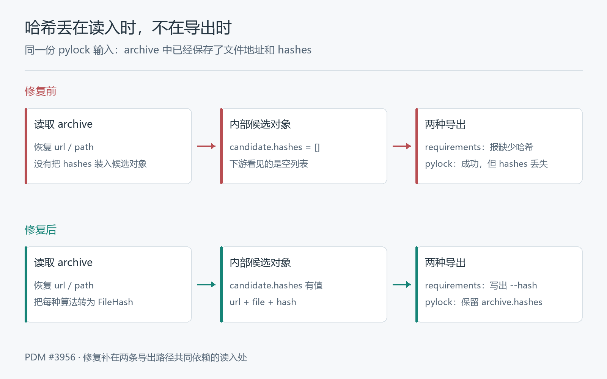

# 锁文件里明明有哈希，PDM 为什么说没有？

打开 `pylock.toml`，`archive.hashes` 就在那里。让 PDM 导出一份 requirements，却得到一句：

```text
Hash is not available for '…', please export with `--no-hashes` option.
```

换成导出 pylock，不报错了。但把新文件和旧文件一比，原来的 `archive.hashes` 不见了。

一个拒绝导出，一个成功丢字段，源头却是同一个：**文件里的哈希还在，读进内存时没带上。**

这就是我在 [PDM #3956](https://github.com/pdm-project/pdm/pull/3956) 修复的问题。它在 2026 年 10 月 27 日合并，生产代码只加了七行。我想沿着一次“写出锁文件 → 重新读入 → 导出”的过程，看看为什么该补的是读入，而不是报错的那一行。

## 一、一个 wheel，两种记录方式

`pylock.toml` 是 Python 包管理工具交换锁定结果的标准格式，最初由 [PEP 751](https://github.com/python/peps/blob/fc008c935df169de9b7669d8c22face10af4be4c/peps/pep-0751.rst) 定义。它不仅记录包名和版本，也记录安装文件从哪里来、用什么哈希校验。

这次出问题的是直接引用一个归档文件：给 PDM 一条 wheel URL，或者本地 wheel 的路径。PDM 生成的文件里，相关字段长这样（节选，哈希值省略）：

```toml
[[packages]]
name = "first"
version = "2.0.2"

[packages.archive]
url = "http://fixtures.test/artifacts/first-2.0.2-py2.py3-none-any.whl"

[packages.archive.hashes]
sha256 = "…"
```

这里有个容易看岔的地方：文件扩展名是 `.whl`，不代表它一定放在 `packages.wheels` 中。

- `packages.archive` 记录直接指定的归档文件，wheel 也可以在这里。
- `packages.wheels` 记录这个包可供选择的 wheel 文件。

前者是“就装这个文件”，后者是“从这些 wheel 中选择适合的”。规范[对 archive 的定义](https://github.com/pypa/packaging.python.org/blob/6a46e9923342d5512167cbc2ca4393928abb8520/source/specifications/pylock-toml.rst#L429-L441)明确包含 wheel 和 sdist；不能只按扩展名决定去哪个表里找哈希。

PDM 在[写出直接文件依赖](https://github.com/pdm-project/pdm/blob/adfdb5dccacc0153ad7bf6b14354ad8e46b9801b/src/pdm/formats/pylock.py#L52-L67)时已经能把哈希放到 `archive.hashes`。问题发生在之后：这个正确写出的文件，被 PDM 自己重新读了一遍。

## 二、地址恢复了，哈希没有

PDM 导出时不是把原 TOML 复制一遍。它先把锁文件读成内部对象，再由各个导出器生成目标格式。

内部的 `Candidate` 可以理解成一个候选安装对象：名字、版本、来源，以及文件哈希，都挂在这个对象上。新建时，它的 [`hashes` 默认是空列表](https://github.com/pdm-project/pdm/blob/adfdb5dccacc0153ad7bf6b14354ad8e46b9801b/src/pdm/models/candidates.py#L145-L157)。

修复前，`_read_pylock()` 能认出 `archive`，也能恢复来源（[父提交源码](https://github.com/pdm-project/pdm/blob/3b82f5291988aa8d6a5c1f92b695c5b18ce170bd/src/pdm/models/repositories/lock.py#L141-L159)，节选）：

```python
elif archive := package.get("archive"):
    req_dict["url"] = archive.get("url")
    req_dict["path"] = archive.get("path")
    req_dict["subdirectory"] = archive.get("subdirectory")

req = Requirement.from_req_dict(package_name, req_dict)
# 本地路径还会在这里转成 file: URL
candidate = Candidate(req=req, name=package_name, version=package.get("version"))
```

接下来确实有一段读取哈希的循环，可它只遍历 `wheels` 和 `sdist`：

```python
for artifact in itertools.chain(
    package.get("wheels", []),
    [sdist] if (sdist := package.get("sdist")) else [],
):
    algo, hash_value = next(iter(artifact["hashes"].items()))
    hash_item = {"hash": f"{algo}:{hash_value}"}
    # 再按输入补上 url / file
    candidate.hashes.append(hash_item)
```

直接归档的哈希位于第三个位置：`archive.hashes`。这个位置没被遍历。

于是对象呈现出一种不完整但很像成功的状态：包名、版本和下载地址都有，哈希列表却还是 `[]`。TOML 语法解析并没有失败，也不是算哈希的算法出了错；缺的是外部字段到内部字段的那一步转换。



**能把地址读回来，不等于把这个安装文件完整地读回来了。**

## 三、为什么两个导出器表现不同

读入后，两条路径拿到的都是这个缺了哈希的候选对象，但它们对空列表的处理不同。

### requirements：直接拒绝

[requirements 导出器](https://github.com/pdm-project/pdm/blob/adfdb5dccacc0153ad7bf6b14354ad8e46b9801b/src/pdm/formats/requirements.py#L255-L275)先检查：用户要求带哈希，而候选对象没有，就报错。

```python
if options.hashes and not candidate.hashes:
    raise PdmUsageError(
        f"Hash is not available for '{req}', "
        "please export with `--no-hashes` option."
    )
```

它没再打开原锁文件找 `archive.hashes`，也不知道上游刚刚漏读了字段。对它眼前的对象来说，“没有哈希”是实话。

`--no-hashes` 能跳过这道检查，却只是让它不再要求输出哈希。文件里的值没有因此回到对象上，导出的 requirements 也不再带相应的 `--hash`。

### pylock：照常写出，但少一个表

[pylock 导出器](https://github.com/pdm-project/pdm/blob/adfdb5dccacc0153ad7bf6b14354ad8e46b9801b/src/pdm/formats/pylock.py#L60-L67)会先创建 `archive`，然后遍历内部哈希列表：

```python
archive = result["archive"] = {"url": req.get_full_url()}
if req.path:
    archive["path"] = req.str_path
for hash_item in candidate.hashes:
    hash_type, hash_value = hash_item["hash"].split(":", 1)
    archive.setdefault("hashes", tomlkit.inline_table())[hash_type] = hash_value
```

空列表意味着循环一次也不执行，`hashes` 这个表就不会创建。序列化可以正常结束，输出也仍是能解析的 TOML。

但 TOML 能解析，与符合 pylock 规范，是两件事。[`packages.archive.hashes` 的规范](https://github.com/pypa/packaging.python.org/blob/6a46e9923342d5512167cbc2ca4393928abb8520/source/specifications/pylock-toml.rst#L499-L510)标明它是必填表，并要求：

> The table MUST contain at least one entry.

也就是说，只要这里记录了归档文件，不能把哈希表省掉，更不能用一个空表顶替。这条导出路径的“成功”，并不意味着数据和格式约束都保住了。

## 四、七行补在共同入口

如果只改 requirements 的报错，pylock 的静默丢失还在。如果只让 pylock 补一个 `hashes = {}`，既没恢复值，也不满足上面的要求。

实际修复放在 `_read_pylock()` 创建候选对象之后、原来的 wheel/sdist 循环之前（[最终合并源码](https://github.com/pdm-project/pdm/blob/adfdb5dccacc0153ad7bf6b14354ad8e46b9801b/src/pdm/models/repositories/lock.py#L148-L166)）：

```python
if archive := package.get("archive"):
    link = candidate.link
    assert link is not None
    candidate.hashes = [
        {"url": link.url_without_fragment, "file": link.filename, "hash": f"{algo}:{value}"}
        for algo, value in archive.get("hashes", {}).items()
    ]
```

这里不是重新下载文件，也不是重新计算哈希。它把输入中已经记录的每一种算法和值，转成 PDM 现有的 `FileHash` 表示。

这个内部表示有三部分：

| 字段 | 从哪里来 | 为什么这样装 |
| --- | --- | --- |
| `hash` | `archive.hashes` 中的算法和值 | 把 TOML 中的算法键和值合成 `sha256:…`，供下游消费 |
| `url` | 候选链接的 `url_without_fragment` | 保存文件地址，不把 `#subdirectory=src` 这样的片段当作文件地址的一部分 |
| `file` | 候选链接的 `filename` | 保存文件名，与 PDM 原来取得文件哈希时的元数据形式一致 |

这个结构不是为本次补丁新造的。[`BaseRepository.get_hashes()`](https://github.com/pdm-project/pdm/blob/adfdb5dccacc0153ad7bf6b14354ad8e46b9801b/src/pdm/models/repositories/base.py#L309-L319)原本就产生这样的记录。[原生锁文件的写出逻辑](https://github.com/pdm-project/pdm/blob/adfdb5dccacc0153ad7bf6b14354ad8e46b9801b/src/pdm/project/lockfile/pdmlock.py#L113-L125)还会根据是否保存静态 URL，分别取 `url` 或 `file`。虽然 requirements 导出主要用 `hash`，恢复时仍应装回完整的内部表示，而不是为眼前一个出口塞一个字符串。

循环用 `.items()`，也保留了归档输入中记录的多种算法；本地路径则沿用前面已经构造好的候选链接，不在这里另外拼地址。原来的 wheel/sdist 读取逻辑没有改。

**修复的落点，是两条导出路径共同依赖的数据入口。** 哈希一旦在这里恢复，两边原有的输出逻辑就都能继续工作。

## 五、测试不能只问“导出成功了吗”

这次[上游回归测试](https://github.com/pdm-project/pdm/blob/adfdb5dccacc0153ad7bf6b14354ad8e46b9801b/tests/models/test_locked_repository.py#L219-L243)先检查读入后的内部表示：URL 和相对路径两种来源，分别记录一种、两种哈希算法，断言 `url`、`file`、`hash` 都对应输入。URL 样例还带了 `#subdirectory=src`，用于核对内部文件地址不保留片段。

另一组[导出测试](https://github.com/pdm-project/pdm/blob/adfdb5dccacc0153ad7bf6b14354ad8e46b9801b/tests/test_formats.py#L1214-L1235)从 PDM 自己生成锁文件开始：

1. 设置 `lock.format = "pylock"`，加入直接 wheel URL 或本地 wheel，使用 `--no-sync` 不安装。
2. 从生成的锁文件中确认哈希已经存在，而且等于测试 wheel 实际内容的 SHA-256。
3. 再导出 requirements 或 pylock，确认同一个值仍然存在。

这就把三个问题分开了：最初有没有写进去？重新读入后有没有带上？换个格式还能不能留下？

尤其是 pylock 那条路径，单测若只断言退出码为零，修复前也可能通过。必须把导出的 TOML 再解析回来，比较 `packages[0].archive.hashes` 的内容。

我在 Windows / Python 3.12 上把合并版的这 8 个回归用例，分别对着直接父提交和合并提交重跑了一遍：修前 `8 failed`，修后 `8 passed`。修前的导出失败也正好分成两种：requirements 报缺少哈希；pylock 命令完成，但测试取 `archive["hashes"]` 时触发 `KeyError`。

## 六、把丢失的位置跑出来

我把父提交 `3b82f529…` 和合并提交 `adfdb5dc…` 的相关函数放进了 [hash_demo](hash_demo/)。离线演示用 Python 标准库运行两版原样提取的读入函数、候选对象构造及两种格式的输出逻辑；周边的需求与链接对象、项目环境、TOML 容器由最小替身提供。它不下载包、不做依赖解析，pylock 一侧输出的是包记录的字典。提取的源码、固定 SHA 和替身边界都在工程 README 中。

在仓库根目录运行：

```powershell
python 锁文件哈希_pdm/hash_demo/run.py
python 锁文件哈希_pdm/hash_demo/run.py --test
```

这里观察的是同一份输入的哈希有没有穿过内部对象，继续出现在 requirements 文本和 pylock 包记录中。这次运行得到下面这组对照：

| 观察点 | 修复前 | 修复后 |
| --- | --- | --- |
| 输入 `archive.hashes` | 有值 | 同一份值 |
| 读入后的 `candidate.hashes` | 空 | 含输入记录的算法和值 |
| 默认带哈希的 requirements 导出 | 报缺少哈希 | 包含对应 `--hash` |
| pylock 导出 | 成功，但缺少 `archive.hashes` | 包含原来的 `archive.hashes` |
| `--no-hashes` 的 requirements 导出 | 能导出，不带哈希 | 仍不带哈希 |

单算法输入中，候选对象的哈希记录从修前的 0 条变成修后的 1 条；同时记录 SHA-256 和 SHA-512 时，则从 0 条变成 2 条。两种来源的结果相同，导出后的值都与本地生成 wheel 的实际字节计算结果一致。

这次离线回归的 5 个测试方法全部通过：其中覆盖了 4 个归档正例、4 个 wheel/sdist 兼容场景，以及 4 个缺失或空哈希的反例。缺失哈希和空哈希这两类输入本身不满足归档哈希的规范要求；测试保留它们，是为了确认修复只搬回已有数据，不会凭空生成一个哈希。

## 写在最后

这个问题让我重新留意一种很安静的失败：输入能解析，主要字段都在，对象也建出来了，唯独某个不参与寻址的字段没被带上。

它直到更晚的阶段才显形。有的消费者发现缺失而拒绝继续，有的消费者则把这份不完整的数据顺利写出去。

所以这里需要保护的，不只是某个导出命令的退出码，而是数据经过一次往返后的含义：给定归档文件、算法和哈希值，读入后再导出，校验依据应该还是同一份。七行修复把它接回了共同入口，测试则沿着这条完整路径，把丢失的位置钉了下来。
